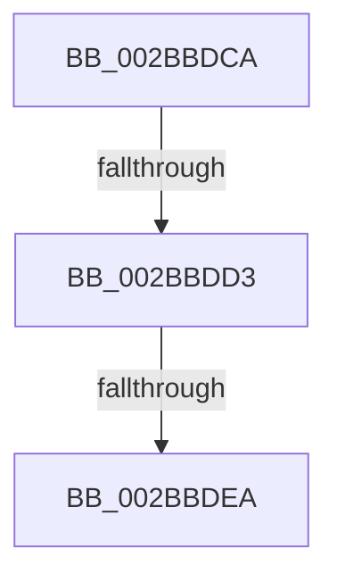

# sub_002BBDCA

- RVA: `0x002BBDCA`–`0x002BBE07` (길이 `61` bytes)
- VA: `0x00000001402BBDCA`
- 실행 섹션: `.text`
- PDB 이름 있음: `아니요`; PDB Function 태그: `아니요`
- unwind 정보 RVA: `0x0006DF48`
- 디코드: `19`개 명령, `61/61` bytes 표시
- 미해석 바이트: `0` (있으면 어셈블리에 `.byte`로 보존)

> 이 문서는 커널 이미지의 기계어와 PDB 기호를 분석해 생성했습니다. 4번과 5번은 함수 원형과 자료형을 바이너리 사용 방식에서 추정한 C 해석이며 원본 소스 복구 결과는 아닙니다.

## 1. Dependencies

- 직접 호출 지점: **1**; 고유 호출 대상: **1**
- 직접 호출자로 확인된 함수: **0**
- RIP 상대 이미지 참조: **1**

### Outgoing calls
- `0x002BBDDC` → [MiRemoveUnusedSegment](MiRemoveUnusedSegment_function_002BBE74.md) (function, `0x002BBE74`)

### Direct callers
- 이 함수 시작 RVA로 연결되는 직접 call은 확인되지 않았습니다. 간접 호출은 완전히 역산할 수 없습니다.

### Static image references
- `0x002BBDE1` → RVA `0x00FC6B06` (`ALMOSTRO`; read)

## 2. Other-region calls and transfers

- 다른 실행 섹션으로 향하는 call: **0**
- call이 아닌 외부 분기/꼬리 이동: **2**
  - `0x002BBDD1` → [sub_002BBE36](Unknown_function_002BBE36.md) (`tail-transfer`)
  - `0x002BBDE8` → [sub_002BBE36 + 0x1B](Unknown_function_002BBE36.md) (`tail-transfer`)

## 3. Assembly (complete function range)

```asm
002BBDCA  48 8B 4F 50                     mov rcx, qword ptr [rdi + 0x50]
002BBDCE  48 85 C9                        test rcx, rcx
002BBDD1  75 63                           jne 0x1402bbe36
002BBDD3  FF 47 4C                        inc dword ptr [rdi + 0x4c]
002BBDD6  48 8B CF                        mov rcx, rdi
002BBDD9  4D 89 2F                        mov qword ptr [r15], r13
002BBDDC  E8 93 00 00 00                  call 0x1402bbe74
002BBDE1  F6 05 1E AD D0 00 01            test byte ptr [rip + 0xd0ad1e], 1
002BBDE8  75 67                           jne 0x1402bbe51
002BBDEA  44 89 6F 48                     mov dword ptr [rdi + 0x48], r13d
002BBDEE  48 8B C7                        mov rax, rdi
002BBDF1  48 8B 74 24 58                  mov rsi, qword ptr [rsp + 0x58]
002BBDF6  48 8B 7C 24 60                  mov rdi, qword ptr [rsp + 0x60]
002BBDFB  48 83 C4 28                     add rsp, 0x28
002BBDFF  41 5F                           pop r15
002BBE01  41 5E                           pop r14
002BBE03  41 5D                           pop r13
002BBE05  5B                              pop rbx
002BBE06  C3                              ret
```

## 4. C-style interpretation (structured pseudocode)

```c
__int64 __fastcall sub_002BBDCA(__int64 a1, __int64 a2, __int64 a3, __int64 a4, __int64 a5, __int64 a6, __int64 a7, __int64 a8, __int64 a9, __int64 a10, __int64 a11, __int64 a12)
{
    __int64 result;
    __int64 v_rsp;

    *(unsigned __int64 *)(v_r15) = v_r13;
    result = MiRemoveUnusedSegment(v_rdi, a2, a3, a4);
    *(unsigned int *)(v_rdi + 72) = (unsigned int)(v_r13);
    v_rsp = (v_rsp) + (40);
    return v_rdi;
}
```

## 5. (Beta) C Style

```c
int64_t sub_002BBDCA(int64_t Arg1, int64_t Arg2, int64_t Arg3, int64_t Arg4, uint64_t Arg5, uint64_t Arg6, uint64_t Arg7, uint64_t Arg8, uint64_t Arg9, uint64_t Arg10, int64_t Arg11, int64_t Arg12)
{
    int64_t result;
    int64_t local_rsp;

    *(uint64_t *)(local_r15) = local_r13;
    result = MiRemoveUnusedSegment(local_rdi, Arg2, Arg3, Arg4);
    *(uint32_t *)(local_rdi + 0x48) = (uint32_t)(local_r13);
    local_rsp = (local_rsp) + (40);
    return local_rdi;
}
```

## 6. Execution-region graph

[열기: 2D/3D 그래프와 함수 탐색 컨트롤 패널](../../../control-panel.html?section=text&rva=0x002BBDCA&view=graph)

- 2D 그래프는 위에서 아래로 흐르고, 3D 그래프는 빈 공간을 드래그해 회전합니다. Shift+드래그는 이동, 휠은 확대·축소, 함수 노드 선택은 대상 보고서 이동입니다.

### Static fallback


