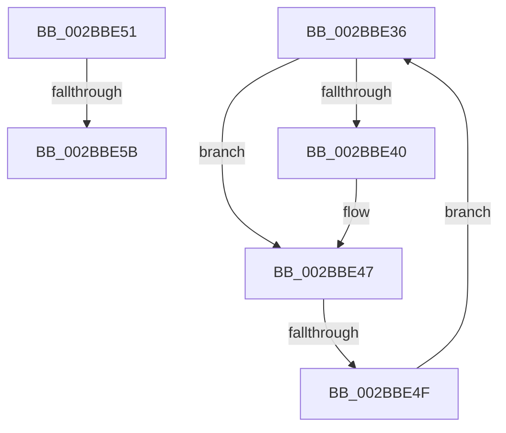

# sub_002BBE36

- RVA: `0x002BBE36`–`0x002BBE6B` (길이 `53` bytes)
- VA: `0x00000001402BBE36`
- 실행 섹션: `.text`
- PDB 이름 있음: `아니요`; PDB Function 태그: `아니요`
- unwind 정보 RVA: `0x0006DFB8`
- 디코드: `16`개 명령, `53/53` bytes 표시
- 미해석 바이트: `0` (있으면 어셈블리에 `.byte`로 보존)

> 이 문서는 커널 이미지의 기계어와 PDB 기호를 분석해 생성했습니다. 4번과 5번은 함수 원형과 자료형을 바이너리 사용 방식에서 추정한 C 해석이며 원본 소스 복구 결과는 아닙니다.

## 1. Dependencies

- 직접 호출 지점: **1**; 고유 호출 대상: **1**
- 직접 호출자로 확인된 함수: **0**
- RIP 상대 이미지 참조: **1**

### Outgoing calls
- `0x002BBE64` → [ExpReleaseSpinLockExclusiveFromDpcLevelInstrumented](../2C/ExpReleaseSpinLockExclusiveFromDpcLevelInstrumented_function_002C0F44.md) (function, `0x002C0F44`)

### Direct callers
- 이 함수 시작 RVA로 연결되는 직접 call은 확인되지 않았습니다. 간접 호출은 완전히 역산할 수 없습니다.

### Static image references
- `0x002BBE51` → RVA `0x00F0DE58` (`.data`; read)

## 2. Other-region calls and transfers

- 다른 실행 섹션으로 향하는 call: **0**
- call이 아닌 외부 분기/꼬리 이동: **3**
  - `0x002BBE4D` → [sub_002BBDCA + 0x9](Unknown_function_002BBDCA.md) (`tail-transfer`)
  - `0x002BBE59` → [sub_002BBDCA + 0x20](Unknown_function_002BBDCA.md) (`tail-transfer`)
  - `0x002BBE69` → [sub_002BBDCA + 0x24](Unknown_function_002BBDCA.md) (`tail-transfer`)

## 3. Assembly (complete function range)

```asm
002BBE36  8B 41 08                        mov eax, dword ptr [rcx + 8]
002BBE39  48 8B 11                        mov rdx, qword ptr [rcx]
002BBE3C  A8 04                           test al, 4
002BBE3E  74 07                           je 0x1402bbe47
002BBE40  C7 41 0C 01 00 00 00            mov dword ptr [rcx + 0xc], 1
002BBE47  48 8B CA                        mov rcx, rdx
002BBE4A  48 85 D2                        test rdx, rdx
002BBE4D  74 84                           je 0x1402bbdd3
002BBE4F  EB E5                           jmp 0x1402bbe36
002BBE51  8B 05 01 20 C5 00               mov eax, dword ptr [rip + 0xc52001]
002BBE57  85 C0                           test eax, eax
002BBE59  75 8F                           jne 0x1402bbdea
002BBE5B  48 8B 54 24 48                  mov rdx, qword ptr [rsp + 0x48]
002BBE60  48 8D 4F 48                     lea rcx, [rdi + 0x48]
002BBE64  E8 DB 50 00 00                  call 0x1402c0f44
002BBE69  EB 83                           jmp 0x1402bbdee
```

## 4. C-style interpretation (structured pseudocode)

```c
__int64 __fastcall sub_002BBE36(__int64 a1)
{
    unsigned __int64 v_stack_p48;

    if ((((unsigned __int8)((unsigned int)(*(unsigned int *)(a1 + 8)))) & (4)) != 0) {
        *(unsigned int *)(a1 + 12) = 1;
    }
    goto loc_002BBE36;
}
```

## 5. (Beta) C Style

```c
int64_t sub_002BBE36(int64_t Arg1)
{
    uint64_t v_stack_p48;

    if ((((uint8_t)((uint32_t)(*(uint32_t *)(Arg1 + 0x8)))) & (4)) != 0) {
        *(uint32_t *)(Arg1 + 0xC) = 1;
    }
    goto loc_002BBE36;
}
```

## 6. Execution-region graph

[열기: 2D/3D 그래프와 함수 탐색 컨트롤 패널](../../../control-panel.html?section=text&rva=0x002BBE36&view=graph)

- 2D 그래프는 위에서 아래로 흐르고, 3D 그래프는 빈 공간을 드래그해 회전합니다. Shift+드래그는 이동, 휠은 확대·축소, 함수 노드 선택은 대상 보고서 이동입니다.

### Static fallback


