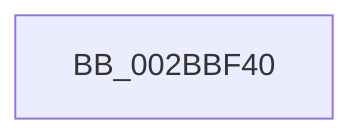

# sub_002BBF40

- RVA: `0x002BBF40`–`0x002BBF53` (길이 `19` bytes)
- VA: `0x00000001402BBF40`
- 실행 섹션: `.text`
- PDB 이름 있음: `아니요`; PDB Function 태그: `아니요`
- unwind 정보 RVA: `0x0006DFF0`
- 디코드: `6`개 명령, `19/19` bytes 표시
- 미해석 바이트: `0` (있으면 어셈블리에 `.byte`로 보존)

> 이 문서는 커널 이미지의 기계어와 PDB 기호를 분석해 생성했습니다. 4번과 5번은 함수 원형과 자료형을 바이너리 사용 방식에서 추정한 C 해석이며 원본 소스 복구 결과는 아닙니다.

## 1. Dependencies

- 직접 호출 지점: **0**; 고유 호출 대상: **0**
- 직접 호출자로 확인된 함수: **0**
- RIP 상대 이미지 참조: **0**

### Outgoing calls
- 직접 디코드된 call 명령이 없습니다.

### Direct callers
- 이 함수 시작 RVA로 연결되는 직접 call은 확인되지 않았습니다. 간접 호출은 완전히 역산할 수 없습니다.

### Static image references
- 디코드된 RIP-relative 메모리 참조가 없습니다.

## 2. Other-region calls and transfers

- 다른 실행 섹션으로 향하는 call: **0**
- call이 아닌 외부 분기/꼬리 이동: **1**
  - `0x002BBF51` → [sub_002BBFAA](Unknown_function_002BBFAA.md) (`tail-transfer`)

## 3. Assembly (complete function range)

```asm
002BBF40  49 89 73 10                     mov qword ptr [r11 + 0x10], rsi
002BBF44  41 8B F0                        mov esi, r8d
002BBF47  49 89 7B 18                     mov qword ptr [r11 + 0x18], rdi
002BBF4B  40 B7 11                        mov dil, 0x11
002BBF4E  83 E6 01                        and esi, 1
002BBF51  75 57                           jne 0x1402bbfaa
```

## 4. C-style interpretation (structured pseudocode)

```c
void __fastcall sub_002BBF40(__int64 a1, __int64 a2, int a3)
{
    __int64 v_rsi;

    *(unsigned __int64 *)(v_r11 + 16) = v_rsi;
    *(unsigned __int64 *)(v_r11 + 24) = v_rdi;
    v_rsi = (unsigned int)(((unsigned int)(a3)) & (1));
}
```

## 5. (Beta) C Style

```c
void sub_002BBF40(int64_t Arg1, int64_t Arg2, int32_t Arg3)
{
    int64_t local_rsi;

    *(uint64_t *)(local_r11 + 0x10) = local_rsi;
    *(uint64_t *)(local_r11 + 0x18) = local_rdi;
    local_rsi = (uint32_t)(((uint32_t)(Arg3)) & (1));
}
```

## 6. Execution-region graph

[열기: 2D/3D 그래프와 함수 탐색 컨트롤 패널](../../../control-panel.html?section=text&rva=0x002BBF40&view=graph)

- 2D 그래프는 위에서 아래로 흐르고, 3D 그래프는 빈 공간을 드래그해 회전합니다. Shift+드래그는 이동, 휠은 확대·축소, 함수 노드 선택은 대상 보고서 이동입니다.

### Static fallback


