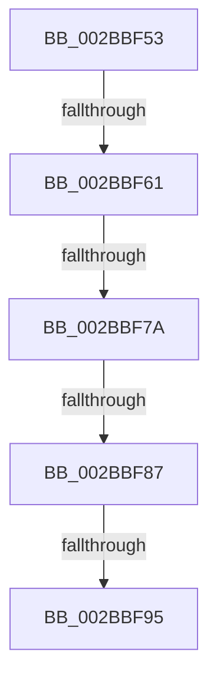

# sub_002BBF53

- RVA: `0x002BBF53`–`0x002BBFAA` (길이 `87` bytes)
- VA: `0x00000001402BBF53`
- 실행 섹션: `.text`
- PDB 이름 있음: `아니요`; PDB Function 태그: `아니요`
- unwind 정보 RVA: `0x0006E008`
- 디코드: `17`개 명령, `87/87` bytes 표시
- 미해석 바이트: `0` (있으면 어셈블리에 `.byte`로 보존)

> 이 문서는 커널 이미지의 기계어와 PDB 기호를 분석해 생성했습니다. 4번과 5번은 함수 원형과 자료형을 바이너리 사용 방식에서 추정한 C 해석이며 원본 소스 복구 결과는 아닙니다.

## 1. Dependencies

- 직접 호출 지점: **1**; 고유 호출 대상: **1**
- 직접 호출자로 확인된 함수: **0**
- RIP 상대 이미지 참조: **3**

### Outgoing calls
- `0x002BBF9D` → [ExpAcquireSpinLockSharedAtDpcLevelInstrumented](../27/ExpAcquireSpinLockSharedAtDpcLevelInstrumented_function_0027CD20.md) (function, `0x0027CD20`)

### Direct callers
- 이 함수 시작 RVA로 연결되는 직접 call은 확인되지 않았습니다. 간접 호출은 완전히 역산할 수 없습니다.

### Static image references
- `0x002BBF6E` → RVA `0x00FC6D20` (`ALMOSTRO`; read)
- `0x002BBF7A` → RVA `0x00FC6B06` (`ALMOSTRO`; read)
- `0x002BBF87` → RVA `0x00F0DE58` (`.data`; read)

## 2. Other-region calls and transfers

- 다른 실행 섹션으로 향하는 call: **0**
- call이 아닌 외부 분기/꼬리 이동: **4**
  - `0x002BBF5B` → [sub_002BC157](Unknown_function_002BC157.md) (`tail-transfer`)
  - `0x002BBF74` → [sub_002BC06C + 0x32](Unknown_function_002BC06C.md) (`tail-transfer`)
  - `0x002BBF81` → [sub_002BC06C](Unknown_function_002BC06C.md) (`tail-transfer`)
  - `0x002BBF8F` → [sub_002BC06C](Unknown_function_002BC06C.md) (`tail-transfer`)

## 3. Assembly (complete function range)

```asm
002BBF53  4D 89 7B E8                     mov qword ptr [r11 - 0x18], r15
002BBF57  41 F6 C0 08                     test r8b, 8
002BBF5B  0F 85 F6 01 00 00               jne 0x1402bc157
002BBF61  44 0F 20 C7                     mov rdi, cr8
002BBF65  B8 02 00 00 00                  mov eax, 2
002BBF6A  44 0F 22 C0                     mov cr8, rax
002BBF6E  39 35 AC AD D0 00               cmp dword ptr [rip + 0xd0adac], esi
002BBF74  0F 85 24 01 00 00               jne 0x1402bc09e
002BBF7A  F6 05 85 AB D0 00 21            test byte ptr [rip + 0xd0ab85], 0x21
002BBF81  0F 84 E5 00 00 00               je 0x1402bc06c
002BBF87  8B 05 CB 1E C5 00               mov eax, dword ptr [rip + 0xc51ecb]
002BBF8D  85 C0                           test eax, eax
002BBF8F  0F 85 D7 00 00 00               jne 0x1402bc06c
002BBF95  40 0F B6 D7                     movzx edx, dil
002BBF99  49 8D 4E 48                     lea rcx, [r14 + 0x48]
002BBF9D  E8 7E 0D FC FF                  call 0x14027cd20
002BBFA2  4C 8B BC 24 C0 00 00 00         mov r15, qword ptr [rsp + 0xc0]
```

## 4. C-style interpretation (structured pseudocode)

```c
__int64 __fastcall sub_002BBF53(__int64 a1, __int64 a2, unsigned __int8 a3, __int64 a4, __int64 a5, __int64 a6, __int64 a7, __int64 a8, __int64 a9, __int64 a10, __int64 a11, __int64 a12, __int64 a13, __int64 a14, __int64 a15, __int64 a16, __int64 a17, __int64 a18, __int64 a19, __int64 a20, __int64 a21, __int64 a22, __int64 a23, __int64 a24)
{
    __int64 result;

    *(unsigned __int64 *)(v_r11 - 24) = v_r15;
    result = ExpAcquireSpinLockSharedAtDpcLevelInstrumented(v_r14 + 72, (unsigned __int8)(v_cr8), a3, a4);
    return result;
}
```

## 5. (Beta) C Style

```c
int64_t sub_002BBF53(int64_t Arg1, int64_t Arg2, uint8_t Arg3, int64_t Arg4, uint64_t Arg5, uint64_t Arg6, uint64_t Arg7, uint64_t Arg8, uint64_t Arg9, uint64_t Arg10, uint64_t Arg11, uint64_t Arg12, uint64_t Arg13, uint64_t Arg14, uint64_t Arg15, uint64_t Arg16, uint64_t Arg17, uint64_t Arg18, uint64_t Arg19, uint64_t Arg20, uint64_t Arg21, uint64_t Arg22, uint64_t Arg23, int64_t Arg24)
{
    int64_t result;

    *(uint64_t *)(local_r11 - 0x18) = local_r15;
    result = ExpAcquireSpinLockSharedAtDpcLevelInstrumented(local_r14 + 72, (uint8_t)(v_cr8), Arg3, Arg4);
    return result;
}
```

## 6. Execution-region graph

[열기: 2D/3D 그래프와 함수 탐색 컨트롤 패널](../../../control-panel.html?section=text&rva=0x002BBF53&view=graph)

- 2D 그래프는 위에서 아래로 흐르고, 3D 그래프는 빈 공간을 드래그해 회전합니다. Shift+드래그는 이동, 휠은 확대·축소, 함수 노드 선택은 대상 보고서 이동입니다.

### Static fallback


