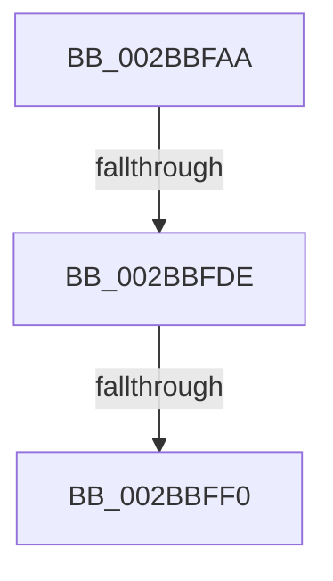

# sub_002BBFAA

- RVA: `0x002BBFAA`–`0x002BBFFC` (길이 `82` bytes)
- VA: `0x00000001402BBFAA`
- 실행 섹션: `.text`
- PDB 이름 있음: `아니요`; PDB Function 태그: `아니요`
- unwind 정보 RVA: `0x0006E01C`
- 디코드: `20`개 명령, `82/82` bytes 표시
- 미해석 바이트: `0` (있으면 어셈블리에 `.byte`로 보존)

> 이 문서는 커널 이미지의 기계어와 PDB 기호를 분석해 생성했습니다. 4번과 5번은 함수 원형과 자료형을 바이너리 사용 방식에서 추정한 C 해석이며 원본 소스 복구 결과는 아닙니다.

## 1. Dependencies

- 직접 호출 지점: **0**; 고유 호출 대상: **0**
- 직접 호출자로 확인된 함수: **0**
- RIP 상대 이미지 참조: **0**

### Outgoing calls
- 직접 디코드된 call 명령이 없습니다.

### Direct callers
- 이 함수 시작 RVA로 연결되는 직접 call은 확인되지 않았습니다. 간접 호출은 완전히 역산할 수 없습니다.

### Static image references
- 디코드된 RIP-relative 메모리 참조가 없습니다.

## 2. Other-region calls and transfers

- 다른 실행 섹션으로 향하는 call: **0**
- call이 아닌 외부 분기/꼬리 이동: **3**
  - `0x002BBFD8` → [sub_002BC0B6](Unknown_function_002BC0B6.md) (`tail-transfer`)
  - `0x002BBFEA` → [sub_002BC0B6](Unknown_function_002BC0B6.md) (`tail-transfer`)
  - `0x002BBFFA` → [sub_002BBFFC + 0x43](Unknown_function_002BBFFC.md) (`tail-transfer`)

## 3. Assembly (complete function range)

```asm
002BBFAA  49 8B AE 28 01 00 00            mov rbp, qword ptr [r14 + 0x128]
002BBFB1  48 C1 EB 0C                     shr rbx, 0xc
002BBFB5  8B 4D 20                        mov ecx, dword ptr [rbp + 0x20]
002BBFB8  8B 45 24                        mov eax, dword ptr [rbp + 0x24]
002BBFBB  81 E1 C0 FF 00 00               and ecx, 0xffc0
002BBFC1  8B 55 28                        mov edx, dword ptr [rbp + 0x28]
002BBFC4  48 C1 E1 1A                     shl rcx, 0x1a
002BBFC8  48 0B C8                        or rcx, rax
002BBFCB  8B 45 20                        mov eax, dword ptr [rbp + 0x20]
002BBFCE  48 03 D1                        add rdx, rcx
002BBFD1  4C 8D 42 FF                     lea r8, [rdx - 1]
002BBFD5  48 3B D9                        cmp rbx, rcx
002BBFD8  0F 82 D8 00 00 00               jb 0x1402bc0b6
002BBFDE  3D 00 00 10 00                  cmp eax, 0x100000
002BBFE3  49 0F 42 D0                     cmovb rdx, r8
002BBFE7  48 3B DA                        cmp rbx, rdx
002BBFEA  0F 87 C6 00 00 00               ja 0x1402bc0b6
002BBFF0  85 F6                           test esi, esi
002BBFF2  48 8B B4 24 E8 00 00 00         mov rsi, qword ptr [rsp + 0xe8]
002BBFFA  75 43                           jne 0x1402bc03f
```

## 4. C-style interpretation (structured pseudocode)

```c
__int64 __fastcall sub_002BBFAA(__int64 a1, __int64 a2, __int64 a3, __int64 a4, __int64 a5, __int64 a6, __int64 a7, __int64 a8, __int64 a9, __int64 a10, __int64 a11, __int64 a12, __int64 a13, __int64 a14, __int64 a15, __int64 a16, __int64 a17, __int64 a18, __int64 a19, __int64 a20, __int64 a21, __int64 a22, __int64 a23, __int64 a24, __int64 a25, __int64 a26, __int64 a27, __int64 a28, __int64 a29)
{
    __int64 v_rbx;

    v_rbx = (v_rbx) >> (12);
    a1 = (unsigned int)(((unsigned int)(*(unsigned int *)(*(unsigned __int64 *)(v_r14 + 296) + 32))) & (0xFFC0ULL));
    a1 = (a1) << (26);
    a1 = (a1) | ((unsigned int)(*(unsigned int *)(*(unsigned __int64 *)(v_r14 + 296) + 36)));
    a2 = ((unsigned int)(*(unsigned int *)(*(unsigned __int64 *)(v_r14 + 296) + 40))) + (a1);
    if (((unsigned int)((unsigned int)(*(unsigned int *)(*(unsigned __int64 *)(v_r14 + 296) + 32)))) < 0x100000ULL) { a2 = a2 - 1; }
}
```

## 5. (Beta) C Style

```c
int64_t sub_002BBFAA(int64_t Arg1, int64_t Arg2, int64_t Arg3, int64_t Arg4, uint64_t Arg5, uint64_t Arg6, uint64_t Arg7, uint64_t Arg8, uint64_t Arg9, uint64_t Arg10, uint64_t Arg11, uint64_t Arg12, uint64_t Arg13, uint64_t Arg14, uint64_t Arg15, uint64_t Arg16, uint64_t Arg17, uint64_t Arg18, uint64_t Arg19, uint64_t Arg20, uint64_t Arg21, uint64_t Arg22, uint64_t Arg23, uint64_t Arg24, uint64_t Arg25, uint64_t Arg26, uint64_t Arg27, uint64_t Arg28, int64_t Arg29)
{
    int64_t local_rbx;

    local_rbx = (local_rbx) >> (12);
    Arg1 = (uint32_t)(((uint32_t)(*(uint32_t *)(*(uint64_t *)(local_r14 + 0x128) + 0x20))) & (0xFFC0ULL));
    Arg1 = (Arg1) << (26);
    Arg1 = (Arg1) | ((uint32_t)(*(uint32_t *)(*(uint64_t *)(local_r14 + 0x128) + 0x24)));
    Arg2 = ((uint32_t)(*(uint32_t *)(*(uint64_t *)(local_r14 + 0x128) + 0x28))) + (Arg1);
    if (((uint32_t)((uint32_t)(*(uint32_t *)(*(uint64_t *)(local_r14 + 0x128) + 0x20)))) < 0x100000ULL) { Arg2 = Arg2 - 1; }
}
```

## 6. Execution-region graph

[열기: 2D/3D 그래프와 함수 탐색 컨트롤 패널](../../../control-panel.html?section=text&rva=0x002BBFAA&view=graph)

- 2D 그래프는 위에서 아래로 흐르고, 3D 그래프는 빈 공간을 드래그해 회전합니다. Shift+드래그는 이동, 휠은 확대·축소, 함수 노드 선택은 대상 보고서 이동입니다.

### Static fallback


