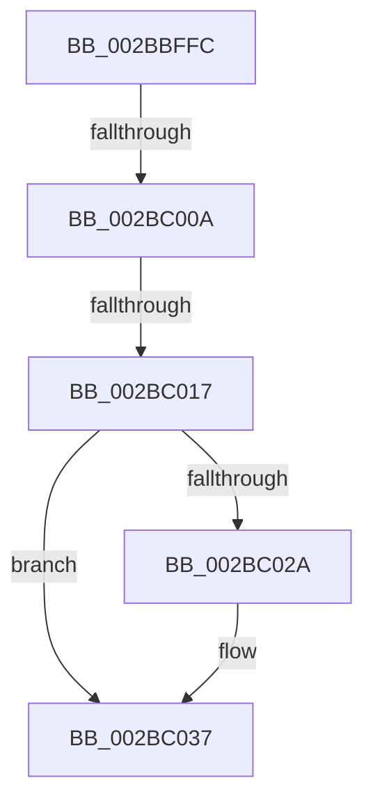

# sub_002BBFFC

- RVA: `0x002BBFFC`–`0x002BC05D` (길이 `97` bytes)
- VA: `0x00000001402BBFFC`
- 실행 섹션: `.text`
- PDB 이름 있음: `아니요`; PDB Function 태그: `아니요`
- unwind 정보 RVA: `0x0006E02C`
- 디코드: `21`개 명령, `97/97` bytes 표시
- 미해석 바이트: `0` (있으면 어셈블리에 `.byte`로 보존)

> 이 문서는 커널 이미지의 기계어와 PDB 기호를 분석해 생성했습니다. 4번과 5번은 함수 원형과 자료형을 바이너리 사용 방식에서 추정한 C 해석이며 원본 소스 복구 결과는 아닙니다.

## 1. Dependencies

- 직접 호출 지점: **1**; 고유 호출 대상: **1**
- 직접 호출자로 확인된 함수: **0**
- RIP 상대 이미지 참조: **2**

### Outgoing calls
- `0x002BC032` → [KiLowerIrqlProcessIrqlFlags](../4F/KiLowerIrqlProcessIrqlFlags_function_004F5698.md) (function, `0x004F5698`)

### Direct callers
- 이 함수 시작 RVA로 연결되는 직접 call은 확인되지 않았습니다. 간접 호출은 완전히 역산할 수 없습니다.

### Static image references
- `0x002BC00A` → RVA `0x00FC6B06` (`ALMOSTRO`; read)
- `0x002BC021` → RVA `0x00FC6D20` (`ALMOSTRO`; read)

## 2. Other-region calls and transfers

- 다른 실행 섹션으로 향하는 call: **0**
- call이 아닌 외부 분기/꼬리 이동: **2**
  - `0x002BC004` → [sub_002BC0AF](Unknown_function_002BC0AF.md) (`tail-transfer`)
  - `0x002BC011` → [sub_002BC16C](Unknown_function_002BC16C.md) (`tail-transfer`)

## 3. Assembly (complete function range)

```asm
002BBFFC  49 8D 4E 48                     lea rcx, [r14 + 0x48]
002BC000  40 80 FF 11                     cmp dil, 0x11
002BC004  0F 84 A5 00 00 00               je 0x1402bc0af
002BC00A  F6 05 F5 AA D0 00 01            test byte ptr [rip + 0xd0aaf5], 1
002BC011  0F 85 55 01 00 00               jne 0x1402bc16c
002BC017  F0 81 21 FF FF FF BF            lock and dword ptr [rcx], 0xbfffffff
002BC01E  F0 FF 09                        lock dec dword ptr [rcx]
002BC021  83 3D F8 AC D0 00 00            cmp dword ptr [rip + 0xd0acf8], 0
002BC028  74 0D                           je 0x1402bc037
002BC02A  44 0F 20 C1                     mov rcx, cr8
002BC02E  40 0F B6 D7                     movzx edx, dil
002BC032  E8 61 96 23 00                  call 0x1404f5698
002BC037  40 0F B6 CF                     movzx ecx, dil
002BC03B  44 0F 22 C1                     mov cr8, rcx
002BC03F  48 8B BC 24 F0 00 00 00         mov rdi, qword ptr [rsp + 0xf0]
002BC047  48 8B C5                        mov rax, rbp
002BC04A  48 8B AC 24 E0 00 00 00         mov rbp, qword ptr [rsp + 0xe0]
002BC052  48 81 C4 C8 00 00 00            add rsp, 0xc8
002BC059  41 5E                           pop r14
002BC05B  5B                              pop rbx
002BC05C  C3                              ret
```

## 4. C-style interpretation (structured pseudocode)

```c
__int64 __fastcall sub_002BBFFC(__int64 a1, __int64 a2, __int64 a3, __int64 a4, __int64 a5, __int64 a6, __int64 a7, __int64 a8, __int64 a9, __int64 a10, __int64 a11, __int64 a12, __int64 a13, __int64 a14, __int64 a15, __int64 a16, __int64 a17, __int64 a18, __int64 a19, __int64 a20, __int64 a21, __int64 a22, __int64 a23, __int64 a24, __int64 a25, __int64 a26, __int64 a27, __int64 a28, __int64 a29, __int64 a30)
{
    __int64 result;
    __int64 v_rsp;

    if ((*(unsigned int *)(v_rip + 13675768)) != 0) {
        a1 = v_cr8;
        a2 = (unsigned __int8)(v_rdi);
        result = KiLowerIrqlProcessIrqlFlags(a1, a2, a3, a4);
    }
    v_rsp = (v_rsp) + (200);
    return v_rbp;
}
```

## 5. (Beta) C Style

```c
int64_t sub_002BBFFC(int64_t Arg1, int64_t Arg2, int64_t Arg3, int64_t Arg4, uint64_t Arg5, uint64_t Arg6, uint64_t Arg7, uint64_t Arg8, uint64_t Arg9, uint64_t Arg10, uint64_t Arg11, uint64_t Arg12, uint64_t Arg13, uint64_t Arg14, uint64_t Arg15, uint64_t Arg16, uint64_t Arg17, uint64_t Arg18, uint64_t Arg19, uint64_t Arg20, uint64_t Arg21, uint64_t Arg22, uint64_t Arg23, uint64_t Arg24, uint64_t Arg25, uint64_t Arg26, uint64_t Arg27, int64_t Arg28, uint64_t Arg29, int64_t Arg30)
{
    int64_t result;
    int64_t local_rsp;

    if ((*(uint32_t *)(v_rip + 0xD0ACF8)) != 0) {
        Arg1 = v_cr8;
        Arg2 = (uint8_t)(local_rdi);
        result = KiLowerIrqlProcessIrqlFlags(Arg1, Arg2, Arg3, Arg4);
    }
    local_rsp = (local_rsp) + (200);
    return local_rbp;
}
```

## 6. Execution-region graph

[열기: 2D/3D 그래프와 함수 탐색 컨트롤 패널](../../../control-panel.html?section=text&rva=0x002BBFFC&view=graph)

- 2D 그래프는 위에서 아래로 흐르고, 3D 그래프는 빈 공간을 드래그해 회전합니다. Shift+드래그는 이동, 휠은 확대·축소, 함수 노드 선택은 대상 보고서 이동입니다.

### Static fallback


