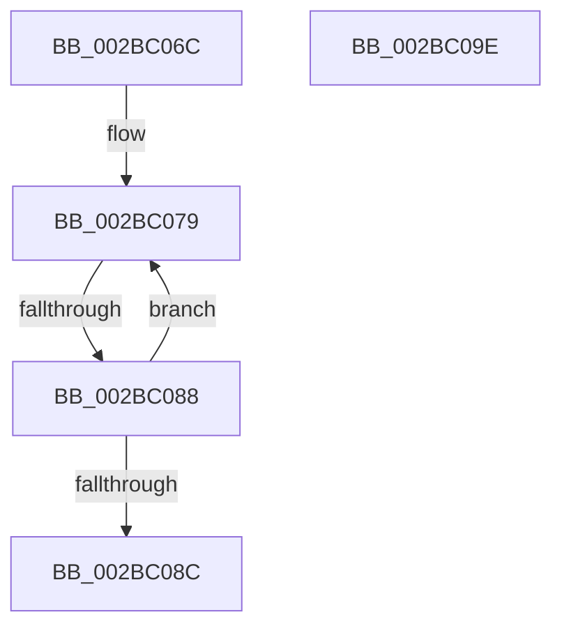

# sub_002BC06C

- RVA: `0x002BC06C`–`0x002BC0AF` (길이 `67` bytes)
- VA: `0x00000001402BC06C`
- 실행 섹션: `.text`
- PDB 이름 있음: `아니요`; PDB Function 태그: `아니요`
- unwind 정보 RVA: `0x0006E058`
- 디코드: `16`개 명령, `67/67` bytes 표시
- 미해석 바이트: `0` (있으면 어셈블리에 `.byte`로 보존)

> 이 문서는 커널 이미지의 기계어와 PDB 기호를 분석해 생성했습니다. 4번과 5번은 함수 원형과 자료형을 바이너리 사용 방식에서 추정한 C 해석이며 원본 소스 복구 결과는 아닙니다.

## 1. Dependencies

- 직접 호출 지점: **2**; 고유 호출 대상: **2**
- 직접 호출자로 확인된 함수: **0**
- RIP 상대 이미지 참조: **0**

### Outgoing calls
- `0x002BC094` → [ExpWaitForSpinLockSharedAndAcquire](../36/ExpWaitForSpinLockSharedAndAcquire_function_00362380.md) (function, `0x00362380`)
- `0x002BC0A5` → [KiRaiseIrqlProcessIrqlFlags](../4F/KiRaiseIrqlProcessIrqlFlags_function_004F56FC.md) (function, `0x004F56FC`)

### Direct callers
- 이 함수 시작 RVA로 연결되는 직접 call은 확인되지 않았습니다. 간접 호출은 완전히 역산할 수 없습니다.

### Static image references
- 디코드된 RIP-relative 메모리 참조가 없습니다.

## 2. Other-region calls and transfers

- 다른 실행 섹션으로 향하는 call: **0**
- call이 아닌 외부 분기/꼬리 이동: **3**
  - `0x002BC082` → [sub_002BBF53 + 0x4F](Unknown_function_002BBF53.md) (`tail-transfer`)
  - `0x002BC099` → [sub_002BBF53 + 0x4F](Unknown_function_002BBF53.md) (`tail-transfer`)
  - `0x002BC0AA` → [sub_002BBF53 + 0x27](Unknown_function_002BBF53.md) (`tail-transfer`)

## 3. Assembly (complete function range)

```asm
002BC06C  41 0F 0D 4E 48                  prefetchw byte ptr [r14 + 0x48]
002BC071  41 8B 46 48                     mov eax, dword ptr [r14 + 0x48]
002BC075  0F BA F0 1F                     btr eax, 0x1f
002BC079  8D 48 01                        lea ecx, [rax + 1]
002BC07C  F0 41 0F B1 4E 48               lock cmpxchg dword ptr [r14 + 0x48], ecx
002BC082  0F 84 1A FF FF FF               je 0x1402bbfa2
002BC088  85 C0                           test eax, eax
002BC08A  79 ED                           jns 0x1402bc079
002BC08C  40 0F B6 D7                     movzx edx, dil
002BC090  49 8D 4E 48                     lea rcx, [r14 + 0x48]
002BC094  E8 E7 62 0A 00                  call 0x140362380
002BC099  E9 04 FF FF FF                  jmp 0x1402bbfa2
002BC09E  0F B6 D0                        movzx edx, al
002BC0A1  40 0F B6 CF                     movzx ecx, dil
002BC0A5  E8 52 96 23 00                  call 0x1404f56fc
002BC0AA  E9 CB FE FF FF                  jmp 0x1402bbf7a
```

## 4. C-style interpretation (structured pseudocode)

```c
__int64 __fastcall sub_002BC06C(void)
{
    __int64 result;

loc_002BC079:
    if (!sign_flag) goto loc_002BC079;
    result = ExpWaitForSpinLockSharedAndAcquire(v_r14 + 72, (unsigned __int8)(v_rdi), a3, a4);
}
```

## 5. (Beta) C Style

```c
void sub_002BC06C(void)
{
    int64_t result;

loc_002BC079:
    if (!sign_flag) goto loc_002BC079;
    result = ExpWaitForSpinLockSharedAndAcquire(local_r14 + 72, (uint8_t)(local_rdi), a3, a4);
}
```

## 6. Execution-region graph

[열기: 2D/3D 그래프와 함수 탐색 컨트롤 패널](../../../control-panel.html?section=text&rva=0x002BC06C&view=graph)

- 2D 그래프는 위에서 아래로 흐르고, 3D 그래프는 빈 공간을 드래그해 회전합니다. Shift+드래그는 이동, 휠은 확대·축소, 함수 노드 선택은 대상 보고서 이동입니다.

### Static fallback


