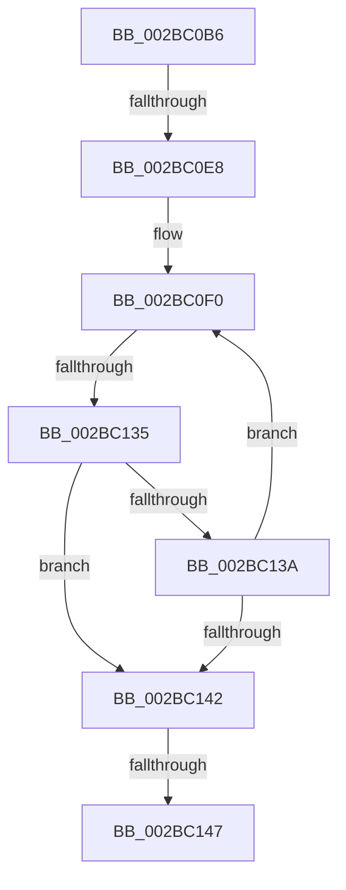

# sub_002BC0B6

- RVA: `0x002BC0B6`–`0x002BC157` (길이 `161` bytes)
- VA: `0x00000001402BC0B6`
- 실행 섹션: `.text`
- PDB 이름 있음: `아니요`; PDB Function 태그: `아니요`
- unwind 정보 RVA: `0x0006E090`
- 디코드: `42`개 명령, `161/161` bytes 표시
- 미해석 바이트: `0` (있으면 어셈블리에 `.byte`로 보존)

> 이 문서는 커널 이미지의 기계어와 PDB 기호를 분석해 생성했습니다. 4번과 5번은 함수 원형과 자료형을 바이너리 사용 방식에서 추정한 C 해석이며 원본 소스 복구 결과는 아닙니다.

## 1. Dependencies

- 직접 호출 지점: **0**; 고유 호출 대상: **0**
- 직접 호출자로 확인된 함수: **0**
- RIP 상대 이미지 참조: **0**

### Outgoing calls
- 직접 디코드된 call 명령이 없습니다.

### Direct callers
- 이 함수 시작 RVA로 연결되는 직접 call은 확인되지 않았습니다. 간접 호출은 완전히 역산할 수 없습니다.

### Static image references
- 디코드된 RIP-relative 메모리 참조가 없습니다.

## 2. Other-region calls and transfers

- 다른 실행 섹션으로 향하는 call: **0**
- call이 아닌 외부 분기/꼬리 이동: **4**
  - `0x002BC0E2` → [sub_002BC165](Unknown_function_002BC165.md) (`tail-transfer`)
  - `0x002BC133` → [sub_002BC18C](Unknown_function_002BC18C.md) (`tail-transfer`)
  - `0x002BC145` → [sub_002BC165](Unknown_function_002BC165.md) (`tail-transfer`)
  - `0x002BC152` → [sub_002BBFAA + 0x46](Unknown_function_002BBFAA.md) (`tail-transfer`)

## 3. Assembly (complete function range)

```asm
002BC0B6  8B 44 24 40                     mov eax, dword ptr [rsp + 0x40]
002BC0BA  4D 8B 96 18 01 00 00            mov r10, qword ptr [r14 + 0x118]
002BC0C1  89 5C 24 44                     mov dword ptr [rsp + 0x44], ebx
002BC0C5  48 C1 EB 20                     shr rbx, 0x20
002BC0C9  0F B7 D3                        movzx edx, bx
002BC0CC  C1 E2 06                        shl edx, 6
002BC0CF  8B CA                           mov ecx, edx
002BC0D1  33 C8                           xor ecx, eax
002BC0D3  81 E1 3F 00 FF FF               and ecx, 0xffff003f
002BC0D9  33 CA                           xor ecx, edx
002BC0DB  89 4C 24 40                     mov dword ptr [rsp + 0x40], ecx
002BC0DF  4D 85 D2                        test r10, r10
002BC0E2  0F 84 7D 00 00 00               je 0x1402bc165
002BC0E8  44 8B 5C 24 44                  mov r11d, dword ptr [rsp + 0x44]
002BC0ED  0F 1F 00                        nop dword ptr [rax]
002BC0F0  44 8B 4C 24 40                  mov r9d, dword ptr [rsp + 0x40]
002BC0F5  41 8B 42 E8                     mov eax, dword ptr [r10 - 0x18]
002BC0F9  41 81 E1 C0 FF 00 00            and r9d, 0xffc0
002BC100  41 8B 4A EC                     mov ecx, dword ptr [r10 - 0x14]
002BC104  25 C0 FF 00 00                  and eax, 0xffc0
002BC109  45 8B 42 F0                     mov r8d, dword ptr [r10 - 0x10]
002BC10D  48 C1 E0 1A                     shl rax, 0x1a
002BC111  48 0B C1                        or rax, rcx
002BC114  49 C1 E1 1A                     shl r9, 0x1a
002BC118  41 8B 4A E8                     mov ecx, dword ptr [r10 - 0x18]
002BC11C  4C 03 C0                        add r8, rax
002BC11F  4D 0B CB                        or r9, r11
002BC122  81 F9 00 00 10 00               cmp ecx, 0x100000
002BC128  49 8D 50 FF                     lea rdx, [r8 - 1]
002BC12C  4C 0F 42 C2                     cmovb r8, rdx
002BC130  4D 3B C8                        cmp r9, r8
002BC133  77 57                           ja 0x1402bc18c
002BC135  4C 3B C8                        cmp r9, rax
002BC138  73 08                           jae 0x1402bc142
002BC13A  4D 8B 12                        mov r10, qword ptr [r10]
002BC13D  4D 85 D2                        test r10, r10
002BC140  75 AE                           jne 0x1402bc0f0
002BC142  4D 85 D2                        test r10, r10
002BC145  74 1E                           je 0x1402bc165
002BC147  49 8D 6A C8                     lea rbp, [r10 - 0x38]
002BC14B  49 89 AE 28 01 00 00            mov qword ptr [r14 + 0x128], rbp
002BC152  E9 99 FE FF FF                  jmp 0x1402bbff0
```

## 4. C-style interpretation (structured pseudocode)

```c
__int64 __fastcall sub_002BC0B6(__int64 a1, __int64 a2, __int64 a3, __int64 a4, __int64 a5, __int64 a6, __int64 a7, unsigned int a8)
{
    __int64 result;
    __int64 v_rbx;
    unsigned int v_stack_p40;
    unsigned int v_stack_p44;

    v_stack_p44 = (unsigned int)(v_rbx);
    v_rbx = (v_rbx) >> (32);
    a2 = (unsigned int)(((unsigned __int16)(v_rbx)) << (6));
    a1 = (unsigned int)(((unsigned int)((unsigned int)(a2))) ^ ((unsigned int)((unsigned int)(a8))));
    a1 = (unsigned int)((a1) & (0xFFFF003FULL));
    a1 = (unsigned int)((a1) ^ ((unsigned int)(a2)));
    v_stack_p40 = (unsigned int)(a1);
loc_002BC0F0:
    a4 = (unsigned int)(((unsigned int)(a8)) & (0xFFC0ULL));
    result = (unsigned int)(((unsigned int)(*(unsigned int *)(*(unsigned __int64 *)(v_r14 + 280) - 24))) & (0xFFC0ULL));
    result = (result) << (26);
    result = (result) | ((unsigned int)(*(unsigned int *)(*(unsigned __int64 *)(v_r14 + 280) - 20)));
    a4 = (a4) << (26);
    a3 = ((unsigned int)(*(unsigned int *)(*(unsigned __int64 *)(v_r14 + 280) - 16))) + (result);
    a4 = (a4) | ((unsigned int)(v_stack_p44));
    if (((unsigned int)((unsigned int)(*(unsigned int *)(*(unsigned __int64 *)(v_r14 + 280) - 24)))) < 0x100000ULL) { a3 = a3 - 1; }
    if (a4 >= result) goto loc_002BC142;
    if (*(unsigned __int64 *)(*(unsigned __int64 *)(v_r14 + 280)) != 0) goto loc_002BC0F0;
loc_002BC142:
    *(unsigned __int64 *)(v_r14 + 296) = *(unsigned __int64 *)(*(unsigned __int64 *)(v_r14 + 280)) - 56;
}
```

## 5. (Beta) C Style

```c
int64_t sub_002BC0B6(int64_t Arg1, int64_t Arg2, int64_t Arg3, int64_t Arg4, uint64_t Arg5, uint64_t Arg6, uint64_t Arg7, void *Arg8)
{
    uint8_t *arg8 = (uint8_t *)Arg8;

    int64_t result;
    int64_t local_rbx;
    uint32_t v_stack_p40;
    uint32_t v_stack_p44;

    v_stack_p44 = (uint32_t)(local_rbx);
    local_rbx = (local_rbx) >> (32);
    Arg2 = (uint32_t)(((uint16_t)(local_rbx)) << (6));
    Arg1 = (uint32_t)(((uint32_t)((uint32_t)(Arg2))) ^ ((uint32_t)((uint32_t)(Arg8))));
    Arg1 = (uint32_t)((Arg1) & (0xFFFF003FULL));
    Arg1 = (uint32_t)((Arg1) ^ ((uint32_t)(Arg2)));
    v_stack_p40 = (uint32_t)(Arg1);
loc_002BC0F0:
    Arg4 = (uint32_t)(((uint32_t)(Arg8)) & (0xFFC0ULL));
    result = (uint32_t)(((uint32_t)(*(uint32_t *)(*(uint64_t *)(local_r14 + 0x118) - 0x18))) & (0xFFC0ULL));
    result = (result) << (26);
    result = (result) | ((uint32_t)(*(uint32_t *)(*(uint64_t *)(local_r14 + 0x118) - 0x14)));
    Arg4 = (Arg4) << (26);
    Arg3 = ((uint32_t)(*(uint32_t *)(*(uint64_t *)(local_r14 + 0x118) - 0x10))) + (result);
    Arg4 = (Arg4) | ((uint32_t)(v_stack_p44));
    if (((uint32_t)((uint32_t)(*(uint32_t *)(*(uint64_t *)(local_r14 + 0x118) - 0x18)))) < 0x100000ULL) { Arg3 = Arg3 - 1; }
    if (Arg4 >= result) goto loc_002BC142;
    if (*(uint64_t *)(*(uint64_t *)(local_r14 + 0x118)) != 0) goto loc_002BC0F0;
loc_002BC142:
    *(uint64_t *)(local_r14 + 0x128) = *(uint64_t *)(*(uint64_t *)(local_r14 + 0x118)) - 56;
}
```

### 관측된 메모리 오프셋

구조체 형식이 확인되지 않은 접근은 인자 기준의 오프셋으로만 기록했습니다.

| 기준 인자 | 오프셋 표현 | 폭 (bit) | 접근 |
|---|---:|---:|---|
| `Arg8` | `+ 0x0` | `32` | `R` |

## 6. Execution-region graph

[열기: 2D/3D 그래프와 함수 탐색 컨트롤 패널](../../../control-panel.html?section=text&rva=0x002BC0B6&view=graph)

- 2D 그래프는 위에서 아래로 흐르고, 3D 그래프는 빈 공간을 드래그해 회전합니다. Shift+드래그는 이동, 휠은 확대·축소, 함수 노드 선택은 대상 보고서 이동입니다.

### Static fallback


