# sub_002BD41B

- RVA: `0x002BD41B`–`0x002BD6E5` (길이 `714` bytes)
- VA: `0x00000001402BD41B`
- 실행 섹션: `.text`
- PDB 이름 있음: `아니요`; PDB Function 태그: `아니요`
- unwind 정보 RVA: `0x0006E204`
- 디코드: `185`개 명령, `714/714` bytes 표시
- 미해석 바이트: `0` (있으면 어셈블리에 `.byte`로 보존)

> 이 문서는 커널 이미지의 기계어와 PDB 기호를 분석해 생성했습니다. 4번과 5번은 함수 원형과 자료형을 바이너리 사용 방식에서 추정한 C 해석이며 원본 소스 복구 결과는 아닙니다.

## 1. Dependencies

- 직접 호출 지점: **16**; 고유 호출 대상: **8**
- 직접 호출자로 확인된 함수: **0**
- RIP 상대 이미지 참조: **5**

### Outgoing calls
- `0x002BD45D` → [PopFxBugCheck](PopFxBugCheck_function_002BFC6C.md) (function, `0x002BFC6C`)
- `0x002BD48F` → [PopFxBugCheck](PopFxBugCheck_function_002BFC6C.md) (function, `0x002BFC6C`)
- `0x002BD4D1` → [PopDiagTraceFxDevicePowerRequirement](../39/PopDiagTraceFxDevicePowerRequirement_function_00391780.md) (function, `0x00391780`)
- `0x002BD4DD` → [KeAcquireSpinLockRaiseToDpc](../20/KeAcquireSpinLockRaiseToDpc_function_00208470.md) (function, `0x00208470`)
- `0x002BD517` → [PopFxBugCheck](PopFxBugCheck_function_002BFC6C.md) (function, `0x002BFC6C`)
- `0x002BD53A` → [PopFxBugCheck](PopFxBugCheck_function_002BFC6C.md) (function, `0x002BFC6C`)
- `0x002BD56C` → [PopFxBugCheck](PopFxBugCheck_function_002BFC6C.md) (function, `0x002BFC6C`)
- `0x002BD589` → [PopFxBugCheck](PopFxBugCheck_function_002BFC6C.md) (function, `0x002BFC6C`)
- `0x002BD5A9` → [PopFxBugCheck](PopFxBugCheck_function_002BFC6C.md) (function, `0x002BFC6C`)
- `0x002BD5C9` → [PopFxBugCheck](PopFxBugCheck_function_002BFC6C.md) (function, `0x002BFC6C`)
- `0x002BD5D2` → [KeAcquireSpinLockRaiseToDpc](../20/KeAcquireSpinLockRaiseToDpc_function_00208470.md) (function, `0x00208470`)
- `0x002BD616` → [KiLowerIrqlProcessIrqlFlags](../4F/KiLowerIrqlProcessIrqlFlags_function_004F5698.md) (function, `0x004F5698`)
- `0x002BD66F` → [guard_dispatch_icall](../6B/guard_dispatch_icall_function_006BAAD0.md) (function, `0x006BAAD0`)
- `0x002BD698` → [PopPepProcessEvent](../24/PopPepProcessEvent_function_0024B930.md) (function, `0x0024B930`)
- `0x002BD6A6` → [PopFxCompleteComponentActivation](PopFxCompleteComponentActivation_function_002BDDE4.md) (function, `0x002BDDE4`)
- `0x002BD6D2` → [_security_check_cookie](../6A/_security_check_cookie_function_006AC640.md) (function, `0x006AC640`)

### Direct callers
- 이 함수 시작 RVA로 연결되는 직접 call은 확인되지 않았습니다. 간접 호출은 완전히 역산할 수 없습니다.

### Static image references
- `0x002BD432` → RVA `0x00000000` (`image boundary/outside`; read)
- `0x002BD5F3` → RVA `0x00FC6B06` (`ALMOSTRO`; read)
- `0x002BD605` → RVA `0x00FC6D20` (`ALMOSTRO`; read)
- `0x002BD61F` → RVA `0x00E67858` (`.data`; read)
- `0x002BD634` → RVA `0x00F0B408` (`.data`; read)

## 2. Other-region calls and transfers

- 다른 실행 섹션으로 향하는 call: **0**
- call이 아닌 외부 분기/꼬리 이동: **6**
  - `0x002BD47F` → [sub_002BD95A + 0x5A](Unknown_function_002BD95A.md) (`tail-transfer`)
  - `0x002BD4E8` → [sub_002BD95A + 0x1EF](Unknown_function_002BD95A.md) (`tail-transfer`)
  - `0x002BD505` → [sub_002BD95A + 0x386](Unknown_function_002BD95A.md) (`tail-transfer`)
  - `0x002BD5FA` → [sub_002BD6E6 + 0xCB](Unknown_function_002BD6E6.md) (`tail-transfer`)
  - `0x002BD648` → [sub_002BD6E6](Unknown_function_002BD6E6.md) (`tail-transfer`)
  - `0x002BD653` → [sub_002BD6E6 + 0xA9](Unknown_function_002BD6E6.md) (`tail-transfer`)

## 3. Assembly (complete function range)

```asm
002BD41B  49 89 5B 18                     mov qword ptr [r11 + 0x18], rbx
002BD41F  41 8D 5F FF                     lea ebx, [r15 - 1]
002BD423  49 89 73 D8                     mov qword ptr [r11 - 0x28], rsi
002BD427  4D 89 63 D0                     mov qword ptr [r11 - 0x30], r12
002BD42B  4D 89 6B C8                     mov qword ptr [r11 - 0x38], r13
002BD42F  48 63 17                        movsxd rdx, dword ptr [rdi]
002BD432  4C 8D 05 C7 2B D4 FF            lea r8, [rip - 0x2bd439]
002BD439  40 32 F6                        xor sil, sil
002BD43C  8B C2                           mov eax, edx
002BD43E  85 D2                           test edx, edx
002BD440  75 21                           jne 0x1402bd463
002BD442  48 8B 77 08                     mov rsi, qword ptr [rdi + 8]
002BD446  4D 85 F6                        test r14, r14
002BD449  0F 84 CE 00 00 00               je 0x1402bd51d
002BD44F  4C 8B C2                        mov r8, rdx
002BD452  45 33 C9                        xor r9d, r9d
002BD455  49 8B D6                        mov rdx, r14
002BD458  B9 03 06 00 00                  mov ecx, 0x603
002BD45D  E8 0A 28 00 00                  call 0x1402bfc6c
002BD462  CC                              int3
002BD463  83 F8 01                        cmp eax, 1
002BD466  75 2D                           jne 0x1402bd495
002BD468  4C 8B 7F 08                     mov r15, qword ptr [rdi + 8]
002BD46C  4D 85 F6                        test r14, r14
002BD46F  75 DE                           jne 0x1402bd44f
002BD471  44 8B 67 10                     mov r12d, dword ptr [rdi + 0x10]
002BD475  45 8B CC                        mov r9d, r12d
002BD478  45 3B A7 64 03 00 00            cmp r12d, dword ptr [r15 + 0x364]
002BD47F  0F 82 2F 05 00 00               jb 0x1402bd9b4
002BD485  4D 8B C7                        mov r8, r15
002BD488  33 D2                           xor edx, edx
002BD48A  B9 11 06 00 00                  mov ecx, 0x611
002BD48F  E8 D8 27 00 00                  call 0x1402bfc6c
002BD494  CC                              int3
002BD495  83 E8 02                        sub eax, 2
002BD498  83 F8 06                        cmp eax, 6
002BD49B  0F 87 0A 02 00 00               ja 0x1402bd6ab
002BD4A1  48 98                           cdqe
002BD4A3  41 8B 8C 80 C0 DD 2B 00         mov ecx, dword ptr [r8 + rax*4 + 0x2bddc0]
002BD4AB  49 03 C8                        add rcx, r8
002BD4AE  FF E1                           jmp rcx
002BD4B0  CC                              int3
002BD4B1  CC                              int3
002BD4B2  CC                              int3
002BD4B3  CC                              int3
002BD4B4  4C 8B 7F 08                     mov r15, qword ptr [rdi + 8]
002BD4B8  4D 85 F6                        test r14, r14
002BD4BB  75 92                           jne 0x1402bd44f
002BD4BD  49 8B 4F 30                     mov rcx, qword ptr [r15 + 0x30]
002BD4C1  44 0F B6 67 10                  movzx r12d, byte ptr [rdi + 0x10]
002BD4C6  48 85 C9                        test rcx, rcx
002BD4C9  74 0B                           je 0x1402bd4d6
002BD4CB  45 0F B6 C4                     movzx r8d, r12b
002BD4CF  B2 01                           mov dl, 1
002BD4D1  E8 AA 42 0D 00                  call 0x140391780
002BD4D6  49 8D 8F 90 01 00 00            lea rcx, [r15 + 0x190]
002BD4DD  E8 8E AF F4 FF                  call 0x140208470
002BD4E2  88 45 97                        mov byte ptr [rbp - 0x69], al
002BD4E5  45 84 E4                        test r12b, r12b
002BD4E8  0F 85 5B 06 00 00               jne 0x1402bdb49
002BD4EE  41 0F 0D 4F 20                  prefetchw byte ptr [r15 + 0x20]
002BD4F3  41 8B 47 20                     mov eax, dword ptr [r15 + 0x20]
002BD4F7  8B C8                           mov ecx, eax
002BD4F9  F0 41 0F B1 4F 20               lock cmpxchg dword ptr [r15 + 0x20], ecx
002BD4FF  75 F6                           jne 0x1402bd4f7
002BD501  33 D2                           xor edx, edx
002BD503  84 C0                           test al, al
002BD505  0F 89 D5 07 00 00               jns 0x1402bdce0
002BD50B  44 8D 4A 01                     lea r9d, [rdx + 1]
002BD50F  4D 8B C7                        mov r8, r15
002BD512  B9 09 06 00 00                  mov ecx, 0x609
002BD517  E8 50 27 00 00                  call 0x1402bfc6c
002BD51C  CC                              int3
002BD51D  44 8B 77 10                     mov r14d, dword ptr [rdi + 0x10]
002BD521  41 8B CE                        mov ecx, r14d
002BD524  44 3B B6 64 03 00 00            cmp r14d, dword ptr [rsi + 0x364]
002BD52B  72 13                           jb 0x1402bd540
002BD52D  44 8B C9                        mov r9d, ecx
002BD530  4C 8B C6                        mov r8, rsi
002BD533  B9 11 06 00 00                  mov ecx, 0x611
002BD538  33 D2                           xor edx, edx
002BD53A  E8 2D 27 00 00                  call 0x1402bfc6c
002BD53F  CC                              int3
002BD540  0F AE E8                        lfence
002BD543  48 8B 86 68 03 00 00            mov rax, qword ptr [rsi + 0x368]
002BD54A  4A 8B 1C F0                     mov rbx, qword ptr [rax + r14*8]
002BD54E  8B 83 98 00 00 00               mov eax, dword ptr [rbx + 0x98]
002BD554  48 8D BB C8 00 00 00            lea rdi, [rbx + 0xc8]
002BD55B  85 C0                           test eax, eax
002BD55D  74 13                           je 0x1402bd572
002BD55F  4C 8B C1                        mov r8, rcx
002BD562  45 33 C9                        xor r9d, r9d
002BD565  B9 15 06 00 00                  mov ecx, 0x615
002BD56A  33 D2                           xor edx, edx
002BD56C  E8 FB 26 00 00                  call 0x1402bfc6c
002BD571  CC                              int3
002BD572  8B 43 58                        mov eax, dword ptr [rbx + 0x58]
002BD575  85 C0                           test eax, eax
002BD577  79 16                           jns 0x1402bd58f
002BD579  41 B9 01 00 00 00               mov r9d, 1
002BD57F  4C 8B C3                        mov r8, rbx
002BD582  33 D2                           xor edx, edx
002BD584  B9 15 06 00 00                  mov ecx, 0x615
002BD589  E8 DE 26 00 00                  call 0x1402bfc6c
002BD58E  CC                              int3
002BD58F  8B 43 58                        mov eax, dword ptr [rbx + 0x58]
002BD592  A9 FF FF FF 3F                  test eax, 0x3fffffff
002BD597  75 16                           jne 0x1402bd5af
002BD599  41 B9 02 00 00 00               mov r9d, 2
002BD59F  4C 8B C3                        mov r8, rbx
002BD5A2  33 D2                           xor edx, edx
002BD5A4  B9 15 06 00 00                  mov ecx, 0x615
002BD5A9  E8 BE 26 00 00                  call 0x1402bfc6c
002BD5AE  CC                              int3
002BD5AF  8B 83 8C 00 00 00               mov eax, dword ptr [rbx + 0x8c]
002BD5B5  85 C0                           test eax, eax
002BD5B7  74 16                           je 0x1402bd5cf
002BD5B9  41 B9 03 00 00 00               mov r9d, 3
002BD5BF  4C 8B C3                        mov r8, rbx
002BD5C2  33 D2                           xor edx, edx
002BD5C4  B9 15 06 00 00                  mov ecx, 0x615
002BD5C9  E8 9E 26 00 00                  call 0x1402bfc6c
002BD5CE  CC                              int3
002BD5CF  48 8B CF                        mov rcx, rdi
002BD5D2  E8 99 AE F4 FF                  call 0x140208470
002BD5D7  83 7F 10 01                     cmp dword ptr [rdi + 0x10], 1
002BD5DB  44 0F B6 F8                     movzx r15d, al
002BD5DF  75 12                           jne 0x1402bd5f3
002BD5E1  48 A1 08 00 00 00 80 F7 FF FF   movabs rax, qword ptr [0xfffff78000000008]
002BD5EB  48 89 47 18                     mov qword ptr [rdi + 0x18], rax
002BD5EF  C6 47 08 01                     mov byte ptr [rdi + 8], 1
002BD5F3  F6 05 0C 95 D0 00 01            test byte ptr [rip + 0xd0950c], 1
002BD5FA  0F 85 B1 01 00 00               jne 0x1402bd7b1
002BD600  F0 48 83 27 00                  lock and qword ptr [rdi], 0
002BD605  83 3D 14 97 D0 00 00            cmp dword ptr [rip + 0xd09714], 0
002BD60C  74 0D                           je 0x1402bd61b
002BD60E  44 0F 20 C1                     mov rcx, cr8
002BD612  41 0F B6 D7                     movzx edx, r15b
002BD616  E8 7D 80 23 00                  call 0x1404f5698
002BD61B  45 0F 22 C7                     mov cr8, r15
002BD61F  80 3D 32 A2 BA 00 00            cmp byte ptr [rip + 0xbaa232], 0
002BD626  48 8B 46 30                     mov rax, qword ptr [rsi + 0x30]
002BD62A  48 89 45 DF                     mov qword ptr [rbp - 0x21], rax
002BD62E  44 89 75 9F                     mov dword ptr [rbp - 0x61], r14d
002BD632  74 25                           je 0x1402bd659
002BD634  48 8B 15 CD DD C4 00            mov rdx, qword ptr [rip + 0xc4ddcd]
002BD63B  48 85 D2                        test rdx, rdx
002BD63E  74 19                           je 0x1402bd659
002BD640  48 8B 4A 20                     mov rcx, qword ptr [rdx + 0x20]
002BD644  83 79 60 00                     cmp dword ptr [rcx + 0x60], 0
002BD648  0F 85 98 00 00 00               jne 0x1402bd6e6
002BD64E  66 83 7A 66 00                  cmp word ptr [rdx + 0x66], 0
002BD653  0F 85 36 01 00 00               jne 0x1402bd78f
002BD659  45 33 E4                        xor r12d, r12d
002BD65C  48 8B 46 70                     mov rax, qword ptr [rsi + 0x70]
002BD660  48 85 C0                        test rax, rax
002BD663  74 0F                           je 0x1402bd674
002BD665  48 8B 8E C0 00 00 00            mov rcx, qword ptr [rsi + 0xc0]
002BD66C  41 8B D6                        mov edx, r14d
002BD66F  E8 5C D4 3F 00                  call 0x1406baad0
002BD674  48 8B 4E 38                     mov rcx, qword ptr [rsi + 0x38]
002BD678  41 B9 03 00 00 00               mov r9d, 3
002BD67E  4D 69 C6 D0 00 00 00            imul r8, r14, 0xd0
002BD685  48 8D 91 C0 00 00 00            lea rdx, [rcx + 0xc0]
002BD68C  4C 89 64 24 28                  mov qword ptr [rsp + 0x28], r12
002BD691  49 03 D0                        add rdx, r8
002BD694  45 8D 41 FF                     lea r8d, [r9 - 1]
002BD698  E8 93 E2 F8 FF                  call 0x14024b930
002BD69D  41 B0 01                        mov r8b, 1
002BD6A0  48 8B D3                        mov rdx, rbx
002BD6A3  48 8B CE                        mov rcx, rsi
002BD6A6  E8 39 07 00 00                  call 0x1402bdde4
002BD6AB  4C 8B A4 24 D8 00 00 00         mov r12, qword ptr [rsp + 0xd8]
002BD6B3  4C 8B AC 24 D0 00 00 00         mov r13, qword ptr [rsp + 0xd0]
002BD6BB  48 8B 9C 24 20 01 00 00         mov rbx, qword ptr [rsp + 0x120]
002BD6C3  48 8B B4 24 E0 00 00 00         mov rsi, qword ptr [rsp + 0xe0]
002BD6CB  48 8B 4D 17                     mov rcx, qword ptr [rbp + 0x17]
002BD6CF  48 33 CC                        xor rcx, rsp
002BD6D2  E8 69 EF 3E 00                  call 0x1406ac640
002BD6D7  48 81 C4 E8 00 00 00            add rsp, 0xe8
002BD6DE  41 5F                           pop r15
002BD6E0  41 5E                           pop r14
002BD6E2  5F                              pop rdi
002BD6E3  5D                              pop rbp
002BD6E4  C3                              ret
```

## 4. C-style interpretation (structured pseudocode)

```c
__int64 __fastcall sub_002BD41B(__int64 a1, __int64 a2, __int64 a3, int a4, __int64 a5, __int64 a6, __int64 a7, __int64 a8, __int64 a9, __int64 a10, __int64 a11, __int64 a12, __int64 a13, __int64 a14, __int64 a15, __int64 a16, __int64 a17, __int64 a18, __int64 a19, __int64 a20, __int64 a21, __int64 a22, __int64 a23, __int64 a24, __int64 a25, __int64 a26, __int64 a27, __int64 a28, __int64 a29, __int64 a30, __int64 a31, __int64 a32, __int64 a33, __int64 a34, __int64 a35, __int64 a36)
{
    __int64 result;
    __int64 v_r12;
    __int64 v_rsi;
    __int64 v_rsp;
    unsigned __int64 v_stack_p28;

    *(unsigned __int64 *)(v_r11 + 24) = v_rbx;
    *(unsigned __int64 *)(v_r11 - 40) = v_rsi;
    *(unsigned __int64 *)(v_r11 - 48) = v_r12;
    *(unsigned __int64 *)(v_r11 - 56) = v_r13;
    v_rsi = 0;
    if ((unsigned int)((int)(*(unsigned int *)(v_rdi))) != 0) goto loc_002BD463;
    if (v_r14 == 0) goto loc_002BD51D;
loc_002BD44F:
    a4 = 0;
    result = PopFxBugCheck((unsigned int)(0x603ULL), v_r14, (int)(*(unsigned int *)(v_rdi)), a4);
loc_002BD463:
    if (((unsigned int)(result)) != 1) goto loc_002BD495;
    if (v_r14 != 0) goto loc_002BD44F;
    a2 = 0;
    result = PopFxBugCheck((unsigned int)(0x611ULL), a2, *(unsigned __int64 *)(v_rdi + 8), (unsigned int)((unsigned int)((unsigned int)(*(unsigned int *)(v_rdi + 16)))));
loc_002BD495:
    result = (unsigned int)((result) - (2));
    if (((unsigned int)(result)) > 6) goto loc_002BD6AB;
    a1 = ((unsigned int)(*(unsigned int *)(*(unsigned __int64 *)(v_rdi + 8) + result * 4 + 2874816))) + (*(unsigned __int64 *)(v_rdi + 8));
loc_002BD51D:
    if (((unsigned int)((unsigned int)(*(unsigned int *)(v_rdi + 16)))) >= (*(unsigned int *)(*(unsigned __int64 *)(v_rdi + 8) + 868))) {
        a4 = (unsigned int)((unsigned int)((unsigned int)((unsigned int)(*(unsigned int *)(v_rdi + 16)))));
        a3 = *(unsigned __int64 *)(v_rdi + 8);
        a1 = 0x611ULL;
        a2 = 0;
        result = PopFxBugCheck(a1, a2, a3, a4);
    }
    result = (unsigned int)(*(unsigned int *)(*(unsigned __int64 *)(*(unsigned __int64 *)(*(unsigned __int64 *)(v_rdi + 8) + 872) + (unsigned int)(*(unsigned int *)(v_rdi + 16)) * 8) + 152));
    if ((unsigned int)((unsigned int)(*(unsigned int *)(*(unsigned __int64 *)(*(unsigned __int64 *)(*(unsigned __int64 *)(v_rdi + 8) + 872) + (unsigned int)(*(unsigned int *)(v_rdi + 16)) * 8) + 152))) != 0) {
        a3 = a1;
        a4 = 0;
        a1 = 0x615ULL;
        a2 = 0;
        result = PopFxBugCheck(a1, a2, a3, a4);
    }
    result = (unsigned int)(*(unsigned int *)(*(unsigned __int64 *)(*(unsigned __int64 *)(*(unsigned __int64 *)(v_rdi + 8) + 872) + (unsigned int)(*(unsigned int *)(v_rdi + 16)) * 8) + 88));
    if (sign_flag) {
        a4 = 1;
        a3 = *(unsigned __int64 *)(*(unsigned __int64 *)(*(unsigned __int64 *)(v_rdi + 8) + 872) + (unsigned int)(*(unsigned int *)(v_rdi + 16)) * 8);
        a2 = 0;
        a1 = 0x615ULL;
        result = PopFxBugCheck(a1, a2, a3, a4);
    }
    result = (unsigned int)(*(unsigned int *)(*(unsigned __int64 *)(*(unsigned __int64 *)(*(unsigned __int64 *)(v_rdi + 8) + 872) + (unsigned int)(*(unsigned int *)(v_rdi + 16)) * 8) + 88));
    if ((((unsigned int)((unsigned int)(*(unsigned int *)(*(unsigned __int64 *)(*(unsigned __int64 *)(*(unsigned __int64 *)(v_rdi + 8) + 872) + (unsigned int)(*(unsigned int *)(v_rdi + 16)) * 8) + 88)))) & (0x3FFFFFFFULL)) == 0) {
        a4 = 2;
        a3 = *(unsigned __int64 *)(*(unsigned __int64 *)(*(unsigned __int64 *)(v_rdi + 8) + 872) + (unsigned int)(*(unsigned int *)(v_rdi + 16)) * 8);
        a2 = 0;
        a1 = 0x615ULL;
        result = PopFxBugCheck(a1, a2, a3, a4);
    }
    result = (unsigned int)(*(unsigned int *)(*(unsigned __int64 *)(*(unsigned __int64 *)(*(unsigned __int64 *)(v_rdi + 8) + 872) + (unsigned int)(*(unsigned int *)(v_rdi + 16)) * 8) + 140));
    if ((unsigned int)((unsigned int)(*(unsigned int *)(*(unsigned __int64 *)(*(unsigned __int64 *)(*(unsigned __int64 *)(v_rdi + 8) + 872) + (unsigned int)(*(unsigned int *)(v_rdi + 16)) * 8) + 140))) != 0) {
        a4 = 3;
        a3 = *(unsigned __int64 *)(*(unsigned __int64 *)(*(unsigned __int64 *)(v_rdi + 8) + 872) + (unsigned int)(*(unsigned int *)(v_rdi + 16)) * 8);
        a2 = 0;
        a1 = 0x615ULL;
        result = PopFxBugCheck(a1, a2, a3, a4);
    }
    result = KeAcquireSpinLockRaiseToDpc(*(unsigned __int64 *)(*(unsigned __int64 *)(*(unsigned __int64 *)(v_rdi + 8) + 872) + (unsigned int)(*(unsigned int *)(v_rdi + 16)) * 8) + 200, a2, a3, a4);
    if ((*(unsigned int *)(*(unsigned __int64 *)(*(unsigned __int64 *)(*(unsigned __int64 *)(v_rdi + 8) + 872) + (unsigned int)(*(unsigned int *)(v_rdi + 16)) * 8) + 200 + 16)) == 1) {
        *(unsigned __int64 *)(*(unsigned __int64 *)(*(unsigned __int64 *)(*(unsigned __int64 *)(v_rdi + 8) + 872) + (unsigned int)(*(unsigned int *)(v_rdi + 16)) * 8) + 200 + 24) = result;
        *(unsigned __int8 *)(*(unsigned __int64 *)(*(unsigned __int64 *)(*(unsigned __int64 *)(v_rdi + 8) + 872) + (unsigned int)(*(unsigned int *)(v_rdi + 16)) * 8) + 200 + 8) = 1;
    }
    if ((*(unsigned int *)(v_rip + 13670164)) != 0) {
        a1 = v_cr8;
        a2 = (unsigned __int8)((unsigned __int8)(result));
        result = KiLowerIrqlProcessIrqlFlags(a1, a2, a3, a4);
    }
    *(unsigned __int64 *)(v_rbp - 33) = *(unsigned __int64 *)(*(unsigned __int64 *)(v_rdi + 8) + 48);
    *(unsigned int *)(v_rbp - 97) = (unsigned int)((unsigned int)(*(unsigned int *)(v_rdi + 16)));
    if ((*(unsigned __int8 *)(v_rip + 12231218)) == 0) goto loc_002BD659;
    if (*(unsigned __int64 *)(v_rip + 12901837) == 0) goto loc_002BD659;
loc_002BD659:
    v_r12 = 0;
    result = *(unsigned __int64 *)(*(unsigned __int64 *)(v_rdi + 8) + 112);
    if (*(unsigned __int64 *)(*(unsigned __int64 *)(v_rdi + 8) + 112) != 0) {
        a1 = *(unsigned __int64 *)(*(unsigned __int64 *)(v_rdi + 8) + 192);
        a2 = (unsigned int)((unsigned int)(*(unsigned int *)(v_rdi + 16)));
        result = guard_dispatch_icall(a1, a2, a3, a4);
    }
    a3 = (a3) * ((unsigned int)(*(unsigned int *)(v_rdi + 16)));
    v_stack_p28 = 0;
    a2 = (*(unsigned __int64 *)(*(unsigned __int64 *)(v_rdi + 8) + 56) + 192) + (a3);
    result = PopPepProcessEvent(*(unsigned __int64 *)(*(unsigned __int64 *)(v_rdi + 8) + 56), a2, 3 - 1, 3);
    result = PopFxCompleteComponentActivation(*(unsigned __int64 *)(v_rdi + 8), *(unsigned __int64 *)(*(unsigned __int64 *)(*(unsigned __int64 *)(v_rdi + 8) + 872) + (unsigned int)(*(unsigned int *)(v_rdi + 16)) * 8), 1, 3);
loc_002BD6AB:
    a1 = (*(unsigned __int64 *)(v_rbp + 23)) ^ (v_rsp);
    result = _security_check_cookie(a1, *(unsigned __int64 *)(*(unsigned __int64 *)(*(unsigned __int64 *)(v_rdi + 8) + 872) + (unsigned int)(*(unsigned int *)(v_rdi + 16)) * 8), 1, 3);
    v_rsp = (v_rsp) + (232);
    return result;
}
```

## 5. (Beta) C Style

```c
int64_t sub_002BD41B(int64_t Arg1, int64_t Arg2, int64_t Arg3, int32_t Arg4, uint64_t Arg5, uint64_t Arg6, uint64_t Arg7, uint64_t Arg8, uint64_t Arg9, uint64_t Arg10, uint64_t Arg11, uint64_t Arg12, uint64_t Arg13, uint64_t Arg14, uint64_t Arg15, uint64_t Arg16, uint64_t Arg17, uint64_t Arg18, uint64_t Arg19, uint64_t Arg20, uint64_t Arg21, uint64_t Arg22, uint64_t Arg23, uint64_t Arg24, uint64_t Arg25, int64_t Arg26, int64_t Arg27, int64_t Arg28, uint64_t Arg29, uint64_t Arg30, uint64_t Arg31, uint64_t Arg32, uint64_t Arg33, uint64_t Arg34, uint64_t Arg35, int64_t Arg36)
{
    int64_t result;
    int64_t local_r12;
    int64_t local_rsi;
    int64_t local_rsp;
    uint64_t v_stack_p28;

    *(uint64_t *)(local_r11 + 0x18) = local_rbx;
    *(uint64_t *)(local_r11 - 0x28) = local_rsi;
    *(uint64_t *)(local_r11 - 0x30) = local_r12;
    *(uint64_t *)(local_r11 - 0x38) = local_r13;
    local_rsi = 0;
    if ((uint32_t)((int32_t)(*(uint32_t *)(local_rdi))) != 0) goto loc_002BD463;
    if (local_r14 == 0) goto loc_002BD51D;
loc_002BD44F:
    Arg4 = 0;
    result = PopFxBugCheck((uint32_t)(0x603ULL), local_r14, (int32_t)(*(uint32_t *)(local_rdi)), Arg4);
loc_002BD463:
    if (((uint32_t)(result)) != 1) goto loc_002BD495;
    if (local_r14 != 0) goto loc_002BD44F;
    Arg2 = 0;
    result = PopFxBugCheck((uint32_t)(0x611ULL), Arg2, *(uint64_t *)(local_rdi + 0x8), (uint32_t)((uint32_t)((uint32_t)(*(uint32_t *)(local_rdi + 0x10)))));
loc_002BD495:
    result = (uint32_t)((result) - (2));
    if (((uint32_t)(result)) > 6) goto loc_002BD6AB;
    Arg1 = ((uint32_t)(*(uint32_t *)(*(uint64_t *)(local_rdi + 0x8) + result * 4 + 0x2BDDC0))) + (*(uint64_t *)(local_rdi + 0x8));
loc_002BD51D:
    if (((uint32_t)((uint32_t)(*(uint32_t *)(local_rdi + 0x10)))) >= (*(uint32_t *)(*(uint64_t *)(local_rdi + 0x8) + 0x364))) {
        Arg4 = (uint32_t)((uint32_t)((uint32_t)((uint32_t)(*(uint32_t *)(local_rdi + 0x10)))));
        Arg3 = *(uint64_t *)(local_rdi + 0x8);
        Arg1 = 0x611ULL;
        Arg2 = 0;
        result = PopFxBugCheck(Arg1, Arg2, Arg3, Arg4);
    }
    result = (uint32_t)(*(uint32_t *)(*(uint64_t *)(*(uint64_t *)(*(uint64_t *)(local_rdi + 0x8) + 0x368) + (uint32_t)(*(uint32_t *)(local_rdi + 0x10)) * 8) + 0x98));
    if ((uint32_t)((uint32_t)(*(uint32_t *)(*(uint64_t *)(*(uint64_t *)(*(uint64_t *)(local_rdi + 0x8) + 0x368) + (uint32_t)(*(uint32_t *)(local_rdi + 0x10)) * 8) + 0x98))) != 0) {
        Arg3 = Arg1;
        Arg4 = 0;
        Arg1 = 0x615ULL;
        Arg2 = 0;
        result = PopFxBugCheck(Arg1, Arg2, Arg3, Arg4);
    }
    result = (uint32_t)(*(uint32_t *)(*(uint64_t *)(*(uint64_t *)(*(uint64_t *)(local_rdi + 0x8) + 0x368) + (uint32_t)(*(uint32_t *)(local_rdi + 0x10)) * 8) + 0x58));
    if (sign_flag) {
        Arg4 = 1;
        Arg3 = *(uint64_t *)(*(uint64_t *)(*(uint64_t *)(local_rdi + 0x8) + 0x368) + (uint32_t)(*(uint32_t *)(local_rdi + 0x10)) * 8);
        Arg2 = 0;
        Arg1 = 0x615ULL;
        result = PopFxBugCheck(Arg1, Arg2, Arg3, Arg4);
    }
    result = (uint32_t)(*(uint32_t *)(*(uint64_t *)(*(uint64_t *)(*(uint64_t *)(local_rdi + 0x8) + 0x368) + (uint32_t)(*(uint32_t *)(local_rdi + 0x10)) * 8) + 0x58));
    if ((((uint32_t)((uint32_t)(*(uint32_t *)(*(uint64_t *)(*(uint64_t *)(*(uint64_t *)(local_rdi + 0x8) + 0x368) + (uint32_t)(*(uint32_t *)(local_rdi + 0x10)) * 8) + 0x58)))) & (0x3FFFFFFFULL)) == 0) {
        Arg4 = 2;
        Arg3 = *(uint64_t *)(*(uint64_t *)(*(uint64_t *)(local_rdi + 0x8) + 0x368) + (uint32_t)(*(uint32_t *)(local_rdi + 0x10)) * 8);
        Arg2 = 0;
        Arg1 = 0x615ULL;
        result = PopFxBugCheck(Arg1, Arg2, Arg3, Arg4);
    }
    result = (uint32_t)(*(uint32_t *)(*(uint64_t *)(*(uint64_t *)(*(uint64_t *)(local_rdi + 0x8) + 0x368) + (uint32_t)(*(uint32_t *)(local_rdi + 0x10)) * 8) + 0x8C));
    if ((uint32_t)((uint32_t)(*(uint32_t *)(*(uint64_t *)(*(uint64_t *)(*(uint64_t *)(local_rdi + 0x8) + 0x368) + (uint32_t)(*(uint32_t *)(local_rdi + 0x10)) * 8) + 0x8C))) != 0) {
        Arg4 = 3;
        Arg3 = *(uint64_t *)(*(uint64_t *)(*(uint64_t *)(local_rdi + 0x8) + 0x368) + (uint32_t)(*(uint32_t *)(local_rdi + 0x10)) * 8);
        Arg2 = 0;
        Arg1 = 0x615ULL;
        result = PopFxBugCheck(Arg1, Arg2, Arg3, Arg4);
    }
    result = KeAcquireSpinLockRaiseToDpc(*(uint64_t *)(*(uint64_t *)(*(uint64_t *)(local_rdi + 0x8) + 0x368) + (uint32_t)(*(uint32_t *)(local_rdi + 0x10)) * 8) + 200, Arg2, Arg3, Arg4);
    if ((*(uint32_t *)(*(uint64_t *)(*(uint64_t *)(*(uint64_t *)(local_rdi + 0x8) + 0x368) + (uint32_t)(*(uint32_t *)(local_rdi + 0x10)) * 8) + 0xC8 + 0x10)) == 1) {
        *(uint64_t *)(*(uint64_t *)(*(uint64_t *)(*(uint64_t *)(local_rdi + 0x8) + 0x368) + (uint32_t)(*(uint32_t *)(local_rdi + 0x10)) * 8) + 0xC8 + 0x18) = result;
        *(uint8_t *)(*(uint64_t *)(*(uint64_t *)(*(uint64_t *)(local_rdi + 0x8) + 0x368) + (uint32_t)(*(uint32_t *)(local_rdi + 0x10)) * 8) + 0xC8 + 0x8) = 1;
    }
    if ((*(uint32_t *)(v_rip + 0xD09714)) != 0) {
        Arg1 = v_cr8;
        Arg2 = (uint8_t)((uint8_t)(result));
        result = KiLowerIrqlProcessIrqlFlags(Arg1, Arg2, Arg3, Arg4);
    }
    *(uint64_t *)(local_rbp - 0x21) = *(uint64_t *)(*(uint64_t *)(local_rdi + 0x8) + 0x30);
    *(uint32_t *)(local_rbp - 0x61) = (uint32_t)((uint32_t)(*(uint32_t *)(local_rdi + 0x10)));
    if ((*(uint8_t *)(v_rip + 0xBAA232)) == 0) goto loc_002BD659;
    if (*(uint64_t *)(v_rip + 0xC4DDCD) == 0) goto loc_002BD659;
loc_002BD659:
    local_r12 = 0;
    result = *(uint64_t *)(*(uint64_t *)(local_rdi + 0x8) + 0x70);
    if (*(uint64_t *)(*(uint64_t *)(local_rdi + 0x8) + 0x70) != 0) {
        Arg1 = *(uint64_t *)(*(uint64_t *)(local_rdi + 0x8) + 0xC0);
        Arg2 = (uint32_t)((uint32_t)(*(uint32_t *)(local_rdi + 0x10)));
        result = guard_dispatch_icall(Arg1, Arg2, Arg3, Arg4);
    }
    Arg3 = (Arg3) * ((uint32_t)(*(uint32_t *)(local_rdi + 0x10)));
    v_stack_p28 = 0;
    Arg2 = (*(uint64_t *)(*(uint64_t *)(local_rdi + 0x8) + 0x38) + 192) + (Arg3);
    result = PopPepProcessEvent(*(uint64_t *)(*(uint64_t *)(local_rdi + 0x8) + 0x38), Arg2, 3 - 1, 3);
    result = PopFxCompleteComponentActivation(*(uint64_t *)(local_rdi + 0x8), *(uint64_t *)(*(uint64_t *)(*(uint64_t *)(local_rdi + 0x8) + 0x368) + (uint32_t)(*(uint32_t *)(local_rdi + 0x10)) * 8), 1, 3);
loc_002BD6AB:
    Arg1 = (*(uint64_t *)(local_rbp + 0x17)) ^ (local_rsp);
    result = _security_check_cookie(Arg1, *(uint64_t *)(*(uint64_t *)(*(uint64_t *)(local_rdi + 0x8) + 0x368) + (uint32_t)(*(uint32_t *)(local_rdi + 0x10)) * 8), 1, 3);
    local_rsp = (local_rsp) + (232);
    return result;
}
```

## 6. Execution-region graph

[열기: 2D/3D 그래프와 함수 탐색 컨트롤 패널](../../../control-panel.html?section=text&rva=0x002BD41B&view=graph)

- 2D 그래프는 위에서 아래로 흐르고, 3D 그래프는 빈 공간을 드래그해 회전합니다. Shift+드래그는 이동, 휠은 확대·축소, 함수 노드 선택은 대상 보고서 이동입니다.

### Static fallback

```mermaid
flowchart TD
  bb_002BD41B[BB_002BD41B]
  bb_002BD442[BB_002BD442]
  bb_002BD44F[BB_002BD44F]
  bb_002BD463[BB_002BD463]
  bb_002BD468[BB_002BD468]
  bb_002BD471[BB_002BD471]
  bb_002BD485[BB_002BD485]
  bb_002BD495[BB_002BD495]
  bb_002BD4A1[BB_002BD4A1]
  bb_002BD4B0[BB_002BD4B0]
  bb_002BD4BD[BB_002BD4BD]
  bb_002BD4CB[BB_002BD4CB]
  bb_002BD4D6[BB_002BD4D6]
  bb_002BD4EE[BB_002BD4EE]
  bb_002BD4F7[BB_002BD4F7]
  bb_002BD501[BB_002BD501]
  bb_002BD50B[BB_002BD50B]
  bb_002BD51D[BB_002BD51D]
  bb_002BD52D[BB_002BD52D]
  bb_002BD540[BB_002BD540]
  bb_002BD55F[BB_002BD55F]
  bb_002BD572[BB_002BD572]
  bb_002BD579[BB_002BD579]
  bb_002BD58F[BB_002BD58F]
  bb_002BD599[BB_002BD599]
  bb_002BD5AF[BB_002BD5AF]
  bb_002BD5B9[BB_002BD5B9]
  bb_002BD5CF[BB_002BD5CF]
  bb_002BD5E1[BB_002BD5E1]
  bb_002BD5F3[BB_002BD5F3]
  bb_002BD600[BB_002BD600]
  bb_002BD60E[BB_002BD60E]
  bb_002BD61B[BB_002BD61B]
  bb_002BD634[BB_002BD634]
  bb_002BD640[BB_002BD640]
  bb_002BD64E[BB_002BD64E]
  bb_002BD659[BB_002BD659]
  bb_002BD665[BB_002BD665]
  bb_002BD674[BB_002BD674]
  bb_002BD6AB[BB_002BD6AB]
  bb_002BD41B -->|branch| bb_002BD463
  bb_002BD41B -->|fallthrough| bb_002BD442
  bb_002BD442 -->|branch| bb_002BD51D
  bb_002BD442 -->|fallthrough| bb_002BD44F
  bb_002BD44F -->|flow| bb_002BD463
  bb_002BD463 -->|branch| bb_002BD495
  bb_002BD463 -->|fallthrough| bb_002BD468
  bb_002BD468 -->|branch| bb_002BD44F
  bb_002BD468 -->|fallthrough| bb_002BD471
  bb_002BD471 -->|fallthrough| bb_002BD485
  bb_002BD485 -->|flow| bb_002BD495
  bb_002BD495 -->|branch| bb_002BD6AB
  bb_002BD495 -->|fallthrough| bb_002BD4A1
  bb_002BD4B0 -->|branch| bb_002BD44F
  bb_002BD4B0 -->|fallthrough| bb_002BD4BD
  bb_002BD4BD -->|branch| bb_002BD4D6
  bb_002BD4BD -->|fallthrough| bb_002BD4CB
  bb_002BD4CB -->|flow| bb_002BD4D6
  bb_002BD4D6 -->|fallthrough| bb_002BD4EE
  bb_002BD4EE -->|flow| bb_002BD4F7
  bb_002BD4F7 -->|branch| bb_002BD4F7
  bb_002BD4F7 -->|fallthrough| bb_002BD501
  bb_002BD501 -->|fallthrough| bb_002BD50B
  bb_002BD50B -->|flow| bb_002BD51D
  bb_002BD51D -->|branch| bb_002BD540
  bb_002BD51D -->|fallthrough| bb_002BD52D
  bb_002BD52D -->|flow| bb_002BD540
  bb_002BD540 -->|branch| bb_002BD572
  bb_002BD540 -->|fallthrough| bb_002BD55F
  bb_002BD55F -->|flow| bb_002BD572
  bb_002BD572 -->|branch| bb_002BD58F
  bb_002BD572 -->|fallthrough| bb_002BD579
  bb_002BD579 -->|flow| bb_002BD58F
  bb_002BD58F -->|branch| bb_002BD5AF
  bb_002BD58F -->|fallthrough| bb_002BD599
  bb_002BD599 -->|flow| bb_002BD5AF
  bb_002BD5AF -->|branch| bb_002BD5CF
  bb_002BD5AF -->|fallthrough| bb_002BD5B9
  bb_002BD5B9 -->|flow| bb_002BD5CF
  bb_002BD5CF -->|branch| bb_002BD5F3
  bb_002BD5CF -->|fallthrough| bb_002BD5E1
  bb_002BD5E1 -->|flow| bb_002BD5F3
  bb_002BD5F3 -->|fallthrough| bb_002BD600
  bb_002BD600 -->|branch| bb_002BD61B
  bb_002BD600 -->|fallthrough| bb_002BD60E
  bb_002BD60E -->|flow| bb_002BD61B
  bb_002BD61B -->|branch| bb_002BD659
  bb_002BD61B -->|fallthrough| bb_002BD634
  bb_002BD634 -->|branch| bb_002BD659
  bb_002BD634 -->|fallthrough| bb_002BD640
  bb_002BD640 -->|fallthrough| bb_002BD64E
  bb_002BD64E -->|fallthrough| bb_002BD659
  bb_002BD659 -->|branch| bb_002BD674
  bb_002BD659 -->|fallthrough| bb_002BD665
  bb_002BD665 -->|flow| bb_002BD674
  bb_002BD674 -->|flow| bb_002BD6AB
```


