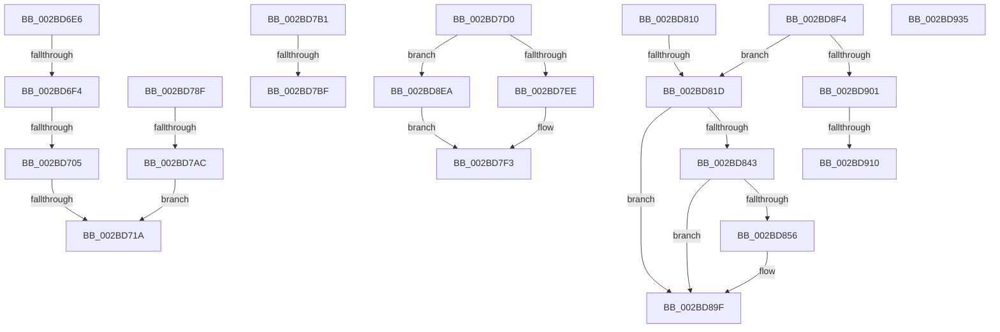

# sub_002BD6E6

- RVA: `0x002BD6E6`–`0x002BD946` (길이 `608` bytes)
- VA: `0x00000001402BD6E6`
- 실행 섹션: `.text`
- PDB 이름 있음: `아니요`; PDB Function 태그: `아니요`
- unwind 정보 RVA: `0x0006E238`
- 디코드: `139`개 명령, `608/608` bytes 표시
- 미해석 바이트: `0` (있으면 어셈블리에 `.byte`로 보존)

> 이 문서는 커널 이미지의 기계어와 PDB 기호를 분석해 생성했습니다. 4번과 5번은 함수 원형과 자료형을 바이너리 사용 방식에서 추정한 C 해석이며 원본 소스 복구 결과는 아닙니다.

## 1. Dependencies

- 직접 호출 지점: **14**; 고유 호출 대상: **12**
- 직접 호출자로 확인된 함수: **0**
- RIP 상대 이미지 참조: **3**

### Outgoing calls
- `0x002BD785` → [EtwWriteEx](../25/EtwWriteEx_function_0025F0D0.md) (function, `0x0025F0D0`)
- `0x002BD79F` → [EtwpLevelKeywordEnabled](../2F/EtwpLevelKeywordEnabled_function_002FD110.md) (function, `0x002FD110`)
- `0x002BD7C6` → [KiReleaseSpinLockInstrumented](../39/KiReleaseSpinLockInstrumented_function_00392EF0.md) (function, `0x00392EF0`)
- `0x002BD7DB` → [KeAcquireSpinLockRaiseToDpc](../20/KeAcquireSpinLockRaiseToDpc_function_00208470.md) (function, `0x00208470`)
- `0x002BD7F6` → [PopFxUpdateDeviceIdleTimer](../4A/PopFxUpdateDeviceIdleTimer_function_004A5C84.md) (function, `0x004A5C84`)
- `0x002BD806` → [KeReleaseSpinLock](../39/KeReleaseSpinLock_function_00392BA0.md) (function, `0x00392BA0`)
- `0x002BD82A` → [PopFxBugCheck](PopFxBugCheck_function_002BFC6C.md) (function, `0x002BFC6C`)
- `0x002BD84B` → [PopFxTryReferenceDevice](../2C/PopFxTryReferenceDevice_function_002C0628.md) (function, `0x002C0628`)
- `0x002BD88B` → [guard_dispatch_icall](../6B/guard_dispatch_icall_function_006BAAD0.md) (function, `0x006BAAD0`)
- `0x002BD89A` → [PopFxDereferenceDevice](../27/PopFxDereferenceDevice_function_0027038C.md) (function, `0x0027038C`)
- `0x002BD8E0` → [guard_dispatch_icall](../6B/guard_dispatch_icall_function_006BAAD0.md) (function, `0x006BAAD0`)
- `0x002BD91E` → [PopFxBugCheck](PopFxBugCheck_function_002BFC6C.md) (function, `0x002BFC6C`)
- `0x002BD92B` → [PopFxAcpiForwardPepAcpiNotifyRequest](../4C/PopFxAcpiForwardPepAcpiNotifyRequest_function_004C7650.md) (function, `0x004C7650`)
- `0x002BD93C` → [PopFxAcpiForwardPepWorkRequest](../4F/PopFxAcpiForwardPepWorkRequest_function_004F65A4.md) (function, `0x004F65A4`)

### Direct callers
- 이 함수 시작 RVA로 연결되는 직접 call은 확인되지 않았습니다. 간접 호출은 완전히 역산할 수 없습니다.

### Static image references
- `0x002BD71A` → RVA `0x00F0B408` (`.data`; read)
- `0x002BD729` → RVA `0x00014700` (`.rdata`; read)
- `0x002BD7B1` → RVA `0x00F0DE58` (`.data`; read)

## 2. Other-region calls and transfers

- 다른 실행 섹션으로 향하는 call: **0**
- call이 아닌 외부 분기/꼬리 이동: **13**
  - `0x002BD6EE` → [sub_002BD41B + 0x233](Unknown_function_002BD41B.md) (`tail-transfer`)
  - `0x002BD6FF` → [sub_002BD41B + 0x233](Unknown_function_002BD41B.md) (`tail-transfer`)
  - `0x002BD714` → [sub_002BD41B + 0x233](Unknown_function_002BD41B.md) (`tail-transfer`)
  - `0x002BD78A` → [sub_002BD41B + 0x241](Unknown_function_002BD41B.md) (`tail-transfer`)
  - `0x002BD7A6` → [sub_002BD41B + 0x23E](Unknown_function_002BD41B.md) (`tail-transfer`)
  - `0x002BD7B9` → [sub_002BD41B + 0x1E5](Unknown_function_002BD41B.md) (`tail-transfer`)
  - `0x002BD7CB` → [sub_002BD41B + 0x1EA](Unknown_function_002BD41B.md) (`tail-transfer`)
  - `0x002BD80B` → [sub_002BD41B + 0x290](Unknown_function_002BD41B.md) (`tail-transfer`)
  - `0x002BD817` → [sub_002BD95A + 0x3B9](Unknown_function_002BD95A.md) (`tail-transfer`)
  - `0x002BD8E5` → [sub_002BD41B + 0x290](Unknown_function_002BD41B.md) (`tail-transfer`)
  - `0x002BD90A` → [sub_002BD95A + 0x441](Unknown_function_002BD95A.md) (`tail-transfer`)
  - `0x002BD930` → [sub_002BD41B + 0x290](Unknown_function_002BD41B.md) (`tail-transfer`)
  - `0x002BD941` → [sub_002BD41B + 0x290](Unknown_function_002BD41B.md) (`tail-transfer`)

## 3. Assembly (complete function range)

```asm
002BD6E6  0F B6 41 64                     movzx eax, byte ptr [rcx + 0x64]
002BD6EA  FE C8                           dec al
002BD6EC  3C 02                           cmp al, 2
002BD6EE  0F 86 5A FF FF FF               jbe 0x1402bd64e
002BD6F4  8B 41 68                        mov eax, dword ptr [rcx + 0x68]
002BD6F7  8B 41 70                        mov eax, dword ptr [rcx + 0x70]
002BD6FA  48 0F BA E0 08                  bt rax, 8
002BD6FF  0F 83 49 FF FF FF               jae 0x1402bd64e
002BD705  48 8B 49 78                     mov rcx, qword ptr [rcx + 0x78]
002BD709  48 8B C1                        mov rax, rcx
002BD70C  25 00 01 00 00                  and eax, 0x100
002BD711  48 3B C1                        cmp rax, rcx
002BD714  0F 85 34 FF FF FF               jne 0x1402bd64e
002BD71A  48 8B 0D E7 DC C4 00            mov rcx, qword ptr [rip + 0xc4dce7]
002BD721  48 8D 45 DF                     lea rax, [rbp - 0x21]
002BD725  48 89 45 E7                     mov qword ptr [rbp - 0x19], rax
002BD729  48 8D 15 D0 6F D5 FF            lea rdx, [rip - 0x2a9030]
002BD730  45 33 E4                        xor r12d, r12d
002BD733  C7 45 A7 01 00 00 00            mov dword ptr [rbp - 0x59], 1
002BD73A  48 8D 45 9F                     lea rax, [rbp - 0x61]
002BD73E  48 C7 45 EF 08 00 00 00         mov qword ptr [rbp - 0x11], 8
002BD746  48 89 45 F7                     mov qword ptr [rbp - 9], rax
002BD74A  45 33 C0                        xor r8d, r8d
002BD74D  48 8D 45 A7                     lea rax, [rbp - 0x59]
002BD751  48 C7 45 FF 04 00 00 00         mov qword ptr [rbp - 1], 4
002BD759  48 89 45 07                     mov qword ptr [rbp + 7], rax
002BD75D  45 8D 4C 24 01                  lea r9d, [r12 + 1]
002BD762  48 8D 45 E7                     lea rax, [rbp - 0x19]
002BD766  48 C7 45 0F 04 00 00 00         mov qword ptr [rbp + 0xf], 4
002BD76E  48 89 44 24 38                  mov qword ptr [rsp + 0x38], rax
002BD773  C7 44 24 30 03 00 00 00         mov dword ptr [rsp + 0x30], 3
002BD77B  4C 89 64 24 28                  mov qword ptr [rsp + 0x28], r12
002BD780  4C 89 64 24 20                  mov qword ptr [rsp + 0x20], r12
002BD785  E8 46 19 FA FF                  call 0x14025f0d0
002BD78A  E9 CD FE FF FF                  jmp 0x1402bd65c
002BD78F  48 8B 4A 28                     mov rcx, qword ptr [rdx + 0x28]
002BD793  41 B8 00 01 00 00               mov r8d, 0x100
002BD799  48 83 C1 60                     add rcx, 0x60
002BD79D  B2 04                           mov dl, 4
002BD79F  E8 6C F9 03 00                  call 0x1402fd110
002BD7A4  84 C0                           test al, al
002BD7A6  0F 84 AD FE FF FF               je 0x1402bd659
002BD7AC  E9 69 FF FF FF                  jmp 0x1402bd71a
002BD7B1  8B 15 A1 06 C5 00               mov edx, dword ptr [rip + 0xc506a1]
002BD7B7  85 D2                           test edx, edx
002BD7B9  0F 85 41 FE FF FF               jne 0x1402bd600
002BD7BF  48 8B 55 5F                     mov rdx, qword ptr [rbp + 0x5f]
002BD7C3  48 8B CF                        mov rcx, rdi
002BD7C6  E8 25 57 0D 00                  call 0x140392ef0
002BD7CB  E9 35 FE FF FF                  jmp 0x1402bd605
002BD7D0  48 8B 5F 08                     mov rbx, qword ptr [rdi + 8]
002BD7D4  48 8D 8B 90 01 00 00            lea rcx, [rbx + 0x190]
002BD7DB  E8 90 AC F4 FF                  call 0x140208470
002BD7E0  44 0F B6 F0                     movzx r14d, al
002BD7E4  40 38 77 10                     cmp byte ptr [rdi + 0x10], sil
002BD7E8  0F 84 FC 00 00 00               je 0x1402bd8ea
002BD7EE  F0 83 4B 20 08                  lock or dword ptr [rbx + 0x20], 8
002BD7F3  48 8B CB                        mov rcx, rbx
002BD7F6  E8 89 84 1E 00                  call 0x1404a5c84
002BD7FB  41 0F B6 D6                     movzx edx, r14b
002BD7FF  48 8D 8B 90 01 00 00            lea rcx, [rbx + 0x190]
002BD806  E8 95 53 0D 00                  call 0x140392ba0
002BD80B  E9 9B FE FF FF                  jmp 0x1402bd6ab
002BD810  48 8B 77 08                     mov rsi, qword ptr [rdi + 8]
002BD814  4D 85 F6                        test r14, r14
002BD817  0F 85 F6 04 00 00               jne 0x1402bdd13
002BD81D  4C 8B C2                        mov r8, rdx
002BD820  45 33 C9                        xor r9d, r9d
002BD823  33 D2                           xor edx, edx
002BD825  B9 03 06 00 00                  mov ecx, 0x603
002BD82A  E8 3D 24 00 00                  call 0x1402bfc6c
002BD82F  CC                              int3
002BD830  48 8B 5F 08                     mov rbx, qword ptr [rdi + 8]
002BD834  BE 02 00 00 C0                  mov esi, 0xc0000002
002BD839  48 83 BB 98 00 00 00 00         cmp qword ptr [rbx + 0x98], 0
002BD841  74 5C                           je 0x1402bd89f
002BD843  BA 01 00 00 00                  mov edx, 1
002BD848  48 8B CB                        mov rcx, rbx
002BD84B  E8 D8 2D 00 00                  call 0x1402c0628
002BD850  8B F0                           mov esi, eax
002BD852  85 C0                           test eax, eax
002BD854  78 49                           js 0x1402bd89f
002BD856  48 8B 83 98 00 00 00            mov rax, qword ptr [rbx + 0x98]
002BD85D  48 8D 4D CF                     lea rcx, [rbp - 0x31]
002BD861  4C 8B 4F 28                     mov r9, qword ptr [rdi + 0x28]
002BD865  4C 8B 47 20                     mov r8, qword ptr [rdi + 0x20]
002BD869  48 8B 57 10                     mov rdx, qword ptr [rdi + 0x10]
002BD86D  48 89 4C 24 30                  mov qword ptr [rsp + 0x30], rcx
002BD872  48 8B 4F 38                     mov rcx, qword ptr [rdi + 0x38]
002BD876  48 89 4C 24 28                  mov qword ptr [rsp + 0x28], rcx
002BD87B  48 8B 4F 30                     mov rcx, qword ptr [rdi + 0x30]
002BD87F  48 89 4C 24 20                  mov qword ptr [rsp + 0x20], rcx
002BD884  48 8B 8B C0 00 00 00            mov rcx, qword ptr [rbx + 0xc0]
002BD88B  E8 40 D2 3F 00                  call 0x1406baad0
002BD890  BA 01 00 00 00                  mov edx, 1
002BD895  48 8B CB                        mov rcx, rbx
002BD898  8B F0                           mov esi, eax
002BD89A  E8 ED 2A FB FF                  call 0x14027038c
002BD89F  48 8B 43 38                     mov rax, qword ptr [rbx + 0x38]
002BD8A3  48 8D 55 E7                     lea rdx, [rbp - 0x19]
002BD8A7  89 75 07                        mov dword ptr [rbp + 7], esi
002BD8AA  48 8B 48 20                     mov rcx, qword ptr [rax + 0x20]
002BD8AE  33 C0                           xor eax, eax
002BD8B0  89 45 0B                        mov dword ptr [rbp + 0xb], eax
002BD8B3  48 8B 41 48                     mov rax, qword ptr [rcx + 0x48]
002BD8B7  48 89 45 E7                     mov qword ptr [rbp - 0x19], rax
002BD8BB  48 8B 47 10                     mov rax, qword ptr [rdi + 0x10]
002BD8BF  48 89 45 EF                     mov qword ptr [rbp - 0x11], rax
002BD8C3  48 8B 47 18                     mov rax, qword ptr [rdi + 0x18]
002BD8C7  48 89 45 F7                     mov qword ptr [rbp - 9], rax
002BD8CB  48 8B 45 CF                     mov rax, qword ptr [rbp - 0x31]
002BD8CF  48 89 45 FF                     mov qword ptr [rbp - 1], rax
002BD8D3  48 8B 41 40                     mov rax, qword ptr [rcx + 0x40]
002BD8D7  B9 0F 00 00 00                  mov ecx, 0xf
002BD8DC  48 8B 40 60                     mov rax, qword ptr [rax + 0x60]
002BD8E0  E8 EB D1 3F 00                  call 0x1406baad0
002BD8E5  E9 C1 FD FF FF                  jmp 0x1402bd6ab
002BD8EA  F0 83 63 20 F7                  lock and dword ptr [rbx + 0x20], 0xfffffff7
002BD8EF  E9 FF FE FF FF                  jmp 0x1402bd7f3
002BD8F4  48 8B 77 08                     mov rsi, qword ptr [rdi + 8]
002BD8F8  4D 85 F6                        test r14, r14
002BD8FB  0F 84 1C FF FF FF               je 0x1402bd81d
002BD901  8B 5F 10                        mov ebx, dword ptr [rdi + 0x10]
002BD904  3B 9E 64 03 00 00               cmp ebx, dword ptr [rsi + 0x364]
002BD90A  0F 82 8B 04 00 00               jb 0x1402bdd9b
002BD910  44 8B CB                        mov r9d, ebx
002BD913  4C 8B C6                        mov r8, rsi
002BD916  49 8B D6                        mov rdx, r14
002BD919  B9 11 06 00 00                  mov ecx, 0x611
002BD91E  E8 49 23 00 00                  call 0x1402bfc6c
002BD923  CC                              int3
002BD924  48 8B 4F 08                     mov rcx, qword ptr [rdi + 8]
002BD928  48 8B D7                        mov rdx, rdi
002BD92B  E8 20 9D 20 00                  call 0x1404c7650
002BD930  E9 76 FD FF FF                  jmp 0x1402bd6ab
002BD935  48 8B 4F 08                     mov rcx, qword ptr [rdi + 8]
002BD939  48 8B D7                        mov rdx, rdi
002BD93C  E8 63 8C 23 00                  call 0x1404f65a4
002BD941  E9 65 FD FF FF                  jmp 0x1402bd6ab
```

## 4. C-style interpretation (structured pseudocode)

```c
__int64 __fastcall sub_002BD6E6(__int64 a1, __int64 a2, int a3)
{
    __int64 result;
    __int64 v_r12;
    unsigned __int64 v_stack_p20;
    unsigned __int64 v_stack_p28;
    unsigned int v_stack_p30;
    unsigned __int64 v_stack_p38;

    result = (unsigned __int8)((*(unsigned __int8 *)(a1 + 100)) - 1);
    result = (unsigned int)((*(unsigned __int64 *)(a1 + 120)) & (256));
loc_002BD71A:
    *(unsigned __int64 *)(v_rbp - 25) = v_rbp - 33;
    v_r12 = 0;
    *(unsigned int *)(v_rbp - 89) = 1;
    *(unsigned __int64 *)(v_rbp - 17) = 8;
    *(unsigned __int64 *)(v_rbp - 9) = v_rbp - 97;
    a3 = 0;
    *(unsigned __int64 *)(v_rbp - 1) = 4;
    *(unsigned __int64 *)(v_rbp + 7) = v_rbp - 89;
    *(unsigned __int64 *)(v_rbp + 15) = 4;
    v_stack_p38 = v_rbp - 25;
    v_stack_p30 = 3;
    v_stack_p28 = 0;
    v_stack_p20 = 0;
    result = EtwWriteEx(*(unsigned __int64 *)(v_rip + 12901607), v_rip - 2789424, a3, v_r12 + 1);
}
```

## 5. (Beta) C Style

```c
int64_t sub_002BD6E6(void *Arg1, int64_t Arg2, int32_t Arg3)
{
    uint8_t *arg1 = (uint8_t *)Arg1;

    int64_t result;
    int64_t local_r12;
    uint64_t v_stack_p20;
    uint64_t v_stack_p28;
    uint32_t v_stack_p30;
    uint64_t v_stack_p38;

    result = (uint8_t)((*(uint8_t *)(arg1 + 0x64)) - 1);
    result = (uint32_t)((*(uint64_t *)(arg1 + 0x78)) & (256));
loc_002BD71A:
    *(uint64_t *)(local_rbp - 0x19) = local_rbp - 33;
    local_r12 = 0;
    *(uint32_t *)(local_rbp - 0x59) = 1;
    *(uint64_t *)(local_rbp - 0x11) = 8;
    *(uint64_t *)(local_rbp - 0x9) = local_rbp - 97;
    Arg3 = 0;
    *(uint64_t *)(local_rbp - 0x1) = 4;
    *(uint64_t *)(local_rbp + 0x7) = local_rbp - 89;
    *(uint64_t *)(local_rbp + 0xF) = 4;
    v_stack_p38 = local_rbp - 25;
    v_stack_p30 = 3;
    v_stack_p28 = 0;
    v_stack_p20 = 0;
    result = EtwWriteEx(*(uint64_t *)(v_rip + 0xC4DCE7), v_rip - 2789424, Arg3, local_r12 + 1);
}
```

### 관측된 메모리 오프셋

구조체 형식이 확인되지 않은 접근은 인자 기준의 오프셋으로만 기록했습니다.

| 기준 인자 | 오프셋 표현 | 폭 (bit) | 접근 |
|---|---:|---:|---|
| `Arg1` | `+ 0x64` | `8` | `R` |
| `Arg1` | `+ 0x68` | `32` | `R` |
| `Arg1` | `+ 0x70` | `32` | `R` |
| `Arg1` | `+ 0x78` | `64` | `R` |

## 6. Execution-region graph

[열기: 2D/3D 그래프와 함수 탐색 컨트롤 패널](../../../control-panel.html?section=text&rva=0x002BD6E6&view=graph)

- 2D 그래프는 위에서 아래로 흐르고, 3D 그래프는 빈 공간을 드래그해 회전합니다. Shift+드래그는 이동, 휠은 확대·축소, 함수 노드 선택은 대상 보고서 이동입니다.

### Static fallback


