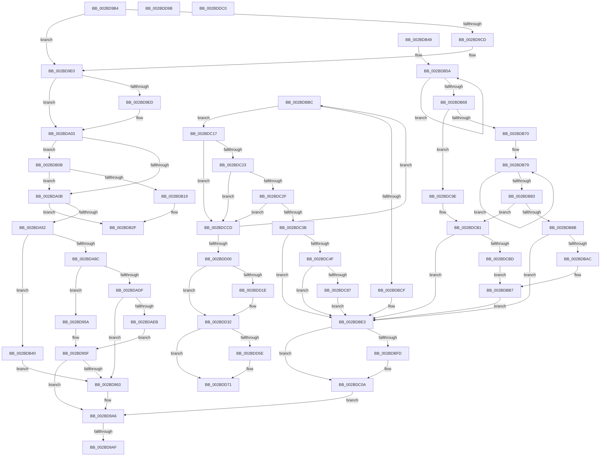

# sub_002BD95A

- RVA: `0x002BD95A`–`0x002BDDDC` (길이 `1,154` bytes)
- VA: `0x00000001402BD95A`
- 실행 섹션: `.text`
- PDB 이름 있음: `아니요`; PDB Function 태그: `아니요`
- unwind 정보 RVA: `0x0006E268`
- 디코드: `288`개 명령, `1,154/1,154` bytes 표시
- 미해석 바이트: `2` (있으면 어셈블리에 `.byte`로 보존)

> 이 문서는 커널 이미지의 기계어와 PDB 기호를 분석해 생성했습니다. 4번과 5번은 함수 원형과 자료형을 바이너리 사용 방식에서 추정한 C 해석이며 원본 소스 복구 결과는 아닙니다.

## 1. Dependencies

- 직접 호출 지점: **31**; 고유 호출 대상: **17**
- 직접 호출자로 확인된 함수: **0**
- RIP 상대 이미지 참조: **1**

### Outgoing calls
- `0x002BD97C` → [PopPepProcessEvent](../24/PopPepProcessEvent_function_0024B930.md) (function, `0x0024B930`)
- `0x002BD9A1` → [PopPlNotifyDeviceFState](PopPlNotifyDeviceFState_function_002BE034.md) (function, `0x002BE034`)
- `0x002BD9DA` → [PopFxBugCheck](PopFxBugCheck_function_002BFC6C.md) (function, `0x002BFC6C`)
- `0x002BD9FD` → [PopFxBugCheck](PopFxBugCheck_function_002BFC6C.md) (function, `0x002BFC6C`)
- `0x002BDA33` → [guard_dispatch_icall](../6B/guard_dispatch_icall_function_006BAAD0.md) (function, `0x006BAAD0`)
- `0x002BDA56` → [PopDiagTraceFxComponentIdleState](PopDiagTraceFxComponentIdleState_function_002BE0C4.md) (function, `0x002BE0C4`)
- `0x002BDA64` → [memset](../6C/memset_function_006C6C40.md) (function, `0x006C6C40`)
- `0x002BDAD2` → [guard_dispatch_icall](../6B/guard_dispatch_icall_function_006BAAD0.md) (function, `0x006BAAD0`)
- `0x002BDAFD` → [PopFxAddLogEntry](../39/PopFxAddLogEntry_function_00390B94.md) (function, `0x00390B94`)
- `0x002BDB29` → [PopFxBugCheck](PopFxBugCheck_function_002BFC6C.md) (function, `0x002BFC6C`)
- `0x002BDB36` → [PopFxAddLogEntry](../39/PopFxAddLogEntry_function_00390B94.md) (function, `0x00390B94`)
- `0x002BDB9E` → [KeCancelTimer](../23/KeCancelTimer_function_002327E0.md) (function, `0x002327E0`)
- `0x002BDBB2` → [PopFxCompleteDevicePowerRequired](../39/PopFxCompleteDevicePowerRequired_function_003908AC.md) (function, `0x003908AC`)
- `0x002BDBD8` → [PopDiagTraceFxDevicePowerRequirement](../39/PopDiagTraceFxDevicePowerRequirement_function_00391780.md) (function, `0x00391780`)
- `0x002BDBEA` → [KxReleaseSpinLock](../20/KxReleaseSpinLock_function_00206670.md) (function, `0x00206670`)
- `0x002BDC05` → [KiLowerIrqlProcessIrqlFlags](../4F/KiLowerIrqlProcessIrqlFlags_function_004F5698.md) (function, `0x004F5698`)
- `0x002BDC46` → [PopFxScheduleDeviceIdleTimer](../22/PopFxScheduleDeviceIdleTimer_function_0022FF18.md) (function, `0x0022FF18`)
- `0x002BDC58` → [PopDiagTraceFxDevicePowerRequirement](../39/PopDiagTraceFxDevicePowerRequirement_function_00391780.md) (function, `0x00391780`)
- `0x002BDC6B` → [guard_dispatch_icall](../6B/guard_dispatch_icall_function_006BAAD0.md) (function, `0x006BAAD0`)
- `0x002BDC94` → [PopFxAddLogEntry](../39/PopFxAddLogEntry_function_00390B94.md) (function, `0x00390B94`)
- `0x002BDCAB` → [PopFxBugCheck](PopFxBugCheck_function_002BFC6C.md) (function, `0x002BFC6C`)
- `0x002BDCC3` → [PopFxDeliverDevicePowerRequired](../49/PopFxDeliverDevicePowerRequired_function_00492C4C.md) (function, `0x00492C4C`)
- `0x002BDCDA` → [PopFxBugCheck](PopFxBugCheck_function_002BFC6C.md) (function, `0x002BFC6C`)
- `0x002BDCF3` → [PopPepProcessEvent](../24/PopPepProcessEvent_function_0024B930.md) (function, `0x0024B930`)
- `0x002BDD0D` → [PopFxBugCheck](PopFxBugCheck_function_002BFC6C.md) (function, `0x002BFC6C`)
- `0x002BDD2C` → [PopFxBugCheck](PopFxBugCheck_function_002BFC6C.md) (function, `0x002BFC6C`)
- `0x002BDD6C` → [PopFxAddLogEntry](../39/PopFxAddLogEntry_function_00390B94.md) (function, `0x00390B94`)
- `0x002BDD79` → [PopDiagTraceFxPerfRequestProgress](../4C/PopDiagTraceFxPerfRequestProgress_function_004C1B78.md) (function, `0x004C1B78`)
- `0x002BDD91` → [PopFxCompleteComponentPerfState](../4C/PopFxCompleteComponentPerfState_function_004C1750.md) (function, `0x004C1750`)
- `0x002BDDAB` → [PopFxAddLogEntry](../39/PopFxAddLogEntry_function_00390B94.md) (function, `0x00390B94`)
- `0x002BDDB6` → [PopPepCompleteComponentIdleState](../4D/PopPepCompleteComponentIdleState_function_004D8EC4.md) (function, `0x004D8EC4`)

### Direct callers
- 이 함수 시작 RVA로 연결되는 직접 call은 확인되지 않았습니다. 간접 호출은 완전히 역산할 수 없습니다.

### Static image references
- `0x002BDBEF` → RVA `0x00FC6D20` (`ALMOSTRO`; read)

## 2. Other-region calls and transfers

- 다른 실행 섹션으로 향하는 call: **0**
- call이 아닌 외부 분기/꼬리 이동: **5**
  - `0x002BD9A9` → [sub_002BD41B + 0x14](Unknown_function_002BD41B.md) (`tail-transfer`)
  - `0x002BD9AF` → [sub_002BD41B + 0x290](Unknown_function_002BD41B.md) (`tail-transfer`)
  - `0x002BDB3B` → [sub_002BD41B + 0x290](Unknown_function_002BD41B.md) (`tail-transfer`)
  - `0x002BDD96` → [sub_002BD41B + 0x290](Unknown_function_002BD41B.md) (`tail-transfer`)
  - `0x002BDDBB` → [sub_002BD41B + 0x290](Unknown_function_002BD41B.md) (`tail-transfer`)

## 3. Assembly (complete function range)

```asm
002BD95A  B0 01                           mov al, 1
002BD95C  88 45 C0                        mov byte ptr [rbp - 0x40], al
002BD95F  84 C0                           test al, al
002BD961  74 43                           je 0x1402bd9a6
002BD963  41 B9 06 00 00 00               mov r9d, 6
002BD969  48 89 7C 24 28                  mov qword ptr [rsp + 0x28], rdi
002BD96E  49 8D 97 C0 00 00 00            lea rdx, [r15 + 0xc0]
002BD975  49 8B CD                        mov rcx, r13
002BD978  45 8D 41 FB                     lea r8d, [r9 - 5]
002BD97C  E8 AF DF F8 FF                  call 0x14024b930
002BD981  48 8B 4D C7                     mov rcx, qword ptr [rbp - 0x39]
002BD985  41 8B D4                        mov edx, r12d
002BD988  45 8B 8F 70 01 00 00            mov r9d, dword ptr [r15 + 0x170]
002BD98F  0F B6 F0                        movzx esi, al
002BD992  45 8B 87 74 01 00 00            mov r8d, dword ptr [r15 + 0x174]
002BD999  C6 44 24 20 01                  mov byte ptr [rsp + 0x20], 1
002BD99E  48 8B 09                        mov rcx, qword ptr [rcx]
002BD9A1  E8 8E 06 00 00                  call 0x1402be034
002BD9A6  40 84 F6                        test sil, sil
002BD9A9  0F 85 80 FA FF FF               jne 0x1402bd42f
002BD9AF  E9 F7 FC FF FF                  jmp 0x1402bd6ab
002BD9B4  0F AE E8                        lfence
002BD9B7  49 8B 87 68 03 00 00            mov rax, qword ptr [r15 + 0x368]
002BD9BE  4A 8B 34 E0                     mov rsi, qword ptr [rax + r12*8]
002BD9C2  8B 86 9C 00 00 00               mov eax, dword ptr [rsi + 0x9c]
002BD9C8  39 47 14                        cmp dword ptr [rdi + 0x14], eax
002BD9CB  72 13                           jb 0x1402bd9e0
002BD9CD  45 33 C9                        xor r9d, r9d
002BD9D0  4C 8B C6                        mov r8, rsi
002BD9D3  33 D2                           xor edx, edx
002BD9D5  B9 16 06 00 00                  mov ecx, 0x616
002BD9DA  E8 8D 22 00 00                  call 0x1402bfc6c
002BD9DF  CC                              int3
002BD9E0  8B 86 98 00 00 00               mov eax, dword ptr [rsi + 0x98]
002BD9E6  8B 4F 14                        mov ecx, dword ptr [rdi + 0x14]
002BD9E9  3B C8                           cmp ecx, eax
002BD9EB  75 16                           jne 0x1402bda03
002BD9ED  41 B9 01 00 00 00               mov r9d, 1
002BD9F3  4C 8B C6                        mov r8, rsi
002BD9F6  33 D2                           xor edx, edx
002BD9F8  B9 16 06 00 00                  mov ecx, 0x616
002BD9FD  E8 6A 22 00 00                  call 0x1402bfc6c
002BDA02  CC                              int3
002BDA03  85 C9                           test ecx, ecx
002BDA05  0F 85 00 01 00 00               jne 0x1402bdb0b
002BDA0B  8B 47 14                        mov eax, dword ptr [rdi + 0x14]
002BDA0E  41 8B D4                        mov edx, r12d
002BDA11  89 86 98 00 00 00               mov dword ptr [rsi + 0x98], eax
002BDA17  C7 86 8C 00 00 00 02 00 00 00   mov dword ptr [rsi + 0x8c], 2
002BDA21  49 8B 87 80 00 00 00            mov rax, qword ptr [r15 + 0x80]
002BDA28  44 8B 47 14                     mov r8d, dword ptr [rdi + 0x14]
002BDA2C  49 8B 8F C0 00 00 00            mov rcx, qword ptr [r15 + 0xc0]
002BDA33  E8 98 D0 3F 00                  call 0x1406baad0
002BDA38  8B C3                           mov eax, ebx
002BDA3A  F0 0F C1 86 8C 00 00 00         lock xadd dword ptr [rsi + 0x8c], eax
002BDA42  49 8B 4F 30                     mov rcx, qword ptr [r15 + 0x30]
002BDA46  41 8B D4                        mov edx, r12d
002BDA49  83 F8 01                        cmp eax, 1
002BDA4C  0F 85 DD 00 00 00               jne 0x1402bdb2f
002BDA52  44 8B 47 14                     mov r8d, dword ptr [rdi + 0x14]
002BDA56  E8 69 06 00 00                  call 0x1402be0c4
002BDA5B  33 D2                           xor edx, edx
002BDA5D  48 8B CF                        mov rcx, rdi
002BDA60  44 8D 42 40                     lea r8d, [rdx + 0x40]
002BDA64  E8 D7 91 40 00                  call 0x1406c6c40
002BDA69  4D 8B 6F 38                     mov r13, qword ptr [r15 + 0x38]
002BDA6D  40 32 F6                        xor sil, sil
002BDA70  4D 69 FC D0 00 00 00            imul r15, r12, 0xd0
002BDA77  49 8D 45 20                     lea rax, [r13 + 0x20]
002BDA7B  4D 03 FD                        add r15, r13
002BDA7E  48 89 45 C7                     mov qword ptr [rbp - 0x39], rax
002BDA82  41 38 75 7C                     cmp byte ptr [r13 + 0x7c], sil
002BDA86  0F 84 B4 00 00 00               je 0x1402bdb40
002BDA8C  48 8B 00                        mov rax, qword ptr [rax]
002BDA8F  33 C9                           xor ecx, ecx
002BDA91  41 8B 97 C8 00 00 00            mov edx, dword ptr [r15 + 0xc8]
002BDA98  89 4D C1                        mov dword ptr [rbp - 0x3f], ecx
002BDA9B  66 89 4D C5                     mov word ptr [rbp - 0x3b], cx
002BDA9F  48 8B 48 40                     mov rcx, qword ptr [rax + 0x40]
002BDAA3  48 89 45 D7                     mov qword ptr [rbp - 0x29], rax
002BDAA7  48 8B 40 48                     mov rax, qword ptr [rax + 0x48]
002BDAAB  48 89 45 AF                     mov qword ptr [rbp - 0x51], rax
002BDAAF  41 8B 87 70 01 00 00            mov eax, dword ptr [r15 + 0x170]
002BDAB6  89 55 B7                        mov dword ptr [rbp - 0x49], edx
002BDAB9  89 45 BB                        mov dword ptr [rbp - 0x45], eax
002BDABC  66 C7 45 BF 01 00               mov word ptr [rbp - 0x41], 1
002BDAC2  48 8B 41 60                     mov rax, qword ptr [rcx + 0x60]
002BDAC6  B9 13 00 00 00                  mov ecx, 0x13
002BDACB  89 55 9B                        mov dword ptr [rbp - 0x65], edx
002BDACE  48 8D 55 AF                     lea rdx, [rbp - 0x51]
002BDAD2  E8 F9 CF 3F 00                  call 0x1406baad0
002BDAD7  84 C0                           test al, al
002BDAD9  0F 84 7B FE FF FF               je 0x1402bd95a
002BDADF  0F B6 45 C0                     movzx eax, byte ptr [rbp - 0x40]
002BDAE3  84 C0                           test al, al
002BDAE5  0F 85 78 FE FF FF               jne 0x1402bd963
002BDAEB  48 8B 4D D7                     mov rcx, qword ptr [rbp - 0x29]
002BDAEF  45 33 C9                        xor r9d, r9d
002BDAF2  8B 55 9B                        mov edx, dword ptr [rbp - 0x65]
002BDAF5  48 8B 49 30                     mov rcx, qword ptr [rcx + 0x30]
002BDAF9  45 8D 41 12                     lea r8d, [r9 + 0x12]
002BDAFD  E8 92 30 0D 00                  call 0x140390b94
002BDB02  0F B6 45 C0                     movzx eax, byte ptr [rbp - 0x40]
002BDB06  E9 54 FE FF FF                  jmp 0x1402bd95f
002BDB0B  8B 86 98 00 00 00               mov eax, dword ptr [rsi + 0x98]
002BDB11  85 C0                           test eax, eax
002BDB13  0F 84 F2 FE FF FF               je 0x1402bda0b
002BDB19  41 B9 02 00 00 00               mov r9d, 2
002BDB1F  4C 8B C6                        mov r8, rsi
002BDB22  33 D2                           xor edx, edx
002BDB24  B9 16 06 00 00                  mov ecx, 0x616
002BDB29  E8 3E 21 00 00                  call 0x1402bfc6c
002BDB2E  CC                              int3
002BDB2F  45 33 C9                        xor r9d, r9d
002BDB32  45 8D 41 0E                     lea r8d, [r9 + 0xe]
002BDB36  E8 59 30 0D 00                  call 0x140390b94
002BDB3B  E9 6B FB FF FF                  jmp 0x1402bd6ab
002BDB40  48 89 45 C7                     mov qword ptr [rbp - 0x39], rax
002BDB44  E9 1A FE FF FF                  jmp 0x1402bd963
002BDB49  41 C7 47 24 02 00 00 00         mov dword ptr [r15 + 0x24], 2
002BDB51  41 0F 0D 4F 20                  prefetchw byte ptr [r15 + 0x20]
002BDB56  41 8B 47 20                     mov eax, dword ptr [r15 + 0x20]
002BDB5A  8B C8                           mov ecx, eax
002BDB5C  0F BA F1 07                     btr ecx, 7
002BDB60  F0 41 0F B1 4F 20               lock cmpxchg dword ptr [r15 + 0x20], ecx
002BDB66  75 F2                           jne 0x1402bdb5a
002BDB68  84 C0                           test al, al
002BDB6A  0F 89 2E 01 00 00               jns 0x1402bdc9e
002BDB70  41 0F 0D 4F 20                  prefetchw byte ptr [r15 + 0x20]
002BDB75  41 8B 47 20                     mov eax, dword ptr [r15 + 0x20]
002BDB79  8B C8                           mov ecx, eax
002BDB7B  F0 41 0F B1 4F 20               lock cmpxchg dword ptr [r15 + 0x20], ecx
002BDB81  75 F6                           jne 0x1402bdb79
002BDB83  A8 04                           test al, 4
002BDB85  0F 84 26 01 00 00               je 0x1402bdcb1
002BDB8B  F0 41 83 67 20 FB               lock and dword ptr [r15 + 0x20], 0xfffffffb
002BDB91  33 C0                           xor eax, eax
002BDB93  49 8D 8F 98 01 00 00            lea rcx, [r15 + 0x198]
002BDB9A  41 89 47 28                     mov dword ptr [r15 + 0x28], eax
002BDB9E  E8 3D 4C F7 FF                  call 0x1402327e0
002BDBA3  F0 41 FF 4F 24                  lock dec dword ptr [r15 + 0x24]
002BDBA8  84 C0                           test al, al
002BDBAA  74 37                           je 0x1402bdbe3
002BDBAC  48 8B D7                        mov rdx, rdi
002BDBAF  49 8B CF                        mov rcx, r15
002BDBB2  E8 F5 2C 0D 00                  call 0x1403908ac
002BDBB7  0F B6 F0                        movzx esi, al
002BDBBA  EB 27                           jmp 0x1402bdbe3
002BDBBC  F0 41 81 4F 20 80 00 00 00      lock or dword ptr [r15 + 0x20], 0x80
002BDBC5  49 83 BF 90 00 00 00 00         cmp qword ptr [r15 + 0x90], 0
002BDBCD  75 48                           jne 0x1402bdc17
002BDBCF  49 8B 4F 30                     mov rcx, qword ptr [r15 + 0x30]
002BDBD3  45 33 C0                        xor r8d, r8d
002BDBD6  33 D2                           xor edx, edx
002BDBD8  E8 A3 3B 0D 00                  call 0x140391780
002BDBDD  F0 41 83 4F 20 40               lock or dword ptr [r15 + 0x20], 0x40
002BDBE3  49 8D 8F 90 01 00 00            lea rcx, [r15 + 0x190]
002BDBEA  E8 81 8A F4 FF                  call 0x140206670
002BDBEF  83 3D 2A 91 D0 00 00            cmp dword ptr [rip + 0xd0912a], 0
002BDBF6  44 0F B6 7D 97                  movzx r15d, byte ptr [rbp - 0x69]
002BDBFB  74 0D                           je 0x1402bdc0a
002BDBFD  44 0F 20 C1                     mov rcx, cr8
002BDC01  41 0F B6 D7                     movzx edx, r15b
002BDC05  E8 8E 7A 23 00                  call 0x1404f5698
002BDC0A  41 0F B6 C7                     movzx eax, r15b
002BDC0E  44 0F 22 C0                     mov cr8, rax
002BDC12  E9 8F FD FF FF                  jmp 0x1402bd9a6
002BDC17  41 8B 47 24                     mov eax, dword ptr [r15 + 0x24]
002BDC1B  85 C0                           test eax, eax
002BDC1D  0F 85 AA 00 00 00               jne 0x1402bdccd
002BDC23  41 8B 47 28                     mov eax, dword ptr [r15 + 0x28]
002BDC27  85 C0                           test eax, eax
002BDC29  0F 85 9E 00 00 00               jne 0x1402bdccd
002BDC2F  41 8B 47 20                     mov eax, dword ptr [r15 + 0x20]
002BDC33  A8 04                           test al, 4
002BDC35  0F 85 92 00 00 00               jne 0x1402bdccd
002BDC3B  49 8B CF                        mov rcx, r15
002BDC3E  41 C7 47 28 02 00 00 00         mov dword ptr [r15 + 0x28], 2
002BDC46  E8 CD 22 F7 FF                  call 0x14022ff18
002BDC4B  84 C0                           test al, al
002BDC4D  75 94                           jne 0x1402bdbe3
002BDC4F  49 8B 4F 30                     mov rcx, qword ptr [r15 + 0x30]
002BDC53  45 33 C0                        xor r8d, r8d
002BDC56  33 D2                           xor edx, edx
002BDC58  E8 23 3B 0D 00                  call 0x140391780
002BDC5D  49 8B 87 90 00 00 00            mov rax, qword ptr [r15 + 0x90]
002BDC64  49 8B 8F C0 00 00 00            mov rcx, qword ptr [r15 + 0xc0]
002BDC6B  E8 60 CE 3F 00                  call 0x1406baad0
002BDC70  F0 41 83 4F 20 40               lock or dword ptr [r15 + 0x20], 0x40
002BDC76  8B C3                           mov eax, ebx
002BDC78  F0 41 0F C1 47 28               lock xadd dword ptr [r15 + 0x28], eax
002BDC7E  83 F8 01                        cmp eax, 1
002BDC81  0F 84 5C FF FF FF               je 0x1402bdbe3
002BDC87  49 8B 4F 30                     mov rcx, qword ptr [r15 + 0x30]
002BDC8B  45 33 C9                        xor r9d, r9d
002BDC8E  33 D2                           xor edx, edx
002BDC90  45 8D 41 11                     lea r8d, [r9 + 0x11]
002BDC94  E8 FB 2E 0D 00                  call 0x140390b94
002BDC99  E9 45 FF FF FF                  jmp 0x1402bdbe3
002BDC9E  45 33 C9                        xor r9d, r9d
002BDCA1  4D 8B C7                        mov r8, r15
002BDCA4  33 D2                           xor edx, edx
002BDCA6  B9 09 06 00 00                  mov ecx, 0x609
002BDCAB  E8 BC 1F 00 00                  call 0x1402bfc6c
002BDCB0  CC                              int3
002BDCB1  41 8B 47 28                     mov eax, dword ptr [r15 + 0x28]
002BDCB5  85 C0                           test eax, eax
002BDCB7  0F 85 26 FF FF FF               jne 0x1402bdbe3
002BDCBD  48 8B D7                        mov rdx, rdi
002BDCC0  49 8B CF                        mov rcx, r15
002BDCC3  E8 84 4F 1D 00                  call 0x140492c4c
002BDCC8  E9 EA FE FF FF                  jmp 0x1402bdbb7
002BDCCD  45 33 C9                        xor r9d, r9d
002BDCD0  4D 8B C7                        mov r8, r15
002BDCD3  33 D2                           xor edx, edx
002BDCD5  B9 10 06 00 00                  mov ecx, 0x610
002BDCDA  E8 8D 1F 00 00                  call 0x1402bfc6c
002BDCDF  CC                              int3
002BDCE0  49 8B 4F 38                     mov rcx, qword ptr [r15 + 0x38]
002BDCE4  33 C0                           xor eax, eax
002BDCE6  48 89 44 24 28                  mov qword ptr [rsp + 0x28], rax
002BDCEB  44 8D 48 06                     lea r9d, [rax + 6]
002BDCEF  44 8D 40 04                     lea r8d, [rax + 4]
002BDCF3  E8 38 DC F8 FF                  call 0x14024b930
002BDCF8  84 C0                           test al, al
002BDCFA  0F 84 BC FE FF FF               je 0x1402bdbbc
002BDD00  45 33 C9                        xor r9d, r9d
002BDD03  45 33 C0                        xor r8d, r8d
002BDD06  33 D2                           xor edx, edx
002BDD08  B9 12 06 00 00                  mov ecx, 0x612
002BDD0D  E8 5A 1F 00 00                  call 0x1402bfc6c
002BDD12  CC                              int3
002BDD13  8B 57 10                        mov edx, dword ptr [rdi + 0x10]
002BDD16  3B 96 64 03 00 00               cmp edx, dword ptr [rsi + 0x364]
002BDD1C  72 14                           jb 0x1402bdd32
002BDD1E  44 8B CA                        mov r9d, edx
002BDD21  4C 8B C6                        mov r8, rsi
002BDD24  49 8B D6                        mov rdx, r14
002BDD27  B9 11 06 00 00                  mov ecx, 0x611
002BDD2C  E8 3B 1F 00 00                  call 0x1402bfc6c
002BDD31  CC                              int3
002BDD32  0F AE E8                        lfence
002BDD35  48 8B 86 68 03 00 00            mov rax, qword ptr [rsi + 0x368]
002BDD3C  4C 8B 3C D0                     mov r15, qword ptr [rax + rdx*8]
002BDD40  4D 8B B7 A8 01 00 00            mov r14, qword ptr [r15 + 0x1a8]
002BDD47  F0 41 0F C1 5E 28               lock xadd dword ptr [r14 + 0x28], ebx
002BDD4D  FF CB                           dec ebx
002BDD4F  F0 41 81 4E 28 00 00 00 20      lock or dword ptr [r14 + 0x28], 0x20000000
002BDD58  0F BA E3 1B                     bt ebx, 0x1b
002BDD5C  72 13                           jb 0x1402bdd71
002BDD5E  48 8B 4E 30                     mov rcx, qword ptr [rsi + 0x30]
002BDD62  41 B9 01 00 00 00               mov r9d, 1
002BDD68  45 8D 41 13                     lea r8d, [r9 + 0x13]
002BDD6C  E8 23 2E 0D 00                  call 0x140390b94
002BDD71  83 E3 07                        and ebx, 7
002BDD74  49 8B CE                        mov rcx, r14
002BDD77  8B D3                           mov edx, ebx
002BDD79  E8 FA 3D 20 00                  call 0x1404c1b78
002BDD7E  44 0F B6 4F 14                  movzx r9d, byte ptr [rdi + 0x14]
002BDD83  48 8B CE                        mov rcx, rsi
002BDD86  4D 8B 87 A8 01 00 00            mov r8, qword ptr [r15 + 0x1a8]
002BDD8D  41 8B 57 10                     mov edx, dword ptr [r15 + 0x10]
002BDD91  E8 BA 39 20 00                  call 0x1404c1750
002BDD96  E9 10 F9 FF FF                  jmp 0x1402bd6ab
002BDD9B  48 8B 4E 30                     mov rcx, qword ptr [rsi + 0x30]
002BDD9F  41 B9 01 00 00 00               mov r9d, 1
002BDDA5  8B D3                           mov edx, ebx
002BDDA7  45 8D 41 11                     lea r8d, [r9 + 0x11]
002BDDAB  E8 E4 2D 0D 00                  call 0x140390b94
002BDDB0  48 8B 4E 38                     mov rcx, qword ptr [rsi + 0x38]
002BDDB4  8B D3                           mov edx, ebx
002BDDB6  E8 09 B1 21 00                  call 0x1404d8ec4
002BDDBB  E9 EB F8 FF FF                  jmp 0x1402bd6ab
002BDDC0  B4 D4                           mov ah, 0xd4
002BDDC2  2B 00                           sub eax, dword ptr [rax]
002BDDC4  30 D8                           xor al, bl
002BDDC6  2B 00                           sub eax, dword ptr [rax]
002BDDC8  D0 D7                           rcl bh, 1
002BDDCA  2B 00                           sub eax, dword ptr [rax]
002BDDCC  F4                              hlt
002BDDCD  D8 2B                           fsubr dword ptr [rbx]
002BDDCF  00 10                           add byte ptr [rax], dl
002BDDD1  D8 2B                           fsubr dword ptr [rbx]
002BDDD3  00 24 D9                        add byte ptr [rcx + rbx*8], ah
002BDDD6  2B 00                           sub eax, dword ptr [rax]
002BDDD8  35                              .byte 0x35
002BDDD9  D9 2B                           fldcw word ptr [rbx]
002BDDDB  00                              .byte 0x00
```

## 4. C-style interpretation (structured pseudocode)

```c
__int64 __fastcall sub_002BD95A(void)
{
    __int64 result;
    __int64 v_rsi;
    unsigned __int8 v_stack_p20;
    unsigned __int64 v_stack_p28;

    *(unsigned __int8 *)(v_rbp - 64) = 1;
loc_002BD95F:
    result = 1;
    if (1 != 0) {
        a4 = 6;
        v_stack_p28 = v_rdi;
        a2 = v_r15 + 192;
        a1 = v_r13;
        a3 = a4 - 5;
        result = PopPepProcessEvent(a1, a2, a3, a4);
        a1 = *(unsigned __int64 *)(v_rbp - 57);
        a2 = (unsigned int)(v_r12);
        a4 = *(unsigned int *)(v_r15 + 368);
        v_rsi = (unsigned __int8)(result);
        a3 = *(unsigned int *)(v_r15 + 372);
        v_stack_p20 = 1;
        a1 = *(unsigned __int64 *)(a1);
        result = PopPlNotifyDeviceFState(a1, a2, a3, a4);
    }
}
```

## 5. (Beta) C Style

```c
void sub_002BD95A(void)
{
    int64_t result;
    int64_t local_rsi;
    uint8_t v_stack_p20;
    uint64_t v_stack_p28;

    *(uint8_t *)(local_rbp - 0x40) = 1;
loc_002BD95F:
    result = 1;
    if (1 != 0) {
        a4 = 6;
        v_stack_p28 = local_rdi;
        a2 = local_r15 + 192;
        a1 = local_r13;
        a3 = a4 - 5;
        result = PopPepProcessEvent(a1, a2, a3, a4);
        a1 = *(uint64_t *)(local_rbp - 0x39);
        a2 = (uint32_t)(local_r12);
        a4 = *(uint32_t *)(local_r15 + 0x170);
        local_rsi = (uint8_t)(result);
        a3 = *(uint32_t *)(local_r15 + 0x174);
        v_stack_p20 = 1;
        a1 = *(uint64_t *)(a1);
        result = PopPlNotifyDeviceFState(a1, a2, a3, a4);
    }
}
```

## 6. Execution-region graph

[열기: 2D/3D 그래프와 함수 탐색 컨트롤 패널](../../../control-panel.html?section=text&rva=0x002BD95A&view=graph)

- 2D 그래프는 위에서 아래로 흐르고, 3D 그래프는 빈 공간을 드래그해 회전합니다. Shift+드래그는 이동, 휠은 확대·축소, 함수 노드 선택은 대상 보고서 이동입니다.

### Static fallback


