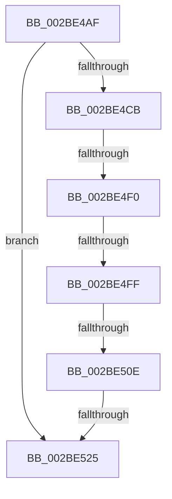

# sub_002BE4AF

- RVA: `0x002BE4AF`–`0x002BE540` (길이 `145` bytes)
- VA: `0x00000001402BE4AF`
- 실행 섹션: `.text`
- PDB 이름 있음: `아니요`; PDB Function 태그: `아니요`
- unwind 정보 RVA: `0x0006E324`
- 디코드: `35`개 명령, `145/145` bytes 표시
- 미해석 바이트: `0` (있으면 어셈블리에 `.byte`로 보존)

> 이 문서는 커널 이미지의 기계어와 PDB 기호를 분석해 생성했습니다. 4번과 5번은 함수 원형과 자료형을 바이너리 사용 방식에서 추정한 C 해석이며 원본 소스 복구 결과는 아닙니다.

## 1. Dependencies

- 직접 호출 지점: **0**; 고유 호출 대상: **0**
- 직접 호출자로 확인된 함수: **0**
- RIP 상대 이미지 참조: **2**

### Outgoing calls
- 직접 디코드된 call 명령이 없습니다.

### Direct callers
- 이 함수 시작 RVA로 연결되는 직접 call은 확인되지 않았습니다. 간접 호출은 완전히 역산할 수 없습니다.

### Static image references
- `0x002BE4D1` → RVA `0x00E2DCCC` (`.data`; read)
- `0x002BE4DF` → RVA `0x00FC5000` (`ALMOSTRO`; read)

## 2. Other-region calls and transfers

- 다른 실행 섹션으로 향하는 call: **0**
- call이 아닌 외부 분기/꼬리 이동: **5**
  - `0x002BE4EA` → [sub_002BE65D](Unknown_function_002BE65D.md) (`tail-transfer`)
  - `0x002BE4F9` → [sub_002BE5F9 + 0xC](Unknown_function_002BE5F9.md) (`tail-transfer`)
  - `0x002BE508` → [sub_002BE5F9](Unknown_function_002BE5F9.md) (`tail-transfer`)
  - `0x002BE51F` → [sub_002BE5A9](Unknown_function_002BE5A9.md) (`tail-transfer`)
  - `0x002BE53E` → [sub_002BE540 + 0x3B](Unknown_function_002BE540.md) (`tail-transfer`)

## 3. Assembly (complete function range)

```asm
002BE4AF  4C 89 64 24 58                  mov qword ptr [rsp + 0x58], r12
002BE4B4  0F 45 D0                        cmovne edx, eax
002BE4B7  4C 89 6C 24 60                  mov qword ptr [rsp + 0x60], r13
002BE4BC  4C 89 74 24 68                  mov qword ptr [rsp + 0x68], r14
002BE4C1  4C 89 7C 24 20                  mov qword ptr [rsp + 0x20], r15
002BE4C6  4C 3B CA                        cmp r9, rdx
002BE4C9  73 5A                           jae 0x1402be525
002BE4CB  4D 8B 60 10                     mov r12, qword ptr [r8 + 0x10]
002BE4CF  33 C0                           xor eax, eax
002BE4D1  44 8B 2D F4 F7 B6 00            mov r13d, dword ptr [rip + 0xb6f7f4]
002BE4D8  49 81 C4 60 3A 00 00            add r12, 0x3a60
002BE4DF  44 0F B7 3D 19 6B D0 00         movzx r15d, word ptr [rip + 0xd06b19]
002BE4E7  41 3B C7                        cmp eax, r15d
002BE4EA  0F 83 6D 01 00 00               jae 0x1402be65d
002BE4F0  33 ED                           xor ebp, ebp
002BE4F2  4D 8B F4                        mov r14, r12
002BE4F5  48 83 FD 01                     cmp rbp, 1
002BE4F9  0F 8F 06 01 00 00               jg 0x1402be605
002BE4FF  4D 8B 1E                        mov r11, qword ptr [r14]
002BE502  45 33 D2                        xor r10d, r10d
002BE505  45 3B D5                        cmp r10d, r13d
002BE508  0F 83 EB 00 00 00               jae 0x1402be5f9
002BE50E  41 8B CA                        mov ecx, r10d
002BE511  48 03 C9                        add rcx, rcx
002BE514  41 0F B7 0C CB                  movzx ecx, word ptr [r11 + rcx*8]
002BE519  4C 03 C9                        add r9, rcx
002BE51C  4C 3B CA                        cmp r9, rdx
002BE51F  0F 82 84 00 00 00               jb 0x1402be5a9
002BE525  B3 01                           mov bl, 1
002BE527  4C 8B 7C 24 20                  mov r15, qword ptr [rsp + 0x20]
002BE52C  4C 8B 74 24 68                  mov r14, qword ptr [rsp + 0x68]
002BE531  4C 8B 6C 24 60                  mov r13, qword ptr [rsp + 0x60]
002BE536  4C 8B 64 24 58                  mov r12, qword ptr [rsp + 0x58]
002BE53B  48 85 FF                        test rdi, rdi
002BE53E  74 3B                           je 0x1402be57b
```

## 4. C-style interpretation (structured pseudocode)

```c
__int64 __fastcall sub_002BE4AF(__int64 a1, __int64 a2, __int64 a3, __int64 a4, __int64 a5, __int64 a6, __int64 a7, __int64 a8, __int64 a9, __int64 a10, __int64 a11, __int64 a12, __int64 a13)
{
    __int64 result;
    __int64 v_r10;
    __int64 v_r12;
    __int64 v_rbp;
    unsigned __int64 v_stack_p20;
    unsigned __int64 v_stack_p58;
    unsigned __int64 v_stack_p60;
    unsigned __int64 v_stack_p68;

    v_stack_p58 = v_r12;
    if (condition_is_not_equal) { a2 = (unsigned int)(result); }
    v_stack_p60 = v_r13;
    v_stack_p68 = v_r14;
    v_stack_p20 = v_r15;
    if (a4 >= a2) goto loc_002BE525;
    result = 0;
    v_r12 = (*(unsigned __int64 *)(a3 + 16)) + (0x3A60ULL);
    v_rbp = 0;
    v_r10 = 0;
    a1 = (0) + (0);
    a4 = (a4) + (*(unsigned __int16 *)(*(unsigned __int64 *)(v_r12) + a1 * 8));
loc_002BE525:
}
```

## 5. (Beta) C Style

```c
int64_t sub_002BE4AF(int64_t Arg1, int64_t Arg2, void *Arg3, int64_t Arg4, uint64_t Arg5, uint64_t Arg6, uint64_t Arg7, uint64_t Arg8, uint64_t Arg9, uint64_t Arg10, int64_t Arg11, int64_t Arg12, int64_t Arg13)
{
    uint8_t *arg3 = (uint8_t *)Arg3;

    int64_t result;
    int64_t local_r10;
    int64_t local_r12;
    int64_t local_rbp;
    uint64_t v_stack_p20;
    uint64_t v_stack_p58;
    uint64_t v_stack_p60;
    uint64_t v_stack_p68;

    v_stack_p58 = local_r12;
    if (condition_is_not_equal) { Arg2 = (uint32_t)(result); }
    v_stack_p60 = local_r13;
    v_stack_p68 = local_r14;
    v_stack_p20 = local_r15;
    if (Arg4 >= Arg2) goto loc_002BE525;
    result = 0;
    local_r12 = (*(uint64_t *)(arg3 + 0x10)) + (0x3A60ULL);
    local_rbp = 0;
    local_r10 = 0;
    Arg1 = (0) + (0);
    Arg4 = (Arg4) + (*(uint16_t *)(*(uint64_t *)(local_r12) + Arg1 * 8));
loc_002BE525:
}
```

### 관측된 메모리 오프셋

구조체 형식이 확인되지 않은 접근은 인자 기준의 오프셋으로만 기록했습니다.

| 기준 인자 | 오프셋 표현 | 폭 (bit) | 접근 |
|---|---:|---:|---|
| `Arg3` | `+ 0x10` | `64` | `R` |

## 6. Execution-region graph

[열기: 2D/3D 그래프와 함수 탐색 컨트롤 패널](../../../control-panel.html?section=text&rva=0x002BE4AF&view=graph)

- 2D 그래프는 위에서 아래로 흐르고, 3D 그래프는 빈 공간을 드래그해 회전합니다. Shift+드래그는 이동, 휠은 확대·축소, 함수 노드 선택은 대상 보고서 이동입니다.

### Static fallback


