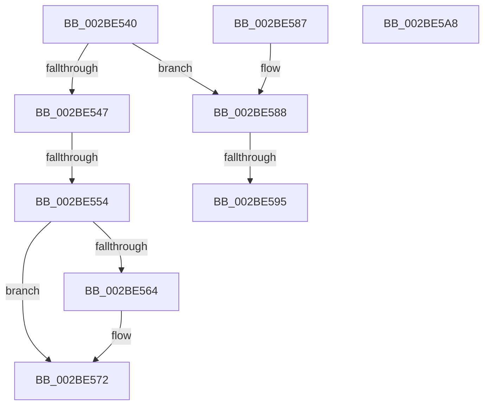

# sub_002BE540

- RVA: `0x002BE540`–`0x002BE5A9` (길이 `105` bytes)
- VA: `0x00000001402BE540`
- 실행 섹션: `.text`
- PDB 이름 있음: `아니요`; PDB Function 태그: `아니요`
- unwind 정보 RVA: `0x0006E344`
- 디코드: `31`개 명령, `105/105` bytes 표시
- 미해석 바이트: `0` (있으면 어셈블리에 `.byte`로 보존)

> 이 문서는 커널 이미지의 기계어와 PDB 기호를 분석해 생성했습니다. 4번과 5번은 함수 원형과 자료형을 바이너리 사용 방식에서 추정한 C 해석이며 원본 소스 복구 결과는 아닙니다.

## 1. Dependencies

- 직접 호출 지점: **1**; 고유 호출 대상: **1**
- 직접 호출자로 확인된 함수: **0**
- RIP 상대 이미지 참조: **2**

### Outgoing calls
- `0x002BE56D` → [KiLowerIrqlProcessIrqlFlags](../4F/KiLowerIrqlProcessIrqlFlags_function_004F5698.md) (function, `0x004F5698`)

### Direct callers
- 이 함수 시작 RVA로 연결되는 직접 call은 확인되지 않았습니다. 간접 호출은 완전히 역산할 수 없습니다.

### Static image references
- `0x002BE547` → RVA `0x00FC6B06` (`ALMOSTRO`; read)
- `0x002BE55B` → RVA `0x00FC6D20` (`ALMOSTRO`; read)

## 2. Other-region calls and transfers

- 다른 실행 섹션으로 향하는 call: **0**
- call이 아닌 외부 분기/꼬리 이동: **2**
  - `0x002BE54E` → [sub_002BE613](Unknown_function_002BE613.md) (`tail-transfer`)
  - `0x002BE58F` → [sub_002BE613 + 0x21](Unknown_function_002BE613.md) (`tail-transfer`)

## 3. Assembly (complete function range)

```asm
002BE540  80 7C 24 50 11                  cmp byte ptr [rsp + 0x50], 0x11
002BE545  74 41                           je 0x1402be588
002BE547  F6 05 B8 85 D0 00 01            test byte ptr [rip + 0xd085b8], 1
002BE54E  0F 85 BF 00 00 00               jne 0x1402be613
002BE554  C7 46 48 00 00 00 00            mov dword ptr [rsi + 0x48], 0
002BE55B  83 3D BE 87 D0 00 00            cmp dword ptr [rip + 0xd087be], 0
002BE562  74 0E                           je 0x1402be572
002BE564  44 0F 20 C1                     mov rcx, cr8
002BE568  0F B6 54 24 50                  movzx edx, byte ptr [rsp + 0x50]
002BE56D  E8 26 71 23 00                  call 0x1404f5698
002BE572  0F B6 44 24 50                  movzx eax, byte ptr [rsp + 0x50]
002BE577  44 0F 22 C0                     mov cr8, rax
002BE57B  0F B6 C3                        movzx eax, bl
002BE57E  48 83 C4 28                     add rsp, 0x28
002BE582  5F                              pop rdi
002BE583  5E                              pop rsi
002BE584  5D                              pop rbp
002BE585  5B                              pop rbx
002BE586  C3                              ret
002BE587  CC                              int3
002BE588  F6 05 77 85 D0 00 01            test byte ptr [rip + 0xd08577], 1
002BE58F  0F 85 9F 00 00 00               jne 0x1402be634
002BE595  C7 46 48 00 00 00 00            mov dword ptr [rsi + 0x48], 0
002BE59C  0F B6 C3                        movzx eax, bl
002BE59F  48 83 C4 28                     add rsp, 0x28
002BE5A3  5F                              pop rdi
002BE5A4  5E                              pop rsi
002BE5A5  5D                              pop rbp
002BE5A6  5B                              pop rbx
002BE5A7  C3                              ret
002BE5A8  CC                              int3
```

## 4. C-style interpretation (structured pseudocode)

```c
__int64 __fastcall sub_002BE540(__int64 a1, __int64 a2, __int64 a3, __int64 a4, __int64 a5, __int64 a6, __int64 a7, __int64 a8, __int64 a9, unsigned __int8 a10)
{
    __int64 result;
    __int64 v_rsp;

    if (a10 == 17) goto loc_002BE588;
    *(unsigned int *)(v_rsi + 72) = 0;
    if ((*(unsigned int *)(v_rip + 13666238)) != 0) {
        a1 = v_cr8;
        a2 = a10;
        result = KiLowerIrqlProcessIrqlFlags(a1, a2, a3, a4);
    }
    v_rsp = (v_rsp) + (40);
    return (unsigned __int8)(v_rbx);
loc_002BE588:
    *(unsigned int *)(v_rsi + 72) = 0;
    v_rsp = (v_rsp) + (40);
    return (unsigned __int8)(v_rbx);
}
```

## 5. (Beta) C Style

```c
int64_t sub_002BE540(int64_t Arg1, int64_t Arg2, int64_t Arg3, int64_t Arg4, uint64_t Arg5, uint64_t Arg6, uint64_t Arg7, uint64_t Arg8, uint64_t Arg9, uint8_t Arg10)
{
    int64_t result;
    int64_t local_rsp;

    if (Arg10 == 17) goto loc_002BE588;
    *(uint32_t *)(local_rsi + 0x48) = 0;
    if ((*(uint32_t *)(v_rip + 0xD087BE)) != 0) {
        Arg1 = v_cr8;
        Arg2 = Arg10;
        result = KiLowerIrqlProcessIrqlFlags(Arg1, Arg2, Arg3, Arg4);
    }
    local_rsp = (local_rsp) + (40);
    return (uint8_t)(local_rbx);
loc_002BE588:
    *(uint32_t *)(local_rsi + 0x48) = 0;
    local_rsp = (local_rsp) + (40);
    return (uint8_t)(local_rbx);
}
```

## 6. Execution-region graph

[열기: 2D/3D 그래프와 함수 탐색 컨트롤 패널](../../../control-panel.html?section=text&rva=0x002BE540&view=graph)

- 2D 그래프는 위에서 아래로 흐르고, 3D 그래프는 빈 공간을 드래그해 회전합니다. Shift+드래그는 이동, 휠은 확대·축소, 함수 노드 선택은 대상 보고서 이동입니다.

### Static fallback


