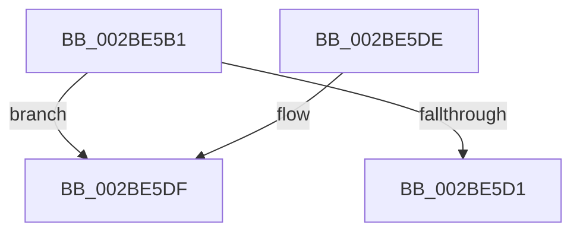

# sub_002BE5B1

- RVA: `0x002BE5B1`–`0x002BE5F9` (길이 `72` bytes)
- VA: `0x00000001402BE5B1`
- 실행 섹션: `.text`
- PDB 이름 있음: `아니요`; PDB Function 태그: `아니요`
- unwind 정보 RVA: `0x0006E37C`
- 디코드: `22`개 명령, `72/72` bytes 표시
- 미해석 바이트: `0` (있으면 어셈블리에 `.byte`로 보존)

> 이 문서는 커널 이미지의 기계어와 PDB 기호를 분석해 생성했습니다. 4번과 5번은 함수 원형과 자료형을 바이너리 사용 방식에서 추정한 C 해석이며 원본 소스 복구 결과는 아닙니다.

## 1. Dependencies

- 직접 호출 지점: **1**; 고유 호출 대상: **1**
- 직접 호출자로 확인된 함수: **0**
- RIP 상대 이미지 참조: **1**

### Outgoing calls
- `0x002BE5C4` → [MiLockSectionControlArea](MiLockSectionControlArea_function_002BC930.md) (function, `0x002BC930`)

### Direct callers
- 이 함수 시작 RVA로 연결되는 직접 call은 확인되지 않았습니다. 간접 호출은 완전히 역산할 수 없습니다.

### Static image references
- `0x002BE5E3` → RVA `0x00E30088` (`.data`; read)

## 2. Other-region calls and transfers

- 다른 실행 섹션으로 향하는 call: **0**
- call이 아닌 외부 분기/꼬리 이동: **1**
  - `0x002BE5F4` → [MmEnoughMemoryForWrite + 0x28](MmEnoughMemoryForWrite_function_002BE470.md) (`tail-transfer`)

## 3. Assembly (complete function range)

```asm
002BE5B1  44 0F 20 C0                     mov rax, cr8
002BE5B5  3C 02                           cmp al, 2
002BE5B7  4C 8D 44 24 50                  lea r8, [rsp + 0x50]
002BE5BC  BA 03 00 00 00                  mov edx, 3
002BE5C1  0F 45 D5                        cmovne edx, ebp
002BE5C4  E8 67 E3 FF FF                  call 0x1402bc930
002BE5C9  48 8B F0                        mov rsi, rax
002BE5CC  48 85 C0                        test rax, rax
002BE5CF  75 0E                           jne 0x1402be5df
002BE5D1  40 0F B6 C5                     movzx eax, bpl
002BE5D5  48 83 C4 28                     add rsp, 0x28
002BE5D9  5F                              pop rdi
002BE5DA  5E                              pop rsi
002BE5DB  5D                              pop rbp
002BE5DC  5B                              pop rbx
002BE5DD  C3                              ret
002BE5DE  CC                              int3
002BE5DF  0F B7 48 3C                     movzx ecx, word ptr [rax + 0x3c]
002BE5E3  48 8B 05 9E 1A B7 00            mov rax, qword ptr [rip + 0xb71a9e]
002BE5EA  81 E1 FF 03 00 00               and ecx, 0x3ff
002BE5F0  4C 8B 04 C8                     mov r8, qword ptr [rax + rcx*8]
002BE5F4  E9 9F FE FF FF                  jmp 0x1402be498
```

## 4. C-style interpretation (structured pseudocode)

```c
__int64 __fastcall sub_002BE5B1(__int64 a1, __int64 a2, __int64 a3, __int64 a4, __int64 a5, __int64 a6, __int64 a7, __int64 a8, __int64 a9, __int64 a10)
{
    __int64 result;
    __int64 v_rsp;

    a2 = 3;
    if (((unsigned __int8)(v_cr8)) != 2) { a2 = (unsigned int)(v_rbp); }
    result = MiLockSectionControlArea(a1, a2, a10, a4);
    if (result != 0) goto loc_002BE5DF;
    v_rsp = (v_rsp) + (40);
    return (unsigned __int8)(v_rbp);
loc_002BE5DF:
    a1 = (unsigned int)((*(unsigned __int16 *)((unsigned __int8)(v_rbp) + 60)) & (0x3FFULL));
}
```

## 5. (Beta) C Style

```c
int64_t sub_002BE5B1(int64_t Arg1, int64_t Arg2, int64_t Arg3, int64_t Arg4, uint64_t Arg5, uint64_t Arg6, uint64_t Arg7, uint64_t Arg8, uint64_t Arg9, int64_t Arg10)
{
    int64_t result;
    int64_t local_rsp;

    Arg2 = 3;
    if (((uint8_t)(v_cr8)) != 2) { Arg2 = (uint32_t)(local_rbp); }
    result = MiLockSectionControlArea(Arg1, Arg2, Arg10, Arg4);
    if (result != 0) goto loc_002BE5DF;
    local_rsp = (local_rsp) + (40);
    return (uint8_t)(local_rbp);
loc_002BE5DF:
    Arg1 = (uint32_t)((*(uint16_t *)((uint8_t)(local_rbp) + 0x3C)) & (0x3FFULL));
}
```

## 6. Execution-region graph

[열기: 2D/3D 그래프와 함수 탐색 컨트롤 패널](../../../control-panel.html?section=text&rva=0x002BE5B1&view=graph)

- 2D 그래프는 위에서 아래로 흐르고, 3D 그래프는 빈 공간을 드래그해 회전합니다. Shift+드래그는 이동, 휠은 확대·축소, 함수 노드 선택은 대상 보고서 이동입니다.

### Static fallback


