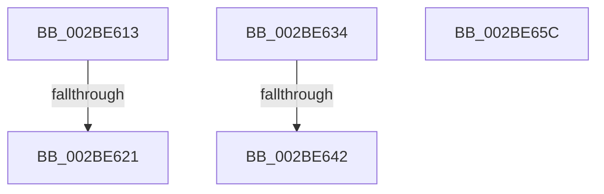

# sub_002BE613

- RVA: `0x002BE613`–`0x002BE65D` (길이 `74` bytes)
- VA: `0x00000001402BE613`
- 실행 섹션: `.text`
- PDB 이름 있음: `아니요`; PDB Function 태그: `아니요`
- unwind 정보 RVA: `0x0006E3B0`
- 디코드: `21`개 명령, `74/74` bytes 표시
- 미해석 바이트: `0` (있으면 어셈블리에 `.byte`로 보존)

> 이 문서는 커널 이미지의 기계어와 PDB 기호를 분석해 생성했습니다. 4번과 5번은 함수 원형과 자료형을 바이너리 사용 방식에서 추정한 C 해석이며 원본 소스 복구 결과는 아닙니다.

## 1. Dependencies

- 직접 호출 지점: **2**; 고유 호출 대상: **1**
- 직접 호출자로 확인된 함수: **0**
- RIP 상대 이미지 참조: **1**

### Outgoing calls
- `0x002BE62A` → [ExpReleaseSpinLockExclusiveFromDpcLevelInstrumented](../2C/ExpReleaseSpinLockExclusiveFromDpcLevelInstrumented_function_002C0F44.md) (function, `0x002C0F44`)
- `0x002BE64B` → [ExpReleaseSpinLockExclusiveFromDpcLevelInstrumented](../2C/ExpReleaseSpinLockExclusiveFromDpcLevelInstrumented_function_002C0F44.md) (function, `0x002C0F44`)

### Direct callers
- 이 함수 시작 RVA로 연결되는 직접 call은 확인되지 않았습니다. 간접 호출은 완전히 역산할 수 없습니다.

### Static image references
- `0x002BE613` → RVA `0x00F0DE58` (`.data`; read)

## 2. Other-region calls and transfers

- 다른 실행 섹션으로 향하는 call: **0**
- call이 아닌 외부 분기/꼬리 이동: **3**
  - `0x002BE61B` → [sub_002BE540 + 0x14](Unknown_function_002BE540.md) (`tail-transfer`)
  - `0x002BE62F` → [sub_002BE540 + 0x1B](Unknown_function_002BE540.md) (`tail-transfer`)
  - `0x002BE63C` → [sub_002BE540 + 0x55](Unknown_function_002BE540.md) (`tail-transfer`)

## 3. Assembly (complete function range)

```asm
002BE613  8B 05 3F F8 C4 00               mov eax, dword ptr [rip + 0xc4f83f]
002BE619  85 C0                           test eax, eax
002BE61B  0F 85 33 FF FF FF               jne 0x1402be554
002BE621  48 8B 54 24 48                  mov rdx, qword ptr [rsp + 0x48]
002BE626  48 8D 4E 48                     lea rcx, [rsi + 0x48]
002BE62A  E8 15 29 00 00                  call 0x1402c0f44
002BE62F  E9 27 FF FF FF                  jmp 0x1402be55b
002BE634  8B 05 1E F8 C4 00               mov eax, dword ptr [rip + 0xc4f81e]
002BE63A  85 C0                           test eax, eax
002BE63C  0F 85 53 FF FF FF               jne 0x1402be595
002BE642  48 8B 54 24 48                  mov rdx, qword ptr [rsp + 0x48]
002BE647  48 8D 4E 48                     lea rcx, [rsi + 0x48]
002BE64B  E8 F4 28 00 00                  call 0x1402c0f44
002BE650  0F B6 C3                        movzx eax, bl
002BE653  48 83 C4 28                     add rsp, 0x28
002BE657  5F                              pop rdi
002BE658  5E                              pop rsi
002BE659  5D                              pop rbp
002BE65A  5B                              pop rbx
002BE65B  C3                              ret
002BE65C  CC                              int3
```

## 4. C-style interpretation (structured pseudocode)

```c
__int64 __fastcall sub_002BE613(__int64 a1, __int64 a2, __int64 a3, __int64 a4, __int64 a5, __int64 a6, __int64 a7, __int64 a8, __int64 a9)
{
    __int64 result;
    unsigned __int64 v_stack_p48;

    result = ExpReleaseSpinLockExclusiveFromDpcLevelInstrumented(v_rsi + 72, a9, a3, a4);
}
```

## 5. (Beta) C Style

```c
int64_t sub_002BE613(int64_t Arg1, int64_t Arg2, int64_t Arg3, int64_t Arg4, uint64_t Arg5, uint64_t Arg6, uint64_t Arg7, uint64_t Arg8, int64_t Arg9)
{
    int64_t result;
    uint64_t v_stack_p48;

    result = ExpReleaseSpinLockExclusiveFromDpcLevelInstrumented(local_rsi + 72, Arg9, Arg3, Arg4);
}
```

## 6. Execution-region graph

[열기: 2D/3D 그래프와 함수 탐색 컨트롤 패널](../../../control-panel.html?section=text&rva=0x002BE613&view=graph)

- 2D 그래프는 위에서 아래로 흐르고, 3D 그래프는 빈 공간을 드래그해 회전합니다. Shift+드래그는 이동, 휠은 확대·축소, 함수 노드 선택은 대상 보고서 이동입니다.

### Static fallback


