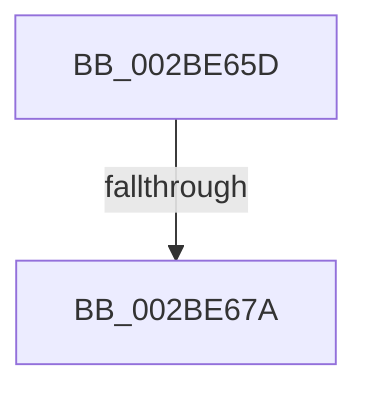

# sub_002BE65D

- RVA: `0x002BE65D`–`0x002BE699` (길이 `60` bytes)
- VA: `0x00000001402BE65D`
- 실행 섹션: `.text`
- PDB 이름 있음: `아니요`; PDB Function 태그: `아니요`
- unwind 정보 RVA: `0x0006E3C4`
- 디코드: `13`개 명령, `60/60` bytes 표시
- 미해석 바이트: `0` (있으면 어셈블리에 `.byte`로 보존)

> 이 문서는 커널 이미지의 기계어와 PDB 기호를 분석해 생성했습니다. 4번과 5번은 함수 원형과 자료형을 바이너리 사용 방식에서 추정한 C 해석이며 원본 소스 복구 결과는 아닙니다.

## 1. Dependencies

- 직접 호출 지점: **1**; 고유 호출 대상: **1**
- 직접 호출자로 확인된 함수: **0**
- RIP 상대 이미지 참조: **0**

### Outgoing calls
- `0x002BE682` → [MiSufficientAvailablePages](../36/MiSufficientAvailablePages_function_0036D0B0.md) (function, `0x0036D0B0`)

### Direct callers
- 이 함수 시작 RVA로 연결되는 직접 call은 확인되지 않았습니다. 간접 호출은 완전히 역산할 수 없습니다.

### Static image references
- 디코드된 RIP-relative 메모리 참조가 없습니다.

## 2. Other-region calls and transfers

- 다른 실행 섹션으로 향하는 call: **0**
- call이 아닌 외부 분기/꼬리 이동: **2**
  - `0x002BE674` → [sub_002BE4AF + 0x78](Unknown_function_002BE4AF.md) (`tail-transfer`)
  - `0x002BE694` → [sub_002BE4AF + 0x78](Unknown_function_002BE4AF.md) (`tail-transfer`)

## 3. Assembly (complete function range)

```asm
002BE65D  49 8B 90 C0 4B 00 00            mov rdx, qword ptr [r8 + 0x4bc0]
002BE664  49 8B 80 A0 4C 00 00            mov rax, qword ptr [r8 + 0x4ca0]
002BE66B  48 05 20 03 00 00               add rax, 0x320
002BE671  48 3B D0                        cmp rdx, rax
002BE674  0F 83 AD FE FF FF               jae 0x1402be527
002BE67A  BA 50 00 00 00                  mov edx, 0x50
002BE67F  49 8B C8                        mov rcx, r8
002BE682  E8 29 EA 0A 00                  call 0x14036d0b0
002BE687  85 C0                           test eax, eax
002BE689  0F B6 DB                        movzx ebx, bl
002BE68C  B8 01 00 00 00                  mov eax, 1
002BE691  0F 45 D8                        cmovne ebx, eax
002BE694  E9 8E FE FF FF                  jmp 0x1402be527
```

## 4. C-style interpretation (structured pseudocode)

```c
__int64 __fastcall sub_002BE65D(__int64 a1, __int64 a2, __int64 a3)
{
    __int64 result;
    __int64 v_rbx;

    result = (*(unsigned __int64 *)(a3 + 19616)) + (800);
    result = MiSufficientAvailablePages(a3, 80, a3, a4);
    v_rbx = (unsigned __int8)(v_rbx);
    if ((unsigned int)(result) != 0) { v_rbx = 1; }
}
```

## 5. (Beta) C Style

```c
int64_t sub_002BE65D(int64_t Arg1, int64_t Arg2, void *Arg3)
{
    uint8_t *arg3 = (uint8_t *)Arg3;

    int64_t result;
    int64_t local_rbx;

    result = (*(uint64_t *)(arg3 + 0x4CA0)) + (800);
    result = MiSufficientAvailablePages(Arg3, 80, Arg3, a4);
    local_rbx = (uint8_t)(local_rbx);
    if ((uint32_t)(result) != 0) { local_rbx = 1; }
}
```

### 관측된 메모리 오프셋

구조체 형식이 확인되지 않은 접근은 인자 기준의 오프셋으로만 기록했습니다.

| 기준 인자 | 오프셋 표현 | 폭 (bit) | 접근 |
|---|---:|---:|---|
| `Arg3` | `+ 0x4BC0` | `64` | `R` |
| `Arg3` | `+ 0x4CA0` | `64` | `R` |

## 6. Execution-region graph

[열기: 2D/3D 그래프와 함수 탐색 컨트롤 패널](../../../control-panel.html?section=text&rva=0x002BE65D&view=graph)

- 2D 그래프는 위에서 아래로 흐르고, 3D 그래프는 빈 공간을 드래그해 회전합니다. Shift+드래그는 이동, 휠은 확대·축소, 함수 노드 선택은 대상 보고서 이동입니다.

### Static fallback


