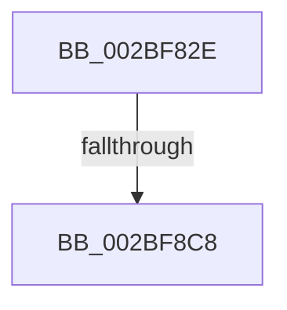

# sub_002BF82E

- RVA: `0x002BF82E`–`0x002BF8D5` (길이 `167` bytes)
- VA: `0x00000001402BF82E`
- 실행 섹션: `.text`
- PDB 이름 있음: `아니요`; PDB Function 태그: `아니요`
- unwind 정보 RVA: `0x0006E4C8`
- 디코드: `47`개 명령, `167/167` bytes 표시
- 미해석 바이트: `0` (있으면 어셈블리에 `.byte`로 보존)

> 이 문서는 커널 이미지의 기계어와 PDB 기호를 분석해 생성했습니다. 4번과 5번은 함수 원형과 자료형을 바이너리 사용 방식에서 추정한 C 해석이며 원본 소스 복구 결과는 아닙니다.

## 1. Dependencies

- 직접 호출 지점: **0**; 고유 호출 대상: **0**
- 직접 호출자로 확인된 함수: **0**
- RIP 상대 이미지 참조: **0**

### Outgoing calls
- 직접 디코드된 call 명령이 없습니다.

### Direct callers
- 이 함수 시작 RVA로 연결되는 직접 call은 확인되지 않았습니다. 간접 호출은 완전히 역산할 수 없습니다.

### Static image references
- 디코드된 RIP-relative 메모리 참조가 없습니다.

## 2. Other-region calls and transfers

- 다른 실행 섹션으로 향하는 call: **0**
- call이 아닌 외부 분기/꼬리 이동: **2**
  - `0x002BF8C6` → [sub_002BF8E2](Unknown_function_002BF8E2.md) (`tail-transfer`)
  - `0x002BF8D3` → [sub_002BF8ED + 0x29](Unknown_function_002BF8ED.md) (`tail-transfer`)

## 3. Assembly (complete function range)

```asm
002BF82E  48 89 7C 24 30                  mov qword ptr [rsp + 0x30], rdi
002BF833  41 8B BB A0 00 00 00            mov edi, dword ptr [r11 + 0xa0]
002BF83A  0F 43 D0                        cmovae edx, eax
002BF83D  45 33 C0                        xor r8d, r8d
002BF840  3B C8                           cmp ecx, eax
002BF842  41 8B 8B 9C 00 00 00            mov ecx, dword ptr [r11 + 0x9c]
002BF849  44 8B C9                        mov r9d, ecx
002BF84C  41 0F 94 C0                     sete r8b
002BF850  3B CA                           cmp ecx, edx
002BF852  44 0F 43 CA                     cmovae r9d, edx
002BF856  3B C8                           cmp ecx, eax
002BF858  8B CF                           mov ecx, edi
002BF85A  45 8D 50 01                     lea r10d, [r8 + 1]
002BF85E  45 0F 45 D0                     cmovne r10d, r8d
002BF862  41 3B F9                        cmp edi, r9d
002BF865  44 8B C3                        mov r8d, ebx
002BF868  41 0F 43 C9                     cmovae ecx, r9d
002BF86C  3B F8                           cmp edi, eax
002BF86E  41 8D 52 01                     lea edx, [r10 + 1]
002BF872  41 0F 45 D2                     cmovne edx, r10d
002BF876  3B D9                           cmp ebx, ecx
002BF878  44 0F 43 C1                     cmovae r8d, ecx
002BF87C  3B D8                           cmp ebx, eax
002BF87E  41 8B 8B A8 00 00 00            mov ecx, dword ptr [r11 + 0xa8]
002BF885  44 8B D1                        mov r10d, ecx
002BF888  44 8D 4A 01                     lea r9d, [rdx + 1]
002BF88C  44 0F 45 CA                     cmovne r9d, edx
002BF890  41 8B 93 AC 00 00 00            mov edx, dword ptr [r11 + 0xac]
002BF897  41 3B C8                        cmp ecx, r8d
002BF89A  8B DA                           mov ebx, edx
002BF89C  45 0F 43 D0                     cmovae r10d, r8d
002BF8A0  3B C8                           cmp ecx, eax
002BF8A2  45 8D 41 01                     lea r8d, [r9 + 1]
002BF8A6  45 0F 45 C1                     cmovne r8d, r9d
002BF8AA  41 3B D2                        cmp edx, r10d
002BF8AD  41 0F 43 DA                     cmovae ebx, r10d
002BF8B1  3B D0                           cmp edx, eax
002BF8B3  41 8D 48 01                     lea ecx, [r8 + 1]
002BF8B7  41 0F 45 C8                     cmovne ecx, r8d
002BF8BB  32 D2                           xor dl, dl
002BF8BD  41 B8 01 00 00 00               mov r8d, 1
002BF8C3  83 F9 05                        cmp ecx, 5
002BF8C6  74 1A                           je 0x1402bf8e2
002BF8C8  41 8B 43 04                     mov eax, dword ptr [r11 + 4]
002BF8CC  48 8B 7C 24 30                  mov rdi, qword ptr [rsp + 0x30]
002BF8D1  A8 04                           test al, 4
002BF8D3  75 41                           jne 0x1402bf916
```

## 4. C-style interpretation (structured pseudocode)

```c
__int64 __fastcall sub_002BF82E(int a1, __int64 a2, int a3, __int64 a4, __int64 a5, __int64 a6)
{
    __int64 v_r10;
    __int64 v_rbx;
    unsigned __int64 v_stack_p30;

    v_stack_p30 = v_rdi;
    if (condition_is_above_or_equal) { a2 = (unsigned int)(result); }
    a3 = 0;
    a3 = (a1 == ((unsigned int)(result))) ? 1 : 0;
    a4 = (unsigned int)((unsigned int)((unsigned int)(*(unsigned int *)(v_r11 + 156))));
    if (((unsigned int)((unsigned int)(*(unsigned int *)(v_r11 + 156)))) >= ((unsigned int)(a2))) { a4 = (unsigned int)(a2); }
    v_r10 = a3 + 1;
    if (((unsigned int)((unsigned int)(*(unsigned int *)(v_r11 + 156)))) != ((unsigned int)(result))) { v_r10 = a3; }
    a1 = (unsigned int)((unsigned int)((unsigned int)(*(unsigned int *)(v_r11 + 160))));
    if (((unsigned int)((unsigned int)(*(unsigned int *)(v_r11 + 160)))) >= ((unsigned int)(a4))) { a1 = (unsigned int)(a4); }
    a2 = v_r10 + 1;
    if (((unsigned int)((unsigned int)(*(unsigned int *)(v_r11 + 160)))) != ((unsigned int)(result))) { a2 = (unsigned int)(v_r10); }
    a3 = (unsigned int)((unsigned int)(v_rbx));
    if (((unsigned int)(v_rbx)) >= a1) { a3 = a1; }
    a4 = a2 + 1;
    if (((unsigned int)(v_rbx)) != ((unsigned int)(result))) { a4 = (unsigned int)(a2); }
    v_r10 = (unsigned int)((unsigned int)((unsigned int)(*(unsigned int *)(v_r11 + 168))));
    if (((unsigned int)((unsigned int)(*(unsigned int *)(v_r11 + 168)))) >= a3) { v_r10 = a3; }
    a3 = a4 + 1;
    if (((unsigned int)((unsigned int)(*(unsigned int *)(v_r11 + 168)))) != ((unsigned int)(result))) { a3 = (unsigned int)(a4); }
    v_rbx = (unsigned int)((unsigned int)((unsigned int)(*(unsigned int *)(v_r11 + 172))));
    if (((unsigned int)((unsigned int)(*(unsigned int *)(v_r11 + 172)))) >= ((unsigned int)(v_r10))) { v_rbx = (unsigned int)(v_r10); }
    a1 = a3 + 1;
    if (((unsigned int)((unsigned int)(*(unsigned int *)(v_r11 + 172)))) != ((unsigned int)(result))) { a1 = a3; }
    a2 = 0;
}
```

## 5. (Beta) C Style

```c
int64_t sub_002BF82E(int32_t Arg1, int64_t Arg2, int32_t Arg3, int64_t Arg4, uint64_t Arg5, int64_t Arg6)
{
    int64_t local_r10;
    int64_t local_rbx;
    uint64_t v_stack_p30;

    v_stack_p30 = local_rdi;
    if (condition_is_above_or_equal) { Arg2 = (uint32_t)(result); }
    Arg3 = 0;
    Arg3 = (Arg1 == ((uint32_t)(result))) ? 1 : 0;
    Arg4 = (uint32_t)((uint32_t)((uint32_t)(*(uint32_t *)(local_r11 + 0x9C))));
    if (((uint32_t)((uint32_t)(*(uint32_t *)(local_r11 + 0x9C)))) >= ((uint32_t)(Arg2))) { Arg4 = (uint32_t)(Arg2); }
    local_r10 = Arg3 + 1;
    if (((uint32_t)((uint32_t)(*(uint32_t *)(local_r11 + 0x9C)))) != ((uint32_t)(result))) { local_r10 = Arg3; }
    Arg1 = (uint32_t)((uint32_t)((uint32_t)(*(uint32_t *)(local_r11 + 0xA0))));
    if (((uint32_t)((uint32_t)(*(uint32_t *)(local_r11 + 0xA0)))) >= ((uint32_t)(Arg4))) { Arg1 = (uint32_t)(Arg4); }
    Arg2 = local_r10 + 1;
    if (((uint32_t)((uint32_t)(*(uint32_t *)(local_r11 + 0xA0)))) != ((uint32_t)(result))) { Arg2 = (uint32_t)(local_r10); }
    Arg3 = (uint32_t)((uint32_t)(local_rbx));
    if (((uint32_t)(local_rbx)) >= Arg1) { Arg3 = Arg1; }
    Arg4 = Arg2 + 1;
    if (((uint32_t)(local_rbx)) != ((uint32_t)(result))) { Arg4 = (uint32_t)(Arg2); }
    local_r10 = (uint32_t)((uint32_t)((uint32_t)(*(uint32_t *)(local_r11 + 0xA8))));
    if (((uint32_t)((uint32_t)(*(uint32_t *)(local_r11 + 0xA8)))) >= Arg3) { local_r10 = Arg3; }
    Arg3 = Arg4 + 1;
    if (((uint32_t)((uint32_t)(*(uint32_t *)(local_r11 + 0xA8)))) != ((uint32_t)(result))) { Arg3 = (uint32_t)(Arg4); }
    local_rbx = (uint32_t)((uint32_t)((uint32_t)(*(uint32_t *)(local_r11 + 0xAC))));
    if (((uint32_t)((uint32_t)(*(uint32_t *)(local_r11 + 0xAC)))) >= ((uint32_t)(local_r10))) { local_rbx = (uint32_t)(local_r10); }
    Arg1 = Arg3 + 1;
    if (((uint32_t)((uint32_t)(*(uint32_t *)(local_r11 + 0xAC)))) != ((uint32_t)(result))) { Arg1 = Arg3; }
    Arg2 = 0;
}
```

## 6. Execution-region graph

[열기: 2D/3D 그래프와 함수 탐색 컨트롤 패널](../../../control-panel.html?section=text&rva=0x002BF82E&view=graph)

- 2D 그래프는 위에서 아래로 흐르고, 3D 그래프는 빈 공간을 드래그해 회전합니다. Shift+드래그는 이동, 휠은 확대·축소, 함수 노드 선택은 대상 보고서 이동입니다.

### Static fallback


