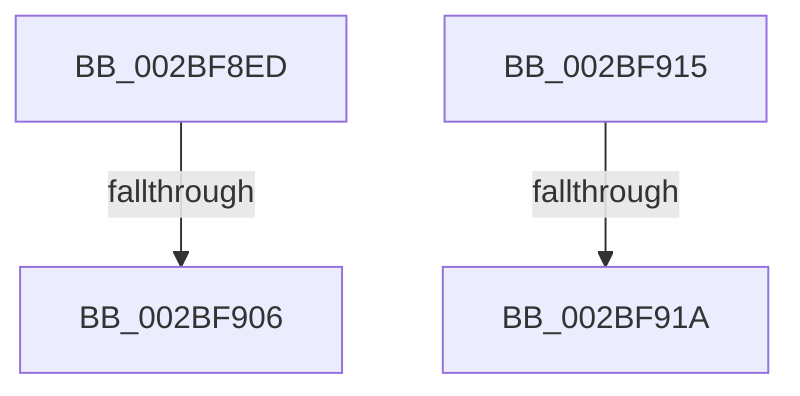

# sub_002BF8ED

- RVA: `0x002BF8ED`–`0x002BF92A` (길이 `61` bytes)
- VA: `0x00000001402BF8ED`
- 실행 섹션: `.text`
- PDB 이름 있음: `아니요`; PDB Function 태그: `아니요`
- unwind 정보 RVA: `0x0006E504`
- 디코드: `19`개 명령, `61/61` bytes 표시
- 미해석 바이트: `0` (있으면 어셈블리에 `.byte`로 보존)

> 이 문서는 커널 이미지의 기계어와 PDB 기호를 분석해 생성했습니다. 4번과 5번은 함수 원형과 자료형을 바이너리 사용 방식에서 추정한 C 해석이며 원본 소스 복구 결과는 아닙니다.

## 1. Dependencies

- 직접 호출 지점: **1**; 고유 호출 대상: **1**
- 직접 호출자로 확인된 함수: **0**
- RIP 상대 이미지 참조: **1**

### Outgoing calls
- `0x002BF908` → [PopPepArmIdleTimer](../2C/PopPepArmIdleTimer_function_002C0B9C.md) (function, `0x002C0B9C`)

### Direct callers
- 이 함수 시작 RVA로 연결되는 직접 call은 확인되지 않았습니다. 간접 호출은 완전히 역산할 수 없습니다.

### Static image references
- `0x002BF8F4` → RVA `0x00F07740` (`.data`; read/write)

## 2. Other-region calls and transfers

- 다른 실행 섹션으로 향하는 call: **0**
- call이 아닌 외부 분기/꼬리 이동: **3**
  - `0x002BF904` → [sub_002BF8D5 + 0x4](Unknown_function_002BF8D5.md) (`tail-transfer`)
  - `0x002BF918` → [sub_002BF8D5 + 0x4](Unknown_function_002BF8D5.md) (`tail-transfer`)
  - `0x002BF928` → [sub_002BF8D5 + 0x4](Unknown_function_002BF8D5.md) (`tail-transfer`)

## 3. Assembly (complete function range)

```asm
002BF8ED  83 C8 04                        or eax, 4
002BF8F0  41 89 43 04                     mov dword ptr [r11 + 4], eax
002BF8F4  F0 44 0F C1 05 43 7E C4 00      lock xadd dword ptr [rip + 0xc47e43], r8d
002BF8FD  41 FF C0                        inc r8d
002BF900  41 83 F8 01                     cmp r8d, 1
002BF904  75 D3                           jne 0x1402bf8d9
002BF906  33 C9                           xor ecx, ecx
002BF908  E8 8F 12 00 00                  call 0x1402c0b9c
002BF90D  8B C3                           mov eax, ebx
002BF90F  48 83 C4 20                     add rsp, 0x20
002BF913  5B                              pop rbx
002BF914  C3                              ret
002BF915  CC                              int3
002BF916  84 D2                           test dl, dl
002BF918  75 BF                           jne 0x1402bf8d9
002BF91A  83 E0 FB                        and eax, 0xfffffffb
002BF91D  41 89 43 04                     mov dword ptr [r11 + 4], eax
002BF921  F0 FF 0D 18 7E C4 00            lock dec dword ptr [rip + 0xc47e18]
002BF928  EB AF                           jmp 0x1402bf8d9
```

## 4. C-style interpretation (structured pseudocode)

```c
__int64 __fastcall sub_002BF8ED(int a1, unsigned __int8 a2, int a3)
{
    __int64 result;
    __int64 v_rsp;

    result = (unsigned int)((result) | (4));
    *(unsigned int *)(v_r11 + 4) = (unsigned int)(result);
    a3 = (unsigned int)((a3) + 1);
    a1 = 0;
    result = PopPepArmIdleTimer(a1, a2, a3, a4);
    v_rsp = (v_rsp) + (32);
    return (unsigned int)((unsigned int)(v_rbx));
}
```

## 5. (Beta) C Style

```c
int64_t sub_002BF8ED(int32_t Arg1, uint8_t Arg2, int32_t Arg3)
{
    int64_t result;
    int64_t local_rsp;

    result = (uint32_t)((result) | (4));
    *(uint32_t *)(local_r11 + 0x4) = (uint32_t)(result);
    Arg3 = (uint32_t)((Arg3) + 1);
    Arg1 = 0;
    result = PopPepArmIdleTimer(Arg1, Arg2, Arg3, a4);
    local_rsp = (local_rsp) + (32);
    return (uint32_t)((uint32_t)(local_rbx));
}
```

## 6. Execution-region graph

[열기: 2D/3D 그래프와 함수 탐색 컨트롤 패널](../../../control-panel.html?section=text&rva=0x002BF8ED&view=graph)

- 2D 그래프는 위에서 아래로 흐르고, 3D 그래프는 빈 공간을 드래그해 회전합니다. Shift+드래그는 이동, 휠은 확대·축소, 함수 노드 선택은 대상 보고서 이동입니다.

### Static fallback


