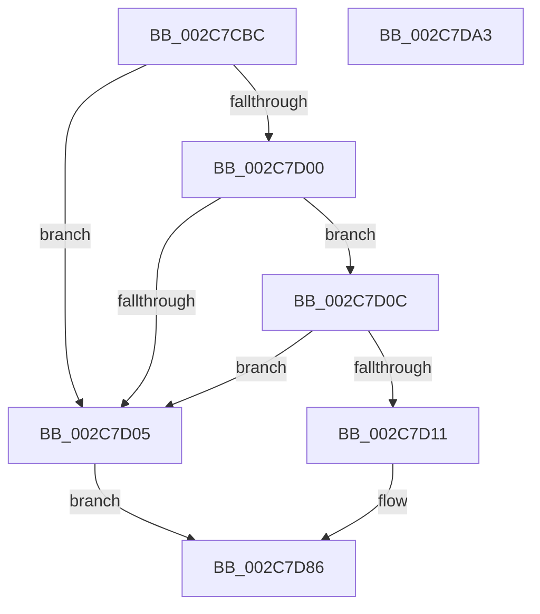

# AccelBuildDescriptorMemoryFill

- RVA: `0x002C7CBC`–`0x002C7DA4` (길이 `232` bytes)
- VA: `0x00000001402C7CBC`
- 실행 섹션: `.text`
- PDB 이름 있음: `예`; PDB Function 태그: `아니요`
- unwind 정보 RVA: `0x0006EE68`
- 디코드: `64`개 명령, `232/232` bytes 표시
- 미해석 바이트: `0` (있으면 어셈블리에 `.byte`로 보존)

> 이 문서는 커널 이미지의 기계어와 PDB 기호를 분석해 생성했습니다. 4번과 5번은 함수 원형과 자료형을 바이너리 사용 방식에서 추정한 C 해석이며 원본 소스 복구 결과는 아닙니다.

## 1. Dependencies

- 직접 호출 지점: **4**; 고유 호출 대상: **2**
- 직접 호출자로 확인된 함수: **4**
- RIP 상대 이미지 참조: **0**

### Outgoing calls
- `0x002C7CF6` → [memset](../6C/memset_function_006C6C40.md) (function, `0x006C6C40`)
- `0x002C7D25` → [memset](../6C/memset_function_006C6C40.md) (function, `0x006C6C40`)
- `0x002C7D3E` → [memset](../6C/memset_function_006C6C40.md) (function, `0x006C6C40`)
- `0x002C7D81` → [AccelpInternalOperationHandler](AccelpInternalOperationHandler_function_002C7DAC.md) (function, `0x002C7DAC`)

### Direct callers
- [MiFillMemory](MiFillMemory_function_002C7BD0.md) at `0x002C7C42`
- [AccelFillMemory](AccelFillMemory_function_002C7C7C.md) at `0x002C7C93`
- [sub_003327E9](../33/Unknown_function_003327E9.md) at `0x00332801`
- [sub_00332A20](../33/Unknown_function_00332A20.md) at `0x00332A38`

### Static image references
- 디코드된 RIP-relative 메모리 참조가 없습니다.

## 2. Other-region calls and transfers

- 다른 실행 섹션으로 향하는 call: **0**
- 별도 외부 분기/꼬리 이동을 확인하지 못했습니다.

## 3. Assembly (complete function range)

```asm
002C7CBC  48 8B C4                        mov rax, rsp
002C7CBF  48 89 58 08                     mov qword ptr [rax + 8], rbx
002C7CC3  48 89 70 10                     mov qword ptr [rax + 0x10], rsi
002C7CC7  48 89 78 18                     mov qword ptr [rax + 0x18], rdi
002C7CCB  4C 89 70 20                     mov qword ptr [rax + 0x20], r14
002C7CCF  55                              push rbp
002C7CD0  48 8D 68 A9                     lea rbp, [rax - 0x57]
002C7CD4  48 81 EC 90 00 00 00            sub rsp, 0x90
002C7CDB  33 C0                           xor eax, eax
002C7CDD  49 8B F8                        mov rdi, r8
002C7CE0  48 8B F2                        mov rsi, rdx
002C7CE3  89 45 E3                        mov dword ptr [rbp - 0x1d], eax
002C7CE6  48 8B D9                        mov rbx, rcx
002C7CE9  33 D2                           xor edx, edx
002C7CEB  48 8D 4D DF                     lea rcx, [rbp - 0x21]
002C7CEF  4D 8B F1                        mov r14, r9
002C7CF2  44 8D 40 6C                     lea r8d, [rax + 0x6c]
002C7CF6  E8 45 EF 3F 00                  call 0x1406c6c40
002C7CFB  48 85 DB                        test rbx, rbx
002C7CFE  74 05                           je 0x1402c7d05
002C7D00  48 85 F6                        test rsi, rsi
002C7D03  75 07                           jne 0x1402c7d0c
002C7D05  B8 0D 00 00 C0                  mov eax, 0xc000000d
002C7D0A  EB 7A                           jmp 0x1402c7d86
002C7D0C  48 85 FF                        test rdi, rdi
002C7D0F  74 F4                           je 0x1402c7d05
002C7D11  48 8B 03                        mov rax, qword ptr [rbx]
002C7D14  33 D2                           xor edx, edx
002C7D16  48 8B 48 10                     mov rcx, qword ptr [rax + 0x10]
002C7D1A  44 8B 81 0C 01 00 00            mov r8d, dword ptr [rcx + 0x10c]
002C7D21  48 8B 4B 18                     mov rcx, qword ptr [rbx + 0x18]
002C7D25  E8 16 EF 3F 00                  call 0x1406c6c40
002C7D2A  48 8B 03                        mov rax, qword ptr [rbx]
002C7D2D  33 D2                           xor edx, edx
002C7D2F  48 8B 48 10                     mov rcx, qword ptr [rax + 0x10]
002C7D33  44 8B 81 10 01 00 00            mov r8d, dword ptr [rcx + 0x110]
002C7D3A  48 8B 4B 20                     mov rcx, qword ptr [rbx + 0x20]
002C7D3E  E8 FD EE 3F 00                  call 0x1406c6c40
002C7D43  48 8B 03                        mov rax, qword ptr [rbx]
002C7D46  48 8D 4D DF                     lea rcx, [rbp - 0x21]
002C7D4A  48 89 45 E7                     mov qword ptr [rbp - 0x19], rax
002C7D4E  33 D2                           xor edx, edx
002C7D50  8B 43 10                        mov eax, dword ptr [rbx + 0x10]
002C7D53  89 45 EF                        mov dword ptr [rbp - 0x11], eax
002C7D56  48 8B 43 18                     mov rax, qword ptr [rbx + 0x18]
002C7D5A  48 89 45 F7                     mov qword ptr [rbp - 9], rax
002C7D5E  48 8B 43 20                     mov rax, qword ptr [rbx + 0x20]
002C7D62  48 89 45 FF                     mov qword ptr [rbp - 1], rax
002C7D66  48 8B 45 7F                     mov rax, qword ptr [rbp + 0x7f]
002C7D6A  48 89 45 07                     mov qword ptr [rbp + 7], rax
002C7D6E  C7 45 DF 06 00 00 00            mov dword ptr [rbp - 0x21], 6
002C7D75  48 89 75 0F                     mov qword ptr [rbp + 0xf], rsi
002C7D79  48 89 7D 17                     mov qword ptr [rbp + 0x17], rdi
002C7D7D  4C 89 75 1F                     mov qword ptr [rbp + 0x1f], r14
002C7D81  E8 26 00 00 00                  call 0x1402c7dac
002C7D86  4C 8D 9C 24 90 00 00 00         lea r11, [rsp + 0x90]
002C7D8E  49 8B 5B 10                     mov rbx, qword ptr [r11 + 0x10]
002C7D92  49 8B 73 18                     mov rsi, qword ptr [r11 + 0x18]
002C7D96  49 8B 7B 20                     mov rdi, qword ptr [r11 + 0x20]
002C7D9A  4D 8B 73 28                     mov r14, qword ptr [r11 + 0x28]
002C7D9E  49 8B E3                        mov rsp, r11
002C7DA1  5D                              pop rbp
002C7DA2  C3                              ret
002C7DA3  CC                              int3
```

## 4. C-style interpretation (structured pseudocode)

```c
__int64 __fastcall AccelBuildDescriptorMemoryFill(__int64 a1, __int64 a2, __int64 a3, __int64 a4)
{
    __int64 result;
    __int64 v_rsp;
    unsigned __int64 v_stack_m8;

    *(unsigned __int64 *)(v_rsp + 8) = v_rbx;
    *(unsigned __int64 *)(v_rsp + 16) = v_rsi;
    *(unsigned __int64 *)(v_rsp + 24) = v_rdi;
    *(unsigned __int64 *)(v_rsp + 32) = v_r14;
    v_rsp = (v_rsp) - (144);
    result = 0;
    *(unsigned int *)(v_rsp - 87 - 29) = 0;
    a2 = 0;
    result = memset(v_rsp - 87 - 33, a2, result + 108, a4);
    if (a1 == 0) goto loc_002C7D05;
    if (0 != 0) goto loc_002C7D0C;
loc_002C7D05:
    goto loc_002C7D86;
loc_002C7D0C:
    if (a3 == 0) goto loc_002C7D05;
    a2 = 0;
    result = memset(*(unsigned __int64 *)(a1 + 24), a2, (unsigned int)(*(unsigned int *)(*(unsigned __int64 *)(*(unsigned __int64 *)(a1) + 16) + 268)), a4);
    a2 = 0;
    result = memset(*(unsigned __int64 *)(a1 + 32), a2, (unsigned int)(*(unsigned int *)(*(unsigned __int64 *)(*(unsigned __int64 *)(a1) + 16) + 272)), a4);
    *(unsigned __int64 *)(v_rsp - 87 - 25) = *(unsigned __int64 *)(a1);
    a2 = 0;
    *(unsigned int *)(v_rsp - 87 - 17) = (unsigned int)((unsigned int)(*(unsigned int *)(a1 + 16)));
    *(unsigned __int64 *)(v_rsp - 87 - 9) = *(unsigned __int64 *)(a1 + 24);
    *(unsigned __int64 *)(v_rsp - 87 - 1) = *(unsigned __int64 *)(a1 + 32);
    *(unsigned __int64 *)(v_rsp - 87 + 7) = *(unsigned __int64 *)(v_rsp - 87 + 127);
    *(unsigned int *)(v_rsp - 87 - 33) = 6;
    *(unsigned __int64 *)(v_rsp - 87 + 15) = 0;
    *(unsigned __int64 *)(v_rsp - 87 + 23) = a3;
    *(unsigned __int64 *)(v_rsp - 87 + 31) = a4;
    result = AccelpInternalOperationHandler(v_rsp - 87 - 33, a2, (unsigned int)(*(unsigned int *)(*(unsigned __int64 *)(*(unsigned __int64 *)(a1) + 16) + 272)), a4);
loc_002C7D86:
    return result;
}
```

## 5. (Beta) C Style

```c
int64_t AccelBuildDescriptorMemoryFill(int64_t Arg1, int64_t Arg2, int64_t Arg3, int64_t Arg4)
{
    int64_t result;
    int64_t local_rsp;
    uint64_t v_stack_m8;

    *(uint64_t *)(local_rsp + 0x8) = local_rbx;
    *(uint64_t *)(local_rsp + 0x10) = local_rsi;
    *(uint64_t *)(local_rsp + 0x18) = local_rdi;
    *(uint64_t *)(local_rsp + 0x20) = local_r14;
    local_rsp = (local_rsp) - (144);
    result = 0;
    *(uint32_t *)(local_rsp - 0x57 - 0x1D) = 0;
    Arg2 = 0;
    result = memset(local_rsp - 87 - 33, Arg2, result + 108, Arg4);
    if (Arg1 == 0) goto loc_002C7D05;
    if (0 != 0) goto loc_002C7D0C;
loc_002C7D05:
    goto loc_002C7D86;
loc_002C7D0C:
    if (Arg3 == 0) goto loc_002C7D05;
    Arg2 = 0;
    result = memset(*(uint64_t *)(Arg1 + 0x18), Arg2, (uint32_t)(*(uint32_t *)(*(uint64_t *)(*(uint64_t *)(Arg1) + 0x10) + 0x10C)), Arg4);
    Arg2 = 0;
    result = memset(*(uint64_t *)(Arg1 + 0x20), Arg2, (uint32_t)(*(uint32_t *)(*(uint64_t *)(*(uint64_t *)(Arg1) + 0x10) + 0x110)), Arg4);
    *(uint64_t *)(local_rsp - 0x57 - 0x19) = *(uint64_t *)(Arg1);
    Arg2 = 0;
    *(uint32_t *)(local_rsp - 0x57 - 0x11) = (uint32_t)((uint32_t)(*(uint32_t *)(Arg1 + 0x10)));
    *(uint64_t *)(local_rsp - 0x57 - 0x9) = *(uint64_t *)(Arg1 + 0x18);
    *(uint64_t *)(local_rsp - 0x57 - 0x1) = *(uint64_t *)(Arg1 + 0x20);
    *(uint64_t *)(local_rsp - 0x57 + 0x7) = *(uint64_t *)(local_rsp - 0x57 + 0x7F);
    *(uint32_t *)(local_rsp - 0x57 - 0x21) = 6;
    *(uint64_t *)(local_rsp - 0x57 + 0xF) = 0;
    *(uint64_t *)(local_rsp - 0x57 + 0x17) = Arg3;
    *(uint64_t *)(local_rsp - 0x57 + 0x1F) = Arg4;
    result = AccelpInternalOperationHandler(local_rsp - 87 - 33, Arg2, (uint32_t)(*(uint32_t *)(*(uint64_t *)(*(uint64_t *)(Arg1) + 0x10) + 0x110)), Arg4);
loc_002C7D86:
    return result;
}
```

## 6. Execution-region graph

[열기: 2D/3D 그래프와 함수 탐색 컨트롤 패널](../../../control-panel.html?section=text&rva=0x002C7CBC&view=graph)

- 2D 그래프는 위에서 아래로 흐르고, 3D 그래프는 빈 공간을 드래그해 회전합니다. Shift+드래그는 이동, 휠은 확대·축소, 함수 노드 선택은 대상 보고서 이동입니다.

### Static fallback


