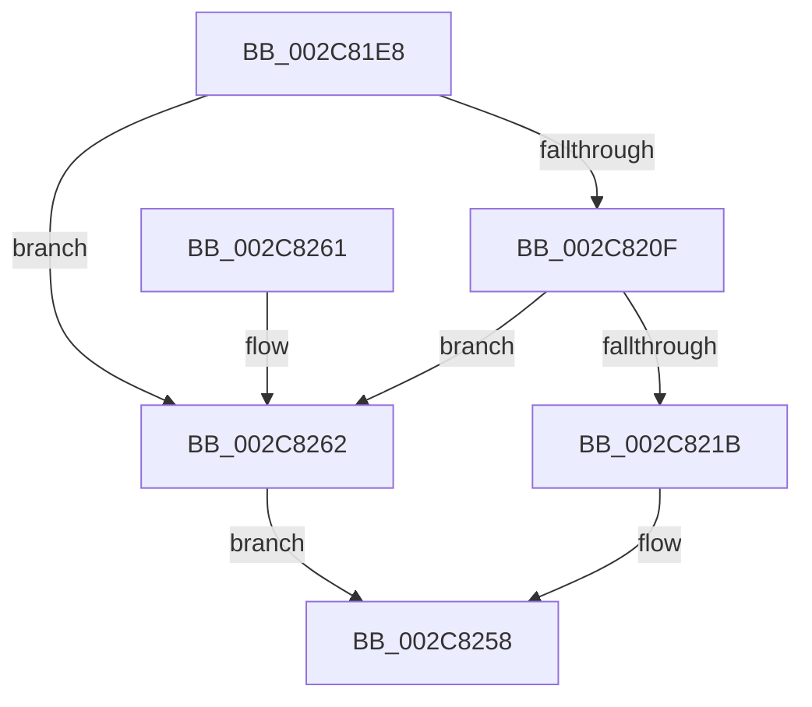

# AccelSubmitWorkAsync

- RVA: `0x002C81E8`–`0x002C8269` (길이 `129` bytes)
- VA: `0x00000001402C81E8`
- 실행 섹션: `.text`
- PDB 이름 있음: `예`; PDB Function 태그: `아니요`
- unwind 정보 RVA: `0x0006EE3C`
- 디코드: `34`개 명령, `129/129` bytes 표시
- 미해석 바이트: `0` (있으면 어셈블리에 `.byte`로 보존)

> 이 문서는 커널 이미지의 기계어와 PDB 기호를 분석해 생성했습니다. 4번과 5번은 함수 원형과 자료형을 바이너리 사용 방식에서 추정한 C 해석이며 원본 소스 복구 결과는 아닙니다.

## 1. Dependencies

- 직접 호출 지점: **2**; 고유 호출 대상: **2**
- 직접 호출자로 확인된 함수: **1**
- RIP 상대 이미지 참조: **0**

### Outgoing calls
- `0x002C8205` → [memset](../6C/memset_function_006C6C40.md) (function, `0x006C6C40`)
- `0x002C8253` → [AccelpInternalOperationHandler](AccelpInternalOperationHandler_function_002C7DAC.md) (function, `0x002C7DAC`)

### Direct callers
- [AccelpSubmitWork](AccelpSubmitWork_function_002C8190.md) at `0x002C81B8`
- [AccelpSubmitWork](AccelpSubmitWork_function_002C8190.md) at `0x002C81DA`

### Static image references
- 디코드된 RIP-relative 메모리 참조가 없습니다.

## 2. Other-region calls and transfers

- 다른 실행 섹션으로 향하는 call: **0**
- 별도 외부 분기/꼬리 이동을 확인하지 못했습니다.

## 3. Assembly (complete function range)

```asm
002C81E8  40 53                           push rbx
002C81EA  48 81 EC 90 00 00 00            sub rsp, 0x90
002C81F1  33 C0                           xor eax, eax
002C81F3  48 8B D9                        mov rbx, rcx
002C81F6  33 D2                           xor edx, edx
002C81F8  89 44 24 24                     mov dword ptr [rsp + 0x24], eax
002C81FC  48 8D 4C 24 20                  lea rcx, [rsp + 0x20]
002C8201  44 8D 40 6C                     lea r8d, [rax + 0x6c]
002C8205  E8 36 EA 3F 00                  call 0x1406c6c40
002C820A  48 85 DB                        test rbx, rbx
002C820D  74 53                           je 0x1402c8262
002C820F  48 8B 03                        mov rax, qword ptr [rbx]
002C8212  48 8B 48 20                     mov rcx, qword ptr [rax + 0x20]
002C8216  48 85 C9                        test rcx, rcx
002C8219  74 47                           je 0x1402c8262
002C821B  48 83 64 24 48 00               and qword ptr [rsp + 0x48], 0
002C8221  33 D2                           xor edx, edx
002C8223  48 89 44 24 28                  mov qword ptr [rsp + 0x28], rax
002C8228  8B 43 10                        mov eax, dword ptr [rbx + 0x10]
002C822B  89 44 24 30                     mov dword ptr [rsp + 0x30], eax
002C822F  48 8B 43 18                     mov rax, qword ptr [rbx + 0x18]
002C8233  48 89 44 24 38                  mov qword ptr [rsp + 0x38], rax
002C8238  48 8B 43 20                     mov rax, qword ptr [rbx + 0x20]
002C823C  48 89 4C 24 50                  mov qword ptr [rsp + 0x50], rcx
002C8241  48 8D 4C 24 20                  lea rcx, [rsp + 0x20]
002C8246  48 89 44 24 40                  mov qword ptr [rsp + 0x40], rax
002C824B  C7 44 24 20 01 00 00 00         mov dword ptr [rsp + 0x20], 1
002C8253  E8 54 FB FF FF                  call 0x1402c7dac
002C8258  48 81 C4 90 00 00 00            add rsp, 0x90
002C825F  5B                              pop rbx
002C8260  C3                              ret
002C8261  CC                              int3
002C8262  B8 0D 00 00 C0                  mov eax, 0xc000000d
002C8267  EB EF                           jmp 0x1402c8258
```

## 4. C-style interpretation (structured pseudocode)

```c
__int64 __fastcall AccelSubmitWorkAsync(__int64 a1, int a2)
{
    __int64 result;
    __int64 v_rsp;
    unsigned __int64 v_stack_m48;
    unsigned __int64 v_stack_m50;
    unsigned __int64 v_stack_m58;
    unsigned __int64 v_stack_m60;
    unsigned int v_stack_m68;
    unsigned __int64 v_stack_m70;
    unsigned int v_stack_m74;
    unsigned __int64 v_stack_m78;

    v_rsp = (v_rsp) - (144);
    result = 0;
    a2 = 0;
    v_stack_m74 = 0;
    result = memset(v_stack_m78, a2, result + 108, a4);
    if (a1 == 0) goto loc_002C8262;
    if (*(unsigned __int64 *)(*(unsigned __int64 *)(a1) + 32) == 0) goto loc_002C8262;
    a2 = 0;
    v_stack_m70 = *(unsigned __int64 *)(a1);
    v_stack_m68 = (unsigned int)((unsigned int)(*(unsigned int *)(a1 + 16)));
    v_stack_m60 = *(unsigned __int64 *)(a1 + 24);
    v_stack_m48 = *(unsigned __int64 *)(*(unsigned __int64 *)(a1) + 32);
    v_stack_m58 = *(unsigned __int64 *)(a1 + 32);
    v_stack_m78 = 1;
    result = AccelpInternalOperationHandler(v_stack_m78, a2, result + 108, a4);
loc_002C8258:
    v_rsp = (v_rsp) + (144);
    return result;
loc_002C8262:
    goto loc_002C8258;
}
```

## 5. (Beta) C Style

```c
int64_t AccelSubmitWorkAsync(int64_t Arg1, int32_t Arg2)
{
    int64_t result;
    int64_t local_rsp;
    uint64_t v_stack_m48;
    uint64_t v_stack_m50;
    uint64_t v_stack_m58;
    uint64_t v_stack_m60;
    uint32_t v_stack_m68;
    uint64_t v_stack_m70;
    uint32_t v_stack_m74;
    uint64_t v_stack_m78;

    local_rsp = (local_rsp) - (144);
    result = 0;
    Arg2 = 0;
    v_stack_m74 = 0;
    result = memset(v_stack_m78, Arg2, result + 108, a4);
    if (Arg1 == 0) goto loc_002C8262;
    if (*(uint64_t *)(*(uint64_t *)(Arg1) + 0x20) == 0) goto loc_002C8262;
    Arg2 = 0;
    v_stack_m70 = *(uint64_t *)(Arg1);
    v_stack_m68 = (uint32_t)((uint32_t)(*(uint32_t *)(Arg1 + 0x10)));
    v_stack_m60 = *(uint64_t *)(Arg1 + 0x18);
    v_stack_m48 = *(uint64_t *)(*(uint64_t *)(Arg1) + 0x20);
    v_stack_m58 = *(uint64_t *)(Arg1 + 0x20);
    v_stack_m78 = 1;
    result = AccelpInternalOperationHandler(v_stack_m78, Arg2, result + 108, a4);
loc_002C8258:
    local_rsp = (local_rsp) + (144);
    return result;
loc_002C8262:
    goto loc_002C8258;
}
```

## 6. Execution-region graph

[열기: 2D/3D 그래프와 함수 탐색 컨트롤 패널](../../../control-panel.html?section=text&rva=0x002C81E8&view=graph)

- 2D 그래프는 위에서 아래로 흐르고, 3D 그래프는 빈 공간을 드래그해 회전합니다. Shift+드래그는 이동, 휠은 확대·축소, 함수 노드 선택은 대상 보고서 이동입니다.

### Static fallback


