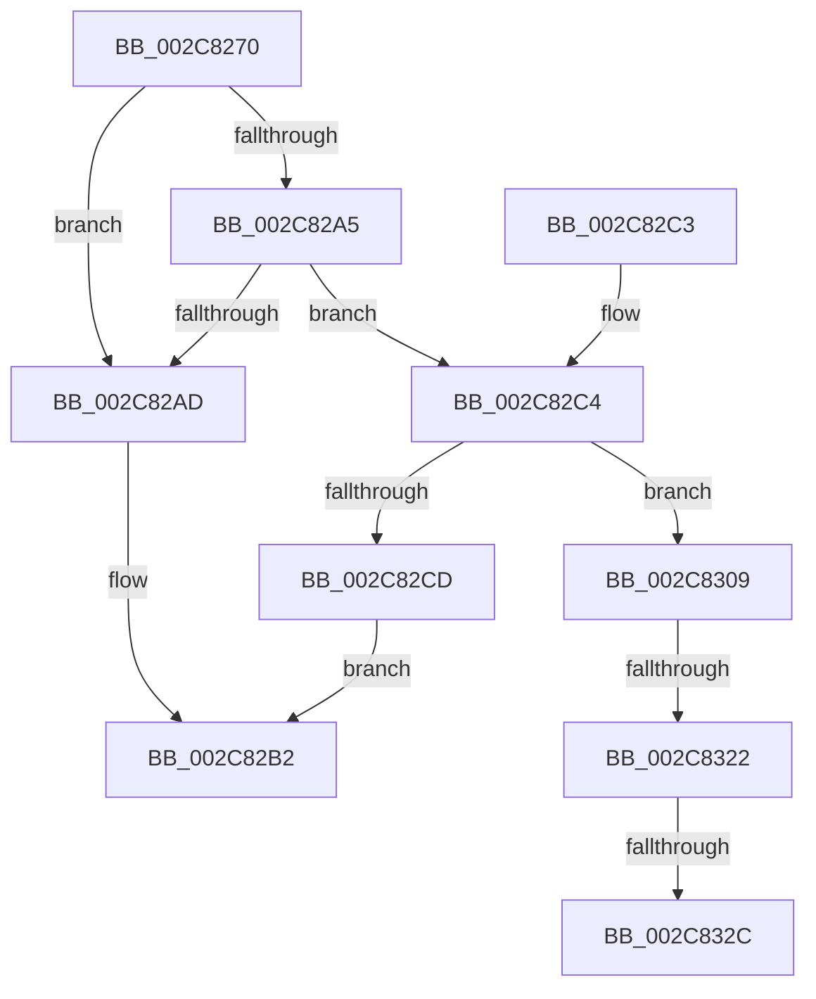

# AccelWaitForWorkCompletion

- RVA: `0x002C8270`–`0x002C8331` (길이 `193` bytes)
- VA: `0x00000001402C8270`
- 실행 섹션: `.text`
- PDB 이름 있음: `예`; PDB Function 태그: `예`
- unwind 정보 RVA: `0x0006EEE0`
- 디코드: `47`개 명령, `193/193` bytes 표시
- 미해석 바이트: `0` (있으면 어셈블리에 `.byte`로 보존)

> 이 문서는 커널 이미지의 기계어와 PDB 기호를 분석해 생성했습니다. 4번과 5번은 함수 원형과 자료형을 바이너리 사용 방식에서 추정한 C 해석이며 원본 소스 복구 결과는 아닙니다.

## 1. Dependencies

- 직접 호출 지점: **2**; 고유 호출 대상: **2**
- 직접 호출자로 확인된 함수: **2**
- RIP 상대 이미지 참조: **0**

### Outgoing calls
- `0x002C8299` → [memset](../6C/memset_function_006C6C40.md) (function, `0x006C6C40`)
- `0x002C8302` → [AccelpInternalOperationHandler](AccelpInternalOperationHandler_function_002C7DAC.md) (function, `0x002C7DAC`)

### Direct callers
- [AccelpSubmitWork](AccelpSubmitWork_function_002C8190.md) at `0x002C81C7`
- [SmHwAcceleratorWaitForRequest](../61/SmHwAcceleratorWaitForRequest_function_00611A7C.md) at `0x00611ACC`

### Static image references
- 디코드된 RIP-relative 메모리 참조가 없습니다.

## 2. Other-region calls and transfers

- 다른 실행 섹션으로 향하는 call: **0**
- call이 아닌 외부 분기/꼬리 이동: **3**
  - `0x002C831C` → [sub_006DC984](../6D/Unknown_function_006DC984.md) (`tail-transfer`)
  - `0x002C8326` → [sub_006DC984](../6D/Unknown_function_006DC984.md) (`tail-transfer`)
  - `0x002C832C` → [sub_006DC984 + 0x13](../6D/Unknown_function_006DC984.md) (`tail-transfer`)

## 3. Assembly (complete function range)

```asm
002C8270  48 89 5C 24 08                  mov qword ptr [rsp + 8], rbx
002C8275  48 89 54 24 10                  mov qword ptr [rsp + 0x10], rdx
002C827A  57                              push rdi
002C827B  48 81 EC 90 00 00 00            sub rsp, 0x90
002C8282  33 C0                           xor eax, eax
002C8284  41 8B F8                        mov edi, r8d
002C8287  48 8B D9                        mov rbx, rcx
002C828A  89 44 24 24                     mov dword ptr [rsp + 0x24], eax
002C828E  33 D2                           xor edx, edx
002C8290  48 8D 4C 24 20                  lea rcx, [rsp + 0x20]
002C8295  44 8D 40 6C                     lea r8d, [rax + 0x6c]
002C8299  E8 A2 E9 3F 00                  call 0x1406c6c40
002C829E  33 D2                           xor edx, edx
002C82A0  48 85 DB                        test rbx, rbx
002C82A3  74 08                           je 0x1402c82ad
002C82A5  F7 C7 FC FF FF FF               test edi, 0xfffffffc
002C82AB  74 17                           je 0x1402c82c4
002C82AD  B8 0D 00 00 C0                  mov eax, 0xc000000d
002C82B2  48 8B 9C 24 A0 00 00 00         mov rbx, qword ptr [rsp + 0xa0]
002C82BA  48 81 C4 90 00 00 00            add rsp, 0x90
002C82C1  5F                              pop rdi
002C82C2  C3                              ret
002C82C3  CC                              int3
002C82C4  48 8B 03                        mov rax, qword ptr [rbx]
002C82C7  40 F6 C7 01                     test dil, 1
002C82CB  75 3C                           jne 0x1402c8309
002C82CD  48 89 44 24 28                  mov qword ptr [rsp + 0x28], rax
002C82D2  48 8D 4C 24 20                  lea rcx, [rsp + 0x20]
002C82D7  8B 43 10                        mov eax, dword ptr [rbx + 0x10]
002C82DA  89 44 24 30                     mov dword ptr [rsp + 0x30], eax
002C82DE  48 8B 43 18                     mov rax, qword ptr [rbx + 0x18]
002C82E2  48 89 44 24 38                  mov qword ptr [rsp + 0x38], rax
002C82E7  48 8B 43 20                     mov rax, qword ptr [rbx + 0x20]
002C82EB  48 89 44 24 40                  mov qword ptr [rsp + 0x40], rax
002C82F0  C7 44 24 20 02 00 00 00         mov dword ptr [rsp + 0x20], 2
002C82F8  48 89 7C 24 48                  mov qword ptr [rsp + 0x48], rdi
002C82FD  48 89 54 24 50                  mov qword ptr [rsp + 0x50], rdx
002C8302  E8 A5 FA FF FF                  call 0x1402c7dac
002C8307  EB A9                           jmp 0x1402c82b2
002C8309  48 8B 48 10                     mov rcx, qword ptr [rax + 0x10]
002C830D  4C 8B 4B 20                     mov r9, qword ptr [rbx + 0x20]
002C8311  44 8B 81 BC 00 00 00            mov r8d, dword ptr [rcx + 0xbc]
002C8318  41 83 E8 01                     sub r8d, 1
002C831C  0F 84 62 46 41 00               je 0x1406dc984
002C8322  41 83 F8 01                     cmp r8d, 1
002C8326  0F 84 58 46 41 00               je 0x1406dc984
002C832C  E9 66 46 41 00                  jmp 0x1406dc997
```

## 4. C-style interpretation (structured pseudocode)

```c
__int64 __fastcall AccelWaitForWorkCompletion(__int64 a1, __int64 a2, int a3)
{
    __int64 result;
    __int64 v_rsp;
    unsigned int v_stack_m74;
    unsigned __int64 v_stack_m78;
    unsigned __int64 v_stack_p10;
    unsigned __int64 v_stack_p20;
    unsigned __int64 v_stack_p28;
    unsigned int v_stack_p30;
    unsigned __int64 v_stack_p38;
    unsigned __int64 v_stack_p40;
    unsigned __int64 v_stack_p48;
    unsigned __int64 v_stack_p50;
    unsigned __int64 v_stack_p8;

    v_stack_p8 = v_rbx;
    v_stack_p10 = a2;
    v_rsp = (v_rsp) - (144);
    result = 0;
    v_stack_m74 = 0;
    a2 = 0;
    result = memset(v_stack_m78, a2, result + 108, a4);
    a2 = 0;
    if (a1 == 0) goto loc_002C82AD;
    if ((((unsigned int)((unsigned int)(a3))) & (0xFFFFFFFCULL)) == 0) goto loc_002C82C4;
loc_002C82AD:
loc_002C82B2:
    v_rsp = (v_rsp) + (144);
    return (unsigned int)(0xC000000DULL);
loc_002C82C4:
    if ((((unsigned __int8)((unsigned int)(a3))) & (1)) != 0) goto loc_002C8309;
    v_stack_p28 = *(unsigned __int64 *)(v_stack_p8);
    v_stack_p30 = (unsigned int)((unsigned int)(*(unsigned int *)(v_stack_p8 + 16)));
    v_stack_p38 = *(unsigned __int64 *)(v_stack_p8 + 24);
    v_stack_p40 = *(unsigned __int64 *)(v_stack_p8 + 32);
    v_stack_p20 = 2;
    v_stack_p48 = (unsigned int)(a3);
    v_stack_p50 = 0;
    result = AccelpInternalOperationHandler(v_stack_p20, a2, result + 108, a4);
    goto loc_002C82B2;
loc_002C8309:
    a3 = (unsigned int)(((unsigned int)(*(unsigned int *)(*(unsigned __int64 *)(result + 16) + 188))) - (1));
}
```

## 5. (Beta) C Style

```c
int64_t AccelWaitForWorkCompletion(int64_t Arg1, int64_t Arg2, int32_t Arg3)
{
    int64_t result;
    int64_t local_rsp;
    uint32_t v_stack_m74;
    uint64_t v_stack_m78;
    uint64_t v_stack_p10;
    uint64_t v_stack_p20;
    uint64_t v_stack_p28;
    uint32_t v_stack_p30;
    uint64_t v_stack_p38;
    uint64_t v_stack_p40;
    uint64_t v_stack_p48;
    uint64_t v_stack_p50;
    uint64_t v_stack_p8;

    v_stack_p8 = local_rbx;
    v_stack_p10 = Arg2;
    local_rsp = (local_rsp) - (144);
    result = 0;
    v_stack_m74 = 0;
    Arg2 = 0;
    result = memset(v_stack_m78, Arg2, result + 108, a4);
    Arg2 = 0;
    if (Arg1 == 0) goto loc_002C82AD;
    if ((((uint32_t)((uint32_t)(Arg3))) & (0xFFFFFFFCULL)) == 0) goto loc_002C82C4;
loc_002C82AD:
loc_002C82B2:
    local_rsp = (local_rsp) + (144);
    return (uint32_t)(0xC000000DULL);
loc_002C82C4:
    if ((((uint8_t)((uint32_t)(Arg3))) & (1)) != 0) goto loc_002C8309;
    v_stack_p28 = *(uint64_t *)(v_stack_p8);
    v_stack_p30 = (uint32_t)((uint32_t)(*(uint32_t *)(v_stack_p8 + 0x10)));
    v_stack_p38 = *(uint64_t *)(v_stack_p8 + 0x18);
    v_stack_p40 = *(uint64_t *)(v_stack_p8 + 0x20);
    v_stack_p20 = 2;
    v_stack_p48 = (uint32_t)(Arg3);
    v_stack_p50 = 0;
    result = AccelpInternalOperationHandler(v_stack_p20, Arg2, result + 108, a4);
    goto loc_002C82B2;
loc_002C8309:
    Arg3 = (uint32_t)(((uint32_t)(*(uint32_t *)(*(uint64_t *)(result + 0x10) + 0xBC))) - (1));
}
```

## 6. Execution-region graph

[열기: 2D/3D 그래프와 함수 탐색 컨트롤 패널](../../../control-panel.html?section=text&rva=0x002C8270&view=graph)

- 2D 그래프는 위에서 아래로 흐르고, 3D 그래프는 빈 공간을 드래그해 회전합니다. Shift+드래그는 이동, 휠은 확대·축소, 함수 노드 선택은 대상 보고서 이동입니다.

### Static fallback


