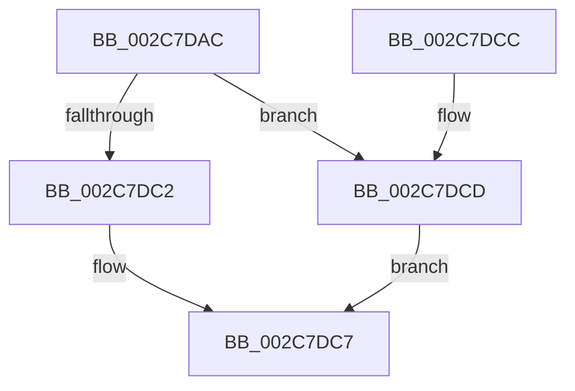

# AccelpInternalOperationHandler

- RVA: `0x002C7DAC`–`0x002C7DD4` (길이 `40` bytes)
- VA: `0x00000001402C7DAC`
- 실행 섹션: `.text`
- PDB 이름 있음: `예`; PDB Function 태그: `아니요`
- unwind 정보 RVA: `0x0005CEE8`
- 디코드: `11`개 명령, `40/40` bytes 표시
- 미해석 바이트: `0` (있으면 어셈블리에 `.byte`로 보존)

> 이 문서는 커널 이미지의 기계어와 PDB 기호를 분석해 생성했습니다. 4번과 5번은 함수 원형과 자료형을 바이너리 사용 방식에서 추정한 C 해석이며 원본 소스 복구 결과는 아닙니다.

## 1. Dependencies

- 직접 호출 지점: **1**; 고유 호출 대상: **1**
- 직접 호출자로 확인된 함수: **11**
- RIP 상대 이미지 참조: **0**

### Outgoing calls
- `0x002C7DC2` → [AccelpSiovInternalOperationHandler](AccelpSiovInternalOperationHandler_function_002C7DDC.md) (function, `0x002C7DDC`)

### Direct callers
- [AccelGetStatusFromCompletionRecord](AccelGetStatusFromCompletionRecord_function_002C7B50.md) at `0x002C7BAD`
- [AccelBuildDescriptorMemoryFill](AccelBuildDescriptorMemoryFill_function_002C7CBC.md) at `0x002C7D81`
- [AccelSubmitWorkAsync](AccelSubmitWorkAsync_function_002C81E8.md) at `0x002C8253`
- [AccelWaitForWorkCompletion](AccelWaitForWorkCompletion_function_002C8270.md) at `0x002C8302`
- [AccelBuildDescriptorMemoryCompress](../66/AccelBuildDescriptorMemoryCompress_function_00667F44.md) at `0x0066804A`
- [AccelBuildDescriptorMemoryDecompress](../66/AccelBuildDescriptorMemoryDecompress_function_00668078.md) at `0x0066817E`
- [AccelBuildDescriptorNop](../66/AccelBuildDescriptorNop_function_006681AC.md) at `0x00668242`
- [AccelInitializeCompressionWorkspace](../66/AccelInitializeCompressionWorkspace_function_006684D0.md) at `0x006685CC`
- [AccelQueryCompletionInformation](../66/AccelQueryCompletionInformation_function_006686A4.md) at `0x0066872B`
- [AccelQueryDescriptorSize](../66/AccelQueryDescriptorSize_function_00668750.md) at `0x006687B5`
- [AccelpBuildDescriptorComputeHistogram](../66/AccelpBuildDescriptorComputeHistogram_function_00668804.md) at `0x006688C6`

### Static image references
- 디코드된 RIP-relative 메모리 참조가 없습니다.

## 2. Other-region calls and transfers

- 다른 실행 섹션으로 향하는 call: **0**
- 별도 외부 분기/꼬리 이동을 확인하지 못했습니다.

## 3. Assembly (complete function range)

```asm
002C7DAC  48 83 EC 28                     sub rsp, 0x28
002C7DB0  48 8B 41 08                     mov rax, qword ptr [rcx + 8]
002C7DB4  4C 8B 40 10                     mov r8, qword ptr [rax + 0x10]
002C7DB8  41 83 B8 B8 00 00 00 01         cmp dword ptr [r8 + 0xb8], 1
002C7DC0  75 0B                           jne 0x1402c7dcd
002C7DC2  E8 15 00 00 00                  call 0x1402c7ddc
002C7DC7  48 83 C4 28                     add rsp, 0x28
002C7DCB  C3                              ret
002C7DCC  CC                              int3
002C7DCD  B8 BB 00 00 C0                  mov eax, 0xc00000bb
002C7DD2  EB F3                           jmp 0x1402c7dc7
```

## 4. C-style interpretation (structured pseudocode)

```c
__int64 __fastcall AccelpInternalOperationHandler(__int64 a1)
{
    __int64 result;
    __int64 v_rsp;

    v_rsp = (v_rsp) - (40);
    if ((*(unsigned int *)(*(unsigned __int64 *)(*(unsigned __int64 *)(a1 + 8) + 16) + 184)) != 1) goto loc_002C7DCD;
    result = AccelpSiovInternalOperationHandler(a1, a2, *(unsigned __int64 *)(*(unsigned __int64 *)(a1 + 8) + 16), a4);
loc_002C7DC7:
    v_rsp = (v_rsp) + (40);
    return result;
loc_002C7DCD:
    goto loc_002C7DC7;
}
```

## 5. (Beta) C Style

```c
int64_t AccelpInternalOperationHandler(void *Arg1)
{
    uint8_t *arg1 = (uint8_t *)Arg1;

    int64_t result;
    int64_t local_rsp;

    local_rsp = (local_rsp) - (40);
    if ((*(uint32_t *)(*(uint64_t *)(*(uint64_t *)(arg1 + 0x8) + 0x10) + 0xB8)) != 1) goto loc_002C7DCD;
    result = AccelpSiovInternalOperationHandler(Arg1, a2, *(uint64_t *)(*(uint64_t *)(arg1 + 0x8) + 0x10), a4);
loc_002C7DC7:
    local_rsp = (local_rsp) + (40);
    return result;
loc_002C7DCD:
    goto loc_002C7DC7;
}
```

### 관측된 메모리 오프셋

구조체 형식이 확인되지 않은 접근은 인자 기준의 오프셋으로만 기록했습니다.

| 기준 인자 | 오프셋 표현 | 폭 (bit) | 접근 |
|---|---:|---:|---|
| `Arg1` | `+ 0x8` | `64` | `R` |

## 6. Execution-region graph

[열기: 2D/3D 그래프와 함수 탐색 컨트롤 패널](../../../control-panel.html?section=text&rva=0x002C7DAC&view=graph)

- 2D 그래프는 위에서 아래로 흐르고, 3D 그래프는 빈 공간을 드래그해 회전합니다. Shift+드래그는 이동, 휠은 확대·축소, 함수 노드 선택은 대상 보고서 이동입니다.

### Static fallback


