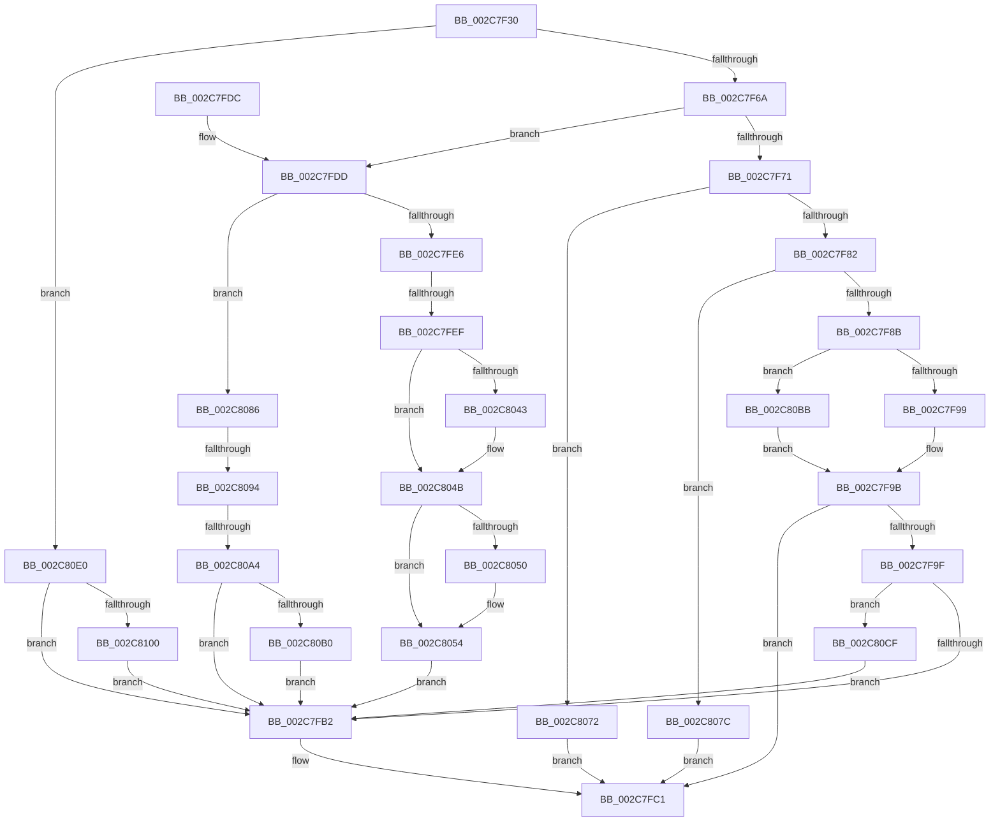

# AccelpSiovDsaOperationHandler

- RVA: `0x002C7F30`–`0x002C8108` (길이 `472` bytes)
- VA: `0x00000001402C7F30`
- 실행 섹션: `.text`
- PDB 이름 있음: `예`; PDB Function 태그: `예`
- unwind 정보 RVA: `0x0006EEA8`
- 디코드: `120`개 명령, `472/472` bytes 표시
- 미해석 바이트: `0` (있으면 어셈블리에 `.byte`로 보존)

> 이 문서는 커널 이미지의 기계어와 PDB 기호를 분석해 생성했습니다. 4번과 5번은 함수 원형과 자료형을 바이너리 사용 방식에서 추정한 C 해석이며 원본 소스 복구 결과는 아닙니다.

## 1. Dependencies

- 직접 호출 지점: **2**; 고유 호출 대상: **2**
- 직접 호출자로 확인된 함수: **1**
- RIP 상대 이미지 참조: **0**

### Outgoing calls
- `0x002C7FBC` → [DsaValidateDescriptorFlags](DsaValidateDescriptorFlags_function_002C8110.md) (function, `0x002C8110`)
- `0x002C80D6` → [AccelpSiovUpdateStatsOnWorkCompletion](../66/AccelpSiovUpdateStatsOnWorkCompletion_function_00669550.md) (function, `0x00669550`)

### Direct callers
- [AccelpSiovInternalOperationHandler](AccelpSiovInternalOperationHandler_function_002C7DDC.md) at `0x002C7E28`

### Static image references
- 디코드된 RIP-relative 메모리 참조가 없습니다.

## 2. Other-region calls and transfers

- 다른 실행 섹션으로 향하는 call: **0**
- call이 아닌 외부 분기/꼬리 이동: **3**
  - `0x002C7FE9` → [sub_006DC7EE](../6D/Unknown_function_006DC7EE.md) (`tail-transfer`)
  - `0x002C808E` → [sub_006DC7EE + 0x18B](../6D/Unknown_function_006DC7EE.md) (`tail-transfer`)
  - `0x002C809E` → [sub_006DC7EE + 0x18B](../6D/Unknown_function_006DC7EE.md) (`tail-transfer`)

## 3. Assembly (complete function range)

```asm
002C7F30  48 8B C4                        mov rax, rsp
002C7F33  48 89 58 08                     mov qword ptr [rax + 8], rbx
002C7F37  48 89 68 10                     mov qword ptr [rax + 0x10], rbp
002C7F3B  48 89 70 18                     mov qword ptr [rax + 0x18], rsi
002C7F3F  48 89 78 20                     mov qword ptr [rax + 0x20], rdi
002C7F43  41 56                           push r14
002C7F45  48 83 EC 40                     sub rsp, 0x40
002C7F49  4C 8B 51 08                     mov r10, qword ptr [rcx + 8]
002C7F4D  48 8B F1                        mov rsi, rcx
002C7F50  8B 09                           mov ecx, dword ptr [rcx]
002C7F52  BB 21 00 00 00                  mov ebx, 0x21
002C7F57  4D 8B 4A 10                     mov r9, qword ptr [r10 + 0x10]
002C7F5B  49 8B 81 C0 00 00 00            mov rax, qword ptr [r9 + 0xc0]
002C7F62  85 C9                           test ecx, ecx
002C7F64  0F 84 76 01 00 00               je 0x1402c80e0
002C7F6A  8D 6B E2                        lea ebp, [rbx - 0x1e]
002C7F6D  2B CD                           sub ecx, ebp
002C7F6F  75 6C                           jne 0x1402c7fdd
002C7F71  4C 8B 46 20                     mov r8, qword ptr [rsi + 0x20]
002C7F75  41 0F B6 08                     movzx ecx, byte ptr [r8]
002C7F79  83 E1 3F                        and ecx, 0x3f
002C7F7C  0F 84 F0 00 00 00               je 0x1402c8072
002C7F82  83 F9 01                        cmp ecx, 1
002C7F85  0F 85 F1 00 00 00               jne 0x1402c807c
002C7F8B  48 8B 46 18                     mov rax, qword ptr [rsi + 0x18]
002C7F8F  80 78 07 05                     cmp byte ptr [rax + 7], 5
002C7F93  0F 84 22 01 00 00               je 0x1402c80bb
002C7F99  33 C0                           xor eax, eax
002C7F9B  85 C0                           test eax, eax
002C7F9D  78 22                           js 0x1402c7fc1
002C7F9F  49 8B 41 10                     mov rax, qword ptr [r9 + 0x10]
002C7FA3  8B 90 98 00 00 00               mov edx, dword ptr [rax + 0x98]
002C7FA9  F6 C2 01                        test dl, 1
002C7FAC  0F 85 1D 01 00 00               jne 0x1402c80cf
002C7FB2  4C 8B 46 28                     mov r8, qword ptr [rsi + 0x28]
002C7FB6  8B CB                           mov ecx, ebx
002C7FB8  48 8B 56 18                     mov rdx, qword ptr [rsi + 0x18]
002C7FBC  E8 4F 01 00 00                  call 0x1402c8110
002C7FC1  48 8B 5C 24 50                  mov rbx, qword ptr [rsp + 0x50]
002C7FC6  48 8B 6C 24 58                  mov rbp, qword ptr [rsp + 0x58]
002C7FCB  48 8B 74 24 60                  mov rsi, qword ptr [rsp + 0x60]
002C7FD0  48 8B 7C 24 68                  mov rdi, qword ptr [rsp + 0x68]
002C7FD5  48 83 C4 40                     add rsp, 0x40
002C7FD9  41 5E                           pop r14
002C7FDB  C3                              ret
002C7FDC  CC                              int3
002C7FDD  83 E9 02                        sub ecx, 2
002C7FE0  0F 84 A0 00 00 00               je 0x1402c8086
002C7FE6  83 E9 01                        sub ecx, 1
002C7FE9  0F 85 FF 47 41 00               jne 0x1406dc7ee
002C7FEF  48 8B 56 18                     mov rdx, qword ptr [rsi + 0x18]
002C7FF3  4C 8B D8                        mov r11, rax
002C7FF6  48 8B 4E 20                     mov rcx, qword ptr [rsi + 0x20]
002C7FFA  BB 04 00 00 00                  mov ebx, 4
002C7FFF  44 8B 56 10                     mov r10d, dword ptr [rsi + 0x10]
002C8003  48 8B 7E 40                     mov rdi, qword ptr [rsi + 0x40]
002C8007  48 8B 6E 38                     mov rbp, qword ptr [rsi + 0x38]
002C800B  4C 8B 76 30                     mov r14, qword ptr [rsi + 0x30]
002C800F  44 8A 4A 04                     mov r9b, byte ptr [rdx + 4]
002C8013  49 C1 EB 0A                     shr r11, 0xa
002C8017  41 80 C9 0C                     or r9b, 0xc
002C801B  48 89 4A 08                     mov qword ptr [rdx + 8], rcx
002C801F  41 80 E3 01                     and r11b, 1
002C8023  8B 0A                           mov ecx, dword ptr [rdx]
002C8025  44 8B C1                        mov r8d, ecx
002C8028  45 33 C2                        xor r8d, r10d
002C802B  C0 E8 07                        shr al, 7
002C802E  41 81 E0 FF FF 0F 00            and r8d, 0xfffff
002C8035  88 5A 07                        mov byte ptr [rdx + 7], bl
002C8038  44 33 C1                        xor r8d, ecx
002C803B  44 88 4A 04                     mov byte ptr [rdx + 4], r9b
002C803F  A8 01                           test al, 1
002C8041  74 08                           je 0x1402c804b
002C8043  41 80 C9 02                     or r9b, 2
002C8047  44 88 4A 04                     mov byte ptr [rdx + 4], r9b
002C804B  45 84 DB                        test r11b, r11b
002C804E  74 04                           je 0x1402c8054
002C8050  80 4A 05 01                     or byte ptr [rdx + 5], 1
002C8054  45 33 C2                        xor r8d, r10d
002C8057  4C 89 72 18                     mov qword ptr [rdx + 0x18], r14
002C805B  41 0F BA F0 1F                  btr r8d, 0x1f
002C8060  89 6A 20                        mov dword ptr [rdx + 0x20], ebp
002C8063  45 33 C2                        xor r8d, r10d
002C8066  48 89 7A 10                     mov qword ptr [rdx + 0x10], rdi
002C806A  44 89 02                        mov dword ptr [rdx], r8d
002C806D  E9 40 FF FF FF                  jmp 0x1402c7fb2
002C8072  B8 03 01 00 00                  mov eax, 0x103
002C8077  E9 45 FF FF FF                  jmp 0x1402c7fc1
002C807C  B8 01 00 00 C0                  mov eax, 0xc0000001
002C8081  E9 3B FF FF FF                  jmp 0x1402c7fc1
002C8086  41 F6 81 D8 00 00 00 01         test byte ptr [r9 + 0xd8], 1
002C808E  0F 84 E5 48 41 00               je 0x1406dc979
002C8094  8B 46 30                        mov eax, dword ptr [rsi + 0x30]
002C8097  41 3B 81 E0 00 00 00            cmp eax, dword ptr [r9 + 0xe0]
002C809E  0F 87 D5 48 41 00               ja 0x1406dc979
002C80A4  89 02                           mov dword ptr [rdx], eax
002C80A6  83 7E 30 01                     cmp dword ptr [rsi + 0x30], 1
002C80AA  0F 85 02 FF FF FF               jne 0x1402c7fb2
002C80B0  C7 02 02 00 00 00               mov dword ptr [rdx], 2
002C80B6  E9 F7 FE FF FF                  jmp 0x1402c7fb2
002C80BB  41 8A 40 01                     mov al, byte ptr [r8 + 1]
002C80BF  F6 D8                           neg al
002C80C1  B8 01 00 00 C0                  mov eax, 0xc0000001
002C80C6  1B C9                           sbb ecx, ecx
002C80C8  23 C1                           and eax, ecx
002C80CA  E9 CC FE FF FF                  jmp 0x1402c7f9b
002C80CF  48 8B 56 18                     mov rdx, qword ptr [rsi + 0x18]
002C80D3  49 8B CA                        mov rcx, r10
002C80D6  E8 75 14 3A 00                  call 0x140669550
002C80DB  E9 D2 FE FF FF                  jmp 0x1402c7fb2
002C80E0  41 B8 40 00 00 00               mov r8d, 0x40
002C80E6  48 8D 42 0C                     lea rax, [rdx + 0xc]
002C80EA  44 89 02                        mov dword ptr [rdx], r8d
002C80ED  41 8D 48 E0                     lea ecx, [r8 - 0x20]
002C80F1  89 4A 04                        mov dword ptr [rdx + 4], ecx
002C80F4  89 4A 08                        mov dword ptr [rdx + 8], ecx
002C80F7  48 85 C0                        test rax, rax
002C80FA  0F 84 B2 FE FF FF               je 0x1402c7fb2
002C8100  44 89 00                        mov dword ptr [rax], r8d
002C8103  E9 AA FE FF FF                  jmp 0x1402c7fb2
```

## 4. C-style interpretation (structured pseudocode)

```c
__int64 __fastcall AccelpSiovDsaOperationHandler(__int64 a1)
{
    __int64 result;
    __int64 v_r11;
    __int64 v_rsp;
    unsigned __int64 v_stack_p10;
    unsigned __int64 v_stack_p18;
    unsigned __int64 v_stack_p20;
    unsigned __int64 v_stack_p8;

    *(unsigned __int64 *)(v_rsp + 8) = v_rbx;
    *(unsigned __int64 *)(v_rsp + 16) = v_rbp;
    *(unsigned __int64 *)(v_rsp + 24) = v_rsi;
    *(unsigned __int64 *)(v_rsp + 32) = v_rdi;
    v_rsp = (v_rsp) - (64);
    if ((unsigned int)((unsigned int)(*(unsigned int *)(a1))) == 0) goto loc_002C80E0;
    a1 = (unsigned int)(((unsigned int)(*(unsigned int *)(a1))) - ((unsigned int)(33 - 30)));
    if (condition_is_not_equal) goto loc_002C7FDD;
    a1 = (unsigned int)((*(unsigned __int8 *)(*(unsigned __int64 *)(a1 + 32))) & (63));
    if (condition_is_equal) goto loc_002C8072;
    if (((unsigned int)(a1)) != 1) goto loc_002C807C;
    if ((*(unsigned __int8 *)(*(unsigned __int64 *)(a1 + 24) + 7)) == 5) goto loc_002C80BB;
    result = 0;
loc_002C7F9B:
    if (sign_flag) goto loc_002C7FC1;
    if ((((unsigned __int8)((unsigned int)(*(unsigned int *)(*(unsigned __int64 *)(*(unsigned __int64 *)(*(unsigned __int64 *)(a1 + 8) + 16) + 16) + 152)))) & (1)) != 0) goto loc_002C80CF;
loc_002C7FB2:
    result = DsaValidateDescriptorFlags(33, *(unsigned __int64 *)(a1 + 24), *(unsigned __int64 *)(a1 + 40), *(unsigned __int64 *)(*(unsigned __int64 *)(a1 + 8) + 16));
loc_002C7FC1:
    v_rsp = (v_rsp) + (64);
    return result;
loc_002C7FDD:
    a1 = (unsigned int)((33) - (2));
    if (condition_is_equal) goto loc_002C8086;
    a1 = (unsigned int)((a1) - (1));
    v_r11 = (result) >> (10);
    a4 = (unsigned __int8)((*(unsigned __int8 *)(*(unsigned __int64 *)(v_stack_p18 + 24) + 4)) | (12));
    *(unsigned __int64 *)(*(unsigned __int64 *)(v_stack_p18 + 24) + 8) = *(unsigned __int64 *)(v_stack_p18 + 32);
    v_r11 = (unsigned __int8)((v_r11) & (1));
    a3 = (unsigned int)(((unsigned int)((unsigned int)((unsigned int)(*(unsigned int *)(*(unsigned __int64 *)(v_stack_p18 + 24)))))) ^ ((unsigned int)((unsigned int)(*(unsigned int *)(v_stack_p18 + 16)))));
    result = (unsigned __int8)((result) >> (7));
    a3 = (unsigned int)((a3) & (0xFFFFFULL));
    *(unsigned __int8 *)(*(unsigned __int64 *)(v_stack_p18 + 24) + 7) = 4;
    a3 = (unsigned int)((a3) ^ ((unsigned int)((unsigned int)(*(unsigned int *)(*(unsigned __int64 *)(v_stack_p18 + 24))))));
    *(unsigned __int8 *)(*(unsigned __int64 *)(v_stack_p18 + 24) + 4) = (unsigned __int8)(a4);
    if ((((unsigned __int8)(result)) & (1)) != 0) {
        a4 = (unsigned __int8)((a4) | (2));
        *(unsigned __int8 *)(*(unsigned __int64 *)(v_stack_p18 + 24) + 4) = (unsigned __int8)(a4);
    }
    if ((unsigned __int8)(v_r11) != 0) {
    }
    a3 = (unsigned int)((a3) ^ ((unsigned int)((unsigned int)(*(unsigned int *)(v_stack_p18 + 16)))));
    *(unsigned __int64 *)(*(unsigned __int64 *)(v_stack_p18 + 24) + 24) = *(unsigned __int64 *)(v_stack_p18 + 48);
    *(unsigned int *)(*(unsigned __int64 *)(v_stack_p18 + 24) + 32) = (unsigned int)(*(unsigned __int64 *)(v_stack_p18 + 56));
    a3 = (unsigned int)((a3) ^ ((unsigned int)((unsigned int)(*(unsigned int *)(v_stack_p18 + 16)))));
    *(unsigned __int64 *)(*(unsigned __int64 *)(v_stack_p18 + 24) + 16) = *(unsigned __int64 *)(v_stack_p18 + 64);
    *(unsigned int *)(*(unsigned __int64 *)(v_stack_p18 + 24)) = (unsigned int)(a3);
    goto loc_002C7FB2;
loc_002C8072:
    goto loc_002C7FC1;
loc_002C807C:
    goto loc_002C7FC1;
loc_002C8086:
    *(unsigned int *)(*(unsigned __int64 *)(v_stack_p18 + 24)) = (unsigned int)((unsigned int)(*(unsigned int *)(v_stack_p18 + 48)));
    if ((*(unsigned int *)(v_stack_p18 + 48)) != 1) goto loc_002C7FB2;
    *(unsigned int *)(*(unsigned __int64 *)(v_stack_p18 + 24)) = 2;
    goto loc_002C7FB2;
loc_002C80BB:
    result = (unsigned __int8)(-(*(unsigned __int8 *)(a3 + 1)));
    result = (unsigned int)(((unsigned int)(0xC0000001ULL)) & ((unsigned int)((unsigned int)(*(unsigned int *)(*(unsigned __int64 *)(v_stack_p18 + 24))))));
    goto loc_002C7F9B;
loc_002C80CF:
    result = AccelpSiovUpdateStatsOnWorkCompletion((unsigned int)(*(unsigned int *)(v_stack_p18 + 16)), *(unsigned __int64 *)(v_stack_p18 + 24), a3, a4);
    goto loc_002C7FB2;
loc_002C80E0:
    *(unsigned int *)(*(unsigned __int64 *)(v_stack_p18 + 24)) = 64;
    *(unsigned int *)(*(unsigned __int64 *)(v_stack_p18 + 24) + 4) = (unsigned int)(64 - 32);
    *(unsigned int *)(*(unsigned __int64 *)(v_stack_p18 + 24) + 8) = (unsigned int)(64 - 32);
    if (*(unsigned __int64 *)(v_stack_p18 + 24) + 12 == 0) goto loc_002C7FB2;
    *(unsigned int *)(*(unsigned __int64 *)(v_stack_p18 + 24) + 12) = 64;
    goto loc_002C7FB2;
}
```

## 5. (Beta) C Style

```c
int64_t AccelpSiovDsaOperationHandler(void *Arg1)
{
    uint8_t *arg1 = (uint8_t *)Arg1;

    int64_t result;
    int64_t local_r11;
    int64_t local_rsp;
    uint64_t v_stack_p10;
    uint64_t v_stack_p18;
    uint64_t v_stack_p20;
    uint64_t v_stack_p8;

    *(uint64_t *)(local_rsp + 0x8) = local_rbx;
    *(uint64_t *)(local_rsp + 0x10) = local_rbp;
    *(uint64_t *)(local_rsp + 0x18) = local_rsi;
    *(uint64_t *)(local_rsp + 0x20) = local_rdi;
    local_rsp = (local_rsp) - (64);
    if ((uint32_t)((uint32_t)(*(uint32_t *)(arg1))) == 0) goto loc_002C80E0;
    Arg1 = (uint32_t)(((uint32_t)(*(uint32_t *)(arg1))) - ((uint32_t)(33 - 30)));
    if (condition_is_not_equal) goto loc_002C7FDD;
    Arg1 = (uint32_t)((*(uint8_t *)(*(uint64_t *)(arg1 + 0x20))) & (63));
    if (condition_is_equal) goto loc_002C8072;
    if (((uint32_t)(Arg1)) != 1) goto loc_002C807C;
    if ((*(uint8_t *)(*(uint64_t *)(arg1 + 0x18) + 0x7)) == 5) goto loc_002C80BB;
    result = 0;
loc_002C7F9B:
    if (sign_flag) goto loc_002C7FC1;
    if ((((uint8_t)((uint32_t)(*(uint32_t *)(*(uint64_t *)(*(uint64_t *)(*(uint64_t *)(arg1 + 0x8) + 0x10) + 0x10) + 0x98)))) & (1)) != 0) goto loc_002C80CF;
loc_002C7FB2:
    result = DsaValidateDescriptorFlags(33, *(uint64_t *)(arg1 + 0x18), *(uint64_t *)(arg1 + 0x28), *(uint64_t *)(*(uint64_t *)(arg1 + 0x8) + 0x10));
loc_002C7FC1:
    local_rsp = (local_rsp) + (64);
    return result;
loc_002C7FDD:
    Arg1 = (uint32_t)((33) - (2));
    if (condition_is_equal) goto loc_002C8086;
    Arg1 = (uint32_t)((Arg1) - (1));
    local_r11 = (result) >> (10);
    a4 = (uint8_t)((*(uint8_t *)(*(uint64_t *)(v_stack_p18 + 0x18) + 0x4)) | (12));
    *(uint64_t *)(*(uint64_t *)(v_stack_p18 + 0x18) + 0x8) = *(uint64_t *)(v_stack_p18 + 0x20);
    local_r11 = (uint8_t)((local_r11) & (1));
    a3 = (uint32_t)(((uint32_t)((uint32_t)((uint32_t)(*(uint32_t *)(*(uint64_t *)(v_stack_p18 + 0x18)))))) ^ ((uint32_t)((uint32_t)(*(uint32_t *)(v_stack_p18 + 0x10)))));
    result = (uint8_t)((result) >> (7));
    a3 = (uint32_t)((a3) & (0xFFFFFULL));
    *(uint8_t *)(*(uint64_t *)(v_stack_p18 + 0x18) + 0x7) = 4;
    a3 = (uint32_t)((a3) ^ ((uint32_t)((uint32_t)(*(uint32_t *)(*(uint64_t *)(v_stack_p18 + 0x18))))));
    *(uint8_t *)(*(uint64_t *)(v_stack_p18 + 0x18) + 0x4) = (uint8_t)(a4);
    if ((((uint8_t)(result)) & (1)) != 0) {
        a4 = (uint8_t)((a4) | (2));
        *(uint8_t *)(*(uint64_t *)(v_stack_p18 + 0x18) + 0x4) = (uint8_t)(a4);
    }
    if ((uint8_t)(local_r11) != 0) {
    }
    a3 = (uint32_t)((a3) ^ ((uint32_t)((uint32_t)(*(uint32_t *)(v_stack_p18 + 0x10)))));
    *(uint64_t *)(*(uint64_t *)(v_stack_p18 + 0x18) + 0x18) = *(uint64_t *)(v_stack_p18 + 0x30);
    *(uint32_t *)(*(uint64_t *)(v_stack_p18 + 0x18) + 0x20) = (uint32_t)(*(uint64_t *)(v_stack_p18 + 0x38));
    a3 = (uint32_t)((a3) ^ ((uint32_t)((uint32_t)(*(uint32_t *)(v_stack_p18 + 0x10)))));
    *(uint64_t *)(*(uint64_t *)(v_stack_p18 + 0x18) + 0x10) = *(uint64_t *)(v_stack_p18 + 0x40);
    *(uint32_t *)(*(uint64_t *)(v_stack_p18 + 0x18)) = (uint32_t)(a3);
    goto loc_002C7FB2;
loc_002C8072:
    goto loc_002C7FC1;
loc_002C807C:
    goto loc_002C7FC1;
loc_002C8086:
    *(uint32_t *)(*(uint64_t *)(v_stack_p18 + 0x18)) = (uint32_t)((uint32_t)(*(uint32_t *)(v_stack_p18 + 0x30)));
    if ((*(uint32_t *)(v_stack_p18 + 0x30)) != 1) goto loc_002C7FB2;
    *(uint32_t *)(*(uint64_t *)(v_stack_p18 + 0x18)) = 2;
    goto loc_002C7FB2;
loc_002C80BB:
    result = (uint8_t)(-(*(uint8_t *)(a3 + 0x1)));
    result = (uint32_t)(((uint32_t)(0xC0000001ULL)) & ((uint32_t)((uint32_t)(*(uint32_t *)(*(uint64_t *)(v_stack_p18 + 0x18))))));
    goto loc_002C7F9B;
loc_002C80CF:
    result = AccelpSiovUpdateStatsOnWorkCompletion((uint32_t)(*(uint32_t *)(v_stack_p18 + 0x10)), *(uint64_t *)(v_stack_p18 + 0x18), a3, a4);
    goto loc_002C7FB2;
loc_002C80E0:
    *(uint32_t *)(*(uint64_t *)(v_stack_p18 + 0x18)) = 64;
    *(uint32_t *)(*(uint64_t *)(v_stack_p18 + 0x18) + 0x4) = (uint32_t)(64 - 32);
    *(uint32_t *)(*(uint64_t *)(v_stack_p18 + 0x18) + 0x8) = (uint32_t)(64 - 32);
    if (*(uint64_t *)(v_stack_p18 + 0x18) + 12 == 0) goto loc_002C7FB2;
    *(uint32_t *)(*(uint64_t *)(v_stack_p18 + 0x18) + 0xC) = 64;
    goto loc_002C7FB2;
}
```

### 관측된 메모리 오프셋

구조체 형식이 확인되지 않은 접근은 인자 기준의 오프셋으로만 기록했습니다.

| 기준 인자 | 오프셋 표현 | 폭 (bit) | 접근 |
|---|---:|---:|---|
| `Arg1` | `+ 0x0` | `32` | `R` |
| `Arg1` | `+ 0x8` | `64` | `R` |
| `Arg1` | `+ 0x10` | `32` | `R` |
| `Arg1` | `+ 0x18` | `64` | `R` |
| `Arg1` | `+ 0x20` | `64` | `R` |
| `Arg1` | `+ 0x28` | `64` | `R` |
| `Arg1` | `+ 0x30` | `32` | `R` |
| `Arg1` | `+ 0x30` | `64` | `R` |
| `Arg1` | `+ 0x38` | `64` | `R` |
| `Arg1` | `+ 0x40` | `64` | `R` |

## 6. Execution-region graph

[열기: 2D/3D 그래프와 함수 탐색 컨트롤 패널](../../../control-panel.html?section=text&rva=0x002C7F30&view=graph)

- 2D 그래프는 위에서 아래로 흐르고, 3D 그래프는 빈 공간을 드래그해 회전합니다. Shift+드래그는 이동, 휠은 확대·축소, 함수 노드 선택은 대상 보고서 이동입니다.

### Static fallback


