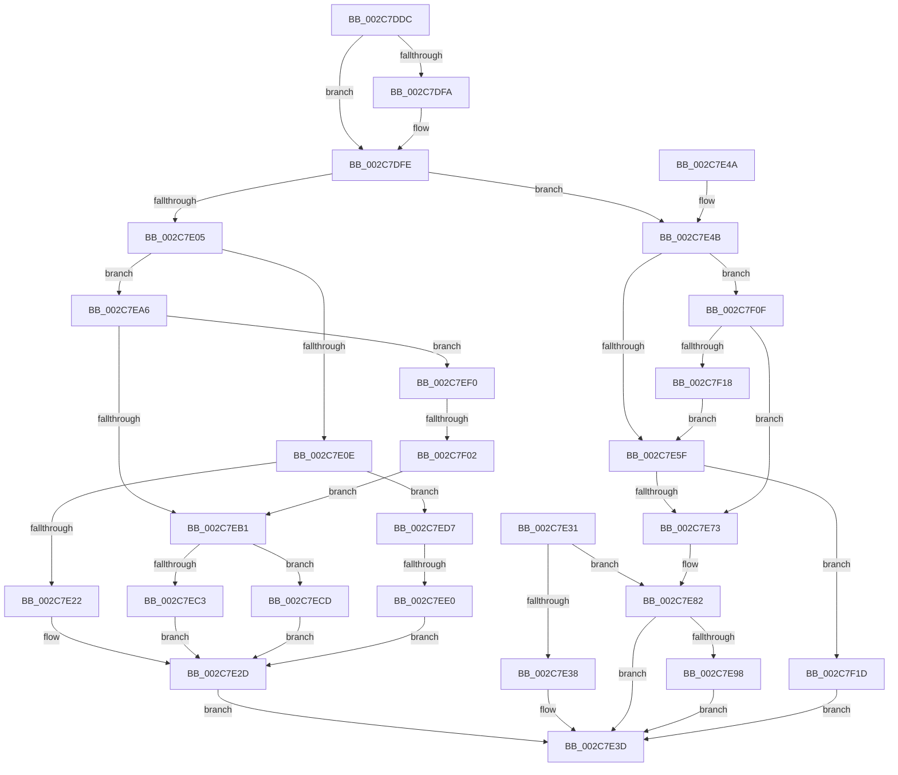

# AccelpSiovInternalOperationHandler

- RVA: `0x002C7DDC`–`0x002C7F27` (길이 `331` bytes)
- VA: `0x00000001402C7DDC`
- 실행 섹션: `.text`
- PDB 이름 있음: `예`; PDB Function 태그: `예`
- unwind 정보 RVA: `0x0006EE88`
- 디코드: `93`개 명령, `331/331` bytes 표시
- 미해석 바이트: `3` (있으면 어셈블리에 `.byte`로 보존)

> 이 문서는 커널 이미지의 기계어와 PDB 기호를 분석해 생성했습니다. 4번과 5번은 함수 원형과 자료형을 바이너리 사용 방식에서 추정한 C 해석이며 원본 소스 복구 결과는 아닙니다.

## 1. Dependencies

- 직접 호출 지점: **5**; 고유 호출 대상: **5**
- 직접 호출자로 확인된 함수: **1**
- RIP 상대 이미지 참조: **2**

### Outgoing calls
- `0x002C7E28` → [AccelpSiovDsaOperationHandler](AccelpSiovDsaOperationHandler_function_002C7F30.md) (function, `0x002C7F30`)
- `0x002C7E9F` → [AccelpSiovUpdateStatsOnSubmitWork](../66/AccelpSiovUpdateStatsOnSubmitWork_function_006694D0.md) (function, `0x006694D0`)
- `0x002C7EC3` → [AccelpSiovWaitForCompletionUMWait](AccelpSiovWaitForCompletionUMWait_function_002C8338.md) (function, `0x002C8338`)
- `0x002C7ECD` → [AccelpWaitForCompletionBusySpin](../4F/AccelpWaitForCompletionBusySpin_function_004FB194.md) (function, `0x004FB194`)
- `0x002C7EE6` → [AccelpSiovIaaOperationHandler](../66/AccelpSiovIaaOperationHandler_function_00668EF0.md) (function, `0x00668EF0`)

### Direct callers
- [AccelpInternalOperationHandler](AccelpInternalOperationHandler_function_002C7DAC.md) at `0x002C7DC2`

### Static image references
- `0x002C7EA6` → RVA `0x00E0EC64` (`.data`; read)
- `0x002C7F07` → RVA `0x00E0EC64` (`.data`; write)

## 2. Other-region calls and transfers

- 다른 실행 섹션으로 향하는 call: **0**
- call이 아닌 외부 분기/꼬리 이동: **2**
  - `0x002C7EDA` → [sub_006DC7D6](../6D/Unknown_function_006DC7D6.md) (`tail-transfer`)
  - `0x002C7EFC` → [sub_006DC7D6 + 0xA](../6D/Unknown_function_006DC7D6.md) (`tail-transfer`)

## 3. Assembly (complete function range)

```asm
002C7DDC  48 89 5C 24 10                  mov qword ptr [rsp + 0x10], rbx
002C7DE1  57                              push rdi
002C7DE2  48 83 EC 30                     sub rsp, 0x30
002C7DE6  48 8B 41 08                     mov rax, qword ptr [rcx + 8]
002C7DEA  33 FF                           xor edi, edi
002C7DEC  48 8B DA                        mov rbx, rdx
002C7DEF  4C 8B C1                        mov r8, rcx
002C7DF2  44 8B CF                        mov r9d, edi
002C7DF5  48 85 C0                        test rax, rax
002C7DF8  74 04                           je 0x1402c7dfe
002C7DFA  4C 8B 48 10                     mov r9, qword ptr [rax + 0x10]
002C7DFE  8B 09                           mov ecx, dword ptr [rcx]
002C7E00  83 E9 01                        sub ecx, 1
002C7E03  74 46                           je 0x1402c7e4b
002C7E05  83 F9 01                        cmp ecx, 1
002C7E08  0F 84 98 00 00 00               je 0x1402c7ea6
002C7E0E  41 8B 81 BC 00 00 00            mov eax, dword ptr [r9 + 0xbc]
002C7E15  BA 01 00 00 00                  mov edx, 1
002C7E1A  3B C2                           cmp eax, edx
002C7E1C  0F 85 B5 00 00 00               jne 0x1402c7ed7
002C7E22  48 8B D3                        mov rdx, rbx
002C7E25  49 8B C8                        mov rcx, r8
002C7E28  E8 03 01 00 00                  call 0x1402c7f30
002C7E2D  8B F8                           mov edi, eax
002C7E2F  EB 0C                           jmp 0x1402c7e3d
002C7E31  03 DA                           add ebx, edx
002C7E33  83 FB 03                        cmp ebx, 3
002C7E36  72 4A                           jb 0x1402c7e82
002C7E38  BF 01 00 EF C0                  mov edi, 0xc0ef0001
002C7E3D  48 8B 5C 24 48                  mov rbx, qword ptr [rsp + 0x48]
002C7E42  8B C7                           mov eax, edi
002C7E44  48 83 C4 30                     add rsp, 0x30
002C7E48  5F                              pop rdi
002C7E49  C3                              ret
002C7E4A  CC                              int3
002C7E4B  41 8B 89 BC 00 00 00            mov ecx, dword ptr [r9 + 0xbc]
002C7E52  49 8B 50 20                     mov rdx, qword ptr [r8 + 0x20]
002C7E56  83 E9 01                        sub ecx, 1
002C7E59  0F 85 B0 00 00 00               jne 0x1402c7f0f
002C7E5F  8A 02                           mov al, byte ptr [rdx]
002C7E61  24 3F                           and al, 0x3f
002C7E63  88 44 24 40                     mov byte ptr [rsp + 0x40], al
002C7E67  8A 44 24 40                     mov al, byte ptr [rsp + 0x40]
002C7E6B  84 C0                           test al, al
002C7E6D  0F 85 AA 00 00 00               jne 0x1402c7f1d
002C7E73  4D 8B 50 18                     mov r10, qword ptr [r8 + 0x18]
002C7E77  8B DF                           mov ebx, edi
002C7E79  4D 8B 58 30                     mov r11, qword ptr [r8 + 0x30]
002C7E7D  BA 01 00 00 00                  mov edx, 1
002C7E82  F3                              .byte 0xf3
002C7E83  45                              .byte 0x45
002C7E84  0F                              .byte 0x0f
002C7E85  38 F8                           cmp al, bh
002C7E87  1A 74 A7 49                     sbb dh, byte ptr [rdi + riz*4 + 0x49]
002C7E8B  8B 41 10                        mov eax, dword ptr [rcx + 0x10]
002C7E8E  8B 88 98 00 00 00               mov ecx, dword ptr [rax + 0x98]
002C7E94  84 CA                           test dl, cl
002C7E96  74 A5                           je 0x1402c7e3d
002C7E98  49 8B 48 08                     mov rcx, qword ptr [r8 + 8]
002C7E9C  49 8B D2                        mov rdx, r10
002C7E9F  E8 2C 16 3A 00                  call 0x1406694d0
002C7EA4  EB 97                           jmp 0x1402c7e3d
002C7EA6  8B 15 B8 6D B4 00               mov edx, dword ptr [rip + 0xb46db8]
002C7EAC  83 FA FF                        cmp edx, -1
002C7EAF  74 3F                           je 0x1402c7ef0
002C7EB1  49 8B 40 20                     mov rax, qword ptr [r8 + 0x20]
002C7EB5  84 D2                           test dl, dl
002C7EB7  41 8B 89 BC 00 00 00            mov ecx, dword ptr [r9 + 0xbc]
002C7EBE  48 8B D0                        mov rdx, rax
002C7EC1  74 0A                           je 0x1402c7ecd
002C7EC3  E8 70 04 00 00                  call 0x1402c8338
002C7EC8  E9 60 FF FF FF                  jmp 0x1402c7e2d
002C7ECD  E8 C2 32 23 00                  call 0x1404fb194
002C7ED2  E9 56 FF FF FF                  jmp 0x1402c7e2d
002C7ED7  83 F8 02                        cmp eax, 2
002C7EDA  0F 85 F6 48 41 00               jne 0x1406dc7d6
002C7EE0  48 8B D3                        mov rdx, rbx
002C7EE3  49 8B C8                        mov rcx, r8
002C7EE6  E8 05 10 3A 00                  call 0x140668ef0
002C7EEB  E9 3D FF FF FF                  jmp 0x1402c7e2d
002C7EF0  33 C9                           xor ecx, ecx
002C7EF2  B8 07 00 00 00                  mov eax, 7
002C7EF7  0F A2                           cpuid
002C7EF9  F6 C1 20                        test cl, 0x20
002C7EFC  0F 84 DE 48 41 00               je 0x1406dc7e0
002C7F02  BA 01 00 00 00                  mov edx, 1
002C7F07  89 15 57 6D B4 00               mov dword ptr [rip + 0xb46d57], edx
002C7F0D  EB A2                           jmp 0x1402c7eb1
002C7F0F  83 F9 01                        cmp ecx, 1
002C7F12  0F 85 5B FF FF FF               jne 0x1402c7e73
002C7F18  E9 42 FF FF FF                  jmp 0x1402c7e5f
002C7F1D  BF 0D 00 00 C0                  mov edi, 0xc000000d
002C7F22  E9 16 FF FF FF                  jmp 0x1402c7e3d
```

## 4. C-style interpretation (structured pseudocode)

```c
__int64 __fastcall AccelpSiovInternalOperationHandler(__int64 a1, __int64 a2)
{
    __int64 result;
    __int64 v_rdi;
    __int64 v_rsp;
    unsigned __int64 v_stack_p10;
    unsigned __int8 v_stack_p40;

    v_stack_p10 = v_rbx;
    v_rsp = (v_rsp) - (48);
    v_rdi = 0;
    if (*(unsigned __int64 *)(a1 + 8) != 0) {
        a4 = *(unsigned __int64 *)(*(unsigned __int64 *)(a1 + 8) + 16);
    }
    a1 = (unsigned int)(((unsigned int)(*(unsigned int *)(a1))) - (1));
    if (condition_is_equal) goto loc_002C7E4B;
    if (((unsigned int)(a1)) == 1) goto loc_002C7EA6;
    if (((unsigned int)((unsigned int)(*(unsigned int *)(a4 + 188)))) != 1) goto loc_002C7ED7;
    result = AccelpSiovDsaOperationHandler(a1, a2, a1, a4);
loc_002C7E2D:
    goto loc_002C7E3D;
loc_002C7E3D:
    v_rsp = (v_rsp) + (48);
    return (unsigned int)((unsigned int)((unsigned int)((unsigned int)(result))));
loc_002C7E4B:
    a1 = (unsigned int)(((unsigned int)(*(unsigned int *)(a4 + 188))) - (1));
    if (condition_is_not_equal) goto loc_002C7F0F;
loc_002C7E5F:
    result = (unsigned __int8)((*(unsigned __int8 *)(*(unsigned __int64 *)(a1 + 32))) & (63));
    v_stack_p40 = (unsigned __int8)(result);
    if ((unsigned __int8)(v_stack_p40) != 0) goto loc_002C7F1D;
loc_002C7E73:
loc_002C7E82:
    if (((1) & ((unsigned __int8)((unsigned int)(*(unsigned int *)((unsigned int)(*(unsigned int *)(a1 + 16)) + 152))))) == 0) goto loc_002C7E3D;
    result = AccelpSiovUpdateStatsOnSubmitWork(*(unsigned __int64 *)(a1 + 8), *(unsigned __int64 *)(a1 + 24), a1, a4);
    goto loc_002C7E3D;
loc_002C7EA6:
    if (((unsigned int)((unsigned int)(*(unsigned int *)(v_rip + 11824568)))) == -1) goto loc_002C7EF0;
loc_002C7EB1:
    if ((unsigned __int8)((unsigned int)(*(unsigned int *)(v_rip + 11824568))) == 0) goto loc_002C7ECD;
    result = AccelpSiovWaitForCompletionUMWait((unsigned int)(*(unsigned int *)(a4 + 188)), *(unsigned __int64 *)(a1 + 32), a1, a4);
    goto loc_002C7E2D;
loc_002C7ECD:
    result = AccelpWaitForCompletionBusySpin((unsigned int)(*(unsigned int *)(a4 + 188)), *(unsigned __int64 *)(a1 + 32), a1, a4);
    goto loc_002C7E2D;
loc_002C7ED7:
    result = AccelpSiovIaaOperationHandler(a1, (unsigned int)((unsigned int)((unsigned int)((unsigned int)(result)))), a1, a4);
    goto loc_002C7E2D;
loc_002C7EF0:
    a1 = 0;
    *(unsigned int *)(v_rip + 11824471) = 1;
    goto loc_002C7EB1;
loc_002C7F0F:
    if (0 != 1) goto loc_002C7E73;
    goto loc_002C7E5F;
loc_002C7F1D:
    goto loc_002C7E3D;
}
```

## 5. (Beta) C Style

```c
int64_t AccelpSiovInternalOperationHandler(void *Arg1, int64_t Arg2)
{
    uint8_t *arg1 = (uint8_t *)Arg1;

    int64_t result;
    int64_t local_rdi;
    int64_t local_rsp;
    uint64_t v_stack_p10;
    uint8_t v_stack_p40;

    v_stack_p10 = local_rbx;
    local_rsp = (local_rsp) - (48);
    local_rdi = 0;
    if (*(uint64_t *)(arg1 + 0x8) != 0) {
        a4 = *(uint64_t *)(*(uint64_t *)(arg1 + 0x8) + 0x10);
    }
    Arg1 = (uint32_t)(((uint32_t)(*(uint32_t *)(arg1))) - (1));
    if (condition_is_equal) goto loc_002C7E4B;
    if (((uint32_t)(Arg1)) == 1) goto loc_002C7EA6;
    if (((uint32_t)((uint32_t)(*(uint32_t *)(a4 + 0xBC)))) != 1) goto loc_002C7ED7;
    result = AccelpSiovDsaOperationHandler(Arg1, Arg2, Arg1, a4);
loc_002C7E2D:
    goto loc_002C7E3D;
loc_002C7E3D:
    local_rsp = (local_rsp) + (48);
    return (uint32_t)((uint32_t)((uint32_t)((uint32_t)(result))));
loc_002C7E4B:
    Arg1 = (uint32_t)(((uint32_t)(*(uint32_t *)(a4 + 0xBC))) - (1));
    if (condition_is_not_equal) goto loc_002C7F0F;
loc_002C7E5F:
    result = (uint8_t)((*(uint8_t *)(*(uint64_t *)(arg1 + 0x20))) & (63));
    v_stack_p40 = (uint8_t)(result);
    if ((uint8_t)(v_stack_p40) != 0) goto loc_002C7F1D;
loc_002C7E73:
loc_002C7E82:
    if (((1) & ((uint8_t)((uint32_t)(*(uint32_t *)((uint32_t)(*(uint32_t *)(arg1 + 0x10)) + 0x98))))) == 0) goto loc_002C7E3D;
    result = AccelpSiovUpdateStatsOnSubmitWork(*(uint64_t *)(arg1 + 0x8), *(uint64_t *)(arg1 + 0x18), Arg1, a4);
    goto loc_002C7E3D;
loc_002C7EA6:
    if (((uint32_t)((uint32_t)(*(uint32_t *)(v_rip + 0xB46DB8)))) == -1) goto loc_002C7EF0;
loc_002C7EB1:
    if ((uint8_t)((uint32_t)(*(uint32_t *)(v_rip + 0xB46DB8))) == 0) goto loc_002C7ECD;
    result = AccelpSiovWaitForCompletionUMWait((uint32_t)(*(uint32_t *)(a4 + 0xBC)), *(uint64_t *)(arg1 + 0x20), Arg1, a4);
    goto loc_002C7E2D;
loc_002C7ECD:
    result = AccelpWaitForCompletionBusySpin((uint32_t)(*(uint32_t *)(a4 + 0xBC)), *(uint64_t *)(arg1 + 0x20), Arg1, a4);
    goto loc_002C7E2D;
loc_002C7ED7:
    result = AccelpSiovIaaOperationHandler(Arg1, (uint32_t)((uint32_t)((uint32_t)((uint32_t)(result)))), Arg1, a4);
    goto loc_002C7E2D;
loc_002C7EF0:
    Arg1 = 0;
    *(uint32_t *)(v_rip + 0xB46D57) = 1;
    goto loc_002C7EB1;
loc_002C7F0F:
    if (0 != 1) goto loc_002C7E73;
    goto loc_002C7E5F;
loc_002C7F1D:
    goto loc_002C7E3D;
}
```

### 관측된 메모리 오프셋

구조체 형식이 확인되지 않은 접근은 인자 기준의 오프셋으로만 기록했습니다.

| 기준 인자 | 오프셋 표현 | 폭 (bit) | 접근 |
|---|---:|---:|---|
| `Arg1` | `+ 0x0` | `32` | `R` |
| `Arg1` | `+ 0x8` | `64` | `R` |
| `Arg1` | `+ 0x18` | `64` | `R` |
| `Arg1` | `+ 0x20` | `64` | `R` |
| `Arg1` | `+ 0x30` | `64` | `R` |

## 6. Execution-region graph

[열기: 2D/3D 그래프와 함수 탐색 컨트롤 패널](../../../control-panel.html?section=text&rva=0x002C7DDC&view=graph)

- 2D 그래프는 위에서 아래로 흐르고, 3D 그래프는 빈 공간을 드래그해 회전합니다. Shift+드래그는 이동, 휠은 확대·축소, 함수 노드 선택은 대상 보고서 이동입니다.

### Static fallback


