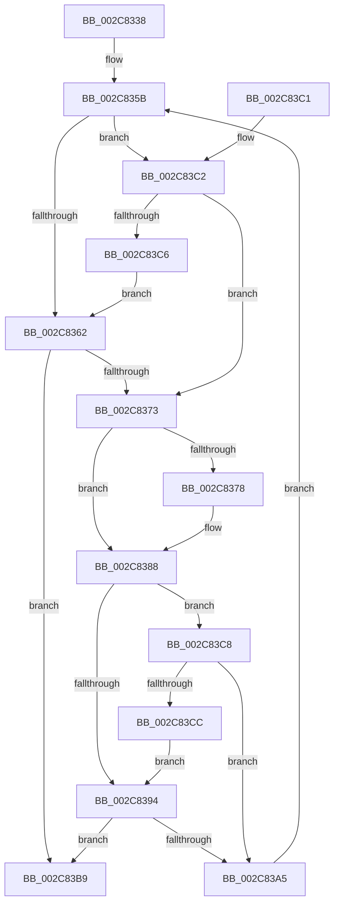

# AccelpSiovWaitForCompletionUMWait

- RVA: `0x002C8338`–`0x002C83CE` (길이 `150` bytes)
- VA: `0x00000001402C8338`
- 실행 섹션: `.text`
- PDB 이름 있음: `예`; PDB Function 태그: `아니요`
- unwind 정보 RVA: `0x0006EF04`
- 디코드: `50`개 명령, `150/150` bytes 표시
- 미해석 바이트: `0` (있으면 어셈블리에 `.byte`로 보존)

> 이 문서는 커널 이미지의 기계어와 PDB 기호를 분석해 생성했습니다. 4번과 5번은 함수 원형과 자료형을 바이너리 사용 방식에서 추정한 C 해석이며 원본 소스 복구 결과는 아닙니다.

## 1. Dependencies

- 직접 호출 지점: **0**; 고유 호출 대상: **0**
- 직접 호출자로 확인된 함수: **1**
- RIP 상대 이미지 참조: **0**

### Outgoing calls
- 직접 디코드된 call 명령이 없습니다.

### Direct callers
- [AccelpSiovInternalOperationHandler](AccelpSiovInternalOperationHandler_function_002C7DDC.md) at `0x002C7EC3`

### Static image references
- 디코드된 RIP-relative 메모리 참조가 없습니다.

## 2. Other-region calls and transfers

- 다른 실행 섹션으로 향하는 call: **0**
- 별도 외부 분기/꼬리 이동을 확인하지 못했습니다.

## 3. Assembly (complete function range)

```asm
002C8338  48 89 74 24 10                  mov qword ptr [rsp + 0x10], rsi
002C833D  BE 01 00 00 00                  mov esi, 1
002C8342  4C 8B C2                        mov r8, rdx
002C8345  44 8A DE                        mov r11b, sil
002C8348  44 8B D1                        mov r10d, ecx
002C834B  0F 31                           rdtsc
002C834D  48 C1 E2 20                     shl rdx, 0x20
002C8351  48 0B C2                        or rax, rdx
002C8354  4C 8D 88 40 4B 4C 00            lea r9, [rax + 0x4c4b40]
002C835B  41 8B D2                        mov edx, r10d
002C835E  2B D6                           sub edx, esi
002C8360  75 60                           jne 0x1402c83c2
002C8362  41 8A 00                        mov al, byte ptr [r8]
002C8365  24 3F                           and al, 0x3f
002C8367  88 44 24 08                     mov byte ptr [rsp + 8], al
002C836B  8A 44 24 08                     mov al, byte ptr [rsp + 8]
002C836F  84 C0                           test al, al
002C8371  75 46                           jne 0x1402c83b9
002C8373  45 84 DB                        test r11b, r11b
002C8376  75 10                           jne 0x1402c8388
002C8378  0F 31                           rdtsc
002C837A  48 C1 E2 20                     shl rdx, 0x20
002C837E  48 0B C2                        or rax, rdx
002C8381  4C 8D 88 40 4B 4C 00            lea r9, [rax + 0x4c4b40]
002C8388  F3 49 0F AE F0                  umonitor r8
002C838D  41 8B CA                        mov ecx, r10d
002C8390  2B CE                           sub ecx, esi
002C8392  75 34                           jne 0x1402c83c8
002C8394  41 8A 00                        mov al, byte ptr [r8]
002C8397  24 3F                           and al, 0x3f
002C8399  88 44 24 08                     mov byte ptr [rsp + 8], al
002C839D  8A 44 24 08                     mov al, byte ptr [rsp + 8]
002C83A1  84 C0                           test al, al
002C83A3  75 14                           jne 0x1402c83b9
002C83A5  49 8B D1                        mov rdx, r9
002C83A8  49 8B C1                        mov rax, r9
002C83AB  48 C1 EA 20                     shr rdx, 0x20
002C83AF  F2 0F AE F6                     umwait esi
002C83B3  41 0F 92 C3                     setb r11b
002C83B7  EB A2                           jmp 0x1402c835b
002C83B9  48 8B 74 24 10                  mov rsi, qword ptr [rsp + 0x10]
002C83BE  33 C0                           xor eax, eax
002C83C0  C3                              ret
002C83C1  CC                              int3
002C83C2  3B D6                           cmp edx, esi
002C83C4  75 AD                           jne 0x1402c8373
002C83C6  EB 9A                           jmp 0x1402c8362
002C83C8  3B CE                           cmp ecx, esi
002C83CA  75 D9                           jne 0x1402c83a5
002C83CC  EB C6                           jmp 0x1402c8394
```

## 4. C-style interpretation (structured pseudocode)

```c
__int64 __fastcall AccelpSiovWaitForCompletionUMWait(int a1, __int64 a2)
{
    __int64 result;
    __int64 v_r11;
    unsigned __int64 v_stack_p10;
    unsigned __int8 v_stack_p8;

    v_stack_p10 = v_rsi;
    a2 = (a2) << (32);
    result = (result) | (a2);
loc_002C835B:
    a2 = (unsigned int)(((unsigned int)((unsigned int)((unsigned int)(a1)))) - (1));
    if (condition_is_not_equal) goto loc_002C83C2;
loc_002C8362:
    result = (unsigned __int8)((*(unsigned __int8 *)(a2)) & (63));
    v_stack_p8 = (unsigned __int8)(result);
    if ((unsigned __int8)(v_stack_p8) != 0) goto loc_002C83B9;
loc_002C8373:
    result = v_stack_p8;
    if (1 == 0) {
        a2 = (a2) << (32);
        result = (v_stack_p8) | (a2);
        a4 = result + 5000000;
    }
    a1 = (unsigned int)(((unsigned int)((unsigned int)((unsigned int)(a1)))) - (1));
    if (condition_is_not_equal) goto loc_002C83C8;
loc_002C8394:
    result = (unsigned __int8)((*(unsigned __int8 *)(a2)) & (63));
    v_stack_p8 = (unsigned __int8)(result);
    if ((unsigned __int8)(v_stack_p8) != 0) goto loc_002C83B9;
loc_002C83A5:
    a2 = (a4) >> (32);
    v_r11 = (condition_is_below) ? 1 : 0;
    goto loc_002C835B;
loc_002C83B9:
    result = 0;
    return result;
loc_002C83C2:
    if (((unsigned int)(a2)) != ((unsigned int)(v_stack_p10))) goto loc_002C8373;
    goto loc_002C8362;
loc_002C83C8:
    if (a1 != ((unsigned int)(v_stack_p10))) goto loc_002C83A5;
    goto loc_002C8394;
}
```

## 5. (Beta) C Style

```c
int64_t AccelpSiovWaitForCompletionUMWait(int32_t Arg1, int64_t Arg2)
{
    int64_t result;
    int64_t local_r11;
    uint64_t v_stack_p10;
    uint8_t v_stack_p8;

    v_stack_p10 = local_rsi;
    Arg2 = (Arg2) << (32);
    result = (result) | (Arg2);
loc_002C835B:
    Arg2 = (uint32_t)(((uint32_t)((uint32_t)((uint32_t)(Arg1)))) - (1));
    if (condition_is_not_equal) goto loc_002C83C2;
loc_002C8362:
    result = (uint8_t)((*(uint8_t *)(Arg2)) & (63));
    v_stack_p8 = (uint8_t)(result);
    if ((uint8_t)(v_stack_p8) != 0) goto loc_002C83B9;
loc_002C8373:
    result = v_stack_p8;
    if (1 == 0) {
        Arg2 = (Arg2) << (32);
        result = (v_stack_p8) | (Arg2);
        a4 = result + 5000000;
    }
    Arg1 = (uint32_t)(((uint32_t)((uint32_t)((uint32_t)(Arg1)))) - (1));
    if (condition_is_not_equal) goto loc_002C83C8;
loc_002C8394:
    result = (uint8_t)((*(uint8_t *)(Arg2)) & (63));
    v_stack_p8 = (uint8_t)(result);
    if ((uint8_t)(v_stack_p8) != 0) goto loc_002C83B9;
loc_002C83A5:
    Arg2 = (a4) >> (32);
    local_r11 = (condition_is_below) ? 1 : 0;
    goto loc_002C835B;
loc_002C83B9:
    result = 0;
    return result;
loc_002C83C2:
    if (((uint32_t)(Arg2)) != ((uint32_t)(v_stack_p10))) goto loc_002C8373;
    goto loc_002C8362;
loc_002C83C8:
    if (Arg1 != ((uint32_t)(v_stack_p10))) goto loc_002C83A5;
    goto loc_002C8394;
}
```

## 6. Execution-region graph

[열기: 2D/3D 그래프와 함수 탐색 컨트롤 패널](../../../control-panel.html?section=text&rva=0x002C8338&view=graph)

- 2D 그래프는 위에서 아래로 흐르고, 3D 그래프는 빈 공간을 드래그해 회전합니다. Shift+드래그는 이동, 휠은 확대·축소, 함수 노드 선택은 대상 보고서 이동입니다.

### Static fallback


