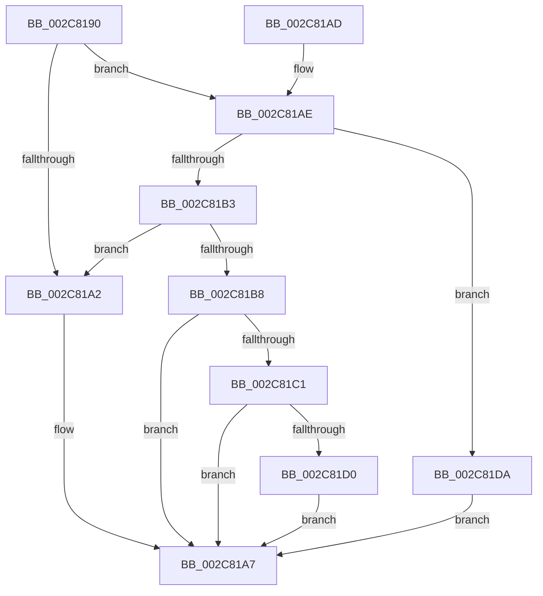

# AccelpSubmitWork

- RVA: `0x002C8190`–`0x002C81E1` (길이 `81` bytes)
- VA: `0x00000001402C8190`
- 실행 섹션: `.text`
- PDB 이름 있음: `예`; PDB Function 태그: `아니요`
- unwind 정보 RVA: `0x0006EED4`
- 디코드: `27`개 명령, `81/81` bytes 표시
- 미해석 바이트: `0` (있으면 어셈블리에 `.byte`로 보존)

> 이 문서는 커널 이미지의 기계어와 PDB 기호를 분석해 생성했습니다. 4번과 5번은 함수 원형과 자료형을 바이너리 사용 방식에서 추정한 C 해석이며 원본 소스 복구 결과는 아닙니다.

## 1. Dependencies

- 직접 호출 지점: **4**; 고유 호출 대상: **3**
- 직접 호출자로 확인된 함수: **7**
- RIP 상대 이미지 참조: **0**

### Outgoing calls
- `0x002C81B8` → [AccelSubmitWorkAsync](AccelSubmitWorkAsync_function_002C81E8.md) (function, `0x002C81E8`)
- `0x002C81C7` → [AccelWaitForWorkCompletion](AccelWaitForWorkCompletion_function_002C8270.md) (function, `0x002C8270`)
- `0x002C81D3` → [AccelGetStatusFromCompletionRecord](AccelGetStatusFromCompletionRecord_function_002C7B50.md) (function, `0x002C7B50`)
- `0x002C81DA` → [AccelSubmitWorkAsync](AccelSubmitWorkAsync_function_002C81E8.md) (function, `0x002C81E8`)

### Direct callers
- [MiFillMemory](MiFillMemory_function_002C7BD0.md) at `0x002C7C51`
- [AccelFillMemory](AccelFillMemory_function_002C7C7C.md) at `0x002C7CA2`
- [sub_003327E9](../33/Unknown_function_003327E9.md) at `0x00332812`
- [sub_00332A20](../33/Unknown_function_00332A20.md) at `0x00332A49`
- [AccelCompressBuffer](../66/AccelCompressBuffer_function_00668258.md) at `0x0066833B`
- [AccelDecompressBuffer](../66/AccelDecompressBuffer_function_006683C8.md) at `0x00668453`
- [AccelpComputeHistogram](../66/AccelpComputeHistogram_function_00668BA0.md) at `0x00668BC6`

### Static image references
- 디코드된 RIP-relative 메모리 참조가 없습니다.

## 2. Other-region calls and transfers

- 다른 실행 섹션으로 향하는 call: **0**
- 별도 외부 분기/꼬리 이동을 확인하지 못했습니다.

## 3. Assembly (complete function range)

```asm
002C8190  40 53                           push rbx
002C8192  48 83 EC 20                     sub rsp, 0x20
002C8196  48 8B D9                        mov rbx, rcx
002C8199  48 F7 C2 F0 FF FF FF            test rdx, -0x10
002C81A0  74 0C                           je 0x1402c81ae
002C81A2  B8 0D 00 00 C0                  mov eax, 0xc000000d
002C81A7  48 83 C4 20                     add rsp, 0x20
002C81AB  5B                              pop rbx
002C81AC  C3                              ret
002C81AD  CC                              int3
002C81AE  F6 C2 04                        test dl, 4
002C81B1  75 27                           jne 0x1402c81da
002C81B3  48 85 DB                        test rbx, rbx
002C81B6  74 EA                           je 0x1402c81a2
002C81B8  E8 2B 00 00 00                  call 0x1402c81e8
002C81BD  85 C0                           test eax, eax
002C81BF  78 E6                           js 0x1402c81a7
002C81C1  45 33 C0                        xor r8d, r8d
002C81C4  48 8B CB                        mov rcx, rbx
002C81C7  E8 A4 00 00 00                  call 0x1402c8270
002C81CC  85 C0                           test eax, eax
002C81CE  78 D7                           js 0x1402c81a7
002C81D0  48 8B CB                        mov rcx, rbx
002C81D3  E8 78 F9 FF FF                  call 0x1402c7b50
002C81D8  EB CD                           jmp 0x1402c81a7
002C81DA  E8 09 00 00 00                  call 0x1402c81e8
002C81DF  EB C6                           jmp 0x1402c81a7
```

## 4. C-style interpretation (structured pseudocode)

```c
__int64 __fastcall AccelpSubmitWork(__int64 a1, __int64 a2, int a3)
{
    __int64 result;
    __int64 v_rsp;

    v_rsp = (v_rsp) - (32);
    if (((a2) & (-16)) == 0) goto loc_002C81AE;
loc_002C81A2:
loc_002C81A7:
    v_rsp = (v_rsp) + (32);
    return (unsigned int)(0xC000000DULL);
loc_002C81AE:
    if ((((unsigned __int8)(a2)) & (4)) != 0) goto loc_002C81DA;
    if (a1 == 0) goto loc_002C81A2;
    result = AccelSubmitWorkAsync(a1, a2, a3, a4);
    if (sign_flag) goto loc_002C81A7;
    a3 = 0;
    result = AccelWaitForWorkCompletion(a1, a2, a3, a4);
    if (sign_flag) goto loc_002C81A7;
    result = AccelGetStatusFromCompletionRecord(a1, a2, a3, a4);
    goto loc_002C81A7;
loc_002C81DA:
    result = AccelSubmitWorkAsync(a1, a2, a3, a4);
    goto loc_002C81A7;
}
```

## 5. (Beta) C Style

```c
int64_t AccelpSubmitWork(int64_t Arg1, int64_t Arg2, int32_t Arg3)
{
    int64_t result;
    int64_t local_rsp;

    local_rsp = (local_rsp) - (32);
    if (((Arg2) & (-16)) == 0) goto loc_002C81AE;
loc_002C81A2:
loc_002C81A7:
    local_rsp = (local_rsp) + (32);
    return (uint32_t)(0xC000000DULL);
loc_002C81AE:
    if ((((uint8_t)(Arg2)) & (4)) != 0) goto loc_002C81DA;
    if (Arg1 == 0) goto loc_002C81A2;
    result = AccelSubmitWorkAsync(Arg1, Arg2, Arg3, a4);
    if (sign_flag) goto loc_002C81A7;
    Arg3 = 0;
    result = AccelWaitForWorkCompletion(Arg1, Arg2, Arg3, a4);
    if (sign_flag) goto loc_002C81A7;
    result = AccelGetStatusFromCompletionRecord(Arg1, Arg2, Arg3, a4);
    goto loc_002C81A7;
loc_002C81DA:
    result = AccelSubmitWorkAsync(Arg1, Arg2, Arg3, a4);
    goto loc_002C81A7;
}
```

## 6. Execution-region graph

[열기: 2D/3D 그래프와 함수 탐색 컨트롤 패널](../../../control-panel.html?section=text&rva=0x002C8190&view=graph)

- 2D 그래프는 위에서 아래로 흐르고, 3D 그래프는 빈 공간을 드래그해 회전합니다. Shift+드래그는 이동, 휠은 확대·축소, 함수 노드 선택은 대상 보고서 이동입니다.

### Static fallback


