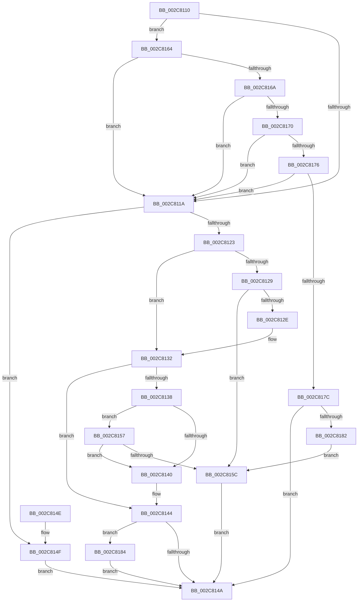

# DsaValidateDescriptorFlags

- RVA: `0x002C8110`–`0x002C818A` (길이 `122` bytes)
- VA: `0x00000001402C8110`
- 실행 섹션: `.text`
- PDB 이름 있음: `예`; PDB Function 태그: `아니요`
- unwind 정보 RVA: `0x000DB714`
- 디코드: `40`개 명령, `122/122` bytes 표시
- 미해석 바이트: `0` (있으면 어셈블리에 `.byte`로 보존)

> 이 문서는 커널 이미지의 기계어와 PDB 기호를 분석해 생성했습니다. 4번과 5번은 함수 원형과 자료형을 바이너리 사용 방식에서 추정한 C 해석이며 원본 소스 복구 결과는 아닙니다.

## 1. Dependencies

- 직접 호출 지점: **0**; 고유 호출 대상: **0**
- 직접 호출자로 확인된 함수: **1**
- RIP 상대 이미지 참조: **0**

### Outgoing calls
- 직접 디코드된 call 명령이 없습니다.

### Direct callers
- [AccelpSiovDsaOperationHandler](AccelpSiovDsaOperationHandler_function_002C7F30.md) at `0x002C7FBC`

### Static image references
- 디코드된 RIP-relative 메모리 참조가 없습니다.

## 2. Other-region calls and transfers

- 다른 실행 섹션으로 향하는 call: **0**
- 별도 외부 분기/꼬리 이동을 확인하지 못했습니다.

## 3. Assembly (complete function range)

```asm
002C8110  45 33 C9                        xor r9d, r9d
002C8113  44 8B D1                        mov r10d, ecx
002C8116  85 C9                           test ecx, ecx
002C8118  75 4A                           jne 0x1402c8164
002C811A  49 F7 C0 F0 FF FF FF            test r8, -0x10
002C8121  75 2C                           jne 0x1402c814f
002C8123  41 F6 C0 01                     test r8b, 1
002C8127  74 09                           je 0x1402c8132
002C8129  83 F9 01                        cmp ecx, 1
002C812C  76 2E                           jbe 0x1402c815c
002C812E  80 62 04 FD                     and byte ptr [rdx + 4], 0xfd
002C8132  41 F6 C0 02                     test r8b, 2
002C8136  74 0C                           je 0x1402c8144
002C8138  F7 C1 FA FF FF FF               test ecx, 0xfffffffa
002C813E  74 17                           je 0x1402c8157
002C8140  80 62 05 FE                     and byte ptr [rdx + 5], 0xfe
002C8144  41 F6 C0 08                     test r8b, 8
002C8148  75 3A                           jne 0x1402c8184
002C814A  41 8B C1                        mov eax, r9d
002C814D  C3                              ret
002C814E  CC                              int3
002C814F  41 B9 0D 00 00 C0               mov r9d, 0xc000000d
002C8155  EB F3                           jmp 0x1402c814a
002C8157  83 F9 04                        cmp ecx, 4
002C815A  74 E4                           je 0x1402c8140
002C815C  41 B9 BB 00 00 C0               mov r9d, 0xc00000bb
002C8162  EB E6                           jmp 0x1402c814a
002C8164  41 83 EA 01                     sub r10d, 1
002C8168  74 B0                           je 0x1402c811a
002C816A  41 83 EA 02                     sub r10d, 2
002C816E  74 AA                           je 0x1402c811a
002C8170  41 83 EA 01                     sub r10d, 1
002C8174  74 A4                           je 0x1402c811a
002C8176  41 83 EA 01                     sub r10d, 1
002C817A  74 9E                           je 0x1402c811a
002C817C  41 83 FA 1C                     cmp r10d, 0x1c
002C8180  74 C8                           je 0x1402c814a
002C8182  EB D8                           jmp 0x1402c815c
002C8184  80 62 04 F7                     and byte ptr [rdx + 4], 0xf7
002C8188  EB C0                           jmp 0x1402c814a
```

## 4. C-style interpretation (structured pseudocode)

```c
__int64 __fastcall DsaValidateDescriptorFlags(int a1, __int64 a2, __int64 a3, int a4)
{
    __int64 v_r10;

    a4 = 0;
    if (a1 != 0) goto loc_002C8164;
loc_002C811A:
    if (((a3) & (-16)) != 0) goto loc_002C814F;
    if ((((unsigned __int8)(a3)) & (1)) == 0) goto loc_002C8132;
    if (a1 <= 1) goto loc_002C815C;
loc_002C8132:
    if ((((unsigned __int8)(a3)) & (2)) == 0) goto loc_002C8144;
    if (((a1) & (0xFFFFFFFAULL)) == 0) goto loc_002C8157;
loc_002C8140:
loc_002C8144:
    if ((((unsigned __int8)(a3)) & (8)) != 0) goto loc_002C8184;
loc_002C814A:
    return 0;
loc_002C814F:
    goto loc_002C814A;
loc_002C8157:
    if (a1 == 4) goto loc_002C8140;
loc_002C815C:
    goto loc_002C814A;
loc_002C8164:
    v_r10 = (unsigned int)(((unsigned int)(a1)) - (1));
    if (condition_is_equal) goto loc_002C811A;
    v_r10 = (unsigned int)((v_r10) - (2));
    if (condition_is_equal) goto loc_002C811A;
    v_r10 = (unsigned int)((v_r10) - (1));
    if (condition_is_equal) goto loc_002C811A;
    v_r10 = (unsigned int)((v_r10) - (1));
    if (condition_is_equal) goto loc_002C811A;
    if (((unsigned int)(v_r10)) == 28) goto loc_002C814A;
    goto loc_002C815C;
loc_002C8184:
    goto loc_002C814A;
}
```

## 5. (Beta) C Style

```c
int64_t DsaValidateDescriptorFlags(int32_t Arg1, void *Arg2, int64_t Arg3, int32_t Arg4)
{
    uint8_t *arg2 = (uint8_t *)Arg2;

    int64_t local_r10;

    Arg4 = 0;
    if (Arg1 != 0) goto loc_002C8164;
loc_002C811A:
    if (((Arg3) & (-16)) != 0) goto loc_002C814F;
    if ((((uint8_t)(Arg3)) & (1)) == 0) goto loc_002C8132;
    if (Arg1 <= 1) goto loc_002C815C;
loc_002C8132:
    if ((((uint8_t)(Arg3)) & (2)) == 0) goto loc_002C8144;
    if (((Arg1) & (0xFFFFFFFAULL)) == 0) goto loc_002C8157;
loc_002C8140:
loc_002C8144:
    if ((((uint8_t)(Arg3)) & (8)) != 0) goto loc_002C8184;
loc_002C814A:
    return 0;
loc_002C814F:
    goto loc_002C814A;
loc_002C8157:
    if (Arg1 == 4) goto loc_002C8140;
loc_002C815C:
    goto loc_002C814A;
loc_002C8164:
    local_r10 = (uint32_t)(((uint32_t)(Arg1)) - (1));
    if (condition_is_equal) goto loc_002C811A;
    local_r10 = (uint32_t)((local_r10) - (2));
    if (condition_is_equal) goto loc_002C811A;
    local_r10 = (uint32_t)((local_r10) - (1));
    if (condition_is_equal) goto loc_002C811A;
    local_r10 = (uint32_t)((local_r10) - (1));
    if (condition_is_equal) goto loc_002C811A;
    if (((uint32_t)(local_r10)) == 28) goto loc_002C814A;
    goto loc_002C815C;
loc_002C8184:
    goto loc_002C814A;
}
```

### 관측된 메모리 오프셋

구조체 형식이 확인되지 않은 접근은 인자 기준의 오프셋으로만 기록했습니다.

| 기준 인자 | 오프셋 표현 | 폭 (bit) | 접근 |
|---|---:|---:|---|
| `Arg2` | `+ 0x4` | `8` | `R/W` |
| `Arg2` | `+ 0x5` | `8` | `R/W` |

## 6. Execution-region graph

[열기: 2D/3D 그래프와 함수 탐색 컨트롤 패널](../../../control-panel.html?section=text&rva=0x002C8110&view=graph)

- 2D 그래프는 위에서 아래로 흐르고, 3D 그래프는 빈 공간을 드래그해 회전합니다. Shift+드래그는 이동, 휠은 확대·축소, 함수 노드 선택은 대상 보고서 이동입니다.

### Static fallback


