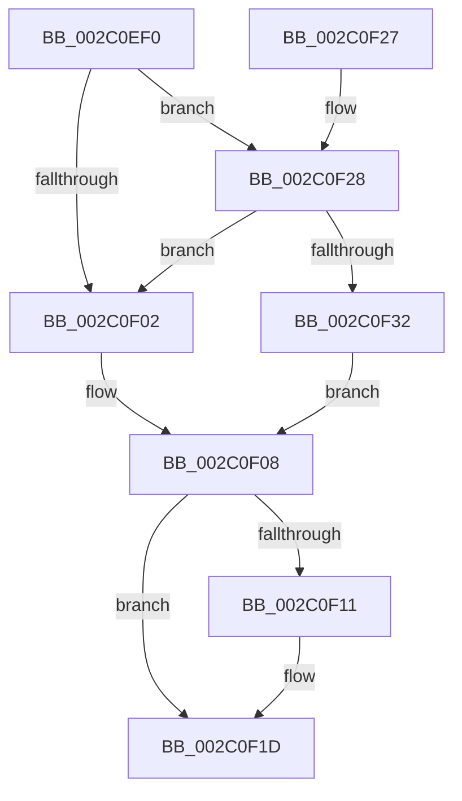

# ExReleaseSpinLockExclusive

- RVA: `0x002C0EF0`–`0x002C0F3E` (길이 `78` bytes)
- VA: `0x00000001402C0EF0`
- 실행 섹션: `.text`
- PDB 이름 있음: `예`; PDB Function 태그: `아니요`
- unwind 정보 RVA: `0x00068804`
- 디코드: `22`개 명령, `78/78` bytes 표시
- 미해석 바이트: `0` (있으면 어셈블리에 `.byte`로 보존)

> 이 문서는 커널 이미지의 기계어와 PDB 기호를 분석해 생성했습니다. 4번과 5번은 함수 원형과 자료형을 바이너리 사용 방식에서 추정한 C 해석이며 원본 소스 복구 결과는 아닙니다.

## 1. Dependencies

- 직접 호출 지점: **2**; 고유 호출 대상: **2**
- 직접 호출자로 확인된 함수: **68**
- RIP 상대 이미지 참조: **3**

### Outgoing calls
- `0x002C0F18` → [KiLowerIrqlProcessIrqlFlags](../4F/KiLowerIrqlProcessIrqlFlags_function_004F5698.md) (function, `0x004F5698`)
- `0x002C0F37` → [ExpReleaseSpinLockExclusiveFromDpcLevelInstrumented](ExpReleaseSpinLockExclusiveFromDpcLevelInstrumented_function_002C0F44.md) (function, `0x002C0F44`)

### Direct callers
- [PopPepProcessEvent](../24/PopPepProcessEvent_function_0024B930.md) at `0x0024CBD9`
- [PopPepReleaseActivityLink](../24/PopPepReleaseActivityLink_function_0024CC90.md) at `0x0024CD3A`
- [SMKM_STORE_MGR&lt;SM_TRAITS&gt;::SmCompressCtxProcessReadyQueue](../26/SMKM_STORE_MGR_SM_TRAITS_SmCompressCtxProcessReadyQueue_function_002678F0.md) at `0x00267968`
- [SMKM_STORE_MGR&lt;SM_TRAITS&gt;::SmCompressCtxWorkerThread](../26/SMKM_STORE_MGR_SM_TRAITS_SmCompressCtxWorkerThread_function_00267D20.md) at `0x00267E17`
- [SMKM_STORE_MGR&lt;SM_TRAITS&gt;::SmCompressCtxWorkerThread](../26/SMKM_STORE_MGR_SM_TRAITS_SmCompressCtxWorkerThread_function_00267D20.md) at `0x002680CE`
- [SMKM_STORE_MGR&lt;SM_TRAITS&gt;::SmCompressCtxWorkerThread](../26/SMKM_STORE_MGR_SM_TRAITS_SmCompressCtxWorkerThread_function_00267D20.md) at `0x00268163`
- [PopFxHandleReportDevicePoweredOn](../26/PopFxHandleReportDevicePoweredOn_function_0026D980.md) at `0x0026DB38`
- [PopFxReleasePowerIrp](../27/PopFxReleasePowerIrp_function_00270274.md) at `0x002702F7`
- [MiCheckControlArea](../28/MiCheckControlArea_function_002861B0.md) at `0x00286418`
- [IoStopDiskIoAttributionForContext](../2A/IoStopDiskIoAttributionForContext_function_002A5614.md) at `0x002A564C`
- [PopPepComponentSetLatency](../2B/PopPepComponentSetLatency_function_002BF3D8.md) at `0x002BF5A5`
- [PopFxArmResidentTimer](PopFxArmResidentTimer_function_002C0680.md) at `0x002C06F6`
- [PopFxAllocatePowerIrp](PopFxAllocatePowerIrp_function_002C0920.md) at `0x002C0AB4`
- [PopPepArmIdleTimer](PopPepArmIdleTimer_function_002C0B9C.md) at `0x002C0C18`
- [PfSnNameQueryWorker](PfSnNameQueryWorker_function_002C0E20.md) at `0x002C0E69`
- [PfSnNameQueryWorker](PfSnNameQueryWorker_function_002C0E20.md) at `0x002C0EBF`
- [SepCleanupMarkedForDeletionEntries](../2E/SepCleanupMarkedForDeletionEntries_function_002EEC84.md) at `0x002EED0E`
- [SepInitSingletonEntry](../2E/SepInitSingletonEntry_function_002EEF64.md) at `0x002EEF94`
- [ExpAddTagForBigPages](../2E/ExpAddTagForBigPages_function_002EF570.md) at `0x002EF8DD`
- [RtlpCSparseBitmapUnlock](../2F/RtlpCSparseBitmapUnlock_function_002F0DD0.md) at `0x002F0E00`
- [HalpBuddyAllocatorAllocateLogicalAddress](../30/HalpBuddyAllocatorAllocateLogicalAddress_function_00307EE0.md) at `0x00308269`
- [PfSnGetFileInformation](../34/PfSnGetFileInformation_function_00343210.md) at `0x00343528`
- [SMKM_STORE_MGR&lt;SM_TRAITS&gt;::SmCompressCtxBalancerThread](../3B/SMKM_STORE_MGR_SM_TRAITS_SmCompressCtxBalancerThread_function_003B22C0.md) at `0x003B234F`
- [SMKM_STORE_MGR&lt;SM_TRAITS&gt;::SmCompressCtxBalancerThread](../3B/SMKM_STORE_MGR_SM_TRAITS_SmCompressCtxBalancerThread_function_003B22C0.md) at `0x003B23C2`
- [PspIumFreePartitionPages](../3E/PspIumFreePartitionPages_function_003E79D8.md) at `0x003E7A35`
- [EtwpUnregisterPartitionPages](../3E/EtwpUnregisterPartitionPages_function_003EBA68.md) at `0x003EBC35`
- [ExCompareExchangeCallBack](../41/ExCompareExchangeCallBack_function_0041BCD0.md) at `0x0041BD74`
- [PfSnNameRemove](../43/PfSnNameRemove_function_0043E3C0.md) at `0x0043E4C8`
- [ExGetBigPoolInfo](../44/ExGetBigPoolInfo_function_00446970.md) at `0x00446A19`
- [ExGetBigPoolInfo](../44/ExGetBigPoolInfo_function_00446970.md) at `0x00446B17`
- [ExGetBigPoolInfo](../44/ExGetBigPoolInfo_function_00446970.md) at `0x00446B65`
- [PopPepIdleTimeoutRoutine](../45/PopPepIdleTimeoutRoutine_function_00458E10.md) at `0x00458F70`
- [IoStartDiskIoAttributionForContext](../46/IoStartDiskIoAttributionForContext_function_0046B434.md) at `0x0046B4E1`
- [PoFxIdleDevice](../48/PoFxIdleDevice_function_00483EE8.md) at `0x00483F59`
- [IoSetDiskIoAttributionOnProcess](../49/IoSetDiskIoAttributionOnProcess_function_0049521C.md) at `0x00495287`
- [FlushLookUpTableBucket](../49/FlushLookUpTableBucket_function_00497690.md) at `0x0049774C`
- [PspJobIoRateVolumeEntryRemoveAll](../49/PspJobIoRateVolumeEntryRemoveAll_function_00499D44.md) at `0x00499E28`
- [PopFxIncrementDeviceSleepCount](../49/PopFxIncrementDeviceSleepCount_function_0049C040.md) at `0x0049C098`
- [PopFxActivateDevice](../4A/PopFxActivateDevice_function_004A0DC8.md) at `0x004A0E43`
- [PopFxActivateDevice](../4A/PopFxActivateDevice_function_004A0DC8.md) at `0x004A0EAE`
- [PsIoRateControlOverQuotaNotify](../4A/PsIoRateControlOverQuotaNotify_function_004A148C.md) at `0x004A150B`
- [PopFxIsDevicePotentialDripsConstraint](../4A/PopFxIsDevicePotentialDripsConstraint_function_004A5D34.md) at `0x004A5E13`
- [PopPepUpdateDripsDeviceVetoMask](../4B/PopPepUpdateDripsDeviceVetoMask_function_004B079C.md) at `0x004B08BD`
- [RtlpHpAcquireReleaseLockExclusive](../4B/RtlpHpAcquireReleaseLockExclusive_function_004B208C.md) at `0x004B2118`
- [PopPepDeviceStarted](../4B/PopPepDeviceStarted_function_004B58D4.md) at `0x004B58FA`
- [SMKM_STORE_MGR&lt;SM_TRAITS&gt;::SmCompressCtxUpdatePriority](../4B/SMKM_STORE_MGR_SM_TRAITS_SmCompressCtxUpdatePriority_function_004BD314.md) at `0x004BD36A`
- [SepExpandSingletonArrays](../4B/SepExpandSingletonArrays_function_004BFCE0.md) at `0x004BFD91`
- [SepExpandSingletonArrays](../4B/SepExpandSingletonArrays_function_004BFCE0.md) at `0x004BFDCD`
- [PopFxAssignDeviceToDevNode](../4C/PopFxAssignDeviceToDevNode_function_004C3CAC.md) at `0x004C3CF5`
- [IopMcAddMdlPagesToTable](../4C/IopMcAddMdlPagesToTable_function_004C82F8.md) at `0x004C83AE`
- [IopMcAddMdlPagesToTable](../4C/IopMcAddMdlPagesToTable_function_004C82F8.md) at `0x004C845D`
- [PopPepInitializeVetoMasks](../4C/PopPepInitializeVetoMasks_function_004C9350.md) at `0x004C9882`
- [SmFpPreAllocate](../4C/SmFpPreAllocate_function_004CF32C.md) at `0x004CF4EA`
- [SmpFpReleaseResource](../4F/SmpFpReleaseResource_function_004FAC90.md) at `0x004FACE4`
- [PopPepWaitForDeviceRelease](../4F/PopPepWaitForDeviceRelease_function_004FC920.md) at `0x004FC937`
- [IommupDomainAttachPasidDevice](../54/IommupDomainAttachPasidDevice_function_0054F984.md) at `0x0054FB11`
- [IommupDomainAttachPasidDevice](../54/IommupDomainAttachPasidDevice_function_0054F984.md) at `0x0054FBC2`
- [IommupDomainAttachPasidDevice](../54/IommupDomainAttachPasidDevice_function_0054F984.md) at `0x0054FCA1`
- [IommupDomainAttachPasidDevice](../54/IommupDomainAttachPasidDevice_function_0054F984.md) at `0x0054FCD6`
- [IommupDomainDetachPasidDevice](../54/IommupDomainDetachPasidDevice_function_0054FD50.md) at `0x0054FE54`
- [HalpNumaAddRangeProximity](../55/HalpNumaAddRangeProximity_function_00558EC0.md) at `0x00558FCB`
- [HalpNumaAddRangeProximity](../55/HalpNumaAddRangeProximity_function_00558EC0.md) at `0x005590EA`
- [HalpNumaAddRangeProximity](../55/HalpNumaAddRangeProximity_function_00558EC0.md) at `0x005591AD`
- [HalpUpdateCoolingPacket](../56/HalpUpdateCoolingPacket_function_00569530.md) at `0x005695CC`
- [IopMcRemoveMdlPagesFromTable](../5A/IopMcRemoveMdlPagesFromTable_function_005A3D94.md) at `0x005A3E32`
- [IopMcRemoveMdlPagesFromTable](../5A/IopMcRemoveMdlPagesFromTable_function_005A3D94.md) at `0x005A3E73`
- [PoFxAddComponentRelation](../5D/PoFxAddComponentRelation_function_005D15E0.md) at `0x005D1671`
- [PoFxAddComponentRelation](../5D/PoFxAddComponentRelation_function_005D15E0.md) at `0x005D168B`
- [PoFxAddDeviceRelation](../5D/PoFxAddDeviceRelation_function_005D1850.md) at `0x005D18C3`
- [PoFxAddDeviceRelation](../5D/PoFxAddDeviceRelation_function_005D1850.md) at `0x005D18DD`
- [PoFxRegisterDripsWatchdogCallback](../5D/PoFxRegisterDripsWatchdogCallback_function_005D1BD0.md) at `0x005D1C41`
- [PoFxRemoveComponentRelation](../5D/PoFxRemoveComponentRelation_function_005D1C90.md) at `0x005D1D26`
- [PoFxRemoveComponentRelation](../5D/PoFxRemoveComponentRelation_function_005D1C90.md) at `0x005D1D40`
- [PoFxRemoveDeviceRelation](../5D/PoFxRemoveDeviceRelation_function_005D1EF0.md) at `0x005D1F5F`
- [PoFxRemoveDeviceRelation](../5D/PoFxRemoveDeviceRelation_function_005D1EF0.md) at `0x005D1F79`
- [PopFxGetParentFxDevice](../5D/PopFxGetParentFxDevice_function_005D2B9C.md) at `0x005D2BE4`
- [PspJobIoRateVolumeEntryInsert](../5E/PspJobIoRateVolumeEntryInsert_function_005E39C8.md) at `0x005E3A65`
- [PspJobIoRateVolumeEntryRemove](../5E/PspJobIoRateVolumeEntryRemove_function_005E3B6C.md) at `0x005E3C0F`
- [PspAddPartitionToGlobalList](../5E/PspAddPartitionToGlobalList_function_005E4B24.md) at `0x005E4B71`
- [PspRemovePartitionFromGlobalList](../5E/PspRemovePartitionFromGlobalList_function_005E4B84.md) at `0x005E4BBF`
- [SepSetSingletonEntry](../60/SepSetSingletonEntry_function_00609DA0.md) at `0x00609E4D`
- [SmpFpWaitForResource](../61/SmpFpWaitForResource_function_006102A4.md) at `0x0061033C`
- [SmRecordDecompressionFailureDumpPayload](../61/SmRecordDecompressionFailureDumpPayload_function_00611120.md) at `0x00611348`
- [ViIrpDatabaseReleaseLockExclusive](../61/ViIrpDatabaseReleaseLockExclusive_function_00617720.md) at `0x0061772D`
- [EtwpRegisterPartitionPages](../65/EtwpRegisterPartitionPages_function_00652960.md) at `0x00652C03`
- [sub_006FBB10](../6F/Unknown_function_006FBB10.md) at `0x006FBBB9`
- [PopSystemIrpCompletion](../../pagelk/B7/PopSystemIrpCompletion_function_00B70CC0.md) at `0x00B70E0D`
- [PopSystemIrpCompletion](../../pagelk/B7/PopSystemIrpCompletion_function_00B70CC0.md) at `0x00B70E1D`

### Static image references
- `0x002C0EF6` → RVA `0x00FC6B06` (`ALMOSTRO`; read)
- `0x002C0F08` → RVA `0x00FC6D20` (`ALMOSTRO`; read)
- `0x002C0F28` → RVA `0x00F0DE58` (`.data`; read)

## 2. Other-region calls and transfers

- 다른 실행 섹션으로 향하는 call: **0**
- 별도 외부 분기/꼬리 이동을 확인하지 못했습니다.

## 3. Assembly (complete function range)

```asm
002C0EF0  40 53                           push rbx
002C0EF2  48 83 EC 20                     sub rsp, 0x20
002C0EF6  F6 05 09 5C D0 00 01            test byte ptr [rip + 0xd05c09], 1
002C0EFD  0F B6 DA                        movzx ebx, dl
002C0F00  75 26                           jne 0x1402c0f28
002C0F02  C7 01 00 00 00 00               mov dword ptr [rcx], 0
002C0F08  83 3D 11 5E D0 00 00            cmp dword ptr [rip + 0xd05e11], 0
002C0F0F  74 0C                           je 0x1402c0f1d
002C0F11  44 0F 20 C1                     mov rcx, cr8
002C0F15  0F B6 D3                        movzx edx, bl
002C0F18  E8 7B 47 23 00                  call 0x1404f5698
002C0F1D  44 0F 22 C3                     mov cr8, rbx
002C0F21  48 83 C4 20                     add rsp, 0x20
002C0F25  5B                              pop rbx
002C0F26  C3                              ret
002C0F27  CC                              int3
002C0F28  8B 05 2A CF C4 00               mov eax, dword ptr [rip + 0xc4cf2a]
002C0F2E  85 C0                           test eax, eax
002C0F30  75 D0                           jne 0x1402c0f02
002C0F32  48 8B 54 24 28                  mov rdx, qword ptr [rsp + 0x28]
002C0F37  E8 08 00 00 00                  call 0x1402c0f44
002C0F3C  EB CA                           jmp 0x1402c0f08
```

## 4. C-style interpretation (structured pseudocode)

```c
__int64 __fastcall ExReleaseSpinLockExclusive(__int64 a1, unsigned __int8 a2)
{
    __int64 result;
    __int64 v_rsp;
    unsigned __int64 v_stack_p28;

    v_rsp = (v_rsp) - (32);
    if (((*(unsigned __int8 *)(v_rip + 13655049)) & (1)) != 0) goto loc_002C0F28;
loc_002C0F02:
    *(unsigned int *)(a1) = 0;
loc_002C0F08:
    if ((*(unsigned int *)(v_rip + 13655569)) != 0) {
        a1 = v_cr8;
        a2 = a2;
        result = KiLowerIrqlProcessIrqlFlags(a1, a2, a3, a4);
    }
    v_rsp = (v_rsp) + (32);
    return result;
loc_002C0F28:
    if ((unsigned int)((unsigned int)(*(unsigned int *)(v_rip + 12898090))) != 0) goto loc_002C0F02;
    result = ExpReleaseSpinLockExclusiveFromDpcLevelInstrumented(a1, v_stack_p28, a3, a4);
    goto loc_002C0F08;
}
```

## 5. (Beta) C Style

```c
int64_t ExReleaseSpinLockExclusive(void *Arg1, uint8_t Arg2)
{
    uint8_t *arg1 = (uint8_t *)Arg1;

    int64_t result;
    int64_t local_rsp;
    uint64_t v_stack_p28;

    local_rsp = (local_rsp) - (32);
    if (((*(uint8_t *)(v_rip + 0xD05C09)) & (1)) != 0) goto loc_002C0F28;
loc_002C0F02:
    *(uint32_t *)(arg1) = 0;
loc_002C0F08:
    if ((*(uint32_t *)(v_rip + 0xD05E11)) != 0) {
        Arg1 = v_cr8;
        Arg2 = Arg2;
        result = KiLowerIrqlProcessIrqlFlags(Arg1, Arg2, a3, a4);
    }
    local_rsp = (local_rsp) + (32);
    return result;
loc_002C0F28:
    if ((uint32_t)((uint32_t)(*(uint32_t *)(v_rip + 0xC4CF2A))) != 0) goto loc_002C0F02;
    result = ExpReleaseSpinLockExclusiveFromDpcLevelInstrumented(Arg1, v_stack_p28, a3, a4);
    goto loc_002C0F08;
}
```

### 관측된 메모리 오프셋

구조체 형식이 확인되지 않은 접근은 인자 기준의 오프셋으로만 기록했습니다.

| 기준 인자 | 오프셋 표현 | 폭 (bit) | 접근 |
|---|---:|---:|---|
| `Arg1` | `+ 0x0` | `32` | `W` |

## 6. Execution-region graph

[열기: 2D/3D 그래프와 함수 탐색 컨트롤 패널](../../../control-panel.html?section=text&rva=0x002C0EF0&view=graph)

- 2D 그래프는 위에서 아래로 흐르고, 3D 그래프는 빈 공간을 드래그해 회전합니다. Shift+드래그는 이동, 휠은 확대·축소, 함수 노드 선택은 대상 보고서 이동입니다.

### Static fallback


