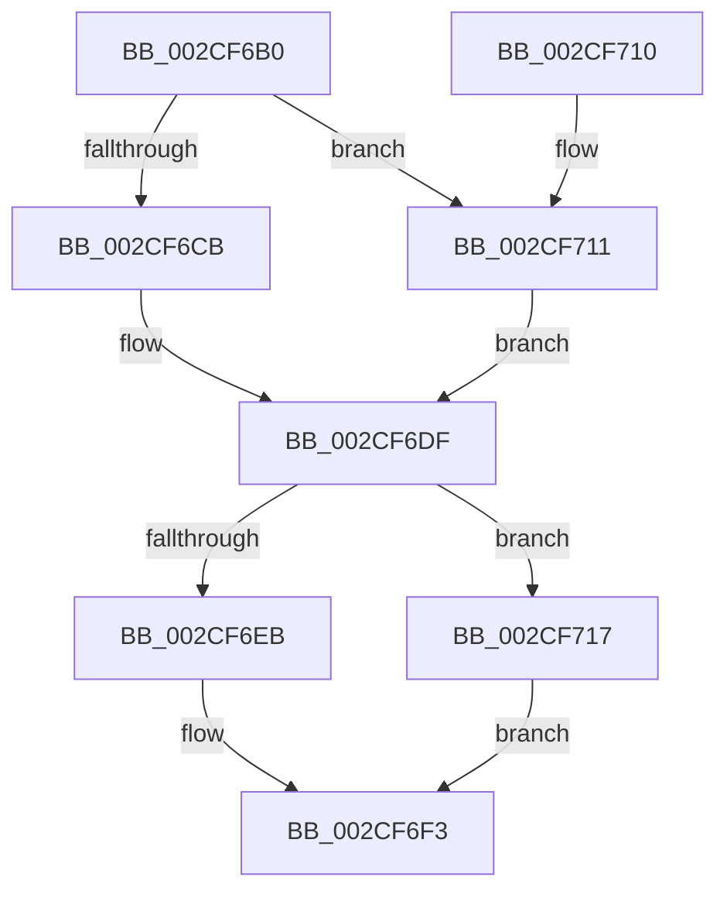

# KeAndGroupAffinityEx

- RVA: `0x002CF6B0`–`0x002CF71C` (길이 `108` bytes)
- VA: `0x00000001402CF6B0`
- 실행 섹션: `.text`
- PDB 이름 있음: `예`; PDB Function 태그: `아니요`
- unwind 정보 RVA: `0x0006F660`
- 디코드: `32`개 명령, `108/108` bytes 표시
- 미해석 바이트: `0` (있으면 어셈블리에 `.byte`로 보존)

> 이 문서는 커널 이미지의 기계어와 PDB 기호를 분석해 생성했습니다. 4번과 5번은 함수 원형과 자료형을 바이너리 사용 방식에서 추정한 C 해석이며 원본 소스 복구 결과는 아닙니다.

## 1. Dependencies

- 직접 호출 지점: **1**; 고유 호출 대상: **1**
- 직접 호출자로 확인된 함수: **5**
- RIP 상대 이미지 참조: **1**

### Outgoing calls
- `0x002CF706` → [_security_check_cookie](../6A/_security_check_cookie_function_006AC640.md) (function, `0x006AC640`)

### Direct callers
- [PnpSetDeviceAffinityThread](../27/PnpSetDeviceAffinityThread_function_00271EA4.md) at `0x00271F2D`
- [KeQueryLogicalProcessorRelationship](KeQueryLogicalProcessorRelationship_function_002CEA60.md) at `0x002CEDCC`
- [PpmEventDomainPerfStateChange](../47/PpmEventDomainPerfStateChange_function_0047B720.md) at `0x0047B824`
- [HalSendNMI](../54/HalSendNMI_function_00545E80.md) at `0x00545FFB`
- [PpmEventTraceProcessorPerformanceDomainRundown](../../page/A8/PpmEventTraceProcessorPerformanceDomainRundown_function_00A8FCC4.md) at `0x00A8FD6E`

### Static image references
- `0x002CF6B4` → RVA `0x00E0A740` (`.data`; read)

## 2. Other-region calls and transfers

- 다른 실행 섹션으로 향하는 call: **0**
- 별도 외부 분기/꼬리 이동을 확인하지 못했습니다.

## 3. Assembly (complete function range)

```asm
002CF6B0  48 83 EC 28                     sub rsp, 0x28
002CF6B4  48 8B 05 85 B0 B3 00            mov rax, qword ptr [rip + 0xb3b085]
002CF6BB  48 33 C4                        xor rax, rsp
002CF6BE  48 89 44 24 10                  mov qword ptr [rsp + 0x10], rax
002CF6C3  4C 8B C9                        mov r9, rcx
002CF6C6  4D 85 C0                        test r8, r8
002CF6C9  74 46                           je 0x1402cf711
002CF6CB  33 C0                           xor eax, eax
002CF6CD  41 89 40 0A                     mov dword ptr [r8 + 0xa], eax
002CF6D1  66 41 89 40 0E                  mov word ptr [r8 + 0xe], ax
002CF6D6  0F B7 42 08                     movzx eax, word ptr [rdx + 8]
002CF6DA  66 41 89 40 08                  mov word ptr [r8 + 8], ax
002CF6DF  0F B7 42 08                     movzx eax, word ptr [rdx + 8]
002CF6E3  33 C9                           xor ecx, ecx
002CF6E5  66 41 39 01                     cmp word ptr [r9], ax
002CF6E9  76 2C                           jbe 0x1402cf717
002CF6EB  49 8B 44 C1 08                  mov rax, qword ptr [r9 + rax*8 + 8]
002CF6F0  48 23 02                        and rax, qword ptr [rdx]
002CF6F3  48 85 C0                        test rax, rax
002CF6F6  49 89 00                        mov qword ptr [r8], rax
002CF6F9  0F 95 C1                        setne cl
002CF6FC  8B C1                           mov eax, ecx
002CF6FE  48 8B 4C 24 10                  mov rcx, qword ptr [rsp + 0x10]
002CF703  48 33 CC                        xor rcx, rsp
002CF706  E8 35 CF 3D 00                  call 0x1406ac640
002CF70B  48 83 C4 28                     add rsp, 0x28
002CF70F  C3                              ret
002CF710  CC                              int3
002CF711  4C 8D 04 24                     lea r8, [rsp]
002CF715  EB C8                           jmp 0x1402cf6df
002CF717  48 8B C1                        mov rax, rcx
002CF71A  EB D7                           jmp 0x1402cf6f3
```

## 4. C-style interpretation (structured pseudocode)

```c
__int64 __fastcall KeAndGroupAffinityEx(__int64 a1, __int64 a2, __int64 a3)
{
    __int64 result;
    __int64 v_rsp;
    unsigned __int64 v_stack_m18;
    unsigned __int64 v_stack_p0;

    v_rsp = (v_rsp) - (40);
    result = (*(unsigned __int64 *)(v_rip + 11776133)) ^ (v_rsp);
    v_stack_m18 = result;
    if (a3 == 0) goto loc_002CF711;
    result = 0;
    *(unsigned int *)(a3 + 10) = 0;
    *(unsigned __int16 *)(a3 + 14) = 0;
    *(unsigned __int16 *)(a3 + 8) = (unsigned __int16)(*(unsigned __int16 *)(a2 + 8));
loc_002CF6DF:
    a1 = 0;
    if ((*(unsigned __int16 *)(a1)) <= ((unsigned __int16)(*(unsigned __int16 *)(a2 + 8)))) goto loc_002CF717;
    result = (*(unsigned __int64 *)(a1 + *(unsigned __int16 *)(a2 + 8) * 8 + 8)) & (*(unsigned __int64 *)(a2));
loc_002CF6F3:
    *(unsigned __int64 *)(a3) = result;
    a1 = (result != 0) ? 1 : 0;
    a1 = (v_stack_m18) ^ (v_rsp);
    result = _security_check_cookie(a1, a2, a3, a1);
    v_rsp = (v_rsp) + (40);
    return result;
loc_002CF711:
    goto loc_002CF6DF;
loc_002CF717:
    goto loc_002CF6F3;
}
```

## 5. (Beta) C Style

```c
int64_t KeAndGroupAffinityEx(void *Arg1, void *Arg2, int64_t Arg3)
{
    uint8_t *arg1 = (uint8_t *)Arg1;
    uint8_t *arg2 = (uint8_t *)Arg2;

    int64_t result;
    int64_t local_rsp;
    uint64_t v_stack_m18;
    uint64_t v_stack_p0;

    local_rsp = (local_rsp) - (40);
    result = (*(uint64_t *)(v_rip + 0xB3B085)) ^ (local_rsp);
    v_stack_m18 = result;
    if (Arg3 == 0) goto loc_002CF711;
    result = 0;
    *(uint32_t *)(Arg3 + 0xA) = 0;
    *(uint16_t *)(Arg3 + 0xE) = 0;
    *(uint16_t *)(Arg3 + 0x8) = (uint16_t)(*(uint16_t *)(arg2 + 0x8));
loc_002CF6DF:
    Arg1 = 0;
    if ((*(uint16_t *)(arg1)) <= ((uint16_t)(*(uint16_t *)(arg2 + 0x8)))) goto loc_002CF717;
    result = (*(uint64_t *)(arg1 + *(uint16_t *)(arg2 + 0x8) * 8 + 0x8)) & (*(uint64_t *)(arg2));
loc_002CF6F3:
    *(uint64_t *)(Arg3) = result;
    Arg1 = (result != 0) ? 1 : 0;
    Arg1 = (v_stack_m18) ^ (local_rsp);
    result = _security_check_cookie(Arg1, Arg2, Arg3, Arg1);
    local_rsp = (local_rsp) + (40);
    return result;
loc_002CF711:
    goto loc_002CF6DF;
loc_002CF717:
    goto loc_002CF6F3;
}
```

### 관측된 메모리 오프셋

구조체 형식이 확인되지 않은 접근은 인자 기준의 오프셋으로만 기록했습니다.

| 기준 인자 | 오프셋 표현 | 폭 (bit) | 접근 |
|---|---:|---:|---|
| `Arg1` | `+ 0x0` | `16` | `R` |
| `Arg1` | `+ 0x8 + rax*8` | `64` | `R` |
| `Arg2` | `+ 0x0` | `64` | `R` |
| `Arg2` | `+ 0x8` | `16` | `R` |

## 6. Execution-region graph

[열기: 2D/3D 그래프와 함수 탐색 컨트롤 패널](../../../control-panel.html?section=text&rva=0x002CF6B0&view=graph)

- 2D 그래프는 위에서 아래로 흐르고, 3D 그래프는 빈 공간을 드래그해 회전합니다. Shift+드래그는 이동, 휠은 확대·축소, 함수 노드 선택은 대상 보고서 이동입니다.

### Static fallback


