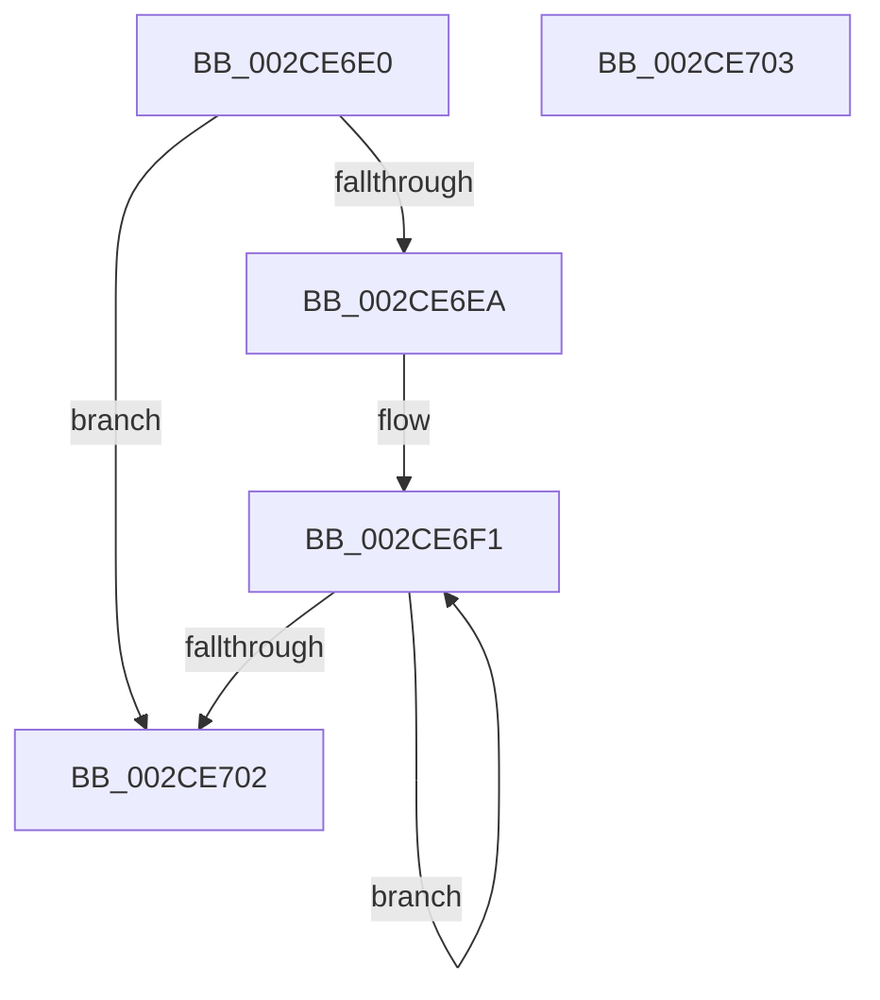

# KeCountSetBitsAffinityEx

- RVA: `0x002CE6E0`–`0x002CE704` (길이 `36` bytes)
- VA: `0x00000001402CE6E0`
- 실행 섹션: `.text`
- PDB 이름 있음: `예`; PDB Function 태그: `아니요`
- unwind 정보 RVA: `0x000DB714`
- 디코드: `13`개 명령, `36/36` bytes 표시
- 미해석 바이트: `0` (있으면 어셈블리에 `.byte`로 보존)

> 이 문서는 커널 이미지의 기계어와 PDB 기호를 분석해 생성했습니다. 4번과 5번은 함수 원형과 자료형을 바이너리 사용 방식에서 추정한 C 해석이며 원본 소스 복구 결과는 아닙니다.

## 1. Dependencies

- 직접 호출 지점: **0**; 고유 호출 대상: **0**
- 직접 호출자로 확인된 함수: **15**
- RIP 상대 이미지 참조: **0**

### Outgoing calls
- 직접 디코드된 call 명령이 없습니다.

### Direct callers
- [KeFlushProcessWriteBuffers](KeFlushProcessWriteBuffers_function_002CE4FC.md) at `0x002CE5BD`
- [PpmParkReportUnparkedCores](../2D/PpmParkReportUnparkedCores_function_002D5BD0.md) at `0x002D5C31`
- [KiIntSteerLogMask](../2D/KiIntSteerLogMask_function_002D71B8.md) at `0x002D7255`
- [KeChangeMemoryAttributes](../30/KeChangeMemoryAttributes_function_00304D08.md) at `0x00304D90`
- [KiForwardTick](../39/KiForwardTick_function_0039D40C.md) at `0x0039D65A`
- [PPmHeteroHgsUpdateOrderValue](../3B/PPmHeteroHgsUpdateOrderValue_function_003BFD24.md) at `0x003BFE45`
- [PpmEventTraceMultiClassHeteroResponseEx](../4F/PpmEventTraceMultiClassHeteroResponseEx_function_004F204C.md) at `0x004F20C4`
- [HalSendNMI](../54/HalSendNMI_function_00545E80.md) at `0x00545F4A`
- [KeUpdateProcessorRestrictionsEx](../5B/KeUpdateProcessorRestrictionsEx_function_005B64E8.md) at `0x005B6724`
- [KeQueryProcessAvailableCpus](../5B/KeQueryProcessAvailableCpus_function_005B96FC.md) at `0x005B9786`
- [KeQuerySystemAvailableCpus](../5B/KeQuerySystemAvailableCpus_function_005B97BC.md) at `0x005B982B`
- [PpmParkCalculateCoreParkingMaskEx](../5D/PpmParkCalculateCoreParkingMaskEx_function_005DFBE0.md) at `0x005DFF7F`
- [PpmParkCalculateCoreParkingMaskEx](../5D/PpmParkCalculateCoreParkingMaskEx_function_005DFBE0.md) at `0x005E0024`
- [PpmParkCalculateCoreParkingMaskEx](../5D/PpmParkCalculateCoreParkingMaskEx_function_005DFBE0.md) at `0x005E00DA`
- [PpmParkCalculateCoreParkingMaskEx](../5D/PpmParkCalculateCoreParkingMaskEx_function_005DFBE0.md) at `0x005E0154`
- [PpmParkComputeUnparkMaskEx](../5E/PpmParkComputeUnparkMaskEx_function_005E05E0.md) at `0x005E0D9A`
- [PpmParkComputeUnparkMaskEx](../5E/PpmParkComputeUnparkMaskEx_function_005E05E0.md) at `0x005E10AB`
- [PpmParkComputeUnparkMaskEx](../5E/PpmParkComputeUnparkMaskEx_function_005E05E0.md) at `0x005E10BF`
- [PpmIdleInitializeConcurrency](../../page/75/PpmIdleInitializeConcurrency_function_00754F30.md) at `0x00754F6E`
- [KiInitializeTopologyStructures](../../pagelk/B6/KiInitializeTopologyStructures_function_00B69708.md) at `0x00B69A11`
- [KiInitializeTopologyStructures](../../pagelk/B6/KiInitializeTopologyStructures_function_00B69708.md) at `0x00B69AAE`

### Static image references
- 디코드된 RIP-relative 메모리 참조가 없습니다.

## 2. Other-region calls and transfers

- 다른 실행 섹션으로 향하는 call: **0**
- 별도 외부 분기/꼬리 이동을 확인하지 못했습니다.

## 3. Assembly (complete function range)

```asm
002CE6E0  0F B7 11                        movzx edx, word ptr [rcx]
002CE6E3  33 C0                           xor eax, eax
002CE6E5  66 3B C2                        cmp ax, dx
002CE6E8  73 18                           jae 0x1402ce702
002CE6EA  48 83 C1 08                     add rcx, 8
002CE6EE  44 8B C2                        mov r8d, edx
002CE6F1  F3 48 0F B8 11                  popcnt rdx, qword ptr [rcx]
002CE6F6  03 C2                           add eax, edx
002CE6F8  48 8D 49 08                     lea rcx, [rcx + 8]
002CE6FC  49 83 E8 01                     sub r8, 1
002CE700  75 EF                           jne 0x1402ce6f1
002CE702  C3                              ret
002CE703  CC                              int3
```

## 4. C-style interpretation (structured pseudocode)

```c
__int64 __fastcall KeCountSetBitsAffinityEx(__int64 a1)
{
    __int64 result;

    result = 0;
    if (0 >= ((unsigned __int16)(*(unsigned __int16 *)(a1)))) goto loc_002CE702;
    a1 = (a1) + (8);
loc_002CE6F1:
    result = (unsigned int)((result) + ((unsigned int)(*(unsigned __int16 *)(a1))));
    a3 = ((unsigned int)((unsigned int)(*(unsigned __int16 *)(a1)))) - (1);
    if (condition_is_not_equal) goto loc_002CE6F1;
loc_002CE702:
    return result;
}
```

## 5. (Beta) C Style

```c
int64_t KeCountSetBitsAffinityEx(void *Arg1)
{
    uint8_t *arg1 = (uint8_t *)Arg1;

    int64_t result;

    result = 0;
    if (0 >= ((uint16_t)(*(uint16_t *)(arg1)))) goto loc_002CE702;
    Arg1 = (Arg1) + (8);
loc_002CE6F1:
    result = (uint32_t)((result) + ((uint32_t)(*(uint16_t *)(arg1))));
    a3 = ((uint32_t)((uint32_t)(*(uint16_t *)(arg1)))) - (1);
    if (condition_is_not_equal) goto loc_002CE6F1;
loc_002CE702:
    return result;
}
```

### 관측된 메모리 오프셋

구조체 형식이 확인되지 않은 접근은 인자 기준의 오프셋으로만 기록했습니다.

| 기준 인자 | 오프셋 표현 | 폭 (bit) | 접근 |
|---|---:|---:|---|
| `Arg1` | `+ 0x0` | `16` | `R` |
| `Arg1` | `+ 0x0` | `64` | `R` |
| `Arg1` | `+ 0x8` | `64` | `R` |

## 6. Execution-region graph

[열기: 2D/3D 그래프와 함수 탐색 컨트롤 패널](../../../control-panel.html?section=text&rva=0x002CE6E0&view=graph)

- 2D 그래프는 위에서 아래로 흐르고, 3D 그래프는 빈 공간을 드래그해 회전합니다. Shift+드래그는 이동, 휠은 확대·축소, 함수 노드 선택은 대상 보고서 이동입니다.

### Static fallback


