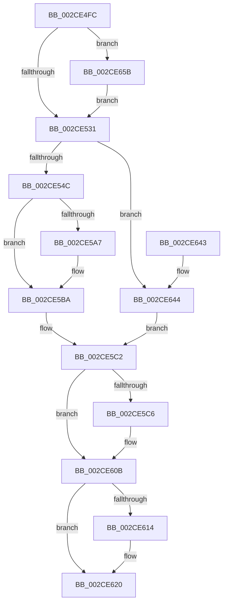

# KeFlushProcessWriteBuffers

- RVA: `0x002CE4FC`–`0x002CE668` (길이 `364` bytes)
- VA: `0x00000001402CE4FC`
- 실행 섹션: `.text`
- PDB 이름 있음: `예`; PDB Function 태그: `아니요`
- unwind 정보 RVA: `0x0006F5E4`
- 디코드: `86`개 명령, `364/364` bytes 표시
- 미해석 바이트: `0` (있으면 어셈블리에 `.byte`로 보존)

> 이 문서는 커널 이미지의 기계어와 PDB 기호를 분석해 생성했습니다. 4번과 5번은 함수 원형과 자료형을 바이너리 사용 방식에서 추정한 C 해석이며 원본 소스 복구 결과는 아닙니다.

## 1. Dependencies

- 직접 호출 지점: **7**; 고유 호출 대상: **7**
- 직접 호출자로 확인된 함수: **10**
- RIP 상대 이미지 참조: **4**

### Outgoing calls
- `0x002CE574` → [memset](../6C/memset_function_006C6C40.md) (function, `0x006C6C40`)
- `0x002CE583` → [KiCopyAffinityEx](KiCopyAffinityEx_function_002CE860.md) (function, `0x002CE860`)
- `0x002CE5BD` → [KeCountSetBitsAffinityEx](KeCountSetBitsAffinityEx_function_002CE6E0.md) (function, `0x002CE6E0`)
- `0x002CE5FE` → [KiIpiSendRequest](../31/KiIpiSendRequest_function_003113C0.md) (function, `0x003113C0`)
- `0x002CE606` → [KiIpiStallOnPacketTargetsPrcb](KiIpiStallOnPacketTargetsPrcb_function_002CE670.md) (function, `0x002CE670`)
- `0x002CE61B` → [KiLowerIrqlProcessIrqlFlags](../4F/KiLowerIrqlProcessIrqlFlags_function_004F5698.md) (function, `0x004F5698`)
- `0x002CE65E` → [KiRaiseIrqlProcessIrqlFlags](../4F/KiRaiseIrqlProcessIrqlFlags_function_004F56FC.md) (function, `0x004F56FC`)

### Direct callers
- [NtFlushProcessWriteBuffers](NtFlushProcessWriteBuffers_function_002CE4E0.md) at `0x002CE4E6`
- [KeQueryTotalCycleTimeThread](../37/KeQueryTotalCycleTimeThread_function_0037EF20.md) at `0x0037F7EB`
- [KeSetPriorityAndQuantumProcess](../3C/KeSetPriorityAndQuantumProcess_function_003C2EC0.md) at `0x003C2FAF`
- [PsUpdateSvmProcessPasidAllThreads](../../page/78/PsUpdateSvmProcessPasidAllThreads_function_00781404.md) at `0x007815F2`
- [PspEnableProcessOptionalXStateFeatures](../../page/78/PspEnableProcessOptionalXStateFeatures_function_00781EF0.md) at `0x007822C5`
- [PspTerminateAllThreads](../../page/8C/PspTerminateAllThreads_function_008C97D0.md) at `0x008C99B0`
- [ExpGetProcessInformation](../../page/91/ExpGetProcessInformation_function_0091A878.md) at `0x0091BC4A`
- [ExProcessCounterSetCallback](../../page/91/ExProcessCounterSetCallback_function_0091CDF0.md) at `0x0091CE55`
- [PsQueryTotalCycleTimeProcess](../../page/A2/PsQueryTotalCycleTimeProcess_function_00A26840.md) at `0x00A26860`
- [ExpQuerySystemInformation](../../page/A5/ExpQuerySystemInformation_function_00A57858.md) at `0x00A5906B`

### Static image references
- `0x002CE524` → RVA `0x00FC6D20` (`ALMOSTRO`; read)
- `0x002CE58B` → RVA `0x00F231B0` (`.data`; read)
- `0x002CE5CF` → RVA `0x0049E550` (`EmpCheckErrataList`; read)
- `0x002CE644` → RVA `0x00FC6A80` (`ALMOSTRO`; read)

## 2. Other-region calls and transfers

- 다른 실행 섹션으로 향하는 call: **0**
- 별도 외부 분기/꼬리 이동을 확인하지 못했습니다.

## 3. Assembly (complete function range)

```asm
002CE4FC  48 8B C4                        mov rax, rsp
002CE4FF  48 89 58 08                     mov qword ptr [rax + 8], rbx
002CE503  48 89 68 10                     mov qword ptr [rax + 0x10], rbp
002CE507  48 89 70 18                     mov qword ptr [rax + 0x18], rsi
002CE50B  48 89 78 20                     mov qword ptr [rax + 0x20], rdi
002CE50F  41 56                           push r14
002CE511  48 83 EC 50                     sub rsp, 0x50
002CE515  8A D9                           mov bl, cl
002CE517  44 0F 20 C6                     mov rsi, cr8
002CE51B  BA 0C 00 00 00                  mov edx, 0xc
002CE520  44 0F 22 C2                     mov cr8, rdx
002CE524  83 3D F5 87 CF 00 00            cmp dword ptr [rip + 0xcf87f5], 0
002CE52B  0F 85 2A 01 00 00               jne 0x1402ce65b
002CE531  65 48 8B 2C 25 20 00 00 00      mov rbp, qword ptr gs:[0x20]
002CE53A  45 33 F6                        xor r14d, r14d
002CE53D  48 8D BD B8 2D 00 00            lea rdi, [rbp + 0x2db8]
002CE544  84 DB                           test bl, bl
002CE546  0F 85 F8 00 00 00               jne 0x1402ce644
002CE54C  48 8B 45 08                     mov rax, qword ptr [rbp + 8]
002CE550  33 D2                           xor edx, edx
002CE552  41 B8 00 01 00 00               mov r8d, 0x100
002CE558  48 8B 88 B8 00 00 00            mov rcx, qword ptr [rax + 0xb8]
002CE55F  48 8B 99 80 00 00 00            mov rbx, qword ptr [rcx + 0x80]
002CE566  48 8D 4F 08                     lea rcx, [rdi + 8]
002CE56A  44 21 77 04                     and dword ptr [rdi + 4], r14d
002CE56E  C7 07 01 00 20 00               mov dword ptr [rdi], 0x200001
002CE574  E8 C7 86 3F 00                  call 0x1406c6c40
002CE579  0F B7 57 02                     movzx edx, word ptr [rdi + 2]
002CE57D  4C 8B C3                        mov r8, rbx
002CE580  48 8B CF                        mov rcx, rdi
002CE583  E8 D8 02 00 00                  call 0x1402ce860
002CE588  8B 4D 24                        mov ecx, dword ptr [rbp + 0x24]
002CE58B  48 8B 05 1E 4C C5 00            mov rax, qword ptr [rip + 0xc54c1e]
002CE592  44 8B 04 88                     mov r8d, dword ptr [rax + rcx*4]
002CE596  41 8B C8                        mov ecx, r8d
002CE599  0F B7 07                        movzx eax, word ptr [rdi]
002CE59C  41 83 E0 3F                     and r8d, 0x3f
002CE5A0  C1 E9 06                        shr ecx, 6
002CE5A3  3B C1                           cmp eax, ecx
002CE5A5  76 13                           jbe 0x1402ce5ba
002CE5A7  8B D1                           mov edx, ecx
002CE5A9  48 8B 4C CF 08                  mov rcx, qword ptr [rdi + rcx*8 + 8]
002CE5AE  41 8B C0                        mov eax, r8d
002CE5B1  48 0F B3 C1                     btr rcx, rax
002CE5B5  48 89 4C D7 08                  mov qword ptr [rdi + rdx*8 + 8], rcx
002CE5BA  48 8B CF                        mov rcx, rdi
002CE5BD  E8 1E 01 00 00                  call 0x1402ce6e0
002CE5C2  85 C0                           test eax, eax
002CE5C4  74 45                           je 0x1402ce60b
002CE5C6  65 48 8B 0C 25 20 00 00 00      mov rcx, qword ptr gs:[0x20]
002CE5CF  48 8D 05 7A FF 1C 00            lea rax, [rip + 0x1cff7a]
002CE5D6  48 83 64 24 40 00               and qword ptr [rsp + 0x40], 0
002CE5DC  4C 8D 4C 24 30                  lea r9, [rsp + 0x30]
002CE5E1  0F 57 C0                        xorps xmm0, xmm0
002CE5E4  48 89 44 24 48                  mov qword ptr [rsp + 0x48], rax
002CE5E9  4C 8B C7                        mov r8, rdi
002CE5EC  48 C7 44 24 20 05 00 00 00      mov qword ptr [rsp + 0x20], 5
002CE5F5  41 8B D6                        mov edx, r14d
002CE5F8  F3 0F 7F 44 24 30               movdqu xmmword ptr [rsp + 0x30], xmm0
002CE5FE  E8 BD 2D 04 00                  call 0x1403113c0
002CE603  48 8B D5                        mov rdx, rbp
002CE606  E8 65 00 00 00                  call 0x1402ce670
002CE60B  83 3D 0E 87 CF 00 00            cmp dword ptr [rip + 0xcf870e], 0
002CE612  74 0C                           je 0x1402ce620
002CE614  44 0F 20 C1                     mov rcx, cr8
002CE618  40 8A D6                        mov dl, sil
002CE61B  E8 78 70 22 00                  call 0x1404f5698
002CE620  40 0F B6 C6                     movzx eax, sil
002CE624  44 0F 22 C0                     mov cr8, rax
002CE628  48 8B 5C 24 60                  mov rbx, qword ptr [rsp + 0x60]
002CE62D  48 8B 6C 24 68                  mov rbp, qword ptr [rsp + 0x68]
002CE632  48 8B 74 24 70                  mov rsi, qword ptr [rsp + 0x70]
002CE637  48 8B 7C 24 78                  mov rdi, qword ptr [rsp + 0x78]
002CE63C  48 83 C4 50                     add rsp, 0x50
002CE640  41 5E                           pop r14
002CE642  C3                              ret
002CE643  CC                              int3
002CE644  8B 05 36 84 CF 00               mov eax, dword ptr [rip + 0xcf8436]
002CE64A  B9 01 00 00 00                  mov ecx, 1
002CE64F  2B C1                           sub eax, ecx
002CE651  44 8B F1                        mov r14d, ecx
002CE654  33 FF                           xor edi, edi
002CE656  E9 67 FF FF FF                  jmp 0x1402ce5c2
002CE65B  40 8A CE                        mov cl, sil
002CE65E  E8 99 70 22 00                  call 0x1404f56fc
002CE663  E9 C9 FE FF FF                  jmp 0x1402ce531
```

## 4. C-style interpretation (structured pseudocode)

```c
__int64 __fastcall KeFlushProcessWriteBuffers(unsigned __int8 a1)
{
    __int64 result;
    __int64 v_r14;
    __int64 v_rdi;
    __int64 v_rsp;
    unsigned __int64 v_stack_m10;
    unsigned __int64 v_stack_m18;
    unsigned __int64 v_stack_m28;
    unsigned __int64 v_stack_m38;
    unsigned __int64 v_stack_p10;
    unsigned __int64 v_stack_p18;
    unsigned __int64 v_stack_p20;
    unsigned __int64 v_stack_p8;

    *(unsigned __int64 *)(v_rsp + 8) = v_rbx;
    *(unsigned __int64 *)(v_rsp + 16) = v_rbp;
    *(unsigned __int64 *)(v_rsp + 24) = v_rsi;
    *(unsigned __int64 *)(v_rsp + 32) = v_rdi;
    v_rsp = (v_rsp) - (80);
    if ((*(unsigned int *)(v_rip + 13600757)) != 0) goto loc_002CE65B;
loc_002CE531:
    v_r14 = 0;
    if (a1 != 0) goto loc_002CE644;
    a2 = 0;
    *(unsigned int *)(*(unsigned __int64 *)(gs_base + (0 + 32)) + 11704) = 0x200001ULL;
    result = memset(*(unsigned __int64 *)(gs_base + (0 + 32)) + 11704 + 8, a2, 256, a4);
    result = KiCopyAffinityEx(*(unsigned __int64 *)(gs_base + (0 + 32)) + 11704, *(unsigned __int16 *)(*(unsigned __int64 *)(gs_base + (0 + 32)) + 11704 + 2), *(unsigned __int64 *)(*(unsigned __int64 *)(*(unsigned __int64 *)(*(unsigned __int64 *)(gs_base + (0 + 32)) + 8) + 184) + 128), a4);
    a3 = (unsigned int)(((unsigned int)(*(unsigned int *)(*(unsigned __int64 *)(v_rip + 12930078) + (unsigned int)(*(unsigned int *)(*(unsigned __int64 *)(gs_base + (0 + 32)) + 36)) * 4))) & (63));
    a1 = (unsigned int)(((unsigned int)((unsigned int)((unsigned int)(*(unsigned int *)(*(unsigned __int64 *)(v_rip + 12930078) + (unsigned int)(*(unsigned int *)(*(unsigned __int64 *)(gs_base + (0 + 32)) + 36)) * 4))))) >> (6));
    result = *(unsigned __int16 *)(*(unsigned __int64 *)(gs_base + (0 + 32)) + 11704);
    if (((unsigned int)(*(unsigned __int16 *)(*(unsigned __int64 *)(gs_base + (0 + 32)) + 11704))) >= = a1) {
        a2 = a1;
        a1 = *(unsigned __int64 *)(*(unsigned __int64 *)(gs_base + (0 + 32)) + 11704 + a1 * 8 + 8);
        result = (unsigned int)(a3);
        *(unsigned __int64 *)(*(unsigned __int64 *)(gs_base + (0 + 32)) + 11704 + a2 * 8 + 8) = a1;
    }
    result = KeCountSetBitsAffinityEx(*(unsigned __int64 *)(gs_base + (0 + 32)) + 11704, a2, a3, a4);
loc_002CE5C2:
    if ((unsigned int)(result) != 0) {
        a1 = *(unsigned __int64 *)(gs_base + (0 + 32));
        result = v_rip + 1900410;
        a4 = v_stack_m28;
        v_stack_m10 = result;
        a3 = *(unsigned __int64 *)(gs_base + (0 + 32)) + 11704;
        v_stack_m38 = 5;
        a2 = 0;
        v_stack_m28 = v_xmm0;
        result = KiIpiSendRequest(a1, a2, a3, a4);
        a2 = *(unsigned __int64 *)(gs_base + (0 + 32));
        result = KiIpiStallOnPacketTargetsPrcb(a1, a2, a3, a4);
    }
    if ((*(unsigned int *)(v_rip + 13600526)) != 0) {
        a1 = 12;
        a2 = (unsigned __int8)(v_cr8);
        result = KiLowerIrqlProcessIrqlFlags(a1, a2, a3, a4);
    }
    v_rsp = (v_rsp) + (80);
    return (unsigned __int8)(v_cr8);
loc_002CE644:
    result = (unsigned int)(((unsigned int)(*(unsigned int *)(v_rip + 13599798))) - (1));
    v_rdi = 0;
    goto loc_002CE5C2;
loc_002CE65B:
    result = KiRaiseIrqlProcessIrqlFlags((unsigned __int8)(v_stack_p18), a2, a3, a4);
    goto loc_002CE531;
}
```

## 5. (Beta) C Style

```c
int64_t KeFlushProcessWriteBuffers(uint8_t Arg1)
{
    int64_t result;
    int64_t local_r14;
    int64_t local_rdi;
    int64_t local_rsp;
    uint64_t v_stack_m10;
    uint64_t v_stack_m18;
    uint64_t v_stack_m28;
    uint64_t v_stack_m38;
    uint64_t v_stack_p10;
    uint64_t v_stack_p18;
    uint64_t v_stack_p20;
    uint64_t v_stack_p8;

    *(uint64_t *)(local_rsp + 0x8) = local_rbx;
    *(uint64_t *)(local_rsp + 0x10) = local_rbp;
    *(uint64_t *)(local_rsp + 0x18) = local_rsi;
    *(uint64_t *)(local_rsp + 0x20) = local_rdi;
    local_rsp = (local_rsp) - (80);
    if ((*(uint32_t *)(v_rip + 0xCF87F5)) != 0) goto loc_002CE65B;
loc_002CE531:
    local_r14 = 0;
    if (Arg1 != 0) goto loc_002CE644;
    a2 = 0;
    *(uint32_t *)(*(uint64_t *)(gs_base + (0 + 0x20)) + 0x2DB8) = 0x200001ULL;
    result = memset(*(uint64_t *)(gs_base + (0 + 0x20)) + 11704 + 8, a2, 256, a4);
    result = KiCopyAffinityEx(*(uint64_t *)(gs_base + (0 + 0x20)) + 11704, *(uint16_t *)(*(uint64_t *)(gs_base + (0 + 0x20)) + 0x2DB8 + 0x2), *(uint64_t *)(*(uint64_t *)(*(uint64_t *)(*(uint64_t *)(gs_base + (0 + 0x20)) + 0x8) + 0xB8) + 0x80), a4);
    a3 = (uint32_t)(((uint32_t)(*(uint32_t *)(*(uint64_t *)(v_rip + 0xC54C1E) + (uint32_t)(*(uint32_t *)(*(uint64_t *)(gs_base + (0 + 0x20)) + 0x24)) * 4))) & (63));
    Arg1 = (uint32_t)(((uint32_t)((uint32_t)((uint32_t)(*(uint32_t *)(*(uint64_t *)(v_rip + 0xC54C1E) + (uint32_t)(*(uint32_t *)(*(uint64_t *)(gs_base + (0 + 0x20)) + 0x24)) * 4))))) >> (6));
    result = *(uint16_t *)(*(uint64_t *)(gs_base + (0 + 0x20)) + 0x2DB8);
    if (((uint32_t)(*(uint16_t *)(*(uint64_t *)(gs_base + (0 + 0x20)) + 0x2DB8))) >= = Arg1) {
        a2 = Arg1;
        Arg1 = *(uint64_t *)(*(uint64_t *)(gs_base + (0 + 0x20)) + 0x2DB8 + Arg1 * 8 + 0x8);
        result = (uint32_t)(a3);
        *(uint64_t *)(*(uint64_t *)(gs_base + (0 + 0x20)) + 0x2DB8 + a2 * 8 + 0x8) = Arg1;
    }
    result = KeCountSetBitsAffinityEx(*(uint64_t *)(gs_base + (0 + 0x20)) + 11704, a2, a3, a4);
loc_002CE5C2:
    if ((uint32_t)(result) != 0) {
        Arg1 = *(uint64_t *)(gs_base + (0 + 0x20));
        result = v_rip + 1900410;
        a4 = v_stack_m28;
        v_stack_m10 = result;
        a3 = *(uint64_t *)(gs_base + (0 + 0x20)) + 11704;
        v_stack_m38 = 5;
        a2 = 0;
        v_stack_m28 = v_xmm0;
        result = KiIpiSendRequest(Arg1, a2, a3, a4);
        a2 = *(uint64_t *)(gs_base + (0 + 0x20));
        result = KiIpiStallOnPacketTargetsPrcb(Arg1, a2, a3, a4);
    }
    if ((*(uint32_t *)(v_rip + 0xCF870E)) != 0) {
        Arg1 = 12;
        a2 = (uint8_t)(v_cr8);
        result = KiLowerIrqlProcessIrqlFlags(Arg1, a2, a3, a4);
    }
    local_rsp = (local_rsp) + (80);
    return (uint8_t)(v_cr8);
loc_002CE644:
    result = (uint32_t)(((uint32_t)(*(uint32_t *)(v_rip + 0xCF8436))) - (1));
    local_rdi = 0;
    goto loc_002CE5C2;
loc_002CE65B:
    result = KiRaiseIrqlProcessIrqlFlags((uint8_t)(v_stack_p18), a2, a3, a4);
    goto loc_002CE531;
}
```

## 6. Execution-region graph

[열기: 2D/3D 그래프와 함수 탐색 컨트롤 패널](../../../control-panel.html?section=text&rva=0x002CE4FC&view=graph)

- 2D 그래프는 위에서 아래로 흐르고, 3D 그래프는 빈 공간을 드래그해 회전합니다. Shift+드래그는 이동, 휠은 확대·축소, 함수 노드 선택은 대상 보고서 이동입니다.

### Static fallback


