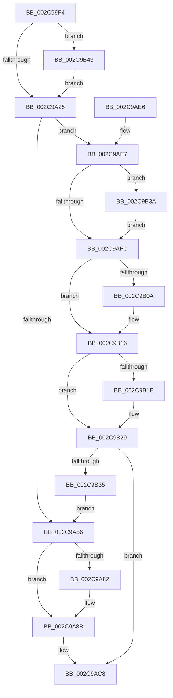

# KeGenericCallDpcEx

- RVA: `0x002C99F4`–`0x002C9B4D` (길이 `345` bytes)
- VA: `0x00000001402C99F4`
- 실행 섹션: `.text`
- PDB 이름 있음: `예`; PDB Function 태그: `아니요`
- unwind 정보 RVA: `0x0006F0CC`
- 디코드: `87`개 명령, `345/345` bytes 표시
- 미해석 바이트: `0` (있으면 어셈블리에 `.byte`로 보존)

> 이 문서는 커널 이미지의 기계어와 PDB 기호를 분석해 생성했습니다. 4번과 5번은 함수 원형과 자료형을 바이너리 사용 방식에서 추정한 C 해석이며 원본 소스 복구 결과는 아닙니다.

## 1. Dependencies

- 직접 호출 지점: **9**; 고유 호출 대상: **9**
- 직접 호출자로 확인된 함수: **18**
- RIP 상대 이미지 참조: **3**

### Outgoing calls
- `0x002C9A2F` → [memset](../6C/memset_function_006C6C40.md) (function, `0x006C6C40`)
- `0x002C9A3C` → [KiAcquireDpcCorralLock](KiAcquireDpcCorralLock_function_002C9BDC.md) (function, `0x002C9BDC`)
- `0x002C9AB5` → [KeInsertQueueDpc](../20/KeInsertQueueDpc_function_00207C50.md) (function, `0x00207C50`)
- `0x002C9AC3` → [KeWaitForGate](KeWaitForGate_function_002CA794.md) (function, `0x002CA794`)
- `0x002C9AC8` → [KiReleaseDpcCorralLock](KiReleaseDpcCorralLock_function_002C9D20.md) (function, `0x002C9D20`)
- `0x002C9B0E` → [KiInitiateGenericCallDpc](KiInitiateGenericCallDpc_function_002C9C40.md) (function, `0x002C9C40`)
- `0x002C9B24` → [KiLowerIrqlProcessIrqlFlags](../4F/KiLowerIrqlProcessIrqlFlags_function_004F5698.md) (function, `0x004F5698`)
- `0x002C9B3C` → [KiRaiseIrqlProcessIrqlFlags](../4F/KiRaiseIrqlProcessIrqlFlags_function_004F56FC.md) (function, `0x004F56FC`)
- `0x002C9B43` → [KiCpuPartitionCheckGenericDpc](../5C/KiCpuPartitionCheckGenericDpc_function_005C159C.md) (function, `0x005C159C`)

### Direct callers
- [MiJumpStack](MiJumpStack_function_002C8B30.md) at `0x002C8B3E`
- [MiStartDpcGang](MiStartDpcGang_function_002C8C34.md) at `0x002C8CB6`
- [KeSetSystemTime](KeSetSystemTime_function_002C8E5C.md) at `0x002C8E92`
- [MiDemoteSlabEntries](../4D/MiDemoteSlabEntries_function_004D89A0.md) at `0x004D8A39`
- [KeAbCrossThreadDelete](../5C/KeAbCrossThreadDelete_function_005C517C.md) at `0x005C5588`
- [ExpTrackTableInsertLimit](../65/ExpTrackTableInsertLimit_function_006572D0.md) at `0x00657514`
- [MiFreeUnusedPfnPages](../67/MiFreeUnusedPfnPages_function_006720C0.md) at `0x00672118`
- [MmMarkPhysicalMemoryAsBad](../67/MmMarkPhysicalMemoryAsBad_function_0067AA50.md) at `0x0067AE04`
- [MiInitializeWorkingSetManagerParameters](../67/MiInitializeWorkingSetManagerParameters_function_0067E7F8.md) at `0x0067EB19`
- [MiDeleteSlabEntriesForIdentity](../68/MiDeleteSlabEntriesForIdentity_function_0068DE10.md) at `0x0068DFDB`
- [MiZeroPageCalibrate](../69/MiZeroPageCalibrate_function_0069A69C.md) at `0x0069A950`
- [sub_006DAAE6](../6D/Unknown_function_006DAAE6.md) at `0x006DAC9F`
- [sub_006DDE00](../6D/Unknown_function_006DDE00.md) at `0x006DDE2F`
- [MmSetPermanentCacheAttribute](../../page/7F/MmSetPermanentCacheAttribute_function_007FE0F0.md) at `0x007FE1B7`
- [MiSpecialPurposeMemoryRemoved](../../page/80/MiSpecialPurposeMemoryRemoved_function_0080FFD8.md) at `0x0081008B`
- [MiUpdateSpecialPurposeMemoryCacheEligibility](../../page/81/MiUpdateSpecialPurposeMemoryCacheEligibility_function_00810270.md) at `0x008102EE`
- [ExGetPoolTagInfo](../../page/A1/ExGetPoolTagInfo_function_00A170D8.md) at `0x00A1719D`
- [ExpAeThresholdInitialization](../../init/C5/ExpAeThresholdInitialization_function_00C54A0C.md) at `0x00C54ABA`

### Static image references
- `0x002C9A0F` → RVA `0x00FC6B14` (`ALMOSTRO`; read)
- `0x002C9A56` → RVA `0x002C83E0` (`KiGenericCallDpcInitiatorDpc`; read)
- `0x002C9AF4` → RVA `0x00FC6D20` (`ALMOSTRO`; read)

## 2. Other-region calls and transfers

- 다른 실행 섹션으로 향하는 call: **0**
- 별도 외부 분기/꼬리 이동을 확인하지 못했습니다.

## 3. Assembly (complete function range)

```asm
002C99F4  48 8B C4                        mov rax, rsp
002C99F7  48 89 58 08                     mov qword ptr [rax + 8], rbx
002C99FB  48 89 70 10                     mov qword ptr [rax + 0x10], rsi
002C99FF  48 89 78 18                     mov qword ptr [rax + 0x18], rdi
002C9A03  55                              push rbp
002C9A04  48 8D 68 A1                     lea rbp, [rax - 0x5f]
002C9A08  48 81 EC 90 00 00 00            sub rsp, 0x90
002C9A0F  F7 05 FB D0 CF 00 00 02 00 00   test dword ptr [rip + 0xcfd0fb], 0x200
002C9A19  48 8B FA                        mov rdi, rdx
002C9A1C  48 8B D9                        mov rbx, rcx
002C9A1F  0F 85 1E 01 00 00               jne 0x1402c9b43
002C9A25  33 D2                           xor edx, edx
002C9A27  48 8D 4D F7                     lea rcx, [rbp - 9]
002C9A2B  44 8D 42 58                     lea r8d, [rdx + 0x58]
002C9A2F  E8 0C D2 3F 00                  call 0x1406c6c40
002C9A34  48 89 5D E7                     mov qword ptr [rbp - 0x19], rbx
002C9A38  48 89 7D EF                     mov qword ptr [rbp - 0x11], rdi
002C9A3C  E8 9B 01 00 00                  call 0x1402c9bdc
002C9A41  65 8B 04 25 A4 01 00 00         mov eax, dword ptr gs:[0x1a4]
002C9A49  33 F6                           xor esi, esi
002C9A4B  40 8A FE                        mov dil, sil
002C9A4E  85 C0                           test eax, eax
002C9A50  0F 84 91 00 00 00               je 0x1402c9ae7
002C9A56  48 8D 05 83 E9 FF FF            lea rax, [rip - 0x167d]
002C9A5D  48 89 75 2F                     mov qword ptr [rbp + 0x2f], rsi
002C9A61  48 89 45 0F                     mov qword ptr [rbp + 0xf], rax
002C9A65  48 8D 45 E7                     lea rax, [rbp - 0x19]
002C9A69  48 89 45 17                     mov qword ptr [rbp + 0x17], rax
002C9A6D  48 8B 45 2F                     mov rax, qword ptr [rbp + 0x2f]
002C9A71  C6 45 F7 13                     mov byte ptr [rbp - 9], 0x13
002C9A75  66 89 75 F9                     mov word ptr [rbp - 7], si
002C9A79  48 89 75 07                     mov qword ptr [rbp + 7], rsi
002C9A7D  48 85 C0                        test rax, rax
002C9A80  75 09                           jne 0x1402c9a8b
002C9A82  B8 00 08 00 00                  mov eax, 0x800
002C9A87  66 89 45 F9                     mov word ptr [rbp - 7], ax
002C9A8B  48 8D 45 3F                     lea rax, [rbp + 0x3f]
002C9A8F  C6 45 F8 03                     mov byte ptr [rbp - 8], 3
002C9A93  48 89 45 47                     mov qword ptr [rbp + 0x47], rax
002C9A97  48 8D 4D F7                     lea rcx, [rbp - 9]
002C9A9B  48 8D 45 3F                     lea rax, [rbp + 0x3f]
002C9A9F  66 C7 45 37 07 01               mov word ptr [rbp + 0x37], 0x107
002C9AA5  45 33 C0                        xor r8d, r8d
002C9AA8  48 89 45 3F                     mov qword ptr [rbp + 0x3f], rax
002C9AAC  33 D2                           xor edx, edx
002C9AAE  C6 45 39 06                     mov byte ptr [rbp + 0x39], 6
002C9AB2  89 75 3B                        mov dword ptr [rbp + 0x3b], esi
002C9AB5  E8 96 E1 F3 FF                  call 0x140207c50
002C9ABA  45 33 C0                        xor r8d, r8d
002C9ABD  48 8D 4D 37                     lea rcx, [rbp + 0x37]
002C9AC1  33 D2                           xor edx, edx
002C9AC3  E8 CC 0C 00 00                  call 0x1402ca794
002C9AC8  E8 53 02 00 00                  call 0x1402c9d20
002C9ACD  4C 8D 9C 24 90 00 00 00         lea r11, [rsp + 0x90]
002C9AD5  49 8B 5B 10                     mov rbx, qword ptr [r11 + 0x10]
002C9AD9  49 8B 73 18                     mov rsi, qword ptr [r11 + 0x18]
002C9ADD  49 8B 7B 20                     mov rdi, qword ptr [r11 + 0x20]
002C9AE1  49 8B E3                        mov rsp, r11
002C9AE4  5D                              pop rbp
002C9AE5  C3                              ret
002C9AE6  CC                              int3
002C9AE7  44 0F 20 C3                     mov rbx, cr8
002C9AEB  BA 02 00 00 00                  mov edx, 2
002C9AF0  44 0F 22 C2                     mov cr8, rdx
002C9AF4  39 35 26 D2 CF 00               cmp dword ptr [rip + 0xcfd226], esi
002C9AFA  75 3E                           jne 0x1402c9b3a
002C9AFC  65 48 8B 0C 25 20 00 00 00      mov rcx, qword ptr gs:[0x20]
002C9B05  39 71 24                        cmp dword ptr [rcx + 0x24], esi
002C9B08  75 0C                           jne 0x1402c9b16
002C9B0A  48 8D 55 E7                     lea rdx, [rbp - 0x19]
002C9B0E  E8 2D 01 00 00                  call 0x1402c9c40
002C9B13  40 B7 01                        mov dil, 1
002C9B16  39 35 04 D2 CF 00               cmp dword ptr [rip + 0xcfd204], esi
002C9B1C  74 0B                           je 0x1402c9b29
002C9B1E  44 0F 20 C1                     mov rcx, cr8
002C9B22  8A D3                           mov dl, bl
002C9B24  E8 6F BB 22 00                  call 0x1404f5698
002C9B29  0F B6 C3                        movzx eax, bl
002C9B2C  44 0F 22 C0                     mov cr8, rax
002C9B30  40 84 FF                        test dil, dil
002C9B33  75 93                           jne 0x1402c9ac8
002C9B35  E9 1C FF FF FF                  jmp 0x1402c9a56
002C9B3A  8A CB                           mov cl, bl
002C9B3C  E8 BB BB 22 00                  call 0x1404f56fc
002C9B41  EB B9                           jmp 0x1402c9afc
002C9B43  E8 54 7A 2F 00                  call 0x1405c159c
002C9B48  E9 D8 FE FF FF                  jmp 0x1402c9a25
```

## 4. C-style interpretation (structured pseudocode)

```c
__int64 __fastcall KeGenericCallDpcEx(__int64 a1, __int64 a2)
{
    __int64 result;
    __int64 v_rdi;
    __int64 v_rsi;
    __int64 v_rsp;
    unsigned __int64 v_stack_m8;

    *(unsigned __int64 *)(v_rsp + 8) = v_rbx;
    *(unsigned __int64 *)(v_rsp + 16) = v_rsi;
    *(unsigned __int64 *)(v_rsp + 24) = v_rdi;
    v_rsp = (v_rsp) - (144);
    if (((*(unsigned int *)(v_rip + 13619451)) & (512)) != 0) goto loc_002C9B43;
loc_002C9A25:
    a2 = 0;
    result = memset(v_rsp - 95 - 9, a2, a2 + 88, a4);
    *(unsigned __int64 *)(v_rsp - 95 - 25) = a1;
    *(unsigned __int64 *)(v_rsp - 95 - 17) = 0;
    result = KiAcquireDpcCorralLock(v_rsp - 95 - 9, a2, a2 + 88, a4);
    v_rsi = 0;
    if ((unsigned int)((unsigned int)(*(unsigned int *)(gs_base + (0 + 420)))) == 0) goto loc_002C9AE7;
loc_002C9A56:
    *(unsigned __int64 *)(v_rsp - 95 + 47) = 0;
    *(unsigned __int64 *)(v_rsp - 95 + 15) = v_rip - 5757;
    *(unsigned __int64 *)(v_rsp - 95 + 23) = v_rsp - 95 - 25;
    *(unsigned __int8 *)(v_rsp - 95 - 9) = 19;
    *(unsigned __int16 *)(v_rsp - 95 - 7) = 0;
    *(unsigned __int64 *)(v_rsp - 95 + 7) = 0;
    result = *(unsigned __int64 *)(v_rsp - 95 + 47);
    if (*(unsigned __int64 *)(v_rsp - 95 + 47) == 0) {
        result = 0x800ULL;
        *(unsigned __int16 *)(v_rsp - 95 - 7) = (unsigned __int16)(result);
    }
    *(unsigned __int8 *)(v_rsp - 95 - 8) = 3;
    *(unsigned __int64 *)(v_rsp - 95 + 71) = v_rsp - 95 + 63;
    *(unsigned __int16 *)(v_rsp - 95 + 55) = 263;
    a3 = 0;
    *(unsigned __int64 *)(v_rsp - 95 + 63) = v_rsp - 95 + 63;
    a2 = 0;
    *(unsigned __int8 *)(v_rsp - 95 + 57) = 6;
    *(unsigned int *)(v_rsp - 95 + 59) = 0;
    result = KeInsertQueueDpc(v_rsp - 95 - 9, a2, a3, a4);
    a3 = 0;
    a2 = 0;
    result = KeWaitForGate(v_rsp - 95 + 55, a2, a3, a4);
loc_002C9AC8:
    result = KiReleaseDpcCorralLock(v_rsp - 95 + 55, a2, a3, a4);
    return result;
loc_002C9AE7:
    if ((*(unsigned int *)(v_rip + 13619750)) != ((unsigned int)(*(unsigned __int64 *)(v_stack_m8 + 24)))) goto loc_002C9B3A;
loc_002C9AFC:
    v_rdi = *(unsigned __int64 *)(v_stack_m8 + 32);
    if ((*(unsigned int *)(*(unsigned __int64 *)(gs_base + (0 + 32)) + 36)) == ((unsigned int)(*(unsigned __int64 *)(v_stack_m8 + 24)))) {
        a2 = v_rsp - 95 - 25;
        result = KiInitiateGenericCallDpc(*(unsigned __int64 *)(gs_base + (0 + 32)), a2, a3, a4);
        v_rdi = 1;
    }
    if ((*(unsigned int *)(v_rip + 13619716)) != ((unsigned int)(*(unsigned __int64 *)(v_stack_m8 + 24)))) {
        a1 = 2;
        a2 = (unsigned __int8)(v_cr8);
        result = KiLowerIrqlProcessIrqlFlags(a1, a2, a3, a4);
    }
    if ((unsigned __int8)(v_rdi) != 0) goto loc_002C9AC8;
    goto loc_002C9A56;
loc_002C9B3A:
    result = KiRaiseIrqlProcessIrqlFlags((unsigned __int8)(v_cr8), a2, a3, a4);
    goto loc_002C9AFC;
loc_002C9B43:
    result = KiCpuPartitionCheckGenericDpc((unsigned __int8)(v_cr8), a2, a3, a4);
    goto loc_002C9A25;
}
```

## 5. (Beta) C Style

```c
int64_t KeGenericCallDpcEx(int64_t Arg1, int64_t Arg2)
{
    int64_t result;
    int64_t local_rdi;
    int64_t local_rsi;
    int64_t local_rsp;
    uint64_t v_stack_m8;

    *(uint64_t *)(local_rsp + 0x8) = local_rbx;
    *(uint64_t *)(local_rsp + 0x10) = local_rsi;
    *(uint64_t *)(local_rsp + 0x18) = local_rdi;
    local_rsp = (local_rsp) - (144);
    if (((*(uint32_t *)(v_rip + 0xCFD0FB)) & (512)) != 0) goto loc_002C9B43;
loc_002C9A25:
    Arg2 = 0;
    result = memset(local_rsp - 95 - 9, Arg2, Arg2 + 88, a4);
    *(uint64_t *)(local_rsp - 0x5F - 0x19) = Arg1;
    *(uint64_t *)(local_rsp - 0x5F - 0x11) = 0;
    result = KiAcquireDpcCorralLock(local_rsp - 95 - 9, Arg2, Arg2 + 88, a4);
    local_rsi = 0;
    if ((uint32_t)((uint32_t)(*(uint32_t *)(gs_base + (0 + 0x1A4)))) == 0) goto loc_002C9AE7;
loc_002C9A56:
    *(uint64_t *)(local_rsp - 0x5F + 0x2F) = 0;
    *(uint64_t *)(local_rsp - 0x5F + 0xF) = v_rip - 5757;
    *(uint64_t *)(local_rsp - 0x5F + 0x17) = local_rsp - 95 - 25;
    *(uint8_t *)(local_rsp - 0x5F - 0x9) = 19;
    *(uint16_t *)(local_rsp - 0x5F - 0x7) = 0;
    *(uint64_t *)(local_rsp - 0x5F + 0x7) = 0;
    result = *(uint64_t *)(local_rsp - 0x5F + 0x2F);
    if (*(uint64_t *)(local_rsp - 0x5F + 0x2F) == 0) {
        result = 0x800ULL;
        *(uint16_t *)(local_rsp - 0x5F - 0x7) = (uint16_t)(result);
    }
    *(uint8_t *)(local_rsp - 0x5F - 0x8) = 3;
    *(uint64_t *)(local_rsp - 0x5F + 0x47) = local_rsp - 95 + 63;
    *(uint16_t *)(local_rsp - 0x5F + 0x37) = 263;
    a3 = 0;
    *(uint64_t *)(local_rsp - 0x5F + 0x3F) = local_rsp - 95 + 63;
    Arg2 = 0;
    *(uint8_t *)(local_rsp - 0x5F + 0x39) = 6;
    *(uint32_t *)(local_rsp - 0x5F + 0x3B) = 0;
    result = KeInsertQueueDpc(local_rsp - 95 - 9, Arg2, a3, a4);
    a3 = 0;
    Arg2 = 0;
    result = KeWaitForGate(local_rsp - 95 + 55, Arg2, a3, a4);
loc_002C9AC8:
    result = KiReleaseDpcCorralLock(local_rsp - 95 + 55, Arg2, a3, a4);
    return result;
loc_002C9AE7:
    if ((*(uint32_t *)(v_rip + 0xCFD226)) != ((uint32_t)(*(uint64_t *)(v_stack_m8 + 0x18)))) goto loc_002C9B3A;
loc_002C9AFC:
    local_rdi = *(uint64_t *)(v_stack_m8 + 0x20);
    if ((*(uint32_t *)(*(uint64_t *)(gs_base + (0 + 0x20)) + 0x24)) == ((uint32_t)(*(uint64_t *)(v_stack_m8 + 0x18)))) {
        Arg2 = local_rsp - 95 - 25;
        result = KiInitiateGenericCallDpc(*(uint64_t *)(gs_base + (0 + 0x20)), Arg2, a3, a4);
        local_rdi = 1;
    }
    if ((*(uint32_t *)(v_rip + 0xCFD204)) != ((uint32_t)(*(uint64_t *)(v_stack_m8 + 0x18)))) {
        Arg1 = 2;
        Arg2 = (uint8_t)(v_cr8);
        result = KiLowerIrqlProcessIrqlFlags(Arg1, Arg2, a3, a4);
    }
    if ((uint8_t)(local_rdi) != 0) goto loc_002C9AC8;
    goto loc_002C9A56;
loc_002C9B3A:
    result = KiRaiseIrqlProcessIrqlFlags((uint8_t)(v_cr8), Arg2, a3, a4);
    goto loc_002C9AFC;
loc_002C9B43:
    result = KiCpuPartitionCheckGenericDpc((uint8_t)(v_cr8), Arg2, a3, a4);
    goto loc_002C9A25;
}
```

## 6. Execution-region graph

[열기: 2D/3D 그래프와 함수 탐색 컨트롤 패널](../../../control-panel.html?section=text&rva=0x002C99F4&view=graph)

- 2D 그래프는 위에서 아래로 흐르고, 3D 그래프는 빈 공간을 드래그해 회전합니다. Shift+드래그는 이동, 휠은 확대·축소, 함수 노드 선택은 대상 보고서 이동입니다.

### Static fallback


