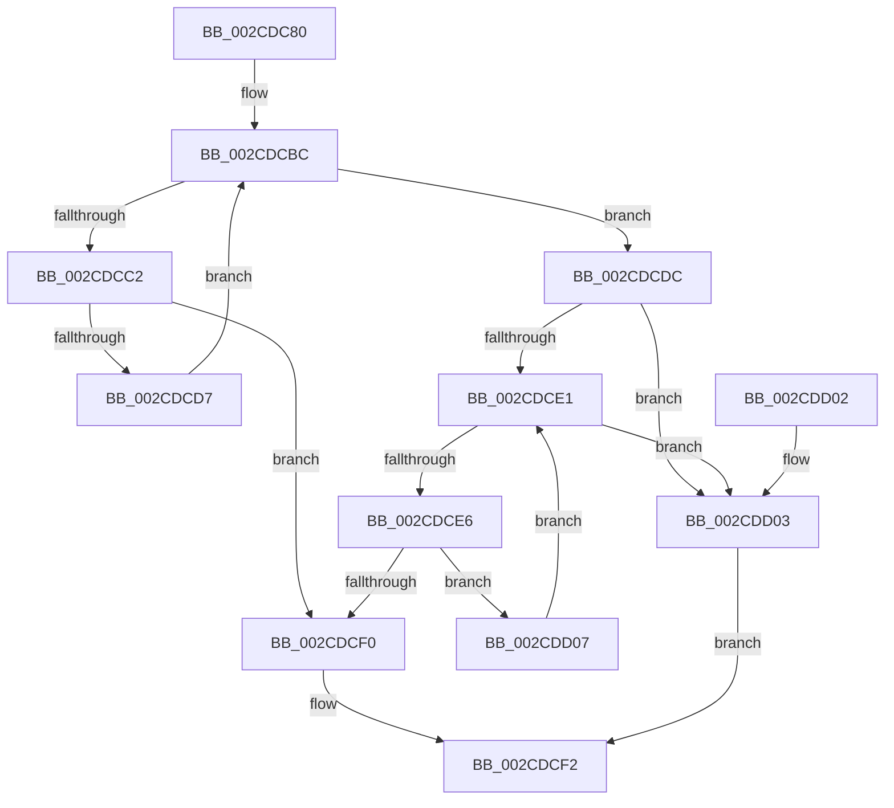

# KeIsSubsetAffinityEx

- RVA: `0x002CDC80`–`0x002CDD0C` (길이 `140` bytes)
- VA: `0x00000001402CDC80`
- 실행 섹션: `.text`
- PDB 이름 있음: `예`; PDB Function 태그: `아니요`
- unwind 정보 RVA: `0x0006F558`
- 디코드: `43`개 명령, `140/140` bytes 표시
- 미해석 바이트: `0` (있으면 어셈블리에 `.byte`로 보존)

> 이 문서는 커널 이미지의 기계어와 PDB 기호를 분석해 생성했습니다. 4번과 5번은 함수 원형과 자료형을 바이너리 사용 방식에서 추정한 C 해석이며 원본 소스 복구 결과는 아닙니다.

## 1. Dependencies

- 직접 호출 지점: **0**; 고유 호출 대상: **0**
- 직접 호출자로 확인된 함수: **16**
- RIP 상대 이미지 참조: **0**

### Outgoing calls
- 직접 디코드된 call 명령이 없습니다.

### Direct callers
- [KeSetUserGroupAffinityThread](KeSetUserGroupAffinityThread_function_002CD1C4.md) at `0x002CD327`
- [PpmPerfApplyDomainStates](PpmPerfApplyDomainStates_function_002CD3B0.md) at `0x002CD417`
- [PpmPerfApplyDomainStates](PpmPerfApplyDomainStates_function_002CD3B0.md) at `0x002CD437`
- [PpmPerfApplyDomainState](PpmPerfApplyDomainState_function_002CD470.md) at `0x002CD572`
- [PpmPerfApplyDomainState](PpmPerfApplyDomainState_function_002CD470.md) at `0x002CDABC`
- [KeSetUserAffinityThread](KeSetUserAffinityThread_function_002CFA2C.md) at `0x002CFA85`
- [KiModifySystemAllowedCpuSetsWithLock](../30/KiModifySystemAllowedCpuSetsWithLock_function_00304278.md) at `0x0030445D`
- [KeStartThread](../3C/KeStartThread_function_003C21B8.md) at `0x003C2450`
- [PpmHeteroHgsGetContainmentType](../4C/PpmHeteroHgsGetContainmentType_function_004C0AE0.md) at `0x004C0B70`
- [KeCpuPartitionMoveCpus](../5C/KeCpuPartitionMoveCpus_function_005C0B70.md) at `0x005C0C09`
- [PpmIdleCheckCoordinatedStateEligibility](../5C/PpmIdleCheckCoordinatedStateEligibility_function_005CFACC.md) at `0x005CFB80`
- [PpmIdleRecheckCoordinatedIdleMask](../5D/PpmIdleRecheckCoordinatedIdleMask_function_005D00FC.md) at `0x005D01BC`
- [PpmUpdateIdleDomains](../5D/PpmUpdateIdleDomains_function_005D0B60.md) at `0x005D0B9A`
- [PpmParkCalculateCoreParkingMaskEx](../5D/PpmParkCalculateCoreParkingMaskEx_function_005DFBE0.md) at `0x005E01EB`
- [PsUpdateActiveProcessAffinity](../../page/78/PsUpdateActiveProcessAffinity_function_00781DA8.md) at `0x00781E19`
- [NtSetInformationThread](../../page/8C/NtSetInformationThread_function_008C9F60.md) at `0x008CB332`
- [PspSetProcessAffinitySafe](../../page/A6/PspSetProcessAffinitySafe_function_00A60904.md) at `0x00A609E5`
- [PspCheckForJobAffinityViolation](../../page/A7/PspCheckForJobAffinityViolation_function_00A79648.md) at `0x00A7966B`

### Static image references
- 디코드된 RIP-relative 메모리 참조가 없습니다.

## 2. Other-region calls and transfers

- 다른 실행 섹션으로 향하는 call: **0**
- 별도 외부 분기/꼬리 이동을 확인하지 못했습니다.

## 3. Assembly (complete function range)

```asm
002CDC80  48 89 5C 24 08                  mov qword ptr [rsp + 8], rbx
002CDC85  48 89 74 24 10                  mov qword ptr [rsp + 0x10], rsi
002CDC8A  48 89 7C 24 18                  mov qword ptr [rsp + 0x18], rdi
002CDC8F  0F B7 02                        movzx eax, word ptr [rdx]
002CDC92  4C 8B DA                        mov r11, rdx
002CDC95  44 0F B7 01                     movzx r8d, word ptr [rcx]
002CDC99  0F B7 D8                        movzx ebx, ax
002CDC9C  66 44 3B C0                     cmp r8w, ax
002CDCA0  4C 8B CA                        mov r9, rdx
002CDCA3  4C 8B D1                        mov r10, rcx
002CDCA6  66 41 0F 43 D8                  cmovae bx, r8w
002CDCAB  4C 0F 43 D9                     cmovae r11, rcx
002CDCAF  66 44 0F 43 C0                  cmovae r8w, ax
002CDCB4  33 F6                           xor esi, esi
002CDCB6  0F B7 D6                        movzx edx, si
002CDCB9  8D 7E 01                        lea edi, [rsi + 1]
002CDCBC  66 41 3B D0                     cmp dx, r8w
002CDCC0  73 1A                           jae 0x1402cdcdc
002CDCC2  0F B7 C2                        movzx eax, dx
002CDCC5  49 8B 4C C2 08                  mov rcx, qword ptr [r10 + rax*8 + 8]
002CDCCA  49 8B 44 C1 08                  mov rax, qword ptr [r9 + rax*8 + 8]
002CDCCF  48 23 C1                        and rax, rcx
002CDCD2  48 3B C1                        cmp rax, rcx
002CDCD5  75 19                           jne 0x1402cdcf0
002CDCD7  66 03 D7                        add dx, di
002CDCDA  EB E0                           jmp 0x1402cdcbc
002CDCDC  4D 3B D9                        cmp r11, r9
002CDCDF  74 22                           je 0x1402cdd03
002CDCE1  66 3B D3                        cmp dx, bx
002CDCE4  73 1D                           jae 0x1402cdd03
002CDCE6  0F B7 C2                        movzx eax, dx
002CDCE9  49 39 74 C2 08                  cmp qword ptr [r10 + rax*8 + 8], rsi
002CDCEE  74 17                           je 0x1402cdd07
002CDCF0  33 C0                           xor eax, eax
002CDCF2  48 8B 5C 24 08                  mov rbx, qword ptr [rsp + 8]
002CDCF7  48 8B 74 24 10                  mov rsi, qword ptr [rsp + 0x10]
002CDCFC  48 8B 7C 24 18                  mov rdi, qword ptr [rsp + 0x18]
002CDD01  C3                              ret
002CDD02  CC                              int3
002CDD03  8B C7                           mov eax, edi
002CDD05  EB EB                           jmp 0x1402cdcf2
002CDD07  66 03 D7                        add dx, di
002CDD0A  EB D5                           jmp 0x1402cdce1
```

## 4. C-style interpretation (structured pseudocode)

```c
__int64 __fastcall KeIsSubsetAffinityEx(__int64 a1, __int64 a2)
{
    __int64 result;
    __int64 v_rbx;
    __int64 v_rsi;
    unsigned __int64 v_stack_p10;
    unsigned __int64 v_stack_p18;
    unsigned __int64 v_stack_p8;

    v_stack_p8 = v_rbx;
    v_stack_p10 = v_rsi;
    v_stack_p18 = v_rdi;
    v_rbx = (unsigned __int16)(*(unsigned __int16 *)(a2));
    if (((unsigned __int16)(*(unsigned __int16 *)(a1))) >= ((unsigned __int16)(*(unsigned __int16 *)(a2)))) {
        v_rbx = (unsigned __int16)(*(unsigned __int16 *)(a1));
        a2 = a1;
    }
    a3 = *(unsigned __int16 *)(a1);
    if (((unsigned __int16)(*(unsigned __int16 *)(a1))) >= ((unsigned __int16)(*(unsigned __int16 *)(a2)))) { a3 = (unsigned __int16)(*(unsigned __int16 *)(a2)); }
    v_rsi = 0;
loc_002CDCBC:
    if (0 >= ((unsigned __int16)(a3))) goto loc_002CDCDC;
    result = (*(unsigned __int64 *)(a2 + 0 * 8 + 8)) & (*(unsigned __int64 *)(a1 + 0 * 8 + 8));
    if (result != (*(unsigned __int64 *)(a1 + 0 * 8 + 8))) goto loc_002CDCF0;
    a2 = (unsigned __int16)((0) + ((unsigned __int16)(v_rsi + 1)));
    goto loc_002CDCBC;
loc_002CDCDC:
    if (a2 == a2) goto loc_002CDD03;
loc_002CDCE1:
    if (((unsigned __int16)(a2)) >= ((unsigned __int16)(v_rbx))) goto loc_002CDD03;
    if ((*(unsigned __int64 *)(a1 + (unsigned __int16)(a2) * 8 + 8)) == 0) goto loc_002CDD07;
loc_002CDCF0:
    result = 0;
loc_002CDCF2:
    return result;
loc_002CDD03:
    goto loc_002CDCF2;
loc_002CDD07:
    a2 = (unsigned __int16)((a2) + ((unsigned __int16)(v_stack_p18)));
    goto loc_002CDCE1;
}
```

## 5. (Beta) C Style

```c
int64_t KeIsSubsetAffinityEx(void *Arg1, void *Arg2)
{
    uint8_t *arg1 = (uint8_t *)Arg1;
    uint8_t *arg2 = (uint8_t *)Arg2;

    int64_t result;
    int64_t local_rbx;
    int64_t local_rsi;
    uint64_t v_stack_p10;
    uint64_t v_stack_p18;
    uint64_t v_stack_p8;

    v_stack_p8 = local_rbx;
    v_stack_p10 = local_rsi;
    v_stack_p18 = local_rdi;
    local_rbx = (uint16_t)(*(uint16_t *)(arg2));
    if (((uint16_t)(*(uint16_t *)(arg1))) >= ((uint16_t)(*(uint16_t *)(arg2)))) {
        local_rbx = (uint16_t)(*(uint16_t *)(arg1));
        Arg2 = Arg1;
    }
    a3 = *(uint16_t *)(arg1);
    if (((uint16_t)(*(uint16_t *)(arg1))) >= ((uint16_t)(*(uint16_t *)(arg2)))) { a3 = (uint16_t)(*(uint16_t *)(arg2)); }
    local_rsi = 0;
loc_002CDCBC:
    if (0 >= ((uint16_t)(a3))) goto loc_002CDCDC;
    result = (*(uint64_t *)(arg2 + 0x0 * 8 + 0x8)) & (*(uint64_t *)(arg1 + 0x0 * 8 + 0x8));
    if (result != (*(uint64_t *)(arg1 + 0x0 * 8 + 0x8))) goto loc_002CDCF0;
    Arg2 = (uint16_t)((0) + ((uint16_t)(local_rsi + 1)));
    goto loc_002CDCBC;
loc_002CDCDC:
    if (Arg2 == Arg2) goto loc_002CDD03;
loc_002CDCE1:
    if (((uint16_t)(Arg2)) >= ((uint16_t)(local_rbx))) goto loc_002CDD03;
    if ((*(uint64_t *)(arg1 + (uint16_t)(arg2) * 8 + 0x8)) == 0) goto loc_002CDD07;
loc_002CDCF0:
    result = 0;
loc_002CDCF2:
    return result;
loc_002CDD03:
    goto loc_002CDCF2;
loc_002CDD07:
    Arg2 = (uint16_t)((Arg2) + ((uint16_t)(v_stack_p18)));
    goto loc_002CDCE1;
}
```

### 관측된 메모리 오프셋

구조체 형식이 확인되지 않은 접근은 인자 기준의 오프셋으로만 기록했습니다.

| 기준 인자 | 오프셋 표현 | 폭 (bit) | 접근 |
|---|---:|---:|---|
| `Arg1` | `+ 0x0` | `16` | `R` |
| `Arg1` | `+ 0x8 + rax*8` | `64` | `R` |
| `Arg2` | `+ 0x0` | `16` | `R` |
| `Arg2` | `+ 0x8 + rax*8` | `64` | `R` |

## 6. Execution-region graph

[열기: 2D/3D 그래프와 함수 탐색 컨트롤 패널](../../../control-panel.html?section=text&rva=0x002CDC80&view=graph)

- 2D 그래프는 위에서 아래로 흐르고, 3D 그래프는 빈 공간을 드래그해 회전합니다. Shift+드래그는 이동, 휠은 확대·축소, 함수 노드 선택은 대상 보고서 이동입니다.

### Static fallback


