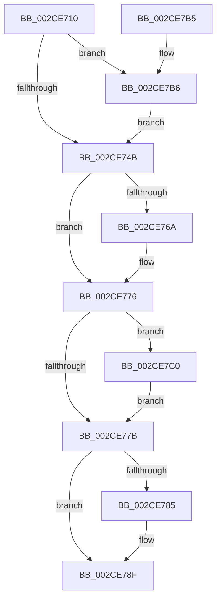

# KeQueryAffinityProcess

- RVA: `0x002CE710`–`0x002CE7F4` (길이 `228` bytes)
- VA: `0x00000001402CE710`
- 실행 섹션: `.text`
- PDB 이름 있음: `예`; PDB Function 태그: `아니요`
- unwind 정보 RVA: `0x0006F600`
- 디코드: `57`개 명령, `228/228` bytes 표시
- 미해석 바이트: `0` (있으면 어셈블리에 `.byte`로 보존)

> 이 문서는 커널 이미지의 기계어와 PDB 기호를 분석해 생성했습니다. 4번과 5번은 함수 원형과 자료형을 바이너리 사용 방식에서 추정한 C 해석이며 원본 소스 복구 결과는 아닙니다.

## 1. Dependencies

- 직접 호출 지점: **4**; 고유 호출 대상: **4**
- 직접 호출자로 확인된 함수: **2**
- RIP 상대 이미지 참조: **1**

### Outgoing calls
- `0x002CE74F` → [ExAcquireSpinLockSharedAtDpcLevel](../24/ExAcquireSpinLockSharedAtDpcLevel_function_00248E30.md) (function, `0x00248E30`)
- `0x002CE760` → [KiCopyAffinityEx](KiCopyAffinityEx_function_002CE860.md) (function, `0x002CE860`)
- `0x002CE795` → [KiReleaseProcessLockShared](KiReleaseProcessLockShared_function_002CE7FC.md) (function, `0x002CE7FC`)
- `0x002CE7B9` → [KiRaiseIrqlProcessIrqlFlags](../4F/KiRaiseIrqlProcessIrqlFlags_function_004F56FC.md) (function, `0x004F56FC`)

### Direct callers
- [NtQueryInformationProcess](../../page/9A/NtQueryInformationProcess_function_009AA250.md) at `0x009AA68F`
- [NtQueryInformationProcess](../../page/9A/NtQueryInformationProcess_function_009AA250.md) at `0x009AD9BD`
- [PspAllocateProcess](../../page/A1/PspAllocateProcess_function_00A13B3C.md) at `0x00A14F0E`

### Static image references
- `0x002CE742` → RVA `0x00FC6D20` (`ALMOSTRO`; read)

## 2. Other-region calls and transfers

- 다른 실행 섹션으로 향하는 call: **0**
- 별도 외부 분기/꼬리 이동을 확인하지 못했습니다.

## 3. Assembly (complete function range)

```asm
002CE710  48 8B C4                        mov rax, rsp
002CE713  48 89 58 08                     mov qword ptr [rax + 8], rbx
002CE717  48 89 68 10                     mov qword ptr [rax + 0x10], rbp
002CE71B  48 89 70 18                     mov qword ptr [rax + 0x18], rsi
002CE71F  48 89 78 20                     mov qword ptr [rax + 0x20], rdi
002CE723  41 56                           push r14
002CE725  48 83 EC 20                     sub rsp, 0x20
002CE729  49 8B F9                        mov rdi, r9
002CE72C  49 8B E8                        mov rbp, r8
002CE72F  4C 8B F2                        mov r14, rdx
002CE732  48 8B D9                        mov rbx, rcx
002CE735  44 0F 20 C6                     mov rsi, cr8
002CE739  BA 02 00 00 00                  mov edx, 2
002CE73E  44 0F 22 C2                     mov cr8, rdx
002CE742  83 3D D7 85 CF 00 00            cmp dword ptr [rip + 0xcf85d7], 0
002CE749  75 6B                           jne 0x1402ce7b6
002CE74B  48 8D 4B 40                     lea rcx, [rbx + 0x40]
002CE74F  E8 DC A6 F7 FF                  call 0x140248e30
002CE754  4C 8B 43 50                     mov r8, qword ptr [rbx + 0x50]
002CE758  49 8B CE                        mov rcx, r14
002CE75B  41 0F B7 56 02                  movzx edx, word ptr [r14 + 2]
002CE760  E8 FB 00 00 00                  call 0x1402ce860
002CE765  48 85 ED                        test rbp, rbp
002CE768  74 0C                           je 0x1402ce776
002CE76A  0F 10 83 98 00 00 00            movups xmm0, xmmword ptr [rbx + 0x98]
002CE771  F3 0F 7F 45 00                  movdqu xmmword ptr [rbp], xmm0
002CE776  48 85 FF                        test rdi, rdi
002CE779  75 45                           jne 0x1402ce7c0
002CE77B  48 8B 4C 24 50                  mov rcx, qword ptr [rsp + 0x50]
002CE780  48 85 C9                        test rcx, rcx
002CE783  74 0A                           je 0x1402ce78f
002CE785  0F B7 83 A0 01 00 00            movzx eax, word ptr [rbx + 0x1a0]
002CE78C  66 89 01                        mov word ptr [rcx], ax
002CE78F  40 8A D6                        mov dl, sil
002CE792  48 8B CB                        mov rcx, rbx
002CE795  E8 62 00 00 00                  call 0x1402ce7fc
002CE79A  48 8B 5C 24 30                  mov rbx, qword ptr [rsp + 0x30]
002CE79F  48 8B 6C 24 38                  mov rbp, qword ptr [rsp + 0x38]
002CE7A4  48 8B 74 24 40                  mov rsi, qword ptr [rsp + 0x40]
002CE7A9  48 8B 7C 24 48                  mov rdi, qword ptr [rsp + 0x48]
002CE7AE  48 83 C4 20                     add rsp, 0x20
002CE7B2  41 5E                           pop r14
002CE7B4  C3                              ret
002CE7B5  CC                              int3
002CE7B6  40 8A CE                        mov cl, sil
002CE7B9  E8 3E 6F 22 00                  call 0x1404f56fc
002CE7BE  EB 8B                           jmp 0x1402ce74b
002CE7C0  48 8B 83 B8 00 00 00            mov rax, qword ptr [rbx + 0xb8]
002CE7C7  0F 10 80 90 00 00 00            movups xmm0, xmmword ptr [rax + 0x90]
002CE7CE  0F 11 07                        movups xmmword ptr [rdi], xmm0
002CE7D1  0F 10 88 A0 00 00 00            movups xmm1, xmmword ptr [rax + 0xa0]
002CE7D8  0F 11 4F 10                     movups xmmword ptr [rdi + 0x10], xmm1
002CE7DC  0F 10 80 B0 00 00 00            movups xmm0, xmmword ptr [rax + 0xb0]
002CE7E3  0F 11 47 20                     movups xmmword ptr [rdi + 0x20], xmm0
002CE7E7  0F 10 88 C0 00 00 00            movups xmm1, xmmword ptr [rax + 0xc0]
002CE7EE  0F 11 4F 30                     movups xmmword ptr [rdi + 0x30], xmm1
002CE7F2  EB 87                           jmp 0x1402ce77b
```

## 4. C-style interpretation (structured pseudocode)

```c
__int64 __fastcall KeQueryAffinityProcess(__int64 a1, __int64 a2, __int64 a3, __int64 a4, __int64 a5)
{
    __int64 result;
    __int64 v_rsp;
    unsigned __int64 v_stack_p10;
    unsigned __int64 v_stack_p18;
    unsigned __int64 v_stack_p20;
    unsigned __int64 v_stack_p8;

    *(unsigned __int64 *)(v_rsp + 8) = v_rbx;
    *(unsigned __int64 *)(v_rsp + 16) = v_rbp;
    *(unsigned __int64 *)(v_rsp + 24) = v_rsi;
    *(unsigned __int64 *)(v_rsp + 32) = v_rdi;
    v_rsp = (v_rsp) - (32);
    if ((*(unsigned int *)(v_rip + 13600215)) != 0) goto loc_002CE7B6;
loc_002CE74B:
    result = ExAcquireSpinLockSharedAtDpcLevel(a1 + 64, 2, a3, a4);
    result = KiCopyAffinityEx(a2, *(unsigned __int16 *)(a2 + 2), *(unsigned __int64 *)(a1 + 80), a4);
    if (a3 != 0) {
        *(unsigned __int64 *)(a3) = v_xmm0;
    }
    if (a4 != 0) goto loc_002CE7C0;
loc_002CE77B:
    if (a5 != 0) {
        result = *(unsigned __int16 *)(a1 + 416);
        *(unsigned __int16 *)(a5) = (unsigned __int16)(result);
    }
    result = KiReleaseProcessLockShared(a1, (unsigned __int8)(v_cr8), *(unsigned __int64 *)(a1 + 80), a4);
    v_rsp = (v_rsp) + (32);
    return result;
loc_002CE7B6:
    result = KiRaiseIrqlProcessIrqlFlags((unsigned __int8)(v_stack_p18), (unsigned __int8)(v_cr8), *(unsigned __int64 *)(a1 + 80), a4);
    goto loc_002CE74B;
loc_002CE7C0:
    *(unsigned __int64 *)(v_stack_p20) = v_xmm0;
    *(unsigned __int64 *)(v_stack_p20 + 16) = v_xmm1;
    *(unsigned __int64 *)(v_stack_p20 + 32) = v_xmm0;
    *(unsigned __int64 *)(v_stack_p20 + 48) = v_xmm1;
    goto loc_002CE77B;
}
```

## 5. (Beta) C Style

```c
int64_t KeQueryAffinityProcess(void *Arg1, void *Arg2, int64_t Arg3, int64_t Arg4, int64_t Arg5)
{
    uint8_t *arg1 = (uint8_t *)Arg1;
    uint8_t *arg2 = (uint8_t *)Arg2;

    int64_t result;
    int64_t local_rsp;
    uint64_t v_stack_p10;
    uint64_t v_stack_p18;
    uint64_t v_stack_p20;
    uint64_t v_stack_p8;

    *(uint64_t *)(local_rsp + 0x8) = local_rbx;
    *(uint64_t *)(local_rsp + 0x10) = local_rbp;
    *(uint64_t *)(local_rsp + 0x18) = local_rsi;
    *(uint64_t *)(local_rsp + 0x20) = local_rdi;
    local_rsp = (local_rsp) - (32);
    if ((*(uint32_t *)(v_rip + 0xCF85D7)) != 0) goto loc_002CE7B6;
loc_002CE74B:
    result = ExAcquireSpinLockSharedAtDpcLevel(Arg1 + 64, 2, Arg3, Arg4);
    result = KiCopyAffinityEx(Arg2, *(uint16_t *)(arg2 + 0x2), *(uint64_t *)(arg1 + 0x50), Arg4);
    if (Arg3 != 0) {
        *(uint64_t *)(Arg3) = v_xmm0;
    }
    if (Arg4 != 0) goto loc_002CE7C0;
loc_002CE77B:
    if (Arg5 != 0) {
        result = *(uint16_t *)(arg1 + 0x1A0);
        *(uint16_t *)(Arg5) = (uint16_t)(result);
    }
    result = KiReleaseProcessLockShared(Arg1, (uint8_t)(v_cr8), *(uint64_t *)(arg1 + 0x50), Arg4);
    local_rsp = (local_rsp) + (32);
    return result;
loc_002CE7B6:
    result = KiRaiseIrqlProcessIrqlFlags((uint8_t)(v_stack_p18), (uint8_t)(v_cr8), *(uint64_t *)(arg1 + 0x50), Arg4);
    goto loc_002CE74B;
loc_002CE7C0:
    *(uint64_t *)(v_stack_p20) = v_xmm0;
    *(uint64_t *)(v_stack_p20 + 0x10) = v_xmm1;
    *(uint64_t *)(v_stack_p20 + 0x20) = v_xmm0;
    *(uint64_t *)(v_stack_p20 + 0x30) = v_xmm1;
    goto loc_002CE77B;
}
```

### 관측된 메모리 오프셋

구조체 형식이 확인되지 않은 접근은 인자 기준의 오프셋으로만 기록했습니다.

| 기준 인자 | 오프셋 표현 | 폭 (bit) | 접근 |
|---|---:|---:|---|
| `Arg1` | `+ 0x40` | `64` | `R` |
| `Arg1` | `+ 0x50` | `64` | `R` |
| `Arg1` | `+ 0x98` | `128` | `R` |
| `Arg1` | `+ 0xB8` | `64` | `R` |
| `Arg1` | `+ 0x1A0` | `16` | `R` |
| `Arg2` | `+ 0x2` | `16` | `R` |

## 6. Execution-region graph

[열기: 2D/3D 그래프와 함수 탐색 컨트롤 패널](../../../control-panel.html?section=text&rva=0x002CE710&view=graph)

- 2D 그래프는 위에서 아래로 흐르고, 3D 그래프는 빈 공간을 드래그해 회전합니다. Shift+드래그는 이동, 휠은 확대·축소, 함수 노드 선택은 대상 보고서 이동입니다.

### Static fallback


