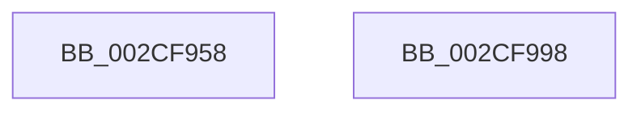

# KeQueryPrimaryGroupProcess

- RVA: `0x002CF958`–`0x002CF999` (길이 `65` bytes)
- VA: `0x00000001402CF958`
- 실행 섹션: `.text`
- PDB 이름 있음: `예`; PDB Function 태그: `아니요`
- unwind 정보 RVA: `0x00068D5C`
- 디코드: `18`개 명령, `65/65` bytes 표시
- 미해석 바이트: `0` (있으면 어셈블리에 `.byte`로 보존)

> 이 문서는 커널 이미지의 기계어와 PDB 기호를 분석해 생성했습니다. 4번과 5번은 함수 원형과 자료형을 바이너리 사용 방식에서 추정한 C 해석이며 원본 소스 복구 결과는 아닙니다.

## 1. Dependencies

- 직접 호출 지점: **2**; 고유 호출 대상: **2**
- 직접 호출자로 확인된 함수: **2**
- RIP 상대 이미지 참조: **0**

### Outgoing calls
- `0x002CF972` → [KiAcquireProcessLockShared](KiAcquireProcessLockShared_function_002CF9A0.md) (function, `0x002CF9A0`)
- `0x002CF988` → [KiReleaseProcessLockShared](KiReleaseProcessLockShared_function_002CE7FC.md) (function, `0x002CE7FC`)

### Direct callers
- [NtSetInformationThread](../../page/8C/NtSetInformationThread_function_008C9F60.md) at `0x008CB219`
- [NtSetInformationProcess](../../page/AE/NtSetInformationProcess_function_00AE5370.md) at `0x00AE6517`

### Static image references
- 디코드된 RIP-relative 메모리 참조가 없습니다.

## 2. Other-region calls and transfers

- 다른 실행 섹션으로 향하는 call: **0**
- 별도 외부 분기/꼬리 이동을 확인하지 못했습니다.

## 3. Assembly (complete function range)

```asm
002CF958  48 89 5C 24 10                  mov qword ptr [rsp + 0x10], rbx
002CF95D  57                              push rdi
002CF95E  48 83 EC 20                     sub rsp, 0x20
002CF962  48 8B DA                        mov rbx, rdx
002CF965  C6 44 24 30 00                  mov byte ptr [rsp + 0x30], 0
002CF96A  48 8D 54 24 30                  lea rdx, [rsp + 0x30]
002CF96F  48 8B F9                        mov rdi, rcx
002CF972  E8 29 00 00 00                  call 0x1402cf9a0
002CF977  0F B7 87 A0 01 00 00            movzx eax, word ptr [rdi + 0x1a0]
002CF97E  48 8B CF                        mov rcx, rdi
002CF981  8A 54 24 30                     mov dl, byte ptr [rsp + 0x30]
002CF985  66 89 03                        mov word ptr [rbx], ax
002CF988  E8 6F EE FF FF                  call 0x1402ce7fc
002CF98D  48 8B 5C 24 38                  mov rbx, qword ptr [rsp + 0x38]
002CF992  48 83 C4 20                     add rsp, 0x20
002CF996  5F                              pop rdi
002CF997  C3                              ret
002CF998  CC                              int3
```

## 4. C-style interpretation (structured pseudocode)

```c
__int64 __fastcall KeQueryPrimaryGroupProcess(__int64 a1, __int64 a2)
{
    __int64 result;
    __int64 v_rsp;
    unsigned __int64 v_stack_p10;
    unsigned __int8 v_stack_p8;

    v_stack_p10 = v_rbx;
    v_rsp = (v_rsp) - (32);
    v_stack_p8 = 0;
    result = KiAcquireProcessLockShared(a1, v_stack_p8, a3, a4);
    *(unsigned __int16 *)(a2) = (unsigned __int16)(*(unsigned __int16 *)(a1 + 416));
    result = KiReleaseProcessLockShared(a1, v_stack_p8, a3, a4);
    v_rsp = (v_rsp) + (32);
    return result;
}
```

## 5. (Beta) C Style

```c
int64_t KeQueryPrimaryGroupProcess(void *Arg1, void *Arg2)
{
    uint8_t *arg1 = (uint8_t *)Arg1;
    uint8_t *arg2 = (uint8_t *)Arg2;

    int64_t result;
    int64_t local_rsp;
    uint64_t v_stack_p10;
    uint8_t v_stack_p8;

    v_stack_p10 = local_rbx;
    local_rsp = (local_rsp) - (32);
    v_stack_p8 = 0;
    result = KiAcquireProcessLockShared(Arg1, v_stack_p8, a3, a4);
    *(uint16_t *)(arg2) = (uint16_t)(*(uint16_t *)(arg1 + 0x1A0));
    result = KiReleaseProcessLockShared(Arg1, v_stack_p8, a3, a4);
    local_rsp = (local_rsp) + (32);
    return result;
}
```

### 관측된 메모리 오프셋

구조체 형식이 확인되지 않은 접근은 인자 기준의 오프셋으로만 기록했습니다.

| 기준 인자 | 오프셋 표현 | 폭 (bit) | 접근 |
|---|---:|---:|---|
| `Arg1` | `+ 0x1A0` | `16` | `R` |
| `Arg2` | `+ 0x0` | `16` | `W` |

## 6. Execution-region graph

[열기: 2D/3D 그래프와 함수 탐색 컨트롤 패널](../../../control-panel.html?section=text&rva=0x002CF958&view=graph)

- 2D 그래프는 위에서 아래로 흐르고, 3D 그래프는 빈 공간을 드래그해 회전합니다. Shift+드래그는 이동, 휠은 확대·축소, 함수 노드 선택은 대상 보고서 이동입니다.

### Static fallback


