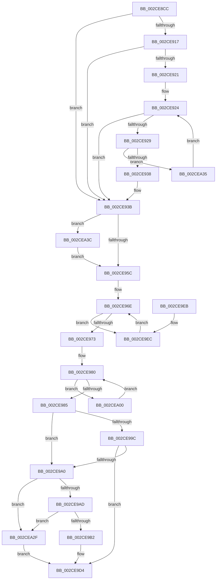

# KeSelectIdealProcessor

- RVA: `0x002CE8CC`–`0x002CEA57` (길이 `395` bytes)
- VA: `0x00000001402CE8CC`
- 실행 섹션: `.text`
- PDB 이름 있음: `예`; PDB Function 태그: `아니요`
- unwind 정보 RVA: `0x0006F61C`
- 디코드: `118`개 명령, `395/395` bytes 표시
- 미해석 바이트: `0` (있으면 어셈블리에 `.byte`로 보존)

> 이 문서는 커널 이미지의 기계어와 PDB 기호를 분석해 생성했습니다. 4번과 5번은 함수 원형과 자료형을 바이너리 사용 방식에서 추정한 C 해석이며 원본 소스 복구 결과는 아닙니다.

## 1. Dependencies

- 직접 호출 지점: **0**; 고유 호출 대상: **0**
- 직접 호출자로 확인된 함수: **6**
- RIP 상대 이미지 참조: **4**

### Outgoing calls
- 직접 디코드된 call 명령이 없습니다.

### Direct callers
- [KiSetAffinityThread](KiSetAffinityThread_function_002CE010.md) at `0x002CE2C3`
- [KiReselectIdealProcessorAfterAffinityChange](KiReselectIdealProcessorAfterAffinityChange_function_002CF894.md) at `0x002CF906`
- [KeSelectInitialIdealProcessorForThread](../3C/KeSelectInitialIdealProcessorForThread_function_003C294C.md) at `0x003C298B`
- [sub_006FAFDA](../6F/Unknown_function_006FAFDA.md) at `0x006FB02C`
- [ExpWorkQueueManagerInitialize](../../page/7D/ExpWorkQueueManagerInitialize_function_007D01D4.md) at `0x007D028B`
- [ExpNodeCreateSystemThread](../../page/9E/ExpNodeCreateSystemThread_function_009ECFF0.md) at `0x009ED05A`

### Static image references
- `0x002CE8E1` → RVA `0x00FC8820` (`ALMOSTRO`; read)
- `0x002CE917` → RVA `0x00FC5084` (`ALMOSTRO`; read)
- `0x002CE9A0` → RVA `0x00FC5018` (`ALMOSTRO`; read)
- `0x002CE9BF` → RVA `0x00F231B8` (`.data`; read)

## 2. Other-region calls and transfers

- 다른 실행 섹션으로 향하는 call: **0**
- 별도 외부 분기/꼬리 이동을 확인하지 못했습니다.

## 3. Assembly (complete function range)

```asm
002CE8CC  48 89 5C 24 10                  mov qword ptr [rsp + 0x10], rbx
002CE8D1  48 89 6C 24 18                  mov qword ptr [rsp + 0x18], rbp
002CE8D6  48 89 74 24 20                  mov qword ptr [rsp + 0x20], rsi
002CE8DB  57                              push rdi
002CE8DC  41 56                           push r14
002CE8DE  4C 8B 11                        mov r10, qword ptr [rcx]
002CE8E1  48 8D 05 38 9F CF 00            lea rax, [rip + 0xcf9f38]
002CE8E8  0F B7 59 08                     movzx ebx, word ptr [rcx + 8]
002CE8EC  4D 8B D8                        mov r11, r8
002CE8EF  48 C1 E3 05                     shl rbx, 5
002CE8F3  4C 8B F2                        mov r14, rdx
002CE8F6  48 03 D8                        add rbx, rax
002CE8F9  48 8B E9                        mov rbp, rcx
002CE8FC  BF 01 00 00 00                  mov edi, 1
002CE901  48 8B 43 18                     mov rax, qword ptr [rbx + 0x18]
002CE905  48 F7 D0                        not rax
002CE908  49 23 C2                        and rax, r10
002CE90B  4C 0F 45 D0                     cmovne r10, rax
002CE90F  45 33 C0                        xor r8d, r8d
002CE912  4D 85 DB                        test r11, r11
002CE915  74 24                           je 0x1402ce93b
002CE917  8B 05 67 67 CF 00               mov eax, dword ptr [rip + 0xcf6767]
002CE91D  A8 04                           test al, 4
002CE91F  74 1A                           je 0x1402ce93b
002CE921  41 8B C8                        mov ecx, r8d
002CE924  41 3B C9                        cmp ecx, r9d
002CE927  73 12                           jae 0x1402ce93b
002CE929  8B C1                           mov eax, ecx
002CE92B  49 8B D2                        mov rdx, r10
002CE92E  49 23 14 C3                     and rdx, qword ptr [r11 + rax*8]
002CE932  0F 84 FD 00 00 00               je 0x1402cea35
002CE938  4C 8B D2                        mov r10, rdx
002CE93B  45 0F B7 0E                     movzx r9d, word ptr [r14]
002CE93F  48 8B D7                        mov rdx, rdi
002CE942  48 8B 73 10                     mov rsi, qword ptr [rbx + 0x10]
002CE946  41 83 E1 3F                     and r9d, 0x3f
002CE94A  48 8B 1B                        mov rbx, qword ptr [rbx]
002CE94D  41 8B C9                        mov ecx, r9d
002CE950  48 D3 E2                        shl rdx, cl
002CE953  48 85 D3                        test rbx, rdx
002CE956  0F 84 E0 00 00 00               je 0x1402cea3c
002CE95C  48 8B FB                        mov rdi, rbx
002CE95F  48 8B CB                        mov rcx, rbx
002CE962  48 F7 D7                        not rdi
002CE965  4C 8B CE                        mov r9, rsi
002CE968  4C 8B DF                        mov r11, rdi
002CE96B  48 23 CE                        and rcx, rsi
002CE96E  48 85 D1                        test rcx, rdx
002CE971  74 79                           je 0x1402ce9ec
002CE973  48 8D 42 FF                     lea rax, [rdx - 1]
002CE977  48 0B C2                        or rax, rdx
002CE97A  48 F7 D0                        not rax
002CE97D  48 23 C8                        and rcx, rax
002CE980  49 85 CA                        test r10, rcx
002CE983  74 7B                           je 0x1402cea00
002CE985  49 23 CA                        and rcx, r10
002CE988  48 0F BC D1                     bsf rdx, rcx
002CE98C  0F B6 C2                        movzx eax, dl
002CE98F  66 41 89 06                     mov word ptr [r14], ax
002CE993  0F B7 45 08                     movzx eax, word ptr [rbp + 8]
002CE997  66 85 C0                        test ax, ax
002CE99A  75 04                           jne 0x1402ce9a0
002CE99C  84 D2                           test dl, dl
002CE99E  74 34                           je 0x1402ce9d4
002CE9A0  66 3B 05 71 66 CF 00            cmp ax, word ptr [rip + 0xcf6671]
002CE9A7  0F 83 82 00 00 00               jae 0x1402cea2f
002CE9AD  80 FA 40                        cmp dl, 0x40
002CE9B0  73 7D                           jae 0x1402cea2f
002CE9B2  48 8B C8                        mov rcx, rax
002CE9B5  0F B6 C2                        movzx eax, dl
002CE9B8  48 C1 E1 06                     shl rcx, 6
002CE9BC  48 03 C8                        add rcx, rax
002CE9BF  48 8B 05 F2 47 C5 00            mov rax, qword ptr [rip + 0xc547f2]
002CE9C6  8B 14 88                        mov edx, dword ptr [rax + rcx*4]
002CE9C9  83 C8 FF                        or eax, 0xffffffff
002CE9CC  85 D2                           test edx, edx
002CE9CE  0F 44 D0                        cmove edx, eax
002CE9D1  44 8B C2                        mov r8d, edx
002CE9D4  48 8B 5C 24 20                  mov rbx, qword ptr [rsp + 0x20]
002CE9D9  41 0F B7 C0                     movzx eax, r8w
002CE9DD  48 8B 6C 24 28                  mov rbp, qword ptr [rsp + 0x28]
002CE9E2  48 8B 74 24 30                  mov rsi, qword ptr [rsp + 0x30]
002CE9E7  41 5E                           pop r14
002CE9E9  5F                              pop rdi
002CE9EA  C3                              ret
002CE9EB  CC                              int3
002CE9EC  4D 0B D9                        or r11, r9
002CE9EF  4D 03 C9                        add r9, r9
002CE9F2  49 8B CB                        mov rcx, r11
002CE9F5  48 F7 D1                        not rcx
002CE9F8  49 23 C9                        and rcx, r9
002CE9FB  E9 6E FF FF FF                  jmp 0x1402ce96e
002CEA00  4D 0B D9                        or r11, r9
002CEA03  49 8B CB                        mov rcx, r11
002CEA06  49 8B C3                        mov rax, r11
002CEA09  48 F7 D1                        not rcx
002CEA0C  4C 8B DF                        mov r11, rdi
002CEA0F  48 85 CB                        test rbx, rcx
002CEA12  4C 0F 45 D8                     cmovne r11, rax
002CEA16  4B 8D 04 09                     lea rax, [r9 + r9]
002CEA1A  4C 8B CE                        mov r9, rsi
002CEA1D  49 8B CB                        mov rcx, r11
002CEA20  4C 0F 45 C8                     cmovne r9, rax
002CEA24  48 F7 D1                        not rcx
002CEA27  49 23 C9                        and rcx, r9
002CEA2A  E9 51 FF FF FF                  jmp 0x1402ce980
002CEA2F  41 83 C8 FF                     or r8d, 0xffffffff
002CEA33  EB 9F                           jmp 0x1402ce9d4
002CEA35  03 CF                           add ecx, edi
002CEA37  E9 E8 FE FF FF                  jmp 0x1402ce924
002CEA3C  48 8B C3                        mov rax, rbx
002CEA3F  48 8B D7                        mov rdx, rdi
002CEA42  48 D3 C8                        ror rax, cl
002CEA45  48 0F BC C8                     bsf rcx, rax
002CEA49  41 03 C9                        add ecx, r9d
002CEA4C  83 E1 3F                        and ecx, 0x3f
002CEA4F  48 D3 E2                        shl rdx, cl
002CEA52  E9 05 FF FF FF                  jmp 0x1402ce95c
```

## 4. C-style interpretation (structured pseudocode)

```c
__int64 __fastcall KeSelectIdealProcessor(__int64 a1, __int64 a2, __int64 a3, int a4)
{
    __int64 result;
    __int64 v_r10;
    __int64 v_r11;
    __int64 v_rbx;
    __int64 v_rdi;
    unsigned __int64 v_stack_p10;
    unsigned __int64 v_stack_p18;
    unsigned __int64 v_stack_p20;

    v_stack_p10 = v_rbx;
    v_stack_p18 = v_rbp;
    v_stack_p20 = v_rsi;
    v_rbx = (*(unsigned __int16 *)(a1 + 8)) << (5);
    v_rbx = (v_rbx) + (v_rip + 13606712);
    result = ~(*(unsigned __int64 *)(v_rbx + 24));
    result = (result) & (*(unsigned __int64 *)(a1));
    v_r10 = *(unsigned __int64 *)(a1);
    if (condition_is_not_equal) { v_r10 = result; }
    a3 = 0;
    if (0 == 0) goto loc_002CE93B;
    if ((((unsigned __int8)((unsigned int)(*(unsigned int *)(v_rip + 13592423)))) & (4)) == 0) goto loc_002CE93B;
loc_002CE924:
    if (0 >= a4) goto loc_002CE93B;
    a2 = (v_r10) & (*(unsigned __int64 *)(a3 + 0 * 8));
    if (condition_is_equal) goto loc_002CEA35;
loc_002CE93B:
    a4 = (unsigned int)((*(unsigned __int16 *)(a2)) & (63));
    a2 = (1) << ((unsigned __int8)((unsigned int)(a4)));
    if (((*(unsigned __int64 *)(v_rbx)) & (a2)) == 0) goto loc_002CEA3C;
loc_002CE95C:
    v_rdi = ~(*(unsigned __int64 *)(v_rbx));
    a1 = (*(unsigned __int64 *)(v_rbx)) & (*(unsigned __int64 *)(v_rbx + 16));
loc_002CE96E:
    if (((a1) & (a2)) == 0) goto loc_002CE9EC;
    result = (a2 - 1) | (a2);
    result = ~(result);
    a1 = (a1) & (result);
loc_002CE980:
    if (((a2) & (a1)) == 0) goto loc_002CEA00;
    a1 = (a1) & (a2);
    *(unsigned __int16 *)(a2) = (unsigned __int16)((unsigned __int8)(a2));
    if ((unsigned __int16)(*(unsigned __int16 *)(a1 + 8)) != 0) goto loc_002CE9A0;
    if ((unsigned __int8)(a2) == 0) goto loc_002CE9D4;
loc_002CE9A0:
    if (((unsigned __int16)(*(unsigned __int16 *)(a1 + 8))) >= (*(unsigned __int16 *)(v_rip + 13592177))) goto loc_002CEA2F;
    if (((unsigned __int8)(a2)) >= 64) goto loc_002CEA2F;
    a1 = (*(unsigned __int16 *)(a1 + 8)) << (6);
    a1 = (a1) + ((unsigned __int8)(a2));
    result = (unsigned int)((*(unsigned __int64 *)(v_rip + 12929010)) | (0xFFFFFFFFULL));
    a2 = (unsigned int)(*(unsigned int *)(*(unsigned __int64 *)(v_rip + 12929010) + a1 * 4));
    if ((unsigned int)((unsigned int)(*(unsigned int *)(*(unsigned __int64 *)(v_rip + 12929010) + a1 * 4))) == 0) { a2 = (unsigned int)(result); }
loc_002CE9D4:
    return (unsigned __int16)((unsigned int)((unsigned int)(a2)));
loc_002CE9EC:
    v_r11 = (v_rdi) | (*(unsigned __int64 *)(v_rbx + 16));
    a4 = (*(unsigned __int64 *)(v_rbx + 16)) + (*(unsigned __int64 *)(v_rbx + 16));
    a1 = ~(v_r11);
    a1 = (a1) & (a4);
    goto loc_002CE96E;
loc_002CEA00:
    v_r11 = (v_r11) | (a4);
    a1 = ~(v_r11);
    v_r11 = v_rdi;
    if (((v_stack_p10) & (a1)) != 0) { v_r11 = v_r11; }
    a4 = v_stack_p20;
    if (((v_stack_p10) & (a1)) != 0) { a4 = a4 + a4 * 1; }
    a1 = ~(v_r11);
    a1 = (a1) & (a4);
    goto loc_002CE980;
loc_002CEA2F:
    a3 = (unsigned int)(((unsigned int)((unsigned int)(a2))) | (0xFFFFFFFFULL));
    goto loc_002CE9D4;
loc_002CEA35:
    a1 = (unsigned int)((a1) + ((unsigned int)(v_rdi)));
    goto loc_002CE924;
loc_002CEA3C:
    a1 = (unsigned int)((a1) + (a4));
    a1 = (unsigned int)((a1) & (63));
    a2 = (v_rdi) << ((unsigned __int8)(a1));
    goto loc_002CE95C;
}
```

## 5. (Beta) C Style

```c
int64_t KeSelectIdealProcessor(void *Arg1, void *Arg2, int64_t Arg3, int32_t Arg4)
{
    uint8_t *arg1 = (uint8_t *)Arg1;
    uint8_t *arg2 = (uint8_t *)Arg2;

    int64_t result;
    int64_t local_r10;
    int64_t local_r11;
    int64_t local_rbx;
    int64_t local_rdi;
    uint64_t v_stack_p10;
    uint64_t v_stack_p18;
    uint64_t v_stack_p20;

    v_stack_p10 = local_rbx;
    v_stack_p18 = local_rbp;
    v_stack_p20 = local_rsi;
    local_rbx = (*(uint16_t *)(arg1 + 0x8)) << (5);
    local_rbx = (local_rbx) + (v_rip + 13606712);
    result = ~(*(uint64_t *)(local_rbx + 0x18));
    result = (result) & (*(uint64_t *)(arg1));
    local_r10 = *(uint64_t *)(arg1);
    if (condition_is_not_equal) { local_r10 = result; }
    Arg3 = 0;
    if (0 == 0) goto loc_002CE93B;
    if ((((uint8_t)((uint32_t)(*(uint32_t *)(v_rip + 0xCF6767)))) & (4)) == 0) goto loc_002CE93B;
loc_002CE924:
    if (0 >= Arg4) goto loc_002CE93B;
    Arg2 = (local_r10) & (*(uint64_t *)(Arg3 + 0x0 * 8));
    if (condition_is_equal) goto loc_002CEA35;
loc_002CE93B:
    Arg4 = (uint32_t)((*(uint16_t *)(arg2)) & (63));
    Arg2 = (1) << ((uint8_t)((uint32_t)(Arg4)));
    if (((*(uint64_t *)(local_rbx)) & (Arg2)) == 0) goto loc_002CEA3C;
loc_002CE95C:
    local_rdi = ~(*(uint64_t *)(local_rbx));
    Arg1 = (*(uint64_t *)(local_rbx)) & (*(uint64_t *)(local_rbx + 0x10));
loc_002CE96E:
    if (((Arg1) & (Arg2)) == 0) goto loc_002CE9EC;
    result = (Arg2 - 1) | (Arg2);
    result = ~(result);
    Arg1 = (Arg1) & (result);
loc_002CE980:
    if (((Arg2) & (Arg1)) == 0) goto loc_002CEA00;
    Arg1 = (Arg1) & (Arg2);
    *(uint16_t *)(arg2) = (uint16_t)((uint8_t)(Arg2));
    if ((uint16_t)(*(uint16_t *)(arg1 + 0x8)) != 0) goto loc_002CE9A0;
    if ((uint8_t)(Arg2) == 0) goto loc_002CE9D4;
loc_002CE9A0:
    if (((uint16_t)(*(uint16_t *)(arg1 + 0x8))) >= (*(uint16_t *)(v_rip + 0xCF6671))) goto loc_002CEA2F;
    if (((uint8_t)(Arg2)) >= 64) goto loc_002CEA2F;
    Arg1 = (*(uint16_t *)(arg1 + 0x8)) << (6);
    Arg1 = (Arg1) + ((uint8_t)(Arg2));
    result = (uint32_t)((*(uint64_t *)(v_rip + 0xC547F2)) | (0xFFFFFFFFULL));
    Arg2 = (uint32_t)(*(uint32_t *)(*(uint64_t *)(v_rip + 0xC547F2) + arg1 * 4));
    if ((uint32_t)((uint32_t)(*(uint32_t *)(*(uint64_t *)(v_rip + 0xC547F2) + arg1 * 4))) == 0) { Arg2 = (uint32_t)(result); }
loc_002CE9D4:
    return (uint16_t)((uint32_t)((uint32_t)(Arg2)));
loc_002CE9EC:
    local_r11 = (local_rdi) | (*(uint64_t *)(local_rbx + 0x10));
    Arg4 = (*(uint64_t *)(local_rbx + 0x10)) + (*(uint64_t *)(local_rbx + 0x10));
    Arg1 = ~(local_r11);
    Arg1 = (Arg1) & (Arg4);
    goto loc_002CE96E;
loc_002CEA00:
    local_r11 = (local_r11) | (Arg4);
    Arg1 = ~(local_r11);
    local_r11 = local_rdi;
    if (((v_stack_p10) & (Arg1)) != 0) { local_r11 = local_r11; }
    Arg4 = v_stack_p20;
    if (((v_stack_p10) & (Arg1)) != 0) { Arg4 = Arg4 + Arg4 * 1; }
    Arg1 = ~(local_r11);
    Arg1 = (Arg1) & (Arg4);
    goto loc_002CE980;
loc_002CEA2F:
    Arg3 = (uint32_t)(((uint32_t)((uint32_t)(Arg2))) | (0xFFFFFFFFULL));
    goto loc_002CE9D4;
loc_002CEA35:
    Arg1 = (uint32_t)((Arg1) + ((uint32_t)(local_rdi)));
    goto loc_002CE924;
loc_002CEA3C:
    Arg1 = (uint32_t)((Arg1) + (Arg4));
    Arg1 = (uint32_t)((Arg1) & (63));
    Arg2 = (local_rdi) << ((uint8_t)(Arg1));
    goto loc_002CE95C;
}
```

### 관측된 메모리 오프셋

구조체 형식이 확인되지 않은 접근은 인자 기준의 오프셋으로만 기록했습니다.

| 기준 인자 | 오프셋 표현 | 폭 (bit) | 접근 |
|---|---:|---:|---|
| `Arg1` | `+ 0x0` | `64` | `R` |
| `Arg1` | `+ 0x8` | `16` | `R` |
| `Arg2` | `+ 0x0` | `16` | `R` |
| `Arg2` | `+ 0x0` | `16` | `W` |

## 6. Execution-region graph

[열기: 2D/3D 그래프와 함수 탐색 컨트롤 패널](../../../control-panel.html?section=text&rva=0x002CE8CC&view=graph)

- 2D 그래프는 위에서 아래로 흐르고, 3D 그래프는 빈 공간을 드래그해 회전합니다. Shift+드래그는 이동, 휠은 확대·축소, 함수 노드 선택은 대상 보고서 이동입니다.

### Static fallback


