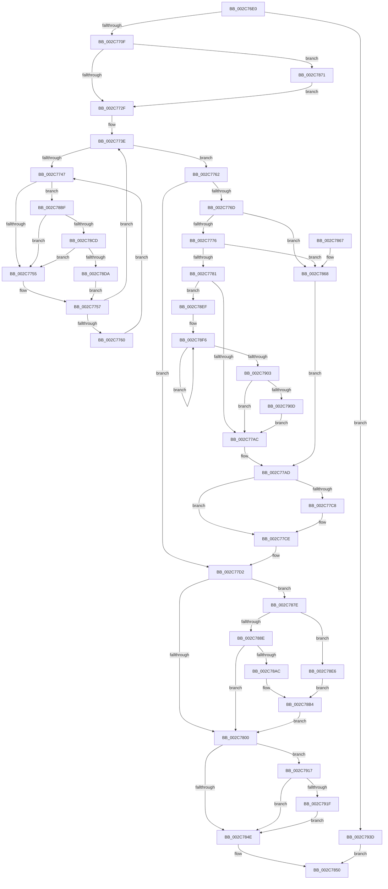

# KeSetPriorityThread

- RVA: `0x002C76E0`–`0x002C7947` (길이 `615` bytes)
- VA: `0x00000001402C76E0`
- 실행 섹션: `.text`
- PDB 이름 있음: `예`; PDB Function 태그: `아니요`
- unwind 정보 RVA: `0x0006EE08`
- 디코드: `155`개 명령, `615/615` bytes 표시
- 미해석 바이트: `0` (있으면 어셈블리에 `.byte`로 보존)

> 이 문서는 커널 이미지의 기계어와 PDB 기호를 분석해 생성했습니다. 4번과 5번은 함수 원형과 자료형을 바이너리 사용 방식에서 추정한 C 해석이며 원본 소스 복구 결과는 아닙니다.

## 1. Dependencies

- 직접 호출 지점: **14**; 고유 호출 대상: **12**
- 직접 호출자로 확인된 함수: **21**
- RIP 상대 이미지 참조: **6**

### Outgoing calls
- `0x002C778B` → [KiUpdateTotalCyclesCurrentThread](../37/KiUpdateTotalCyclesCurrentThread_function_0037DE40.md) (function, `0x0037DE40`)
- `0x002C77B0` → [KiQueryQuantumReset](../21/KiQueryQuantumReset_function_0021F6B4.md) (function, `0x0021F6B4`)
- `0x002C77F6` → [KiAdjustRealtimePriorityFloor](../21/KiAdjustRealtimePriorityFloor_function_0021FBE0.md) (function, `0x0021FBE0`)
- `0x002C7808` → [KiComputeThreadPriority](../3C/KiComputeThreadPriority_function_003C45F4.md) (function, `0x003C45F4`)
- `0x002C781A` → [KiSetPriorityThread](../22/KiSetPriorityThread_function_00220E78.md) (function, `0x00220E78`)
- `0x002C7839` → [KiProcessDeferredReadyList](../25/KiProcessDeferredReadyList_function_00250800.md) (function, `0x00250800`)
- `0x002C7874` → [KiRaiseIrqlProcessIrqlFlags](../4F/KiRaiseIrqlProcessIrqlFlags_function_004F56FC.md) (function, `0x004F56FC`)
- `0x002C787E` → [Feature_StackingDecayBoosts__private_IsEnabledNoReportingNoInline](../4E/Feature_StackingDecayBoosts__private_IsEnabledNoReportingNoInline_function_004EF7C0.md) (function, `0x004EF7C0`)
- `0x002C78AC` → [Feature_StackingDecayBoosts__private_IsEnabledNoReportingNoInline](../4E/Feature_StackingDecayBoosts__private_IsEnabledNoReportingNoInline_function_004EF7C0.md) (function, `0x004EF7C0`)
- `0x002C78CD` → [KiCheckVpBackingLongSpinWaitHypercall](../30/KiCheckVpBackingLongSpinWaitHypercall_function_0030F490.md) (function, `0x0030F490`)
- `0x002C78DC` → [HvlNotifyLongSpinWait](../30/HvlNotifyLongSpinWait_function_0030F460.md) (function, `0x0030F460`)
- `0x002C78E8` → [Feature_StackingDecayBoosts__private_IsEnabledNoReportingNoInline](../4E/Feature_StackingDecayBoosts__private_IsEnabledNoReportingNoInline_function_004EF7C0.md) (function, `0x004EF7C0`)
- `0x002C790D` → [KiRemoveSystemWorkPriorityKick](../26/KiRemoveSystemWorkPriorityKick_function_002631D0.md) (function, `0x002631D0`)
- `0x002C7933` → [EtwTracePriority](../3C/EtwTracePriority_function_003C41A4.md) (function, `0x003C41A4`)

### Direct callers
- [MiSetIdealProcessorThread](MiSetIdealProcessorThread_function_002C760C.md) at `0x002C7661`
- [MiSetIdealProcessorThread](MiSetIdealProcessorThread_function_002C760C.md) at `0x002C76A2`
- [MiRebuildLargePagesThread](../37/MiRebuildLargePagesThread_function_00379AC0.md) at `0x00379B22`
- [KeGenericProcessorCallback](../39/KeGenericProcessorCallback_function_00398C2C.md) at `0x00398DDC`
- [KeGenericProcessorCallback](../39/KeGenericProcessorCallback_function_00398C2C.md) at `0x00398E85`
- [EtwpThreadRundownApc](../3C/EtwpThreadRundownApc_function_003C1B50.md) at `0x003C1BC0`
- [MiMappedPageWriter](../40/MiMappedPageWriter_function_00404AC0.md) at `0x00404B21`
- [MiDereferenceSegmentThread](../46/MiDereferenceSegmentThread_function_00464890.md) at `0x004648D6`
- [EtwpTraceThreadRundownWithStack](../4A/EtwpTraceThreadRundownWithStack_function_004AB5A0.md) at `0x004AB71B`
- [CcBoostLowPriorityWorkerThread](../57/CcBoostLowPriorityWorkerThread_function_0057B704.md) at `0x0057B7D1`
- [FsRtlWorkerThread](../58/FsRtlWorkerThread_function_00583480.md) at `0x00583498`
- [KeBalanceSetManager](../5C/KeBalanceSetManager_function_005C5B30.md) at `0x005C5B51`
- [KeSwapProcessOrStack](../5C/KeSwapProcessOrStack_function_005C5E00.md) at `0x005C5E1D`
- [KiExecuteDpc](../5C/KiExecuteDpc_function_005C84F0.md) at `0x005C853D`
- [PfTSetTraceWorkerPriority](../5C/PfTSetTraceWorkerPriority_function_005CDD60.md) at `0x005CDD87`
- [ExRegisterBootDevice](../65/ExRegisterBootDevice_function_00657B90.md) at `0x00657C74`
- [MiPartitionWorkingSetManager](../67/MiPartitionWorkingSetManager_function_006791E0.md) at `0x00679215`
- [sub_006E0538](../6E/Unknown_function_006E0538.md) at `0x006E05EF`
- [sub_006F937E](../6F/Unknown_function_006F937E.md) at `0x006F94C1`
- [sub_006FA560](../6F/Unknown_function_006FA560.md) at `0x006FA579`
- [NtSetInformationThread](../../page/8C/NtSetInformationThread_function_008C9F60.md) at `0x008CA455`
- [ViPendingQueuePassiveLevelCompletion](../../pagevrfy/BA/ViPendingQueuePassiveLevelCompletion_function_00BA1FE0.md) at `0x00BA20A4`
- [Phase1InitializationDiscard](../../init/C1/Phase1InitializationDiscard_function_00C1C728.md) at `0x00C1C7FE`

### Static image references
- `0x002C76F6` → RVA `0x00FCFF00` (`CACHEALI`; read)
- `0x002C7722` → RVA `0x00FC6D20` (`ALMOSTRO`; read)
- `0x002C7749` → RVA `0x00FC52AC` (`ALMOSTRO`; reference)
- `0x002C77B5` → RVA `0x00FC5098` (`ALMOSTRO`; read)
- `0x002C783E` → RVA `0x00FC6B04` (`ALMOSTRO`; read)
- `0x002C78BF` → RVA `0x00FC6AB8` (`ALMOSTRO`; read)

## 2. Other-region calls and transfers

- 다른 실행 섹션으로 향하는 call: **0**
- 별도 외부 분기/꼬리 이동을 확인하지 못했습니다.

## 3. Assembly (complete function range)

```asm
002C76E0  48 89 5C 24 10                  mov qword ptr [rsp + 0x10], rbx
002C76E5  48 89 6C 24 18                  mov qword ptr [rsp + 0x18], rbp
002C76EA  56                              push rsi
002C76EB  57                              push rdi
002C76EC  41 54                           push r12
002C76EE  41 56                           push r14
002C76F0  41 57                           push r15
002C76F2  48 83 EC 30                     sub rsp, 0x30
002C76F6  48 8D 05 03 88 D0 00            lea rax, [rip + 0xd08803]
002C76FD  8B DA                           mov ebx, edx
002C76FF  48 8B F9                        mov rdi, rcx
002C7702  48 39 81 20 02 00 00            cmp qword ptr [rcx + 0x220], rax
002C7709  0F 84 2E 02 00 00               je 0x1402c793d
002C770F  48 83 64 24 60 00               and qword ptr [rsp + 0x60], 0
002C7715  45 0F 20 C4                     mov r12, cr8
002C7719  BA 02 00 00 00                  mov edx, 2
002C771E  44 0F 22 C2                     mov cr8, rdx
002C7722  83 3D F7 F5 CF 00 00            cmp dword ptr [rip + 0xcff5f7], 0
002C7729  0F 85 42 01 00 00               jne 0x1402c7871
002C772F  65 4C 8B 34 25 20 00 00 00      mov r14, qword ptr gs:[0x20]
002C7738  33 F6                           xor esi, esi
002C773A  4D 8B 7E 08                     mov r15, qword ptr [r14 + 8]
002C773E  F0 48 0F BA 6F 40 00            lock bts qword ptr [rdi + 0x40], 0
002C7745  73 1B                           jae 0x1402c7762
002C7747  FF C6                           inc esi
002C7749  85 35 5D DB CF 00               test dword ptr [rip + 0xcfdb5d], esi
002C774F  0F 84 6A 01 00 00               je 0x1402c78bf
002C7755  F3 90                           pause
002C7757  48 8B 47 40                     mov rax, qword ptr [rdi + 0x40]
002C775B  48 85 C0                        test rax, rax
002C775E  74 DE                           je 0x1402c773e
002C7760  EB E5                           jmp 0x1402c7747
002C7762  0F BE AF C3 00 00 00            movsx ebp, byte ptr [rdi + 0xc3]
002C7769  3B DD                           cmp ebx, ebp
002C776B  74 65                           je 0x1402c77d2
002C776D  49 3B FF                        cmp rdi, r15
002C7770  0F 85 F2 00 00 00               jne 0x1402c7868
002C7776  41 80 7E 20 00                  cmp byte ptr [r14 + 0x20], 0
002C777B  0F 85 E7 00 00 00               jne 0x1402c7868
002C7781  FA                              cli
002C7782  45 33 C0                        xor r8d, r8d
002C7785  48 8B D7                        mov rdx, rdi
002C7788  49 8B CE                        mov rcx, r14
002C778B  E8 B0 66 0B 00                  call 0x14037de40
002C7790  65 48 8B 0C 25 20 00 00 00      mov rcx, qword ptr gs:[0x20]
002C7799  48 8B F0                        mov rsi, rax
002C779C  4C 8B 81 B8 8E 00 00            mov r8, qword ptr [rcx + 0x8eb8]
002C77A3  4D 85 C0                        test r8, r8
002C77A6  0F 85 43 01 00 00               jne 0x1402c78ef
002C77AC  FB                              sti
002C77AD  48 8B CF                        mov rcx, rdi
002C77B0  E8 FF 7E F5 FF                  call 0x14021f6b4
002C77B5  0F AF 05 DC D8 CF 00            imul eax, dword ptr [rip + 0xcfd8dc]
002C77BC  8B C8                           mov ecx, eax
002C77BE  8B 47 78                        mov eax, dword ptr [rdi + 0x78]
002C77C1  48 03 CE                        add rcx, rsi
002C77C4  A8 20                           test al, 0x20
002C77C6  74 06                           je 0x1402c77ce
002C77C8  F0 0F BA 77 78 05               lock btr dword ptr [rdi + 0x78], 5
002C77CE  48 89 4F 20                     mov qword ptr [rdi + 0x20], rcx
002C77D2  0F BE 87 33 02 00 00            movsx eax, byte ptr [rdi + 0x233]
002C77D9  B9 0F F0 00 00                  mov ecx, 0xf00f
002C77DE  3B D8                           cmp ebx, eax
002C77E0  C6 87 66 03 00 00 00            mov byte ptr [rdi + 0x366], 0
002C77E7  0F 4C D8                        cmovl ebx, eax
002C77EA  66 21 8F 06 02 00 00            and word ptr [rdi + 0x206], cx
002C77F1  8B D3                           mov edx, ebx
002C77F3  48 8B CF                        mov rcx, rdi
002C77F6  E8 E5 83 F5 FF                  call 0x14021fbe0
002C77FB  83 FB 10                        cmp ebx, 0x10
002C77FE  7C 7E                           jl 0x1402c787e
002C7800  45 33 C0                        xor r8d, r8d
002C7803  33 D2                           xor edx, edx
002C7805  48 8B CF                        mov rcx, rdi
002C7808  E8 E7 CD 0F 00                  call 0x1403c45f4
002C780D  44 8B C0                        mov r8d, eax
002C7810  48 8D 54 24 60                  lea rdx, [rsp + 0x60]
002C7815  48 8B CF                        mov rcx, rdi
002C7818  8B D8                           mov ebx, eax
002C781A  E8 59 96 F5 FF                  call 0x140220e78
002C781F  33 F6                           xor esi, esi
002C7821  48 C7 47 40 00 00 00 00         mov qword ptr [rdi + 0x40], 0
002C7829  84 C0                           test al, al
002C782B  48 8D 54 24 60                  lea rdx, [rsp + 0x60]
002C7830  45 8A C4                        mov r8b, r12b
002C7833  49 8B CE                        mov rcx, r14
002C7836  0F 45 F3                        cmovne esi, ebx
002C7839  E8 C2 8F F8 FF                  call 0x140250800
002C783E  F7 05 BC F2 CF 00 00 20 00 00   test dword ptr [rip + 0xcff2bc], 0x2000
002C7848  0F 85 C9 00 00 00               jne 0x1402c7917
002C784E  8B C5                           mov eax, ebp
002C7850  48 8B 5C 24 68                  mov rbx, qword ptr [rsp + 0x68]
002C7855  48 8B 6C 24 70                  mov rbp, qword ptr [rsp + 0x70]
002C785A  48 83 C4 30                     add rsp, 0x30
002C785E  41 5F                           pop r15
002C7860  41 5E                           pop r14
002C7862  41 5C                           pop r12
002C7864  5F                              pop rdi
002C7865  5E                              pop rsi
002C7866  C3                              ret
002C7867  CC                              int3
002C7868  48 8B 77 48                     mov rsi, qword ptr [rdi + 0x48]
002C786C  E9 3C FF FF FF                  jmp 0x1402c77ad
002C7871  41 8A CC                        mov cl, r12b
002C7874  E8 83 DE 22 00                  call 0x1404f56fc
002C7879  E9 B1 FE FF FF                  jmp 0x1402c772f
002C787E  E8 3D 7F 22 00                  call 0x1404ef7c0
002C7883  85 C0                           test eax, eax
002C7885  0F BE 87 33 02 00 00            movsx eax, byte ptr [rdi + 0x233]
002C788C  74 58                           je 0x1402c78e6
002C788E  0F B7 B7 06 02 00 00            movzx esi, word ptr [rdi + 0x206]
002C7895  B9 0F 00 00 00                  mov ecx, 0xf
002C789A  23 F1                           and esi, ecx
002C789C  03 F0                           add esi, eax
002C789E  83 FE 10                        cmp esi, 0x10
002C78A1  0F 4D F1                        cmovge esi, ecx
002C78A4  3B DE                           cmp ebx, esi
002C78A6  0F 8E 54 FF FF FF               jle 0x1402c7800
002C78AC  E8 0F 7F 22 00                  call 0x1404ef7c0
002C78B1  40 2A DE                        sub bl, sil
002C78B4  88 9F 66 03 00 00               mov byte ptr [rdi + 0x366], bl
002C78BA  E9 41 FF FF FF                  jmp 0x1402c7800
002C78BF  8B 05 F3 F1 CF 00               mov eax, dword ptr [rip + 0xcff1f3]
002C78C5  A8 40                           test al, 0x40
002C78C7  0F 84 88 FE FF FF               je 0x1402c7755
002C78CD  E8 BE 7B 04 00                  call 0x14030f490
002C78D2  84 C0                           test al, al
002C78D4  0F 84 7B FE FF FF               je 0x1402c7755
002C78DA  8B CE                           mov ecx, esi
002C78DC  E8 7F 7B 04 00                  call 0x14030f460
002C78E1  E9 71 FE FF FF                  jmp 0x1402c7757
002C78E6  2B D8                           sub ebx, eax
002C78E8  E8 D3 7E 22 00                  call 0x1404ef7c0
002C78ED  EB C5                           jmp 0x1402c78b4
002C78EF  41 0F 0D 08                     prefetchw byte ptr [r8]
002C78F3  41 8B 00                        mov eax, dword ptr [r8]
002C78F6  8B D0                           mov edx, eax
002C78F8  0F BA F2 15                     btr edx, 0x15
002C78FC  F0 41 0F B1 10                  lock cmpxchg dword ptr [r8], edx
002C7901  75 F3                           jne 0x1402c78f6
002C7903  0F BA E0 15                     bt eax, 0x15
002C7907  0F 83 9F FE FF FF               jae 0x1402c77ac
002C790D  E8 BE B8 F9 FF                  call 0x1402631d0
002C7912  E9 95 FE FF FF                  jmp 0x1402c77ac
002C7917  85 F6                           test esi, esi
002C7919  0F 84 2F FF FF FF               je 0x1402c784e
002C791F  48 83 64 24 20 00               and qword ptr [rsp + 0x20], 0
002C7925  BA 30 05 00 00                  mov edx, 0x530
002C792A  44 8B CE                        mov r9d, esi
002C792D  44 8B C5                        mov r8d, ebp
002C7930  48 8B CF                        mov rcx, rdi
002C7933  E8 6C C8 0F 00                  call 0x1403c41a4
002C7938  E9 11 FF FF FF                  jmp 0x1402c784e
002C793D  B8 01 00 00 00                  mov eax, 1
002C7942  E9 09 FF FF FF                  jmp 0x1402c7850
```

## 4. C-style interpretation (structured pseudocode)

```c
__int64 __fastcall KeSetPriorityThread(__int64 a1, int a2, int a3)
{
    __int64 result;
    __int64 v_rbx;
    __int64 v_rsi;
    __int64 v_rsp;
    unsigned __int64 v_stack_p10;
    unsigned __int64 v_stack_p18;
    unsigned __int64 v_stack_p20;
    unsigned __int64 v_stack_p8;

    v_stack_p10 = v_rbx;
    v_stack_p18 = v_rbp;
    v_rsp = (v_rsp) - (48);
    if ((*(unsigned __int64 *)(a1 + 544)) == (v_rip + 13666307)) goto loc_002C793D;
    if ((*(unsigned int *)(v_rip + 13628919)) != 0) goto loc_002C7871;
loc_002C772F:
    v_rsi = 0;
loc_002C773E:
    if (condition_is_above_or_equal) goto loc_002C7762;
loc_002C7747:
    v_rsi = (unsigned int)((v_rsi) + 1);
    if (((*(unsigned int *)(v_rip + 13622109)) & ((unsigned int)(v_rsi))) == 0) goto loc_002C78BF;
loc_002C7755:
loc_002C7757:
    if (*(unsigned __int64 *)(a1 + 64) == 0) goto loc_002C773E;
    goto loc_002C7747;
loc_002C7762:
    if (((unsigned int)((unsigned int)(a2))) == ((unsigned int)((__int8)(*(unsigned __int8 *)(a1 + 195))))) goto loc_002C77D2;
    if (a1 != (*(unsigned __int64 *)(*(unsigned __int64 *)(gs_base + (0 + 32)) + 8))) goto loc_002C7868;
    if ((*(unsigned __int8 *)(*(unsigned __int64 *)(gs_base + (0 + 32)) + 32)) != 0) goto loc_002C7868;
    a3 = 0;
    result = KiUpdateTotalCyclesCurrentThread(*(unsigned __int64 *)(gs_base + (0 + 32)), a1, a3, a4);
    if (*(unsigned __int64 *)(*(unsigned __int64 *)(gs_base + (0 + 32)) + 36536) != 0) goto loc_002C78EF;
loc_002C77AC:
loc_002C77AD:
    result = KiQueryQuantumReset(a1, a1, *(unsigned __int64 *)(*(unsigned __int64 *)(gs_base + (0 + 32)) + 36536), a4);
    result = (unsigned int)((result) * (*(unsigned int *)(v_rip + 13621468)));
    a1 = ((unsigned int)((unsigned int)(result))) + (result);
    if ((((unsigned __int8)((unsigned int)(*(unsigned int *)(a1 + 120)))) & (32)) != 0) {
    }
    *(unsigned __int64 *)(a1 + 32) = a1;
loc_002C77D2:
    *(unsigned __int8 *)(a1 + 870) = 0;
    v_rbx = (unsigned int)(a2);
    if (((unsigned int)((unsigned int)(a2))) < ((unsigned int)((__int8)(*(unsigned __int8 *)(a1 + 563))))) { v_rbx = (unsigned int)((__int8)(*(unsigned __int8 *)(a1 + 563))); }
    result = KiAdjustRealtimePriorityFloor(a1, (unsigned int)((unsigned int)(v_rbx)), *(unsigned __int64 *)(*(unsigned __int64 *)(gs_base + (0 + 32)) + 36536), a4);
    if (((unsigned int)(v_rbx)) < 16) goto loc_002C787E;
loc_002C7800:
    a3 = 0;
    a2 = 0;
    result = KiComputeThreadPriority(a1, a2, a3, a4);
    result = KiSetPriorityThread(a1, v_stack_p8, (unsigned int)((unsigned int)(result)), a4);
    v_rsi = 0;
    *(unsigned __int64 *)(a1 + 64) = 0;
    if ((unsigned __int8)(result) != 0) { v_rsi = (unsigned int)((unsigned int)((unsigned int)(result))); }
    result = KiProcessDeferredReadyList(*(unsigned __int64 *)(gs_base + (0 + 32)), v_stack_p8, (unsigned __int8)(v_cr8), a4);
    if (((*(unsigned int *)(v_rip + 13628092)) & (0x2000ULL)) != 0) goto loc_002C7917;
loc_002C784E:
loc_002C7850:
    v_rsp = (v_rsp) + (48);
    return (unsigned int)((unsigned int)((__int8)(*(unsigned __int8 *)(a1 + 195))));
loc_002C7868:
    goto loc_002C77AD;
loc_002C7871:
    result = KiRaiseIrqlProcessIrqlFlags((unsigned __int8)(v_cr8), v_stack_p8, (unsigned __int8)(v_cr8), a4);
    goto loc_002C772F;
loc_002C787E:
    result = Feature_StackingDecayBoosts__private_IsEnabledNoReportingNoInline((unsigned __int8)(v_cr8), v_stack_p8, (unsigned __int8)(v_cr8), a4);
    if ((unsigned int)(result) == 0) goto loc_002C78E6;
    v_rsi = (unsigned int)((*(unsigned __int16 *)(a1 + 518)) & (15));
    v_rsi = (unsigned int)((v_rsi) + ((unsigned int)((__int8)(*(unsigned __int8 *)(a1 + 563)))));
    if (((unsigned int)(v_rsi)) >= 16) { v_rsi = 15; }
    if (((unsigned int)(v_stack_p10)) <= ((unsigned int)(v_rsi))) goto loc_002C7800;
    result = Feature_StackingDecayBoosts__private_IsEnabledNoReportingNoInline(15, v_stack_p8, (unsigned __int8)(v_cr8), a4);
    v_rbx = (unsigned __int8)((v_stack_p10) - ((unsigned __int8)(v_rsi)));
loc_002C78B4:
    *(unsigned __int8 *)(a1 + 870) = (unsigned __int8)(v_rbx);
    goto loc_002C7800;
loc_002C78BF:
    if ((((unsigned __int8)((unsigned int)(*(unsigned int *)(v_rip + 13627891)))) & (64)) == 0) goto loc_002C7755;
    result = KiCheckVpBackingLongSpinWaitHypercall(15, v_stack_p8, (unsigned __int8)(v_cr8), a4);
    if ((unsigned __int8)(result) == 0) goto loc_002C7755;
    result = HvlNotifyLongSpinWait((unsigned int)((unsigned int)(v_rsi)), v_stack_p8, (unsigned __int8)(v_cr8), a4);
    goto loc_002C7757;
loc_002C78E6:
    v_rbx = (unsigned int)((v_rbx) - ((unsigned int)(result)));
    result = Feature_StackingDecayBoosts__private_IsEnabledNoReportingNoInline((unsigned int)((unsigned int)(v_rsi)), v_stack_p8, (unsigned __int8)(v_cr8), a4);
    goto loc_002C78B4;
loc_002C78EF:
loc_002C78F6:
    if (condition_is_not_equal) goto loc_002C78F6;
    if (condition_is_above_or_equal) goto loc_002C77AC;
    result = KiRemoveSystemWorkPriorityKick((unsigned int)((unsigned int)(v_rsi)), (unsigned int)((unsigned int)((unsigned int)(*(unsigned int *)((unsigned __int8)(v_cr8))))), (unsigned __int8)(v_cr8), a4);
    goto loc_002C77AC;
loc_002C7917:
    if ((unsigned int)(v_rsi) == 0) goto loc_002C784E;
    result = EtwTracePriority(a1, (unsigned int)(0x530ULL), (unsigned int)((unsigned int)(v_stack_p18)), (unsigned int)((unsigned int)(v_rsi)));
    goto loc_002C784E;
loc_002C793D:
    goto loc_002C7850;
}
```

## 5. (Beta) C Style

```c
int64_t KeSetPriorityThread(void *Arg1, int32_t Arg2, int32_t Arg3)
{
    uint8_t *arg1 = (uint8_t *)Arg1;

    int64_t result;
    int64_t local_rbx;
    int64_t local_rsi;
    int64_t local_rsp;
    uint64_t v_stack_p10;
    uint64_t v_stack_p18;
    uint64_t v_stack_p20;
    uint64_t v_stack_p8;

    v_stack_p10 = local_rbx;
    v_stack_p18 = local_rbp;
    local_rsp = (local_rsp) - (48);
    if ((*(uint64_t *)(arg1 + 0x220)) == (v_rip + 13666307)) goto loc_002C793D;
    if ((*(uint32_t *)(v_rip + 0xCFF5F7)) != 0) goto loc_002C7871;
loc_002C772F:
    local_rsi = 0;
loc_002C773E:
    if (condition_is_above_or_equal) goto loc_002C7762;
loc_002C7747:
    local_rsi = (uint32_t)((local_rsi) + 1);
    if (((*(uint32_t *)(v_rip + 0xCFDB5D)) & ((uint32_t)(local_rsi))) == 0) goto loc_002C78BF;
loc_002C7755:
loc_002C7757:
    if (*(uint64_t *)(arg1 + 0x40) == 0) goto loc_002C773E;
    goto loc_002C7747;
loc_002C7762:
    if (((uint32_t)((uint32_t)(Arg2))) == ((uint32_t)((int8_t)(*(uint8_t *)(arg1 + 0xC3))))) goto loc_002C77D2;
    if (Arg1 != (*(uint64_t *)(*(uint64_t *)(gs_base + (0 + 0x20)) + 0x8))) goto loc_002C7868;
    if ((*(uint8_t *)(*(uint64_t *)(gs_base + (0 + 0x20)) + 0x20)) != 0) goto loc_002C7868;
    Arg3 = 0;
    result = KiUpdateTotalCyclesCurrentThread(*(uint64_t *)(gs_base + (0 + 0x20)), Arg1, Arg3, a4);
    if (*(uint64_t *)(*(uint64_t *)(gs_base + (0 + 0x20)) + 0x8EB8) != 0) goto loc_002C78EF;
loc_002C77AC:
loc_002C77AD:
    result = KiQueryQuantumReset(Arg1, Arg1, *(uint64_t *)(*(uint64_t *)(gs_base + (0 + 0x20)) + 0x8EB8), a4);
    result = (uint32_t)((result) * (*(uint32_t *)(v_rip + 0xCFD8DC)));
    Arg1 = ((uint32_t)((uint32_t)(result))) + (result);
    if ((((uint8_t)((uint32_t)(*(uint32_t *)(arg1 + 0x78)))) & (32)) != 0) {
    }
    *(void **)(arg1 + 0x20) = Arg1;
loc_002C77D2:
    *(uint8_t *)(arg1 + 0x366) = 0;
    local_rbx = (uint32_t)(Arg2);
    if (((uint32_t)((uint32_t)(Arg2))) < ((uint32_t)((int8_t)(*(uint8_t *)(arg1 + 0x233))))) { local_rbx = (uint32_t)((int8_t)(*(uint8_t *)(arg1 + 0x233))); }
    result = KiAdjustRealtimePriorityFloor(Arg1, (uint32_t)((uint32_t)(local_rbx)), *(uint64_t *)(*(uint64_t *)(gs_base + (0 + 0x20)) + 0x8EB8), a4);
    if (((uint32_t)(local_rbx)) < 16) goto loc_002C787E;
loc_002C7800:
    Arg3 = 0;
    Arg2 = 0;
    result = KiComputeThreadPriority(Arg1, Arg2, Arg3, a4);
    result = KiSetPriorityThread(Arg1, v_stack_p8, (uint32_t)((uint32_t)(result)), a4);
    local_rsi = 0;
    *(uint64_t *)(arg1 + 0x40) = 0;
    if ((uint8_t)(result) != 0) { local_rsi = (uint32_t)((uint32_t)((uint32_t)(result))); }
    result = KiProcessDeferredReadyList(*(uint64_t *)(gs_base + (0 + 0x20)), v_stack_p8, (uint8_t)(v_cr8), a4);
    if (((*(uint32_t *)(v_rip + 0xCFF2BC)) & (0x2000ULL)) != 0) goto loc_002C7917;
loc_002C784E:
loc_002C7850:
    local_rsp = (local_rsp) + (48);
    return (uint32_t)((uint32_t)((int8_t)(*(uint8_t *)(arg1 + 0xC3))));
loc_002C7868:
    goto loc_002C77AD;
loc_002C7871:
    result = KiRaiseIrqlProcessIrqlFlags((uint8_t)(v_cr8), v_stack_p8, (uint8_t)(v_cr8), a4);
    goto loc_002C772F;
loc_002C787E:
    result = Feature_StackingDecayBoosts__private_IsEnabledNoReportingNoInline((uint8_t)(v_cr8), v_stack_p8, (uint8_t)(v_cr8), a4);
    if ((uint32_t)(result) == 0) goto loc_002C78E6;
    local_rsi = (uint32_t)((*(uint16_t *)(arg1 + 0x206)) & (15));
    local_rsi = (uint32_t)((local_rsi) + ((uint32_t)((int8_t)(*(uint8_t *)(arg1 + 0x233)))));
    if (((uint32_t)(local_rsi)) >= 16) { local_rsi = 15; }
    if (((uint32_t)(v_stack_p10)) <= ((uint32_t)(local_rsi))) goto loc_002C7800;
    result = Feature_StackingDecayBoosts__private_IsEnabledNoReportingNoInline(15, v_stack_p8, (uint8_t)(v_cr8), a4);
    local_rbx = (uint8_t)((v_stack_p10) - ((uint8_t)(local_rsi)));
loc_002C78B4:
    *(uint8_t *)(arg1 + 0x366) = (uint8_t)(local_rbx);
    goto loc_002C7800;
loc_002C78BF:
    if ((((uint8_t)((uint32_t)(*(uint32_t *)(v_rip + 0xCFF1F3)))) & (64)) == 0) goto loc_002C7755;
    result = KiCheckVpBackingLongSpinWaitHypercall(15, v_stack_p8, (uint8_t)(v_cr8), a4);
    if ((uint8_t)(result) == 0) goto loc_002C7755;
    result = HvlNotifyLongSpinWait((uint32_t)((uint32_t)(local_rsi)), v_stack_p8, (uint8_t)(v_cr8), a4);
    goto loc_002C7757;
loc_002C78E6:
    local_rbx = (uint32_t)((local_rbx) - ((uint32_t)(result)));
    result = Feature_StackingDecayBoosts__private_IsEnabledNoReportingNoInline((uint32_t)((uint32_t)(local_rsi)), v_stack_p8, (uint8_t)(v_cr8), a4);
    goto loc_002C78B4;
loc_002C78EF:
loc_002C78F6:
    if (condition_is_not_equal) goto loc_002C78F6;
    if (condition_is_above_or_equal) goto loc_002C77AC;
    result = KiRemoveSystemWorkPriorityKick((uint32_t)((uint32_t)(local_rsi)), (uint32_t)((uint32_t)((uint32_t)(*(uint32_t *)((uint8_t)(v_cr8))))), (uint8_t)(v_cr8), a4);
    goto loc_002C77AC;
loc_002C7917:
    if ((uint32_t)(local_rsi) == 0) goto loc_002C784E;
    result = EtwTracePriority(Arg1, (uint32_t)(0x530ULL), (uint32_t)((uint32_t)(v_stack_p18)), (uint32_t)((uint32_t)(local_rsi)));
    goto loc_002C784E;
loc_002C793D:
    goto loc_002C7850;
}
```

### 관측된 메모리 오프셋

구조체 형식이 확인되지 않은 접근은 인자 기준의 오프셋으로만 기록했습니다.

| 기준 인자 | 오프셋 표현 | 폭 (bit) | 접근 |
|---|---:|---:|---|
| `Arg1` | `+ 0x40` | `64` | `R` |
| `Arg1` | `+ 0x40` | `64` | `R/W` |
| `Arg1` | `+ 0xC3` | `8` | `R` |
| `Arg1` | `+ 0x220` | `64` | `R` |

## 6. Execution-region graph

[열기: 2D/3D 그래프와 함수 탐색 컨트롤 패널](../../../control-panel.html?section=text&rva=0x002C76E0&view=graph)

- 2D 그래프는 위에서 아래로 흐르고, 3D 그래프는 빈 공간을 드래그해 회전합니다. Shift+드래그는 이동, 휠은 확대·축소, 함수 노드 선택은 대상 보고서 이동입니다.

### Static fallback


