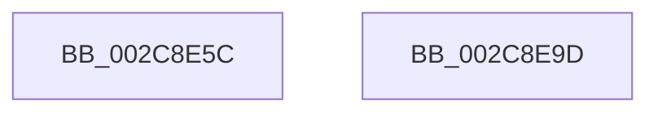

# KeSetSystemTime

- RVA: `0x002C8E5C`–`0x002C8E9E` (길이 `66` bytes)
- VA: `0x00000001402C8E5C`
- 실행 섹션: `.text`
- PDB 이름 있음: `예`; PDB Function 태그: `아니요`
- unwind 정보 RVA: `0x0006EFC0`
- 디코드: `20`개 명령, `66/66` bytes 표시
- 미해석 바이트: `0` (있으면 어셈블리에 `.byte`로 보존)

> 이 문서는 커널 이미지의 기계어와 PDB 기호를 분석해 생성했습니다. 4번과 5번은 함수 원형과 자료형을 바이너리 사용 방식에서 추정한 C 해석이며 원본 소스 복구 결과는 아닙니다.

## 1. Dependencies

- 직접 호출 지점: **1**; 고유 호출 대상: **1**
- 직접 호출자로 확인된 함수: **4**
- RIP 상대 이미지 참조: **1**

### Outgoing calls
- `0x002C8E92` → [KeGenericCallDpcEx](KeGenericCallDpcEx_function_002C99F4.md) (function, `0x002C99F4`)

### Direct callers
- [ExpRefreshSystemTime](../../page/7C/ExpRefreshSystemTime_function_007C6264.md) at `0x007C637E`
- [NtSetSystemTime](../../page/7C/NtSetSystemTime_function_007C65F0.md) at `0x007C6885`
- [ExpSetSystemTime](../../pagelk/B7/ExpSetSystemTime_function_00B7C838.md) at `0x00B7C89F`
- [Phase1InitializationDiscard](../../init/C1/Phase1InitializationDiscard_function_00C1C728.md) at `0x00C1CE6B`
- [Phase1InitializationDiscard](../../init/C1/Phase1InitializationDiscard_function_00C1C728.md) at `0x00C1D704`

### Static image references
- `0x002C8E6F` → RVA `0x00486130` (`KiSetSystemTimeDpc`; read)

## 2. Other-region calls and transfers

- 다른 실행 섹션으로 향하는 call: **0**
- 별도 외부 분기/꼬리 이동을 확인하지 못했습니다.

## 3. Assembly (complete function range)

```asm
002C8E5C  40 55                           push rbp
002C8E5E  48 8B EC                        mov rbp, rsp
002C8E61  48 83 EC 50                     sub rsp, 0x50
002C8E65  33 C0                           xor eax, eax
002C8E67  48 89 4D D8                     mov qword ptr [rbp - 0x28], rcx
002C8E6B  48 89 55 E0                     mov qword ptr [rbp - 0x20], rdx
002C8E6F  48 8D 0D BA D2 1B 00            lea rcx, [rip + 0x1bd2ba]
002C8E76  48 8D 55 D0                     lea rdx, [rbp - 0x30]
002C8E7A  66 89 45 D1                     mov word ptr [rbp - 0x2f], ax
002C8E7E  88 45 D3                        mov byte ptr [rbp - 0x2d], al
002C8E81  48 89 45 E8                     mov qword ptr [rbp - 0x18], rax
002C8E85  89 45 F1                        mov dword ptr [rbp - 0xf], eax
002C8E88  88 45 D0                        mov byte ptr [rbp - 0x30], al
002C8E8B  88 45 F0                        mov byte ptr [rbp - 0x10], al
002C8E8E  44 89 45 D4                     mov dword ptr [rbp - 0x2c], r8d
002C8E92  E8 5D 0B 00 00                  call 0x1402c99f4
002C8E97  48 83 C4 50                     add rsp, 0x50
002C8E9B  5D                              pop rbp
002C8E9C  C3                              ret
002C8E9D  CC                              int3
```

## 4. C-style interpretation (structured pseudocode)

```c
__int64 __fastcall KeSetSystemTime(__int64 a1, __int64 a2, int a3)
{
    __int64 result;
    __int64 v_rsp;
    unsigned int v_stack_m17;
    unsigned __int8 v_stack_m18;
    unsigned __int64 v_stack_m20;
    unsigned __int64 v_stack_m28;
    unsigned __int64 v_stack_m30;
    unsigned int v_stack_m34;
    unsigned __int8 v_stack_m35;
    unsigned __int16 v_stack_m37;
    unsigned __int64 v_stack_m38;

    v_rsp = (v_rsp) - (80);
    result = 0;
    v_stack_m30 = a1;
    v_stack_m28 = a2;
    v_stack_m37 = 0;
    v_stack_m35 = 0;
    v_stack_m20 = 0;
    v_stack_m17 = 0;
    v_stack_m38 = 0;
    v_stack_m18 = 0;
    v_stack_m34 = a3;
    result = KeGenericCallDpcEx(v_rip + 1823418, v_stack_m38, a3, a4);
    v_rsp = (v_rsp) + (80);
    return result;
}
```

## 5. (Beta) C Style

```c
int64_t KeSetSystemTime(int64_t Arg1, int64_t Arg2, int32_t Arg3)
{
    int64_t result;
    int64_t local_rsp;
    uint32_t v_stack_m17;
    uint8_t v_stack_m18;
    uint64_t v_stack_m20;
    uint64_t v_stack_m28;
    uint64_t v_stack_m30;
    uint32_t v_stack_m34;
    uint8_t v_stack_m35;
    uint16_t v_stack_m37;
    uint64_t v_stack_m38;

    local_rsp = (local_rsp) - (80);
    result = 0;
    v_stack_m30 = Arg1;
    v_stack_m28 = Arg2;
    v_stack_m37 = 0;
    v_stack_m35 = 0;
    v_stack_m20 = 0;
    v_stack_m17 = 0;
    v_stack_m38 = 0;
    v_stack_m18 = 0;
    v_stack_m34 = Arg3;
    result = KeGenericCallDpcEx(v_rip + 1823418, v_stack_m38, Arg3, a4);
    local_rsp = (local_rsp) + (80);
    return result;
}
```

## 6. Execution-region graph

[열기: 2D/3D 그래프와 함수 탐색 컨트롤 패널](../../../control-panel.html?section=text&rva=0x002C8E5C&view=graph)

- 2D 그래프는 위에서 아래로 흐르고, 3D 그래프는 빈 공간을 드래그해 회전합니다. Shift+드래그는 이동, 휠은 확대·축소, 함수 노드 선택은 대상 보고서 이동입니다.

### Static fallback


