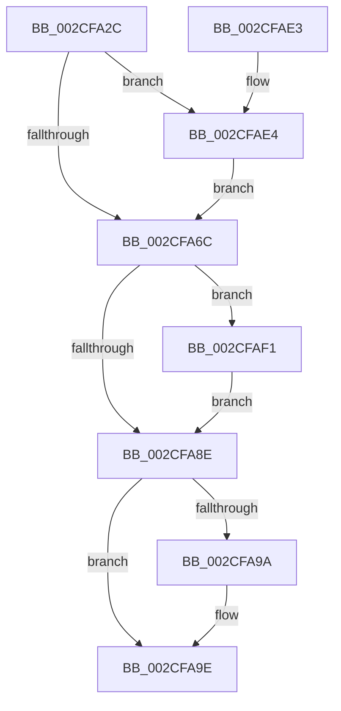

# KeSetUserAffinityThread

- RVA: `0x002CFA2C`–`0x002CFAFE` (길이 `210` bytes)
- VA: `0x00000001402CFA2C`
- 실행 섹션: `.text`
- PDB 이름 있음: `예`; PDB Function 태그: `아니요`
- unwind 정보 RVA: `0x0006F6A4`
- 디코드: `57`개 명령, `210/210` bytes 표시
- 미해석 바이트: `0` (있으면 어셈블리에 `.byte`로 보존)

> 이 문서는 커널 이미지의 기계어와 PDB 기호를 분석해 생성했습니다. 4번과 5번은 함수 원형과 자료형을 바이너리 사용 방식에서 추정한 C 해석이며 원본 소스 복구 결과는 아닙니다.

## 1. Dependencies

- 직접 호출 지점: **8**; 고유 호출 대상: **8**
- 직접 호출자로 확인된 함수: **5**
- RIP 상대 이미지 참조: **1**

### Outgoing calls
- `0x002CFA79` → [ExAcquireSpinLockExclusiveAtDpcLevel](../24/ExAcquireSpinLockExclusiveAtDpcLevel_function_00248E80.md) (function, `0x00248E80`)
- `0x002CFA85` → [KeIsSubsetAffinityEx](KeIsSubsetAffinityEx_function_002CDC80.md) (function, `0x002CDC80`)
- `0x002CFA91` → [KeIsEmptyAffinityEx](../2D/KeIsEmptyAffinityEx_function_002D1580.md) (function, `0x002D1580`)
- `0x002CFAAC` → [KiSetAffinityThread](KiSetAffinityThread_function_002CE010.md) (function, `0x002CE010`)
- `0x002CFAB5` → [ExReleaseSpinLockExclusiveFromDpcLevel](../24/ExReleaseSpinLockExclusiveFromDpcLevel_function_002497E0.md) (function, `0x002497E0`)
- `0x002CFAC5` → [KiProcessDeferredReadyList](../25/KiProcessDeferredReadyList_function_00250800.md) (function, `0x00250800`)
- `0x002CFAE7` → [KiRaiseIrqlProcessIrqlFlags](../4F/KiRaiseIrqlProcessIrqlFlags_function_004F56FC.md) (function, `0x004F56FC`)
- `0x002CFAF7` → [KiExtendProcessAffinity](../5C/KiExtendProcessAffinity_function_005CA600.md) (function, `0x005CA600`)

### Direct callers
- [SMKM_STORE_MGR&lt;SM_TRAITS&gt;::SmCompressCtxUpdateThreadTopology](../3B/SMKM_STORE_MGR_SM_TRAITS_SmCompressCtxUpdateThreadTopology_function_003B216C.md) at `0x003B218C`
- [ExpWorkerThread](../4E/ExpWorkerThread_function_004ECAF0.md) at `0x004ECF8D`
- [sub_006DB99C](../6D/Unknown_function_006DB99C.md) at `0x006DB9D1`
- [sub_006DB99C](../6D/Unknown_function_006DB99C.md) at `0x006DB9F3`
- [NtSetInformationThread](../../page/8C/NtSetInformationThread_function_008C9F60.md) at `0x008CB20C`
- [ExpWorkQueueManagerThread](../../page/AF/ExpWorkQueueManagerThread_function_00AF6D60.md) at `0x00AF7228`

### Static image references
- `0x002CFA63` → RVA `0x00FC6D20` (`ALMOSTRO`; read)

## 2. Other-region calls and transfers

- 다른 실행 섹션으로 향하는 call: **0**
- 별도 외부 분기/꼬리 이동을 확인하지 못했습니다.

## 3. Assembly (complete function range)

```asm
002CFA2C  48 8B C4                        mov rax, rsp
002CFA2F  48 89 58 10                     mov qword ptr [rax + 0x10], rbx
002CFA33  48 89 68 18                     mov qword ptr [rax + 0x18], rbp
002CFA37  48 89 70 20                     mov qword ptr [rax + 0x20], rsi
002CFA3B  57                              push rdi
002CFA3C  41 56                           push r14
002CFA3E  41 57                           push r15
002CFA40  48 83 EC 20                     sub rsp, 0x20
002CFA44  48 8B B9 20 02 00 00            mov rdi, qword ptr [rcx + 0x220]
002CFA4B  48 8B DA                        mov rbx, rdx
002CFA4E  48 83 60 08 00                  and qword ptr [rax + 8], 0
002CFA53  48 8B E9                        mov rbp, rcx
002CFA56  44 0F 20 C6                     mov rsi, cr8
002CFA5A  BA 02 00 00 00                  mov edx, 2
002CFA5F  44 0F 22 C2                     mov cr8, rdx
002CFA63  83 3D B6 72 CF 00 00            cmp dword ptr [rip + 0xcf72b6], 0
002CFA6A  75 78                           jne 0x1402cfae4
002CFA6C  65 4C 8B 3C 25 20 00 00 00      mov r15, qword ptr gs:[0x20]
002CFA75  48 8D 4F 40                     lea rcx, [rdi + 0x40]
002CFA79  E8 02 94 F7 FF                  call 0x140248e80
002CFA7E  48 8B 57 50                     mov rdx, qword ptr [rdi + 0x50]
002CFA82  48 8B CB                        mov rcx, rbx
002CFA85  E8 F6 E1 FF FF                  call 0x1402cdc80
002CFA8A  85 C0                           test eax, eax
002CFA8C  74 63                           je 0x1402cfaf1
002CFA8E  48 8B CB                        mov rcx, rbx
002CFA91  E8 EA 1A 00 00                  call 0x1402d1580
002CFA96  85 C0                           test eax, eax
002CFA98  74 04                           je 0x1402cfa9e
002CFA9A  48 8B 5F 50                     mov rbx, qword ptr [rdi + 0x50]
002CFA9E  44 8A CE                        mov r9b, sil
002CFAA1  48 8D 54 24 40                  lea rdx, [rsp + 0x40]
002CFAA6  4C 8B C3                        mov r8, rbx
002CFAA9  48 8B CD                        mov rcx, rbp
002CFAAC  E8 5F E5 FF FF                  call 0x1402ce010
002CFAB1  48 8D 4F 40                     lea rcx, [rdi + 0x40]
002CFAB5  E8 26 9D F7 FF                  call 0x1402497e0
002CFABA  44 8A C6                        mov r8b, sil
002CFABD  48 8D 54 24 40                  lea rdx, [rsp + 0x40]
002CFAC2  49 8B CF                        mov rcx, r15
002CFAC5  E8 36 0D F8 FF                  call 0x140250800
002CFACA  48 8B 5C 24 48                  mov rbx, qword ptr [rsp + 0x48]
002CFACF  48 8B 6C 24 50                  mov rbp, qword ptr [rsp + 0x50]
002CFAD4  48 8B 74 24 58                  mov rsi, qword ptr [rsp + 0x58]
002CFAD9  48 83 C4 20                     add rsp, 0x20
002CFADD  41 5F                           pop r15
002CFADF  41 5E                           pop r14
002CFAE1  5F                              pop rdi
002CFAE2  C3                              ret
002CFAE3  CC                              int3
002CFAE4  40 8A CE                        mov cl, sil
002CFAE7  E8 10 5C 22 00                  call 0x1404f56fc
002CFAEC  E9 7B FF FF FF                  jmp 0x1402cfa6c
002CFAF1  48 8B D3                        mov rdx, rbx
002CFAF4  48 8B CF                        mov rcx, rdi
002CFAF7  E8 04 AB 2F 00                  call 0x1405ca600
002CFAFC  EB 90                           jmp 0x1402cfa8e
```

## 4. C-style interpretation (structured pseudocode)

```c
__int64 __fastcall KeSetUserAffinityThread(__int64 a1, __int64 a2)
{
    __int64 result;
    __int64 v_rbx;
    __int64 v_rsp;
    unsigned __int64 v_stack_p10;
    unsigned __int64 v_stack_p18;
    unsigned __int64 v_stack_p20;
    unsigned __int64 v_stack_p8;

    *(unsigned __int64 *)(v_rsp + 16) = v_rbx;
    *(unsigned __int64 *)(v_rsp + 24) = v_rbp;
    *(unsigned __int64 *)(v_rsp + 32) = v_rsi;
    v_rsp = (v_rsp) - (32);
    if ((*(unsigned int *)(v_rip + 13595318)) != 0) goto loc_002CFAE4;
loc_002CFA6C:
    result = ExAcquireSpinLockExclusiveAtDpcLevel(*(unsigned __int64 *)(a1 + 544) + 64, 2, a3, a4);
    result = KeIsSubsetAffinityEx(a2, *(unsigned __int64 *)(*(unsigned __int64 *)(a1 + 544) + 80), a3, a4);
    if ((unsigned int)(result) == 0) goto loc_002CFAF1;
loc_002CFA8E:
    result = KeIsEmptyAffinityEx(a2, *(unsigned __int64 *)(*(unsigned __int64 *)(a1 + 544) + 80), a3, a4);
    v_rbx = a2;
    if ((unsigned int)(result) != 0) {
        v_rbx = *(unsigned __int64 *)(*(unsigned __int64 *)(a1 + 544) + 80);
    }
    result = KiSetAffinityThread(a1, v_stack_p8, v_rbx, (unsigned __int8)(v_cr8));
    result = ExReleaseSpinLockExclusiveFromDpcLevel(*(unsigned __int64 *)(a1 + 544) + 64, v_stack_p8, v_rbx, (unsigned __int8)(v_cr8));
    result = KiProcessDeferredReadyList(*(unsigned __int64 *)(gs_base + (0 + 32)), v_stack_p8, (unsigned __int8)(v_cr8), (unsigned __int8)(v_cr8));
    v_rsp = (v_rsp) + (32);
    return result;
loc_002CFAE4:
    result = KiRaiseIrqlProcessIrqlFlags((unsigned __int8)(v_stack_p20), v_stack_p8, (unsigned __int8)(v_cr8), (unsigned __int8)(v_cr8));
    goto loc_002CFA6C;
loc_002CFAF1:
    result = KiExtendProcessAffinity(*(unsigned __int64 *)(a1 + 544), v_stack_p10, (unsigned __int8)(v_cr8), (unsigned __int8)(v_cr8));
    goto loc_002CFA8E;
}
```

## 5. (Beta) C Style

```c
int64_t KeSetUserAffinityThread(void *Arg1, int64_t Arg2)
{
    uint8_t *arg1 = (uint8_t *)Arg1;

    int64_t result;
    int64_t local_rbx;
    int64_t local_rsp;
    uint64_t v_stack_p10;
    uint64_t v_stack_p18;
    uint64_t v_stack_p20;
    uint64_t v_stack_p8;

    *(uint64_t *)(local_rsp + 0x10) = local_rbx;
    *(uint64_t *)(local_rsp + 0x18) = local_rbp;
    *(uint64_t *)(local_rsp + 0x20) = local_rsi;
    local_rsp = (local_rsp) - (32);
    if ((*(uint32_t *)(v_rip + 0xCF72B6)) != 0) goto loc_002CFAE4;
loc_002CFA6C:
    result = ExAcquireSpinLockExclusiveAtDpcLevel(*(uint64_t *)(arg1 + 0x220) + 64, 2, a3, a4);
    result = KeIsSubsetAffinityEx(Arg2, *(uint64_t *)(*(uint64_t *)(arg1 + 0x220) + 0x50), a3, a4);
    if ((uint32_t)(result) == 0) goto loc_002CFAF1;
loc_002CFA8E:
    result = KeIsEmptyAffinityEx(Arg2, *(uint64_t *)(*(uint64_t *)(arg1 + 0x220) + 0x50), a3, a4);
    local_rbx = Arg2;
    if ((uint32_t)(result) != 0) {
        local_rbx = *(uint64_t *)(*(uint64_t *)(arg1 + 0x220) + 0x50);
    }
    result = KiSetAffinityThread(Arg1, v_stack_p8, local_rbx, (uint8_t)(v_cr8));
    result = ExReleaseSpinLockExclusiveFromDpcLevel(*(uint64_t *)(arg1 + 0x220) + 64, v_stack_p8, local_rbx, (uint8_t)(v_cr8));
    result = KiProcessDeferredReadyList(*(uint64_t *)(gs_base + (0 + 0x20)), v_stack_p8, (uint8_t)(v_cr8), (uint8_t)(v_cr8));
    local_rsp = (local_rsp) + (32);
    return result;
loc_002CFAE4:
    result = KiRaiseIrqlProcessIrqlFlags((uint8_t)(v_stack_p20), v_stack_p8, (uint8_t)(v_cr8), (uint8_t)(v_cr8));
    goto loc_002CFA6C;
loc_002CFAF1:
    result = KiExtendProcessAffinity(*(uint64_t *)(arg1 + 0x220), v_stack_p10, (uint8_t)(v_cr8), (uint8_t)(v_cr8));
    goto loc_002CFA8E;
}
```

### 관측된 메모리 오프셋

구조체 형식이 확인되지 않은 접근은 인자 기준의 오프셋으로만 기록했습니다.

| 기준 인자 | 오프셋 표현 | 폭 (bit) | 접근 |
|---|---:|---:|---|
| `Arg1` | `+ 0x220` | `64` | `R` |

## 6. Execution-region graph

[열기: 2D/3D 그래프와 함수 탐색 컨트롤 패널](../../../control-panel.html?section=text&rva=0x002CFA2C&view=graph)

- 2D 그래프는 위에서 아래로 흐르고, 3D 그래프는 빈 공간을 드래그해 회전합니다. Shift+드래그는 이동, 휠은 확대·축소, 함수 노드 선택은 대상 보고서 이동입니다.

### Static fallback


