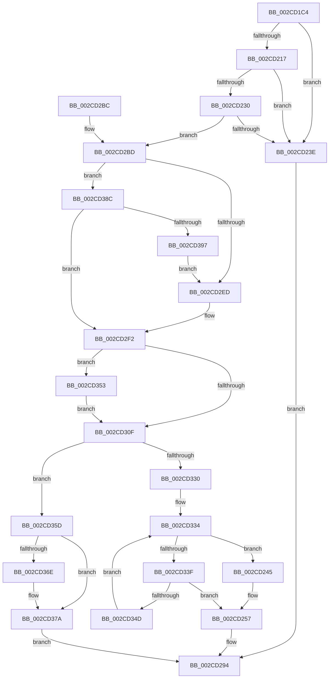

# KeSetUserGroupAffinityThread

- RVA: `0x002CD1C4`–`0x002CD3A5` (길이 `481` bytes)
- VA: `0x00000001402CD1C4`
- 실행 섹션: `.text`
- PDB 이름 있음: `예`; PDB Function 태그: `아니요`
- unwind 정보 RVA: `0x0006F4F4`
- 디코드: `120`개 명령, `481/481` bytes 표시
- 미해석 바이트: `0` (있으면 어셈블리에 `.byte`로 보존)

> 이 문서는 커널 이미지의 기계어와 PDB 기호를 분석해 생성했습니다. 4번과 5번은 함수 원형과 자료형을 바이너리 사용 방식에서 추정한 C 해석이며 원본 소스 복구 결과는 아닙니다.

## 1. Dependencies

- 직접 호출 지점: **12**; 고유 호출 대상: **10**
- 직접 호출자로 확인된 함수: **2**
- RIP 상대 이미지 참조: **4**

### Outgoing calls
- `0x002CD205` → [memset](../6C/memset_function_006C6C40.md) (function, `0x006C6C40`)
- `0x002CD252` → [KiCopyAffinityEx](KiCopyAffinityEx_function_002CE860.md) (function, `0x002CE860`)
- `0x002CD26C` → [KiSetAffinityThread](KiSetAffinityThread_function_002CE010.md) (function, `0x002CE010`)
- `0x002CD27D` → [ExReleaseSpinLockSharedFromDpcLevel](../24/ExReleaseSpinLockSharedFromDpcLevel_function_0024A590.md) (function, `0x0024A590`)
- `0x002CD28D` → [KiProcessDeferredReadyList](../25/KiProcessDeferredReadyList_function_00250800.md) (function, `0x00250800`)
- `0x002CD29B` → [_security_check_cookie](../6A/_security_check_cookie_function_006AC640.md) (function, `0x006AC640`)
- `0x002CD2D9` → [memset](../6C/memset_function_006C6C40.md) (function, `0x006C6C40`)
- `0x002CD316` → [ExAcquireSpinLockSharedAtDpcLevel](../24/ExAcquireSpinLockSharedAtDpcLevel_function_00248E30.md) (function, `0x00248E30`)
- `0x002CD327` → [KeIsSubsetAffinityEx](KeIsSubsetAffinityEx_function_002CDC80.md) (function, `0x002CDC80`)
- `0x002CD356` → [KiRaiseIrqlProcessIrqlFlags](../4F/KiRaiseIrqlProcessIrqlFlags_function_004F56FC.md) (function, `0x004F56FC`)
- `0x002CD360` → [ExReleaseSpinLockSharedFromDpcLevel](../24/ExReleaseSpinLockSharedFromDpcLevel_function_0024A590.md) (function, `0x0024A590`)
- `0x002CD375` → [KiLowerIrqlProcessIrqlFlags](../4F/KiLowerIrqlProcessIrqlFlags_function_004F5698.md) (function, `0x004F5698`)

### Direct callers
- [MiAssignBackgroundZeroThreadToProcessor](MiAssignBackgroundZeroThreadToProcessor_function_002CCAAC.md) at `0x002CCB45`
- [MiMoveBackgroundZeroThreads](../30/MiMoveBackgroundZeroThreads_function_00305810.md) at `0x00305A42`

### Static image references
- `0x002CD1E2` → RVA `0x00E0A740` (`.data`; read)
- `0x002CD20E` → RVA `0x00FC5018` (`ALMOSTRO`; read)
- `0x002CD217` → RVA `0x00FC7128` (`ALMOSTRO`; read)
- `0x002CD306` → RVA `0x00FC6D20` (`ALMOSTRO`; read)

## 2. Other-region calls and transfers

- 다른 실행 섹션으로 향하는 call: **0**
- 별도 외부 분기/꼬리 이동을 확인하지 못했습니다.

## 3. Assembly (complete function range)

```asm
002CD1C4  48 89 5C 24 18                  mov qword ptr [rsp + 0x18], rbx
002CD1C9  48 89 74 24 20                  mov qword ptr [rsp + 0x20], rsi
002CD1CE  55                              push rbp
002CD1CF  57                              push rdi
002CD1D0  41 54                           push r12
002CD1D2  41 56                           push r14
002CD1D4  41 57                           push r15
002CD1D6  48 8D 6C 24 B0                  lea rbp, [rsp - 0x50]
002CD1DB  48 81 EC 50 01 00 00            sub rsp, 0x150
002CD1E2  48 8B 05 57 D5 B3 00            mov rax, qword ptr [rip + 0xb3d557]
002CD1E9  48 33 C4                        xor rax, rsp
002CD1EC  48 89 45 40                     mov qword ptr [rbp + 0x40], rax
002CD1F0  48 8B DA                        mov rbx, rdx
002CD1F3  4C 8B F1                        mov r14, rcx
002CD1F6  BE 00 01 00 00                  mov esi, 0x100
002CD1FB  48 8D 4C 24 38                  lea rcx, [rsp + 0x38]
002CD200  44 8B C6                        mov r8d, esi
002CD203  33 D2                           xor edx, edx
002CD205  E8 36 9A 3F 00                  call 0x1406c6c40
002CD20A  0F B7 43 08                     movzx eax, word ptr [rbx + 8]
002CD20E  66 3B 05 03 7E CF 00            cmp ax, word ptr [rip + 0xcf7e03]
002CD215  73 27                           jae 0x1402cd23e
002CD217  48 8D 0D 0A 9F CF 00            lea rcx, [rip + 0xcf9f0a]
002CD21E  48 8B 0C C1                     mov rcx, qword ptr [rcx + rax*8]
002CD222  48 8B 3B                        mov rdi, qword ptr [rbx]
002CD225  48 8B C7                        mov rax, rdi
002CD228  48 23 C1                        and rax, rcx
002CD22B  48 3B C7                        cmp rax, rdi
002CD22E  75 0E                           jne 0x1402cd23e
002CD230  0F B7 4B 0E                     movzx ecx, word ptr [rbx + 0xe]
002CD234  66 0B 4B 0C                     or cx, word ptr [rbx + 0xc]
002CD238  66 0B 4B 0A                     or cx, word ptr [rbx + 0xa]
002CD23C  74 7F                           je 0x1402cd2bd
002CD23E  B8 0D 00 00 C0                  mov eax, 0xc000000d
002CD243  EB 4F                           jmp 0x1402cd294
002CD245  0F B7 54 24 32                  movzx edx, word ptr [rsp + 0x32]
002CD24A  48 8D 4C 24 30                  lea rcx, [rsp + 0x30]
002CD24F  4C 8B C3                        mov r8, rbx
002CD252  E8 09 16 00 00                  call 0x1402ce860
002CD257  44 8A CF                        mov r9b, dil
002CD25A  4C 89 7C 24 20                  mov qword ptr [rsp + 0x20], r15
002CD25F  4C 8D 44 24 30                  lea r8, [rsp + 0x30]
002CD264  49 8B CE                        mov rcx, r14
002CD267  48 8D 54 24 20                  lea rdx, [rsp + 0x20]
002CD26C  E8 9F 0D 00 00                  call 0x1402ce010
002CD271  65 48 8B 1C 25 20 00 00 00      mov rbx, qword ptr gs:[0x20]
002CD27A  48 8B CE                        mov rcx, rsi
002CD27D  E8 0E D3 F7 FF                  call 0x14024a590
002CD282  44 8A C7                        mov r8b, dil
002CD285  48 8D 54 24 20                  lea rdx, [rsp + 0x20]
002CD28A  48 8B CB                        mov rcx, rbx
002CD28D  E8 6E 35 F8 FF                  call 0x140250800
002CD292  33 C0                           xor eax, eax
002CD294  48 8B 4D 40                     mov rcx, qword ptr [rbp + 0x40]
002CD298  48 33 CC                        xor rcx, rsp
002CD29B  E8 A0 F3 3D 00                  call 0x1406ac640
002CD2A0  4C 8D 9C 24 50 01 00 00         lea r11, [rsp + 0x150]
002CD2A8  49 8B 5B 40                     mov rbx, qword ptr [r11 + 0x40]
002CD2AC  49 8B 73 48                     mov rsi, qword ptr [r11 + 0x48]
002CD2B0  49 8B E3                        mov rsp, r11
002CD2B3  41 5F                           pop r15
002CD2B5  41 5E                           pop r14
002CD2B7  41 5C                           pop r12
002CD2B9  5F                              pop rdi
002CD2BA  5D                              pop rbp
002CD2BB  C3                              ret
002CD2BC  CC                              int3
002CD2BD  4C 8B C6                        mov r8, rsi
002CD2C0  48 C7 44 24 30 01 00 20 00      mov qword ptr [rsp + 0x30], 0x200001
002CD2C9  33 D2                           xor edx, edx
002CD2CB  48 8D 4C 24 38                  lea rcx, [rsp + 0x38]
002CD2D0  41 BC 01 00 00 00               mov r12d, 1
002CD2D6  45 33 FF                        xor r15d, r15d
002CD2D9  E8 62 99 3F 00                  call 0x1406c6c40
002CD2DE  0F B7 4B 08                     movzx ecx, word ptr [rbx + 8]
002CD2E2  66 39 4C 24 30                  cmp word ptr [rsp + 0x30], cx
002CD2E7  0F 86 9F 00 00 00               jbe 0x1402cd38c
002CD2ED  48 09 7C CC 38                  or qword ptr [rsp + rcx*8 + 0x38], rdi
002CD2F2  49 8B 9E 20 02 00 00            mov rbx, qword ptr [r14 + 0x220]
002CD2F9  44 0F 20 C7                     mov rdi, cr8
002CD2FD  BA 02 00 00 00                  mov edx, 2
002CD302  44 0F 22 C2                     mov cr8, rdx
002CD306  44 39 3D 13 9A CF 00            cmp dword ptr [rip + 0xcf9a13], r15d
002CD30D  75 44                           jne 0x1402cd353
002CD30F  48 8D 73 40                     lea rsi, [rbx + 0x40]
002CD313  48 8B CE                        mov rcx, rsi
002CD316  E8 15 BB F7 FF                  call 0x140248e30
002CD31B  48 8B 5B 50                     mov rbx, qword ptr [rbx + 0x50]
002CD31F  48 8D 4C 24 30                  lea rcx, [rsp + 0x30]
002CD324  48 8B D3                        mov rdx, rbx
002CD327  E8 54 09 00 00                  call 0x1402cdc80
002CD32C  85 C0                           test eax, eax
002CD32E  74 2D                           je 0x1402cd35d
002CD330  41 0F B7 CF                     movzx ecx, r15w
002CD334  66 3B 4C 24 30                  cmp cx, word ptr [rsp + 0x30]
002CD339  0F 83 06 FF FF FF               jae 0x1402cd245
002CD33F  0F B7 C1                        movzx eax, cx
002CD342  4C 39 7C C4 38                  cmp qword ptr [rsp + rax*8 + 0x38], r15
002CD347  0F 85 0A FF FF FF               jne 0x1402cd257
002CD34D  66 41 03 CC                     add cx, r12w
002CD351  EB E1                           jmp 0x1402cd334
002CD353  40 8A CF                        mov cl, dil
002CD356  E8 A1 83 22 00                  call 0x1404f56fc
002CD35B  EB B2                           jmp 0x1402cd30f
002CD35D  48 8B CE                        mov rcx, rsi
002CD360  E8 2B D2 F7 FF                  call 0x14024a590
002CD365  44 39 3D B4 99 CF 00            cmp dword ptr [rip + 0xcf99b4], r15d
002CD36C  74 0C                           je 0x1402cd37a
002CD36E  44 0F 20 C1                     mov rcx, cr8
002CD372  40 8A D7                        mov dl, dil
002CD375  E8 1E 83 22 00                  call 0x1404f5698
002CD37A  40 0F B6 C7                     movzx eax, dil
002CD37E  44 0F 22 C0                     mov cr8, rax
002CD382  B8 01 00 00 C0                  mov eax, 0xc0000001
002CD387  E9 08 FF FF FF                  jmp 0x1402cd294
002CD38C  66 39 4C 24 32                  cmp word ptr [rsp + 0x32], cx
002CD391  0F 86 5B FF FF FF               jbe 0x1402cd2f2
002CD397  41 8D 04 0C                     lea eax, [r12 + rcx]
002CD39B  66 89 44 24 30                  mov word ptr [rsp + 0x30], ax
002CD3A0  E9 48 FF FF FF                  jmp 0x1402cd2ed
```

## 4. C-style interpretation (structured pseudocode)

```c
__int64 __fastcall KeSetUserGroupAffinityThread(__int64 a1, __int64 a2)
{
    __int64 result;
    __int64 v_r15;
    __int64 v_rsp;
    unsigned __int64 v_stack_m118;
    unsigned __int16 v_stack_m11E;
    unsigned __int64 v_stack_m120;
    unsigned __int64 v_stack_m140;
    unsigned __int16 v_stack_m146;
    unsigned __int64 v_stack_m148;
    unsigned __int64 v_stack_m158;
    unsigned __int64 v_stack_m28;
    unsigned __int64 v_stack_m38;
    unsigned __int64 v_stack_m78;
    unsigned __int64 v_stack_p18;
    unsigned __int64 v_stack_p20;

    v_stack_p18 = v_rbx;
    v_stack_p20 = v_rsi;
    v_rsp = (v_rsp) - (336);
    result = (*(unsigned __int64 *)(v_rip + 11785559)) ^ (v_rsp);
    v_stack_m38 = result;
    a2 = 0;
    result = memset(v_stack_m140, a2, 256, a4);
    if (((unsigned __int16)(*(unsigned __int16 *)(a2 + 8))) >= (*(unsigned __int16 *)(v_rip + 13598211))) goto loc_002CD23E;
    result = (*(unsigned __int64 *)(a2)) & (*(unsigned __int64 *)(v_rip + 13606666 + *(unsigned __int16 *)(a2 + 8) * 8));
    if (result != (*(unsigned __int64 *)(a2))) goto loc_002CD23E;
    a1 = (unsigned __int16)((*(unsigned __int16 *)(a2 + 14)) | (*(unsigned __int16 *)(a2 + 12)));
    a1 = (unsigned __int16)((a1) | (*(unsigned __int16 *)(a2 + 10)));
    if (condition_is_equal) goto loc_002CD2BD;
loc_002CD23E:
    goto loc_002CD294;
loc_002CD245:
    result = KiCopyAffinityEx(v_stack_m148, v_stack_m146, 0, a4);
loc_002CD257:
    v_stack_m158 = v_r15;
    result = KiSetAffinityThread(a1, v_stack_m158, v_stack_m148, (unsigned __int8)(*(unsigned __int64 *)(a2)));
    result = ExReleaseSpinLockSharedFromDpcLevel(256, v_stack_m158, v_stack_m148, (unsigned __int8)(*(unsigned __int64 *)(a2)));
    result = KiProcessDeferredReadyList(*(unsigned __int64 *)(gs_base + (0 + 32)), v_stack_m158, (unsigned __int8)(*(unsigned __int64 *)(a2)), (unsigned __int8)(*(unsigned __int64 *)(a2)));
    result = 0;
loc_002CD294:
    a1 = (v_stack_m38) ^ (v_rsp);
    result = _security_check_cookie(a1, v_stack_m158, (unsigned __int8)(*(unsigned __int64 *)(a2)), (unsigned __int8)(*(unsigned __int64 *)(a2)));
    return result;
loc_002CD2BD:
    v_stack_m120 = 0x200001ULL;
    a2 = 0;
    v_r15 = 0;
    result = memset(v_stack_m118, a2, *(unsigned __int64 *)(v_stack_m28 + 72), (unsigned __int8)(*(unsigned __int64 *)(a2)));
    if (v_stack_m120 <= ((unsigned __int16)(*(unsigned __int16 *)(*(unsigned __int64 *)(v_stack_m28 + 64) + 8)))) goto loc_002CD38C;
loc_002CD2ED:
loc_002CD2F2:
    if ((*(unsigned int *)(v_rip + 13605395)) != 0) goto loc_002CD353;
loc_002CD30F:
    result = ExAcquireSpinLockSharedAtDpcLevel(*(unsigned __int64 *)(a1 + 544) + 64, 2, *(unsigned __int64 *)(v_stack_m28 + 72), (unsigned __int8)(*(unsigned __int64 *)(a2)));
    result = KeIsSubsetAffinityEx(v_stack_m120, *(unsigned __int64 *)(*(unsigned __int64 *)(a1 + 544) + 80), *(unsigned __int64 *)(v_stack_m28 + 72), (unsigned __int8)(*(unsigned __int64 *)(a2)));
    if ((unsigned int)(result) == 0) goto loc_002CD35D;
loc_002CD334:
    if (0 >= v_stack_m120) goto loc_002CD245;
    if ((*(unsigned __int64 *)(v_stack_m28 + 0 * 8 + 56)) != 0) goto loc_002CD257;
    a1 = (unsigned __int16)((0) + (1));
    goto loc_002CD334;
loc_002CD353:
    result = KiRaiseIrqlProcessIrqlFlags((unsigned __int8)(v_cr8), *(unsigned __int64 *)(*(unsigned __int64 *)(a1 + 544) + 80), *(unsigned __int64 *)(v_stack_m28 + 72), (unsigned __int8)(*(unsigned __int64 *)(a2)));
    goto loc_002CD30F;
loc_002CD35D:
    result = ExReleaseSpinLockSharedFromDpcLevel(*(unsigned __int64 *)(a1 + 544) + 64, *(unsigned __int64 *)(*(unsigned __int64 *)(a1 + 544) + 80), *(unsigned __int64 *)(v_stack_m28 + 72), (unsigned __int8)(*(unsigned __int64 *)(a2)));
    if ((*(unsigned int *)(v_rip + 13605300)) != 0) {
        a1 = 2;
        a2 = (unsigned __int8)(v_cr8);
        result = KiLowerIrqlProcessIrqlFlags(a1, a2, *(unsigned __int64 *)(v_stack_m28 + 72), (unsigned __int8)(*(unsigned __int64 *)(a2)));
    }
    goto loc_002CD294;
loc_002CD38C:
    if (v_stack_m11E <= ((unsigned __int16)(a1))) goto loc_002CD2F2;
    v_stack_m120 = (unsigned __int16)(1 + a1 * 1);
    goto loc_002CD2ED;
}
```

## 5. (Beta) C Style

```c
int64_t KeSetUserGroupAffinityThread(void *Arg1, void *Arg2)
{
    uint8_t *arg1 = (uint8_t *)Arg1;
    uint8_t *arg2 = (uint8_t *)Arg2;

    int64_t result;
    int64_t local_r15;
    int64_t local_rsp;
    uint64_t v_stack_m118;
    uint16_t v_stack_m11E;
    uint64_t v_stack_m120;
    uint64_t v_stack_m140;
    uint16_t v_stack_m146;
    uint64_t v_stack_m148;
    uint64_t v_stack_m158;
    uint64_t v_stack_m28;
    uint64_t v_stack_m38;
    uint64_t v_stack_m78;
    uint64_t v_stack_p18;
    uint64_t v_stack_p20;

    v_stack_p18 = local_rbx;
    v_stack_p20 = local_rsi;
    local_rsp = (local_rsp) - (336);
    result = (*(uint64_t *)(v_rip + 0xB3D557)) ^ (local_rsp);
    v_stack_m38 = result;
    Arg2 = 0;
    result = memset(v_stack_m140, Arg2, 256, a4);
    if (((uint16_t)(*(uint16_t *)(arg2 + 0x8))) >= (*(uint16_t *)(v_rip + 0xCF7E03))) goto loc_002CD23E;
    result = (*(uint64_t *)(arg2)) & (*(uint64_t *)(v_rip + 0xCF9F0A + *(uint16_t *)(arg2 + 0x8) * 8));
    if (result != (*(uint64_t *)(arg2))) goto loc_002CD23E;
    Arg1 = (uint16_t)((*(uint16_t *)(arg2 + 0xE)) | (*(uint16_t *)(arg2 + 0xC)));
    Arg1 = (uint16_t)((Arg1) | (*(uint16_t *)(arg2 + 0xA)));
    if (condition_is_equal) goto loc_002CD2BD;
loc_002CD23E:
    goto loc_002CD294;
loc_002CD245:
    result = KiCopyAffinityEx(v_stack_m148, v_stack_m146, 0, a4);
loc_002CD257:
    v_stack_m158 = local_r15;
    result = KiSetAffinityThread(Arg1, v_stack_m158, v_stack_m148, (uint8_t)(*(uint64_t *)(arg2)));
    result = ExReleaseSpinLockSharedFromDpcLevel(256, v_stack_m158, v_stack_m148, (uint8_t)(*(uint64_t *)(arg2)));
    result = KiProcessDeferredReadyList(*(uint64_t *)(gs_base + (0 + 0x20)), v_stack_m158, (uint8_t)(*(uint64_t *)(arg2)), (uint8_t)(*(uint64_t *)(arg2)));
    result = 0;
loc_002CD294:
    Arg1 = (v_stack_m38) ^ (local_rsp);
    result = _security_check_cookie(Arg1, v_stack_m158, (uint8_t)(*(uint64_t *)(arg2)), (uint8_t)(*(uint64_t *)(arg2)));
    return result;
loc_002CD2BD:
    v_stack_m120 = 0x200001ULL;
    Arg2 = 0;
    local_r15 = 0;
    result = memset(v_stack_m118, Arg2, *(uint64_t *)(v_stack_m28 + 0x48), (uint8_t)(*(uint64_t *)(arg2)));
    if (v_stack_m120 <= ((uint16_t)(*(uint16_t *)(*(uint64_t *)(v_stack_m28 + 0x40) + 0x8)))) goto loc_002CD38C;
loc_002CD2ED:
loc_002CD2F2:
    if ((*(uint32_t *)(v_rip + 0xCF9A13)) != 0) goto loc_002CD353;
loc_002CD30F:
    result = ExAcquireSpinLockSharedAtDpcLevel(*(uint64_t *)(arg1 + 0x220) + 64, 2, *(uint64_t *)(v_stack_m28 + 0x48), (uint8_t)(*(uint64_t *)(arg2)));
    result = KeIsSubsetAffinityEx(v_stack_m120, *(uint64_t *)(*(uint64_t *)(arg1 + 0x220) + 0x50), *(uint64_t *)(v_stack_m28 + 0x48), (uint8_t)(*(uint64_t *)(arg2)));
    if ((uint32_t)(result) == 0) goto loc_002CD35D;
loc_002CD334:
    if (0 >= v_stack_m120) goto loc_002CD245;
    if ((*(uint64_t *)(v_stack_m28 + 0x0 * 8 + 0x38)) != 0) goto loc_002CD257;
    Arg1 = (uint16_t)((0) + (1));
    goto loc_002CD334;
loc_002CD353:
    result = KiRaiseIrqlProcessIrqlFlags((uint8_t)(v_cr8), *(uint64_t *)(*(uint64_t *)(arg1 + 0x220) + 0x50), *(uint64_t *)(v_stack_m28 + 0x48), (uint8_t)(*(uint64_t *)(arg2)));
    goto loc_002CD30F;
loc_002CD35D:
    result = ExReleaseSpinLockSharedFromDpcLevel(*(uint64_t *)(arg1 + 0x220) + 64, *(uint64_t *)(*(uint64_t *)(arg1 + 0x220) + 0x50), *(uint64_t *)(v_stack_m28 + 0x48), (uint8_t)(*(uint64_t *)(arg2)));
    if ((*(uint32_t *)(v_rip + 0xCF99B4)) != 0) {
        Arg1 = 2;
        Arg2 = (uint8_t)(v_cr8);
        result = KiLowerIrqlProcessIrqlFlags(Arg1, Arg2, *(uint64_t *)(v_stack_m28 + 0x48), (uint8_t)(*(uint64_t *)(arg2)));
    }
    goto loc_002CD294;
loc_002CD38C:
    if (v_stack_m11E <= ((uint16_t)(Arg1))) goto loc_002CD2F2;
    v_stack_m120 = (uint16_t)(1 + Arg1 * 1);
    goto loc_002CD2ED;
}
```

### 관측된 메모리 오프셋

구조체 형식이 확인되지 않은 접근은 인자 기준의 오프셋으로만 기록했습니다.

| 기준 인자 | 오프셋 표현 | 폭 (bit) | 접근 |
|---|---:|---:|---|
| `Arg1` | `+ 0x220` | `64` | `R` |
| `Arg2` | `+ 0x0` | `64` | `R` |
| `Arg2` | `+ 0x8` | `16` | `R` |
| `Arg2` | `+ 0xA` | `16` | `R` |
| `Arg2` | `+ 0xC` | `16` | `R` |
| `Arg2` | `+ 0xE` | `16` | `R` |

## 6. Execution-region graph

[열기: 2D/3D 그래프와 함수 탐색 컨트롤 패널](../../../control-panel.html?section=text&rva=0x002CD1C4&view=graph)

- 2D 그래프는 위에서 아래로 흐르고, 3D 그래프는 빈 공간을 드래그해 회전합니다. Shift+드래그는 이동, 휠은 확대·축소, 함수 노드 선택은 대상 보고서 이동입니다.

### Static fallback


