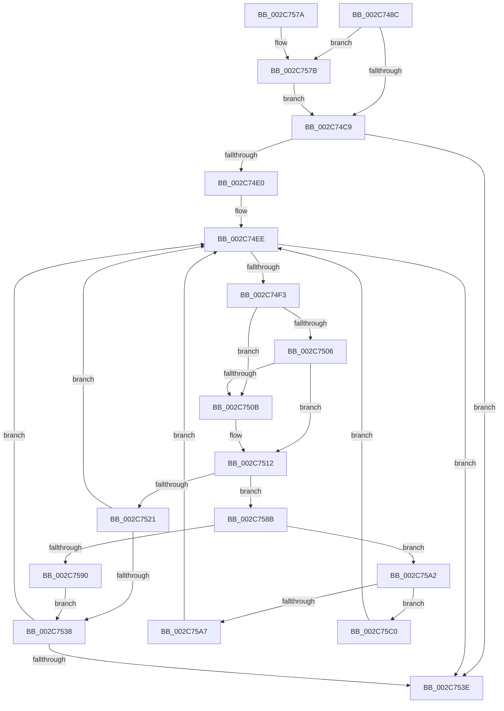

# KeSignalGate

- RVA: `0x002C748C`–`0x002C75DC` (길이 `336` bytes)
- VA: `0x00000001402C748C`
- 실행 섹션: `.text`
- PDB 이름 있음: `예`; PDB Function 태그: `아니요`
- unwind 정보 RVA: `0x0006EDC0`
- 디코드: `93`개 명령, `336/336` bytes 표시
- 미해석 바이트: `0` (있으면 어셈블리에 `.byte`로 보존)

> 이 문서는 커널 이미지의 기계어와 PDB 기호를 분석해 생성했습니다. 4번과 5번은 함수 원형과 자료형을 바이너리 사용 방식에서 추정한 C 해석이며 원본 소스 복구 결과는 아닙니다.

## 1. Dependencies

- 직접 호출 지점: **7**; 고유 호출 대상: **6**
- 직접 호출자로 확인된 함수: **18**
- RIP 상대 이미지 참조: **1**

### Outgoing calls
- `0x002C74D5` → [KiAcquireKobjectLockSafe](../25/KiAcquireKobjectLockSafe_function_00251C90.md) (function, `0x00251C90`)
- `0x002C752F` → [KiTryUnwaitThread](../35/KiTryUnwaitThread_function_003506D0.md) (function, `0x003506D0`)
- `0x002C7556` → [KiExitDispatcher](../25/KiExitDispatcher_function_00251CF0.md) (function, `0x00251CF0`)
- `0x002C7581` → [KiRaiseIrqlProcessIrqlFlags](../4F/KiRaiseIrqlProcessIrqlFlags_function_004F56FC.md) (function, `0x004F56FC`)
- `0x002C759B` → [KiInsertQueueInternal](../21/KiInsertQueueInternal_function_00219B30.md) (function, `0x00219B30`)
- `0x002C75B6` → [KiTryUnwaitThread](../35/KiTryUnwaitThread_function_003506D0.md) (function, `0x003506D0`)
- `0x002C75D2` → [KeInsertQueueDpc](../20/KeInsertQueueDpc_function_00207C50.md) (function, `0x00207C50`)

### Direct callers
- [KiRcuFlushCompleted](../20/KiRcuFlushCompleted_function_0020AD38.md) at `0x0020AED6`
- [PspDetachSession](../22/PspDetachSession_function_0022480C.md) at `0x00224897`
- [sub_0028F57A](../28/Unknown_function_0028F57A.md) at `0x0028F5C9`
- [MiZeroInParallelWorker](MiZeroInParallelWorker_function_002C6600.md) at `0x002C676A`
- [KiGenericCallDpcInitiatorDpc](KiGenericCallDpcInitiatorDpc_function_002C83E0.md) at `0x002C844D`
- [MiFinishVadDeletion](../43/MiFinishVadDeletion_function_00430ED0.md) at `0x00431112`
- [MiUnlockControlAreaSectionExtend](../44/MiUnlockControlAreaSectionExtend_function_0044BDC4.md) at `0x0044BE83`
- [PsWatchWorkingSet](../45/PsWatchWorkingSet_function_00452910.md) at `0x00452A9B`
- [MiSubsectionProtosCreated](../4D/MiSubsectionProtosCreated_function_004D9570.md) at `0x004D9626`
- [KiSrcuFlushCompleted](../5C/KiSrcuFlushCompleted_function_005C22B4.md) at `0x005C23D9`
- [KiSrcuNotifyWorkerSelectAndQueue](../5C/KiSrcuNotifyWorkerSelectAndQueue_function_005C29D4.md) at `0x005C2A44`
- [KiEpfComplete](../5C/KiEpfComplete_function_005C4958.md) at `0x005C4A1E`
- [MiDeleteExtentPfns](../68/MiDeleteExtentPfns_function_006808B0.md) at `0x00680977`
- [MiWakeWaitersForAweCacheAttributeChange](../68/MiWakeWaitersForAweCacheAttributeChange_function_00689A58.md) at `0x00689AF3`
- [MiZeroHugeRangeWorker](../68/MiZeroHugeRangeWorker_function_0068C960.md) at `0x0068CA4B`
- [MiUnlinkAccelerator](../69/MiUnlinkAccelerator_function_00697860.md) at `0x006978FD`
- [MiScrubMemoryWorker](../../page/80/MiScrubMemoryWorker_function_0080EE00.md) at `0x0080EE51`
- [sub_00BF1290](../../init/BF/Unknown_function_00BF1290.md) at `0x00BF16A5`

### Static image references
- `0x002C74BC` → RVA `0x00FC6D20` (`ALMOSTRO`; read)

## 2. Other-region calls and transfers

- 다른 실행 섹션으로 향하는 call: **0**
- 별도 외부 분기/꼬리 이동을 확인하지 못했습니다.

## 3. Assembly (complete function range)

```asm
002C748C  48 8B C4                        mov rax, rsp
002C748F  48 89 58 08                     mov qword ptr [rax + 8], rbx
002C7493  48 89 68 10                     mov qword ptr [rax + 0x10], rbp
002C7497  48 89 70 18                     mov qword ptr [rax + 0x18], rsi
002C749B  48 89 78 20                     mov qword ptr [rax + 0x20], rdi
002C749F  41 55                           push r13
002C74A1  41 56                           push r14
002C74A3  41 57                           push r15
002C74A5  48 83 EC 30                     sub rsp, 0x30
002C74A9  8B EA                           mov ebp, edx
002C74AB  48 8B D9                        mov rbx, rcx
002C74AE  44 0F 20 C7                     mov rdi, cr8
002C74B2  41 BD 02 00 00 00               mov r13d, 2
002C74B8  45 0F 22 C5                     mov cr8, r13
002C74BC  83 3D 5D F8 CF 00 00            cmp dword ptr [rip + 0xcff85d], 0
002C74C3  0F 85 B2 00 00 00               jne 0x1402c757b
002C74C9  65 48 8B 34 25 20 00 00 00      mov rsi, qword ptr gs:[0x20]
002C74D2  48 8B CB                        mov rcx, rbx
002C74D5  E8 B6 A7 F8 FF                  call 0x140251c90
002C74DA  83 7B 04 00                     cmp dword ptr [rbx + 4], 0
002C74DE  75 5E                           jne 0x1402c753e
002C74E0  4C 8D 7B 08                     lea r15, [rbx + 8]
002C74E4  C7 43 04 01 00 00 00            mov dword ptr [rbx + 4], 1
002C74EB  4D 8B 37                        mov r14, qword ptr [r15]
002C74EE  4D 3B F7                        cmp r14, r15
002C74F1  74 4B                           je 0x1402c753e
002C74F3  49 8B 16                        mov rdx, qword ptr [r14]
002C74F6  49 8B C6                        mov rax, r14
002C74F9  4C 8B F2                        mov r14, rdx
002C74FC  48 8B 48 08                     mov rcx, qword ptr [rax + 8]
002C7500  48 39 42 08                     cmp qword ptr [rdx + 8], rax
002C7504  75 05                           jne 0x1402c750b
002C7506  48 39 01                        cmp qword ptr [rcx], rax
002C7509  74 07                           je 0x1402c7512
002C750B  B9 03 00 00 00                  mov ecx, 3
002C7510  CD 29                           int 0x29
002C7512  48 89 11                        mov qword ptr [rcx], rdx
002C7515  48 89 4A 08                     mov qword ptr [rdx + 8], rcx
002C7519  8A 48 10                        mov cl, byte ptr [rax + 0x10]
002C751C  80 F9 01                        cmp cl, 1
002C751F  75 6A                           jne 0x1402c758b
002C7521  44 0F B7 40 12                  movzx r8d, word ptr [rax + 0x12]
002C7526  45 33 C9                        xor r9d, r9d
002C7529  48 8B D0                        mov rdx, rax
002C752C  48 8B CE                        mov rcx, rsi
002C752F  E8 9C 91 08 00                  call 0x1403506d0
002C7534  84 C0                           test al, al
002C7536  74 B6                           je 0x1402c74ee
002C7538  83 6B 04 01                     sub dword ptr [rbx + 4], 1
002C753C  75 B0                           jne 0x1402c74ee
002C753E  F0 81 23 7F FF FF FF            lock and dword ptr [rbx], 0xffffff7f
002C7545  33 D2                           xor edx, edx
002C7547  40 88 7C 24 20                  mov byte ptr [rsp + 0x20], dil
002C754C  44 8B CD                        mov r9d, ebp
002C754F  48 8B CE                        mov rcx, rsi
002C7552  44 8D 42 01                     lea r8d, [rdx + 1]
002C7556  E8 95 A7 F8 FF                  call 0x140251cf0
002C755B  48 8B 5C 24 50                  mov rbx, qword ptr [rsp + 0x50]
002C7560  48 8B 6C 24 58                  mov rbp, qword ptr [rsp + 0x58]
002C7565  48 8B 74 24 60                  mov rsi, qword ptr [rsp + 0x60]
002C756A  48 8B 7C 24 68                  mov rdi, qword ptr [rsp + 0x68]
002C756F  48 83 C4 30                     add rsp, 0x30
002C7573  41 5F                           pop r15
002C7575  41 5E                           pop r14
002C7577  41 5D                           pop r13
002C7579  C3                              ret
002C757A  CC                              int3
002C757B  41 8A D5                        mov dl, r13b
002C757E  40 8A CF                        mov cl, dil
002C7581  E8 76 E1 22 00                  call 0x1404f56fc
002C7586  E9 3E FF FF FF                  jmp 0x1402c74c9
002C758B  41 3A CD                        cmp cl, r13b
002C758E  75 12                           jne 0x1402c75a2
002C7590  C6 40 11 05                     mov byte ptr [rax + 0x11], 5
002C7594  48 8B D0                        mov rdx, rax
002C7597  48 8B 48 18                     mov rcx, qword ptr [rax + 0x18]
002C759B  E8 90 25 F5 FF                  call 0x140219b30
002C75A0  EB 96                           jmp 0x1402c7538
002C75A2  80 F9 04                        cmp cl, 4
002C75A5  74 19                           je 0x1402c75c0
002C75A7  45 33 C9                        xor r9d, r9d
002C75AA  41 B8 00 01 00 00               mov r8d, 0x100
002C75B0  48 8B D0                        mov rdx, rax
002C75B3  48 8B CE                        mov rcx, rsi
002C75B6  E8 15 91 08 00                  call 0x1403506d0
002C75BB  E9 2E FF FF FF                  jmp 0x1402c74ee
002C75C0  C6 40 11 05                     mov byte ptr [rax + 0x11], 5
002C75C4  4C 8B C0                        mov r8, rax
002C75C7  83 63 04 00                     and dword ptr [rbx + 4], 0
002C75CB  48 8B D3                        mov rdx, rbx
002C75CE  48 8B 48 18                     mov rcx, qword ptr [rax + 0x18]
002C75D2  E8 79 06 F4 FF                  call 0x140207c50
002C75D7  E9 12 FF FF FF                  jmp 0x1402c74ee
```

## 4. C-style interpretation (structured pseudocode)

```c
__int64 __fastcall KeSignalGate(__int64 a1, int a2, __int64 a3, int a4)
{
    __int64 result;
    __int64 v_rsp;
    unsigned __int8 v_stack_m28;
    unsigned __int64 v_stack_p10;
    unsigned __int64 v_stack_p18;
    unsigned __int64 v_stack_p20;
    unsigned __int64 v_stack_p8;

    *(unsigned __int64 *)(v_rsp + 8) = v_rbx;
    *(unsigned __int64 *)(v_rsp + 16) = v_rbp;
    *(unsigned __int64 *)(v_rsp + 24) = v_rsi;
    *(unsigned __int64 *)(v_rsp + 32) = v_rdi;
    v_rsp = (v_rsp) - (48);
    if ((*(unsigned int *)(v_rip + 13629533)) != 0) goto loc_002C757B;
loc_002C74C9:
    result = KiAcquireKobjectLockSafe(a1, a2, a3, a4);
    if ((*(unsigned int *)(a1 + 4)) != 0) goto loc_002C753E;
    *(unsigned int *)(a1 + 4) = 1;
loc_002C74EE:
    if ((*(unsigned __int64 *)(a1 + 8)) == (a1 + 8)) goto loc_002C753E;
    if ((*(unsigned __int64 *)(*(unsigned __int64 *)(*(unsigned __int64 *)(a1 + 8)) + 8)) != (*(unsigned __int64 *)(a1 + 8))) goto loc_002C750B;
    if ((*(unsigned __int64 *)(*(unsigned __int64 *)(*(unsigned __int64 *)(a1 + 8) + 8))) != (*(unsigned __int64 *)(a1 + 8))) {
        a1 = 3;
    }
    *(unsigned __int64 *)(a1) = *(unsigned __int64 *)(*(unsigned __int64 *)(a1 + 8));
    *(unsigned __int64 *)(*(unsigned __int64 *)(*(unsigned __int64 *)(a1 + 8)) + 8) = a1;
    if (((unsigned __int8)(*(unsigned __int8 *)(*(unsigned __int64 *)(a1 + 8) + 16))) != 1) goto loc_002C758B;
    a4 = 0;
    result = KiTryUnwaitThread(*(unsigned __int64 *)(gs_base + (0 + 32)), *(unsigned __int64 *)(a1 + 8), *(unsigned __int16 *)(*(unsigned __int64 *)(a1 + 8) + 18), a4);
    if ((unsigned __int8)(result) == 0) goto loc_002C74EE;
loc_002C7538:
    if ((unsigned __int8)(result) != 0) goto loc_002C74EE;
loc_002C753E:
    a2 = 0;
    v_stack_m28 = (unsigned __int8)(v_cr8);
    result = KiExitDispatcher(*(unsigned __int64 *)(gs_base + (0 + 32)), a2, a2 + 1, (unsigned int)((unsigned int)((unsigned int)(a2))));
    v_rsp = (v_rsp) + (48);
    return result;
loc_002C757B:
    result = KiRaiseIrqlProcessIrqlFlags((unsigned __int8)(v_stack_p20), 2, a2 + 1, (unsigned int)((unsigned int)((unsigned int)(a2))));
    goto loc_002C74C9;
loc_002C758B:
    if (((unsigned __int8)((unsigned __int8)(v_stack_p20))) != 2) goto loc_002C75A2;
    *(unsigned __int8 *)(result + 17) = 5;
    result = KiInsertQueueInternal(*(unsigned __int64 *)(result + 24), result, a2 + 1, (unsigned int)((unsigned int)((unsigned int)(a2))));
    goto loc_002C7538;
loc_002C75A2:
    if (((unsigned __int8)(*(unsigned __int64 *)(result + 24))) == 4) goto loc_002C75C0;
    a4 = 0;
    result = KiTryUnwaitThread(v_stack_p18, result, 256, a4);
    goto loc_002C74EE;
loc_002C75C0:
    *(unsigned __int8 *)(result + 17) = 5;
    result = KeInsertQueueDpc(*(unsigned __int64 *)(result + 24), v_stack_p8, result, a4);
    goto loc_002C74EE;
}
```

## 5. (Beta) C Style

```c
int64_t KeSignalGate(void *Arg1, int32_t Arg2, int64_t Arg3, int32_t Arg4)
{
    uint8_t *arg1 = (uint8_t *)Arg1;

    int64_t result;
    int64_t local_rsp;
    uint8_t v_stack_m28;
    uint64_t v_stack_p10;
    uint64_t v_stack_p18;
    uint64_t v_stack_p20;
    uint64_t v_stack_p8;

    *(uint64_t *)(local_rsp + 0x8) = local_rbx;
    *(uint64_t *)(local_rsp + 0x10) = local_rbp;
    *(uint64_t *)(local_rsp + 0x18) = local_rsi;
    *(uint64_t *)(local_rsp + 0x20) = local_rdi;
    local_rsp = (local_rsp) - (48);
    if ((*(uint32_t *)(v_rip + 0xCFF85D)) != 0) goto loc_002C757B;
loc_002C74C9:
    result = KiAcquireKobjectLockSafe(Arg1, Arg2, Arg3, Arg4);
    if ((*(uint32_t *)(arg1 + 0x4)) != 0) goto loc_002C753E;
    *(uint32_t *)(arg1 + 0x4) = 1;
loc_002C74EE:
    if ((*(uint64_t *)(arg1 + 0x8)) == (Arg1 + 8)) goto loc_002C753E;
    if ((*(uint64_t *)(*(uint64_t *)(*(uint64_t *)(arg1 + 0x8)) + 0x8)) != (*(uint64_t *)(arg1 + 0x8))) goto loc_002C750B;
    if ((*(uint64_t *)(*(uint64_t *)(*(uint64_t *)(arg1 + 0x8) + 0x8))) != (*(uint64_t *)(arg1 + 0x8))) {
        Arg1 = 3;
    }
    *(uint64_t *)(arg1) = *(uint64_t *)(*(uint64_t *)(arg1 + 0x8));
    *(void **)(*(uint64_t *)(*(uint64_t *)(arg1 + 0x8)) + 0x8) = Arg1;
    if (((uint8_t)(*(uint8_t *)(*(uint64_t *)(arg1 + 0x8) + 0x10))) != 1) goto loc_002C758B;
    Arg4 = 0;
    result = KiTryUnwaitThread(*(uint64_t *)(gs_base + (0 + 0x20)), *(uint64_t *)(arg1 + 0x8), *(uint16_t *)(*(uint64_t *)(arg1 + 0x8) + 0x12), Arg4);
    if ((uint8_t)(result) == 0) goto loc_002C74EE;
loc_002C7538:
    if ((uint8_t)(result) != 0) goto loc_002C74EE;
loc_002C753E:
    Arg2 = 0;
    v_stack_m28 = (uint8_t)(v_cr8);
    result = KiExitDispatcher(*(uint64_t *)(gs_base + (0 + 0x20)), Arg2, Arg2 + 1, (uint32_t)((uint32_t)((uint32_t)(Arg2))));
    local_rsp = (local_rsp) + (48);
    return result;
loc_002C757B:
    result = KiRaiseIrqlProcessIrqlFlags((uint8_t)(v_stack_p20), 2, Arg2 + 1, (uint32_t)((uint32_t)((uint32_t)(Arg2))));
    goto loc_002C74C9;
loc_002C758B:
    if (((uint8_t)((uint8_t)(v_stack_p20))) != 2) goto loc_002C75A2;
    *(uint8_t *)(result + 0x11) = 5;
    result = KiInsertQueueInternal(*(uint64_t *)(result + 0x18), result, Arg2 + 1, (uint32_t)((uint32_t)((uint32_t)(Arg2))));
    goto loc_002C7538;
loc_002C75A2:
    if (((uint8_t)(*(uint64_t *)(result + 0x18))) == 4) goto loc_002C75C0;
    Arg4 = 0;
    result = KiTryUnwaitThread(v_stack_p18, result, 256, Arg4);
    goto loc_002C74EE;
loc_002C75C0:
    *(uint8_t *)(result + 0x11) = 5;
    result = KeInsertQueueDpc(*(uint64_t *)(result + 0x18), v_stack_p8, result, Arg4);
    goto loc_002C74EE;
}
```

### 관측된 메모리 오프셋

구조체 형식이 확인되지 않은 접근은 인자 기준의 오프셋으로만 기록했습니다.

| 기준 인자 | 오프셋 표현 | 폭 (bit) | 접근 |
|---|---:|---:|---|
| `Arg1` | `+ 0x0` | `32` | `R/W` |
| `Arg1` | `+ 0x0` | `64` | `R` |
| `Arg1` | `+ 0x4` | `32` | `R` |
| `Arg1` | `+ 0x4` | `32` | `R/W` |
| `Arg1` | `+ 0x4` | `32` | `W` |
| `Arg1` | `+ 0x8` | `64` | `R` |

## 6. Execution-region graph

[열기: 2D/3D 그래프와 함수 탐색 컨트롤 패널](../../../control-panel.html?section=text&rva=0x002C748C&view=graph)

- 2D 그래프는 위에서 아래로 흐르고, 3D 그래프는 빈 공간을 드래그해 회전합니다. Shift+드래그는 이동, 휠은 확대·축소, 함수 노드 선택은 대상 보고서 이동입니다.

### Static fallback


