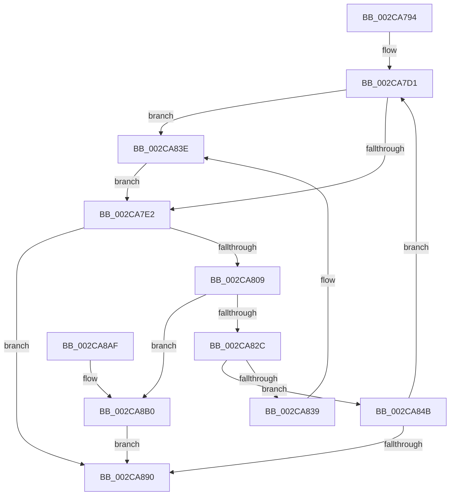

# KeWaitForGate

- RVA: `0x002CA794`–`0x002CA8D1` (길이 `317` bytes)
- VA: `0x00000001402CA794`
- 실행 섹션: `.text`
- PDB 이름 있음: `예`; PDB Function 태그: `아니요`
- unwind 정보 RVA: `0x0006F1D4`
- 디코드: `83`개 명령, `317/317` bytes 표시
- 미해석 바이트: `0` (있으면 어셈블리에 `.byte`로 보존)

> 이 문서는 커널 이미지의 기계어와 PDB 기호를 분석해 생성했습니다. 4번과 5번은 함수 원형과 자료형을 바이너리 사용 방식에서 추정한 C 해석이며 원본 소스 복구 결과는 아닙니다.

## 1. Dependencies

- 직접 호출 지점: **5**; 고유 호출 대상: **5**
- 직접 호출자로 확인된 함수: **26**
- RIP 상대 이미지 참조: **1**

### Outgoing calls
- `0x002CA7FA` → [KiBeginThreadWait](KiBeginThreadWait_function_002CA8E0.md) (function, `0x002CA8E0`)
- `0x002CA81D` → [KiAcquireKobjectLockSafe](../25/KiAcquireKobjectLockSafe_function_00251C90.md) (function, `0x00251C90`)
- `0x002CA844` → [KiRaiseIrqlProcessIrqlFlags](../4F/KiRaiseIrqlProcessIrqlFlags_function_004F56FC.md) (function, `0x004F56FC`)
- `0x002CA87D` → [KiCommitThreadWait](../20/KiCommitThreadWait_function_0020DFE0.md) (function, `0x0020DFE0`)
- `0x002CA8CA` → [KiFastExitThreadWait](../22/KiFastExitThreadWait_function_00220BB0.md) (function, `0x00220BB0`)

### Direct callers
- [MiAttemptSectionDelete](../2A/MiAttemptSectionDelete_function_002AD044.md) at `0x002AD120`
- [MiReferenceControlArea](../2B/MiReferenceControlArea_function_002BC198.md) at `0x002BC493`
- [MiUnlinkWorkingSet](MiUnlinkWorkingSet_function_002C8B50.md) at `0x002C8C15`
- [KeGenericCallDpcEx](KeGenericCallDpcEx_function_002C99F4.md) at `0x002C9AC3`
- [MiLockControlAreaSectionExtend](MiLockControlAreaSectionExtend_function_002C9D60.md) at `0x002C9E7C`
- [MiWaitForPageWriteCompletion](MiWaitForPageWriteCompletion_function_002C9EBC.md) at `0x002C9F50`
- [MiWaitForZeroWorkers](MiWaitForZeroWorkers_function_002C9FC4.md) at `0x002C9FDF`
- [MiWaitForVadDeletion](../31/MiWaitForVadDeletion_function_00316F1C.md) at `0x00316F9D`
- [MiDrainControlAreaWrites](../46/MiDrainControlAreaWrites_function_0046317C.md) at `0x004631F9`
- [MiIncrementLargeSubsections](../4D/MiIncrementLargeSubsections_function_004D3410.md) at `0x004D34C4`
- [KeSrcuFree](../5C/KeSrcuFree_function_005C1F60.md) at `0x005C203C`
- [KiEpfStart](../5C/KiEpfStart_function_005C4B14.md) at `0x005C4C8E`
- [KiExecuteDpc](../5C/KiExecuteDpc_function_005C84F0.md) at `0x005C8573`
- [MiChangingSubsectionProtos](../68/MiChangingSubsectionProtos_function_0068057C.md) at `0x006806F5`
- [MiWaitForExtentDeletions](../68/MiWaitForExtentDeletions_function_00681F80.md) at `0x00682008`
- [MiResolveAwePageConflict](../68/MiResolveAwePageConflict_function_00689758.md) at `0x006897EC`
- [MiDeleteHardwareAccelerators](../69/MiDeleteHardwareAccelerators_function_006972DC.md) at `0x006973FC`
- [sub_006E82CE](../6E/Unknown_function_006E82CE.md) at `0x006E8309`
- [sub_006ED466](../6E/Unknown_function_006ED466.md) at `0x006ED4BD`
- [KeRcuSynchronize](../../page/74/KeRcuSynchronize_function_00746450.md) at `0x007464A4`
- [KeSrcuSynchronize](../../page/74/KeSrcuSynchronize_function_00747230.md) at `0x0074726E`
- [PspDereferenceSessionFinal](../../page/78/PspDereferenceSessionFinal_function_00788F5C.md) at `0x00788FC0`
- [MmScrubMemory](../../page/80/MmScrubMemory_function_0080EFA0.md) at `0x0080F0E9`
- [PspQueryWorkingSetWatch](../../page/A2/PspQueryWorkingSetWatch_function_00A21478.md) at `0x00A217BF`
- [sub_00BE60B0](../../initkdbg/BE/Unknown_function_00BE60B0.md) at `0x00BE6C30`
- [sub_00BE60B0](../../initkdbg/BE/Unknown_function_00BE60B0.md) at `0x00BE6C62`
- [sub_00BE60B0](../../initkdbg/BE/Unknown_function_00BE60B0.md) at `0x00BE7229`
- [sub_00BE60B0](../../initkdbg/BE/Unknown_function_00BE60B0.md) at `0x00BE725B`
- [sub_00BE60B0](../../initkdbg/BE/Unknown_function_00BE60B0.md) at `0x00BE75F0`
- [sub_00BE60B0](../../initkdbg/BE/Unknown_function_00BE60B0.md) at `0x00BE7622`
- [sub_00BE60B0](../../initkdbg/BE/Unknown_function_00BE60B0.md) at `0x00BE7646`
- [sub_00BE60B0](../../initkdbg/BE/Unknown_function_00BE60B0.md) at `0x00BE7A47`
- [sub_00BE60B0](../../initkdbg/BE/Unknown_function_00BE60B0.md) at `0x00BE7A75`
- [sub_00BE60B0](../../initkdbg/BE/Unknown_function_00BE60B0.md) at `0x00BE7A9A`
- [sub_00BEFF8C](../../init/BE/Unknown_function_00BEFF8C.md) at `0x00BF0D6F`
- [sub_00BEFF8C](../../init/BE/Unknown_function_00BEFF8C.md) at `0x00BF0DA2`
- [sub_00BEFF8C](../../init/BE/Unknown_function_00BEFF8C.md) at `0x00BF0DD4`
- [sub_00BEFF8C](../../init/BE/Unknown_function_00BEFF8C.md) at `0x00BF0E84`

### Static image references
- `0x002CA7D9` → RVA `0x00FC6D20` (`ALMOSTRO`; read)

## 2. Other-region calls and transfers

- 다른 실행 섹션으로 향하는 call: **0**
- 별도 외부 분기/꼬리 이동을 확인하지 못했습니다.

## 3. Assembly (complete function range)

```asm
002CA794  48 89 5C 24 08                  mov qword ptr [rsp + 8], rbx
002CA799  48 89 6C 24 10                  mov qword ptr [rsp + 0x10], rbp
002CA79E  48 89 74 24 18                  mov qword ptr [rsp + 0x18], rsi
002CA7A3  57                              push rdi
002CA7A4  41 54                           push r12
002CA7A6  41 55                           push r13
002CA7A8  41 56                           push r14
002CA7AA  41 57                           push r15
002CA7AC  48 83 EC 30                     sub rsp, 0x30
002CA7B0  65 48 8B 34 25 88 01 00 00      mov rsi, qword ptr gs:[0x188]
002CA7B9  45 33 E4                        xor r12d, r12d
002CA7BC  45 8A F0                        mov r14b, r8b
002CA7BF  44 8B FA                        mov r15d, edx
002CA7C2  48 8B D9                        mov rbx, rcx
002CA7C5  48 8D BE 40 01 00 00            lea rdi, [rsi + 0x140]
002CA7CC  45 8D 6C 24 02                  lea r13d, [r12 + 2]
002CA7D1  44 0F 20 C5                     mov rbp, cr8
002CA7D5  45 0F 22 C5                     mov cr8, r13
002CA7D9  44 39 25 40 C5 CF 00            cmp dword ptr [rip + 0xcfc540], r12d
002CA7E0  75 5C                           jne 0x1402ca83e
002CA7E2  45 33 C9                        xor r9d, r9d
002CA7E5  40 88 AE 86 01 00 00            mov byte ptr [rsi + 0x186], bpl
002CA7EC  45 8B C7                        mov r8d, r15d
002CA7EF  44 89 64 24 20                  mov dword ptr [rsp + 0x20], r12d
002CA7F4  41 8A D6                        mov dl, r14b
002CA7F7  48 8B CE                        mov rcx, rsi
002CA7FA  E8 E1 00 00 00                  call 0x1402ca8e0
002CA7FF  8B E8                           mov ebp, eax
002CA801  85 C0                           test eax, eax
002CA803  0F 85 87 00 00 00               jne 0x1402ca890
002CA809  C6 47 10 01                     mov byte ptr [rdi + 0x10], 1
002CA80D  48 8B CB                        mov rcx, rbx
002CA810  C6 47 11 04                     mov byte ptr [rdi + 0x11], 4
002CA814  66 44 89 67 12                  mov word ptr [rdi + 0x12], r12w
002CA819  48 89 5F 20                     mov qword ptr [rdi + 0x20], rbx
002CA81D  E8 6E 74 F8 FF                  call 0x140251c90
002CA822  44 39 63 04                     cmp dword ptr [rbx + 4], r12d
002CA826  0F 85 84 00 00 00               jne 0x1402ca8b0
002CA82C  48 8D 43 08                     lea rax, [rbx + 8]
002CA830  48 8B 48 08                     mov rcx, qword ptr [rax + 8]
002CA834  48 39 01                        cmp qword ptr [rcx], rax
002CA837  74 12                           je 0x1402ca84b
002CA839  8D 4D 03                        lea ecx, [rbp + 3]
002CA83C  CD 29                           int 0x29
002CA83E  41 8A D5                        mov dl, r13b
002CA841  40 8A CD                        mov cl, bpl
002CA844  E8 B3 AE 22 00                  call 0x1404f56fc
002CA849  EB 97                           jmp 0x1402ca7e2
002CA84B  48 89 07                        mov qword ptr [rdi], rax
002CA84E  48 89 4F 08                     mov qword ptr [rdi + 8], rcx
002CA852  48 89 39                        mov qword ptr [rcx], rdi
002CA855  48 89 78 08                     mov qword ptr [rax + 8], rdi
002CA859  F0 81 23 7F FF FF FF            lock and dword ptr [rbx], 0xffffff7f
002CA860  4C 89 64 24 28                  mov qword ptr [rsp + 0x28], r12
002CA865  45 33 C9                        xor r9d, r9d
002CA868  45 33 C0                        xor r8d, r8d
002CA86B  44 89 64 24 20                  mov dword ptr [rsp + 0x20], r12d
002CA870  48 8B D7                        mov rdx, rdi
002CA873  C6 86 4B 02 00 00 01            mov byte ptr [rsi + 0x24b], 1
002CA87A  48 8B CE                        mov rcx, rsi
002CA87D  E8 5E 37 F4 FF                  call 0x14020dfe0
002CA882  48 8B E8                        mov rbp, rax
002CA885  3D 00 01 00 00                  cmp eax, 0x100
002CA88A  0F 84 41 FF FF FF               je 0x1402ca7d1
002CA890  48 8B 5C 24 60                  mov rbx, qword ptr [rsp + 0x60]
002CA895  8B C5                           mov eax, ebp
002CA897  48 8B 6C 24 68                  mov rbp, qword ptr [rsp + 0x68]
002CA89C  48 8B 74 24 70                  mov rsi, qword ptr [rsp + 0x70]
002CA8A1  48 83 C4 30                     add rsp, 0x30
002CA8A5  41 5F                           pop r15
002CA8A7  41 5E                           pop r14
002CA8A9  41 5D                           pop r13
002CA8AB  41 5C                           pop r12
002CA8AD  5F                              pop rdi
002CA8AE  C3                              ret
002CA8AF  CC                              int3
002CA8B0  44 89 63 04                     mov dword ptr [rbx + 4], r12d
002CA8B4  F0 81 23 7F FF FF FF            lock and dword ptr [rbx], 0xffffff7f
002CA8BB  65 48 8B 0C 25 20 00 00 00      mov rcx, qword ptr gs:[0x20]
002CA8C4  45 8B C4                        mov r8d, r12d
002CA8C7  48 8B D6                        mov rdx, rsi
002CA8CA  E8 E1 62 F5 FF                  call 0x140220bb0
002CA8CF  EB BF                           jmp 0x1402ca890
```

## 4. C-style interpretation (structured pseudocode)

```c
__int64 __fastcall KeWaitForGate(__int64 a1, int a2, unsigned __int8 a3, int a4)
{
    __int64 result;
    __int64 v_r12;
    __int64 v_rsp;
    unsigned __int64 v_stack_m30;
    unsigned int v_stack_m38;
    unsigned __int64 v_stack_p10;
    unsigned __int64 v_stack_p18;
    unsigned __int64 v_stack_p8;

    v_stack_p8 = v_rbx;
    v_stack_p10 = v_rbp;
    v_stack_p18 = v_rsi;
    v_rsp = (v_rsp) - (48);
    v_r12 = 0;
loc_002CA7D1:
    if ((*(unsigned int *)(v_rip + 13616448)) != 0) goto loc_002CA83E;
loc_002CA7E2:
    a4 = 0;
    *(unsigned __int8 *)(*(unsigned __int64 *)(gs_base + (0 + 392)) + 390) = (unsigned __int8)(v_cr8);
    v_stack_m38 = 0;
    result = KiBeginThreadWait(*(unsigned __int64 *)(gs_base + (0 + 392)), a3, (unsigned int)((unsigned int)((unsigned int)(a2))), a4);
    if ((unsigned int)(result) != 0) goto loc_002CA890;
    *(unsigned __int8 *)(*(unsigned __int64 *)(gs_base + (0 + 392)) + 320 + 16) = 1;
    *(unsigned __int8 *)(*(unsigned __int64 *)(gs_base + (0 + 392)) + 320 + 17) = 4;
    *(unsigned __int16 *)(*(unsigned __int64 *)(gs_base + (0 + 392)) + 320 + 18) = 0;
    *(unsigned __int64 *)(*(unsigned __int64 *)(gs_base + (0 + 392)) + 320 + 32) = a1;
    result = KiAcquireKobjectLockSafe(a1, a3, (unsigned int)((unsigned int)((unsigned int)(a2))), a4);
    if ((*(unsigned int *)(a1 + 4)) != 0) goto loc_002CA8B0;
    if ((*(unsigned __int64 *)(*(unsigned __int64 *)(a1 + 8 + 8))) == (a1 + 8)) goto loc_002CA84B;
loc_002CA83E:
    result = KiRaiseIrqlProcessIrqlFlags((unsigned __int8)((unsigned int)((unsigned int)(result))), (unsigned __int8)(v_r12 + 2), (unsigned int)((unsigned int)((unsigned int)(a2))), a4);
    goto loc_002CA7E2;
loc_002CA84B:
    *(unsigned __int64 *)(*(unsigned __int64 *)(gs_base + (0 + 392)) + 320) = result;
    *(unsigned __int64 *)(*(unsigned __int64 *)(gs_base + (0 + 392)) + 320 + 8) = (unsigned __int8)((unsigned int)((unsigned int)(result)));
    *(unsigned __int64 *)((unsigned __int8)((unsigned int)((unsigned int)(result)))) = *(unsigned __int64 *)(gs_base + (0 + 392)) + 320;
    *(unsigned __int64 *)(result + 8) = *(unsigned __int64 *)(gs_base + (0 + 392)) + 320;
    v_stack_m30 = 0;
    a4 = 0;
    a3 = 0;
    v_stack_m38 = 0;
    *(unsigned __int8 *)(*(unsigned __int64 *)(gs_base + (0 + 392)) + 587) = 1;
    result = KiCommitThreadWait(*(unsigned __int64 *)(gs_base + (0 + 392)), *(unsigned __int64 *)(gs_base + (0 + 392)) + 320, a3, a4);
    if (((unsigned int)(result)) == 256) goto loc_002CA7D1;
loc_002CA890:
    v_rsp = (v_rsp) + (48);
    return (unsigned int)((unsigned int)(result));
loc_002CA8B0:
    *(unsigned int *)(v_stack_p8 + 4) = 0;
    result = KiFastExitThreadWait(*(unsigned __int64 *)(gs_base + (0 + 32)), v_stack_p18, 0, a4);
    goto loc_002CA890;
}
```

## 5. (Beta) C Style

```c
int64_t KeWaitForGate(void *Arg1, int32_t Arg2, uint8_t Arg3, int32_t Arg4)
{
    uint8_t *arg1 = (uint8_t *)Arg1;

    int64_t result;
    int64_t local_r12;
    int64_t local_rsp;
    uint64_t v_stack_m30;
    uint32_t v_stack_m38;
    uint64_t v_stack_p10;
    uint64_t v_stack_p18;
    uint64_t v_stack_p8;

    v_stack_p8 = local_rbx;
    v_stack_p10 = local_rbp;
    v_stack_p18 = local_rsi;
    local_rsp = (local_rsp) - (48);
    local_r12 = 0;
loc_002CA7D1:
    if ((*(uint32_t *)(v_rip + 0xCFC540)) != 0) goto loc_002CA83E;
loc_002CA7E2:
    Arg4 = 0;
    *(uint8_t *)(*(uint64_t *)(gs_base + (0 + 0x188)) + 0x186) = (uint8_t)(v_cr8);
    v_stack_m38 = 0;
    result = KiBeginThreadWait(*(uint64_t *)(gs_base + (0 + 0x188)), Arg3, (uint32_t)((uint32_t)((uint32_t)(Arg2))), Arg4);
    if ((uint32_t)(result) != 0) goto loc_002CA890;
    *(uint8_t *)(*(uint64_t *)(gs_base + (0 + 0x188)) + 0x140 + 0x10) = 1;
    *(uint8_t *)(*(uint64_t *)(gs_base + (0 + 0x188)) + 0x140 + 0x11) = 4;
    *(uint16_t *)(*(uint64_t *)(gs_base + (0 + 0x188)) + 0x140 + 0x12) = 0;
    *(void **)(*(uint64_t *)(gs_base + (0 + 0x188)) + 0x140 + 0x20) = Arg1;
    result = KiAcquireKobjectLockSafe(Arg1, Arg3, (uint32_t)((uint32_t)((uint32_t)(Arg2))), Arg4);
    if ((*(uint32_t *)(arg1 + 0x4)) != 0) goto loc_002CA8B0;
    if ((*(uint64_t *)(*(uint64_t *)(arg1 + 0x8 + 0x8))) == (Arg1 + 8)) goto loc_002CA84B;
loc_002CA83E:
    result = KiRaiseIrqlProcessIrqlFlags((uint8_t)((uint32_t)((uint32_t)(result))), (uint8_t)(local_r12 + 2), (uint32_t)((uint32_t)((uint32_t)(Arg2))), Arg4);
    goto loc_002CA7E2;
loc_002CA84B:
    *(uint64_t *)(*(uint64_t *)(gs_base + (0 + 0x188)) + 0x140) = result;
    *(uint64_t *)(*(uint64_t *)(gs_base + (0 + 0x188)) + 0x140 + 0x8) = (uint8_t)((uint32_t)((uint32_t)(result)));
    *(uint64_t *)((uint8_t)((uint32_t)((uint32_t)(result)))) = *(uint64_t *)(gs_base + (0 + 0x188)) + 320;
    *(uint64_t *)(result + 0x8) = *(uint64_t *)(gs_base + (0 + 0x188)) + 320;
    v_stack_m30 = 0;
    Arg4 = 0;
    Arg3 = 0;
    v_stack_m38 = 0;
    *(uint8_t *)(*(uint64_t *)(gs_base + (0 + 0x188)) + 0x24B) = 1;
    result = KiCommitThreadWait(*(uint64_t *)(gs_base + (0 + 0x188)), *(uint64_t *)(gs_base + (0 + 0x188)) + 320, Arg3, Arg4);
    if (((uint32_t)(result)) == 256) goto loc_002CA7D1;
loc_002CA890:
    local_rsp = (local_rsp) + (48);
    return (uint32_t)((uint32_t)(result));
loc_002CA8B0:
    *(uint32_t *)(v_stack_p8 + 0x4) = 0;
    result = KiFastExitThreadWait(*(uint64_t *)(gs_base + (0 + 0x20)), v_stack_p18, 0, Arg4);
    goto loc_002CA890;
}
```

### 관측된 메모리 오프셋

구조체 형식이 확인되지 않은 접근은 인자 기준의 오프셋으로만 기록했습니다.

| 기준 인자 | 오프셋 표현 | 폭 (bit) | 접근 |
|---|---:|---:|---|
| `Arg1` | `+ 0x0` | `32` | `R/W` |
| `Arg1` | `+ 0x4` | `32` | `R` |
| `Arg1` | `+ 0x4` | `32` | `W` |
| `Arg1` | `+ 0x8` | `64` | `R` |
| `Arg1` | `+ 0x8` | `64` | `W` |

## 6. Execution-region graph

[열기: 2D/3D 그래프와 함수 탐색 컨트롤 패널](../../../control-panel.html?section=text&rva=0x002CA794&view=graph)

- 2D 그래프는 위에서 아래로 흐르고, 3D 그래프는 빈 공간을 드래그해 회전합니다. Shift+드래그는 이동, 휠은 확대·축소, 함수 노드 선택은 대상 보고서 이동입니다.

### Static fallback


