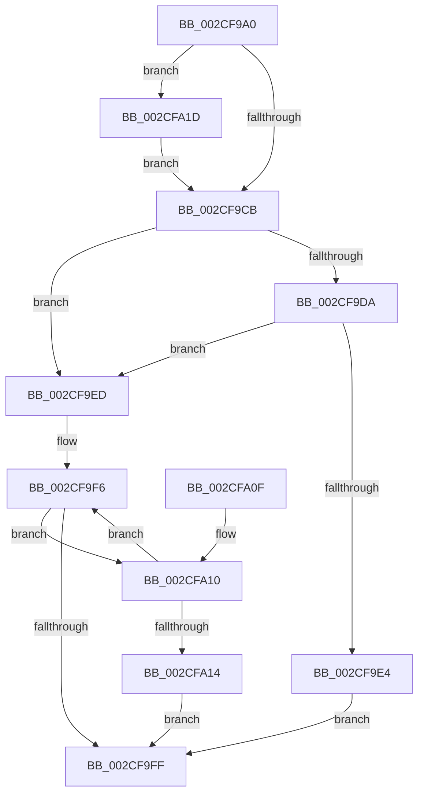

# KiAcquireProcessLockShared

- RVA: `0x002CF9A0`–`0x002CFA26` (길이 `134` bytes)
- VA: `0x00000001402CF9A0`
- 실행 섹션: `.text`
- PDB 이름 있음: `예`; PDB Function 태그: `아니요`
- unwind 정보 RVA: `0x0005C774`
- 디코드: `41`개 명령, `134/134` bytes 표시
- 미해석 바이트: `0` (있으면 어셈블리에 `.byte`로 보존)

> 이 문서는 커널 이미지의 기계어와 PDB 기호를 분석해 생성했습니다. 4번과 5번은 함수 원형과 자료형을 바이너리 사용 방식에서 추정한 C 해석이며 원본 소스 복구 결과는 아닙니다.

## 1. Dependencies

- 직접 호출 지점: **3**; 고유 호출 대상: **3**
- 직접 호출자로 확인된 함수: **4**
- RIP 상대 이미지 참조: **3**

### Outgoing calls
- `0x002CF9E6` → [ExpAcquireSpinLockSharedAtDpcLevelInstrumented](../27/ExpAcquireSpinLockSharedAtDpcLevelInstrumented_function_0027CD20.md) (function, `0x0027CD20`)
- `0x002CFA16` → [ExpWaitForSpinLockSharedAndAcquire](../36/ExpWaitForSpinLockSharedAndAcquire_function_00362380.md) (function, `0x00362380`)
- `0x002CFA1F` → [KiRaiseIrqlProcessIrqlFlags](../4F/KiRaiseIrqlProcessIrqlFlags_function_004F56FC.md) (function, `0x004F56FC`)

### Direct callers
- [KeQueryPrimaryGroupProcess](KeQueryPrimaryGroupProcess_function_002CF958.md) at `0x002CF972`
- [KeSetSelectedCpuSetsThread](../30/KeSetSelectedCpuSetsThread_function_003033D0.md) at `0x0030343D`
- [KeQueryPrimaryGroupAffinityProcess](../49/KeQueryPrimaryGroupAffinityProcess_function_00490BA4.md) at `0x00490BCA`
- [KeQueryCpuSetsProcess](../4D/KeQueryCpuSetsProcess_function_004DE068.md) at `0x004DE090`

### Static image references
- `0x002CF9C2` → RVA `0x00FC6D20` (`ALMOSTRO`; read)
- `0x002CF9CB` → RVA `0x00FC6B06` (`ALMOSTRO`; read)
- `0x002CF9DA` → RVA `0x00F0DE58` (`.data`; read)

## 2. Other-region calls and transfers

- 다른 실행 섹션으로 향하는 call: **0**
- 별도 외부 분기/꼬리 이동을 확인하지 못했습니다.

## 3. Assembly (complete function range)

```asm
002CF9A0  48 89 5C 24 08                  mov qword ptr [rsp + 8], rbx
002CF9A5  48 89 74 24 10                  mov qword ptr [rsp + 0x10], rsi
002CF9AA  57                              push rdi
002CF9AB  48 83 EC 20                     sub rsp, 0x20
002CF9AF  48 8B FA                        mov rdi, rdx
002CF9B2  48 8B F1                        mov rsi, rcx
002CF9B5  44 0F 20 C3                     mov rbx, cr8
002CF9B9  BA 02 00 00 00                  mov edx, 2
002CF9BE  44 0F 22 C2                     mov cr8, rdx
002CF9C2  83 3D 57 73 CF 00 00            cmp dword ptr [rip + 0xcf7357], 0
002CF9C9  75 52                           jne 0x1402cfa1d
002CF9CB  F6 05 34 71 CF 00 21            test byte ptr [rip + 0xcf7134], 0x21
002CF9D2  48 8D 4E 40                     lea rcx, [rsi + 0x40]
002CF9D6  88 1F                           mov byte ptr [rdi], bl
002CF9D8  74 13                           je 0x1402cf9ed
002CF9DA  8B 05 78 E4 C3 00               mov eax, dword ptr [rip + 0xc3e478]
002CF9E0  85 C0                           test eax, eax
002CF9E2  75 09                           jne 0x1402cf9ed
002CF9E4  B2 FF                           mov dl, 0xff
002CF9E6  E8 35 D3 FA FF                  call 0x14027cd20
002CF9EB  EB 12                           jmp 0x1402cf9ff
002CF9ED  0F 0D 09                        prefetchw byte ptr [rcx]
002CF9F0  8B 01                           mov eax, dword ptr [rcx]
002CF9F2  0F BA F0 1F                     btr eax, 0x1f
002CF9F6  8D 50 01                        lea edx, [rax + 1]
002CF9F9  F0 0F B1 11                     lock cmpxchg dword ptr [rcx], edx
002CF9FD  75 11                           jne 0x1402cfa10
002CF9FF  48 8B 5C 24 30                  mov rbx, qword ptr [rsp + 0x30]
002CFA04  48 8B 74 24 38                  mov rsi, qword ptr [rsp + 0x38]
002CFA09  48 83 C4 20                     add rsp, 0x20
002CFA0D  5F                              pop rdi
002CFA0E  C3                              ret
002CFA0F  CC                              int3
002CFA10  85 C0                           test eax, eax
002CFA12  79 E2                           jns 0x1402cf9f6
002CFA14  B2 FF                           mov dl, 0xff
002CFA16  E8 65 29 09 00                  call 0x140362380
002CFA1B  EB E2                           jmp 0x1402cf9ff
002CFA1D  8A CB                           mov cl, bl
002CFA1F  E8 D8 5C 22 00                  call 0x1404f56fc
002CFA24  EB A5                           jmp 0x1402cf9cb
```

## 4. C-style interpretation (structured pseudocode)

```c
__int64 __fastcall KiAcquireProcessLockShared(__int64 a1, __int64 a2)
{
    __int64 result;
    __int64 v_rsp;
    unsigned __int64 v_stack_p10;
    unsigned __int64 v_stack_p8;

    v_stack_p8 = v_rbx;
    v_stack_p10 = v_rsi;
    v_rsp = (v_rsp) - (32);
    if ((*(unsigned int *)(v_rip + 13595479)) != 0) goto loc_002CFA1D;
loc_002CF9CB:
    *(unsigned __int8 *)(a2) = (unsigned __int8)(v_cr8);
    if (((*(unsigned __int8 *)(v_rip + 13594932)) & (33)) == 0) goto loc_002CF9ED;
    if ((unsigned int)((unsigned int)(*(unsigned int *)(v_rip + 12838008))) != 0) goto loc_002CF9ED;
    result = ExpAcquireSpinLockSharedAtDpcLevelInstrumented(a1 + 64, 255, a3, a4);
    goto loc_002CF9FF;
loc_002CF9ED:
loc_002CF9F6:
    if ((unsigned int)((unsigned int)(*(unsigned int *)(v_rip + 12838008))) != 0) goto loc_002CFA10;
loc_002CF9FF:
    v_rsp = (v_rsp) + (32);
    return (unsigned int)(*(unsigned int *)(a1 + 64));
loc_002CFA10:
    if (!sign_flag) goto loc_002CF9F6;
    result = ExpWaitForSpinLockSharedAndAcquire(a1 + 64, 255, a3, a4);
    goto loc_002CF9FF;
loc_002CFA1D:
    result = KiRaiseIrqlProcessIrqlFlags((unsigned __int8)(v_stack_p8), 255, a3, a4);
    goto loc_002CF9CB;
}
```

## 5. (Beta) C Style

```c
int64_t KiAcquireProcessLockShared(void *Arg1, void *Arg2)
{
    uint8_t *arg1 = (uint8_t *)Arg1;
    uint8_t *arg2 = (uint8_t *)Arg2;

    int64_t result;
    int64_t local_rsp;
    uint64_t v_stack_p10;
    uint64_t v_stack_p8;

    v_stack_p8 = local_rbx;
    v_stack_p10 = local_rsi;
    local_rsp = (local_rsp) - (32);
    if ((*(uint32_t *)(v_rip + 0xCF7357)) != 0) goto loc_002CFA1D;
loc_002CF9CB:
    *(uint8_t *)(arg2) = (uint8_t)(v_cr8);
    if (((*(uint8_t *)(v_rip + 0xCF7134)) & (33)) == 0) goto loc_002CF9ED;
    if ((uint32_t)((uint32_t)(*(uint32_t *)(v_rip + 0xC3E478))) != 0) goto loc_002CF9ED;
    result = ExpAcquireSpinLockSharedAtDpcLevelInstrumented(Arg1 + 64, 255, a3, a4);
    goto loc_002CF9FF;
loc_002CF9ED:
loc_002CF9F6:
    if ((uint32_t)((uint32_t)(*(uint32_t *)(v_rip + 0xC3E478))) != 0) goto loc_002CFA10;
loc_002CF9FF:
    local_rsp = (local_rsp) + (32);
    return (uint32_t)(*(uint32_t *)(arg1 + 0x40));
loc_002CFA10:
    if (!sign_flag) goto loc_002CF9F6;
    result = ExpWaitForSpinLockSharedAndAcquire(Arg1 + 64, 255, a3, a4);
    goto loc_002CF9FF;
loc_002CFA1D:
    result = KiRaiseIrqlProcessIrqlFlags((uint8_t)(v_stack_p8), 255, a3, a4);
    goto loc_002CF9CB;
}
```

### 관측된 메모리 오프셋

구조체 형식이 확인되지 않은 접근은 인자 기준의 오프셋으로만 기록했습니다.

| 기준 인자 | 오프셋 표현 | 폭 (bit) | 접근 |
|---|---:|---:|---|
| `Arg1` | `+ 0x0` | `8` | `R` |
| `Arg1` | `+ 0x0` | `32` | `R` |
| `Arg1` | `+ 0x40` | `64` | `R` |
| `Arg2` | `+ 0x0` | `8` | `W` |

## 6. Execution-region graph

[열기: 2D/3D 그래프와 함수 탐색 컨트롤 패널](../../../control-panel.html?section=text&rva=0x002CF9A0&view=graph)

- 2D 그래프는 위에서 아래로 흐르고, 3D 그래프는 빈 공간을 드래그해 회전합니다. Shift+드래그는 이동, 휠은 확대·축소, 함수 노드 선택은 대상 보고서 이동입니다.

### Static fallback


