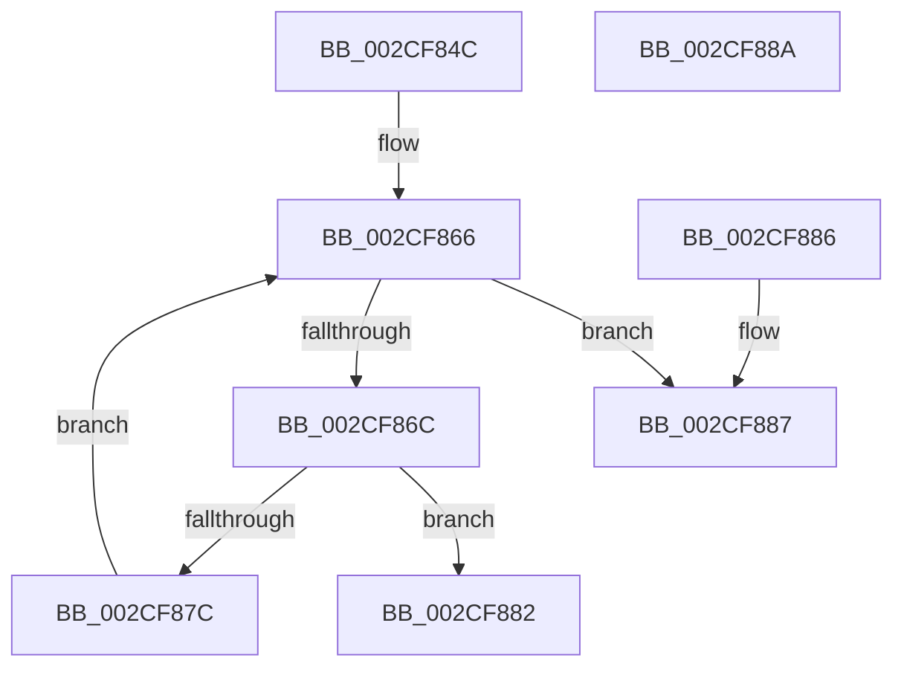

# KiAndAffinityExNoResult

- RVA: `0x002CF84C`–`0x002CF88B` (길이 `63` bytes)
- VA: `0x00000001402CF84C`
- 실행 섹션: `.text`
- PDB 이름 있음: `예`; PDB Function 태그: `아니요`
- unwind 정보 RVA: `0x000DB714`
- 디코드: `21`개 명령, `63/63` bytes 표시
- 미해석 바이트: `0` (있으면 어셈블리에 `.byte`로 보존)

> 이 문서는 커널 이미지의 기계어와 PDB 기호를 분석해 생성했습니다. 4번과 5번은 함수 원형과 자료형을 바이너리 사용 방식에서 추정한 C 해석이며 원본 소스 복구 결과는 아닙니다.

## 1. Dependencies

- 직접 호출 지점: **0**; 고유 호출 대상: **0**
- 직접 호출자로 확인된 함수: **9**
- RIP 상대 이미지 참조: **0**

### Outgoing calls
- 직접 디코드된 call 명령이 없습니다.

### Direct callers
- [KeQueryLogicalProcessorRelationship](KeQueryLogicalProcessorRelationship_function_002CEA60.md) at `0x002CF24C`
- [KiTryPopulateLogicalProcessorInformation](KiTryPopulateLogicalProcessorInformation_function_002CF724.md) at `0x002CF756`
- [sub_002D95FE](../2D/Unknown_function_002D95FE.md) at `0x002D9656`
- [KeAndAffinityEx2](../3C/KeAndAffinityEx2_function_003C0740.md) at `0x003C07F1`
- [PpmParkEvaluateRestriction](../4A/PpmParkEvaluateRestriction_function_004ADE0C.md) at `0x004ADE56`
- [PpmParkBuildTopologyCandidatesEx](../4F/PpmParkBuildTopologyCandidatesEx_function_004F3038.md) at `0x004F3050`
- [KeAndAffinityEx](../4F/KeAndAffinityEx_function_004FC0E0.md) at `0x004FC0E9`
- [KiCpuPartitionCheckAffinitization](../5C/KiCpuPartitionCheckAffinitization_function_005C1420.md) at `0x005C1545`
- [PpmParkComputeUnparkMaskEx](../5E/PpmParkComputeUnparkMaskEx_function_005E05E0.md) at `0x005E13B2`
- [PpmParkComputeUnparkMaskEx](../5E/PpmParkComputeUnparkMaskEx_function_005E05E0.md) at `0x005E13CD`

### Static image references
- 디코드된 RIP-relative 메모리 참조가 없습니다.

## 2. Other-region calls and transfers

- 다른 실행 섹션으로 향하는 call: **0**
- 별도 외부 분기/꼬리 이동을 확인하지 못했습니다.

## 3. Assembly (complete function range)

```asm
002CF84C  44 0F B7 09                     movzx r9d, word ptr [rcx]
002CF850  4C 8B D1                        mov r10, rcx
002CF853  0F B7 02                        movzx eax, word ptr [rdx]
002CF856  66 44 3B C8                     cmp r9w, ax
002CF85A  66 44 0F 43 C8                  cmovae r9w, ax
002CF85F  45 33 C0                        xor r8d, r8d
002CF862  45 8D 58 01                     lea r11d, [r8 + 1]
002CF866  66 45 3B C1                     cmp r8w, r9w
002CF86A  73 1B                           jae 0x1402cf887
002CF86C  41 0F B7 C8                     movzx ecx, r8w
002CF870  49 8B 44 CA 08                  mov rax, qword ptr [r10 + rcx*8 + 8]
002CF875  48 85 44 CA 08                  test qword ptr [rdx + rcx*8 + 8], rax
002CF87A  75 06                           jne 0x1402cf882
002CF87C  66 45 03 C3                     add r8w, r11w
002CF880  EB E4                           jmp 0x1402cf866
002CF882  41 8B C3                        mov eax, r11d
002CF885  C3                              ret
002CF886  CC                              int3
002CF887  33 C0                           xor eax, eax
002CF889  C3                              ret
002CF88A  CC                              int3
```

## 4. C-style interpretation (structured pseudocode)

```c
__int64 __fastcall KiAndAffinityExNoResult(__int64 a1, __int64 a2, int a3)
{
    __int64 result;

    a4 = *(unsigned __int16 *)(a1);
    if (((unsigned __int16)(*(unsigned __int16 *)(a1))) >= ((unsigned __int16)(*(unsigned __int16 *)(a2)))) { a4 = (unsigned __int16)(*(unsigned __int16 *)(a2)); }
    a3 = 0;
loc_002CF866:
    if (0 >= ((unsigned __int16)(a4))) goto loc_002CF887;
    if (((*(unsigned __int64 *)(a2 + 0 * 8 + 8)) & (*(unsigned __int64 *)(a1 + 0 * 8 + 8))) != 0) goto loc_002CF882;
    a3 = (unsigned __int16)((a3) + ((unsigned __int16)(a3 + 1)));
    goto loc_002CF866;
loc_002CF882:
    return (unsigned int)((unsigned int)(a3 + 1));
loc_002CF887:
    result = 0;
    return result;
}
```

## 5. (Beta) C Style

```c
int64_t KiAndAffinityExNoResult(void *Arg1, void *Arg2, int32_t Arg3)
{
    uint8_t *arg1 = (uint8_t *)Arg1;
    uint8_t *arg2 = (uint8_t *)Arg2;

    int64_t result;

    a4 = *(uint16_t *)(arg1);
    if (((uint16_t)(*(uint16_t *)(arg1))) >= ((uint16_t)(*(uint16_t *)(arg2)))) { a4 = (uint16_t)(*(uint16_t *)(arg2)); }
    Arg3 = 0;
loc_002CF866:
    if (0 >= ((uint16_t)(a4))) goto loc_002CF887;
    if (((*(uint64_t *)(arg2 + 0x0 * 8 + 0x8)) & (*(uint64_t *)(arg1 + 0x0 * 8 + 0x8))) != 0) goto loc_002CF882;
    Arg3 = (uint16_t)((Arg3) + ((uint16_t)(Arg3 + 1)));
    goto loc_002CF866;
loc_002CF882:
    return (uint32_t)((uint32_t)(Arg3 + 1));
loc_002CF887:
    result = 0;
    return result;
}
```

### 관측된 메모리 오프셋

구조체 형식이 확인되지 않은 접근은 인자 기준의 오프셋으로만 기록했습니다.

| 기준 인자 | 오프셋 표현 | 폭 (bit) | 접근 |
|---|---:|---:|---|
| `Arg1` | `+ 0x0` | `16` | `R` |
| `Arg1` | `+ 0x8 + rcx*8` | `64` | `R` |
| `Arg2` | `+ 0x0` | `16` | `R` |
| `Arg2` | `+ 0x8 + rcx*8` | `64` | `R` |

## 6. Execution-region graph

[열기: 2D/3D 그래프와 함수 탐색 컨트롤 패널](../../../control-panel.html?section=text&rva=0x002CF84C&view=graph)

- 2D 그래프는 위에서 아래로 흐르고, 3D 그래프는 빈 공간을 드래그해 회전합니다. Shift+드래그는 이동, 휠은 확대·축소, 함수 노드 선택은 대상 보고서 이동입니다.

### Static fallback


