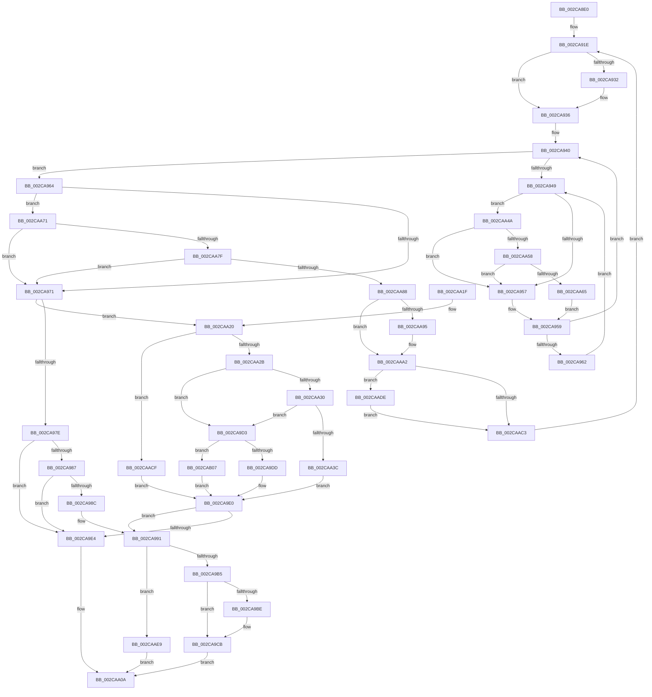

# KiBeginThreadWait

- RVA: `0x002CA8E0`–`0x002CAB15` (길이 `565` bytes)
- VA: `0x00000001402CA8E0`
- 실행 섹션: `.text`
- PDB 이름 있음: `예`; PDB Function 태그: `아니요`
- unwind 정보 RVA: `0x0006F1F4`
- 디코드: `140`개 명령, `565/565` bytes 표시
- 미해석 바이트: `0` (있으면 어셈블리에 `.byte`로 보존)

> 이 문서는 커널 이미지의 기계어와 PDB 기호를 분석해 생성했습니다. 4번과 5번은 함수 원형과 자료형을 바이너리 사용 방식에서 추정한 C 해석이며 원본 소스 복구 결과는 아닙니다.

## 1. Dependencies

- 직접 호출 지점: **8**; 고유 호출 대상: **7**
- 직접 호출자로 확인된 함수: **1**
- RIP 상대 이미지 참조: **3**

### Outgoing calls
- `0x002CA9A4` → [KiPerformWaitDeferredWork](../22/KiPerformWaitDeferredWork_function_00220480.md) (function, `0x00220480`)
- `0x002CA9C6` → [KiLowerIrqlProcessIrqlFlags](../4F/KiLowerIrqlProcessIrqlFlags_function_004F5698.md) (function, `0x004F5698`)
- `0x002CAA58` → [KiCheckVpBackingLongSpinWaitHypercall](../30/KiCheckVpBackingLongSpinWaitHypercall_function_0030F490.md) (function, `0x0030F490`)
- `0x002CAA67` → [HvlNotifyLongSpinWait](../30/HvlNotifyLongSpinWait_function_0030F460.md) (function, `0x0030F460`)
- `0x002CAA9D` → [KiLowerIrqlProcessIrqlFlags](../4F/KiLowerIrqlProcessIrqlFlags_function_004F5698.md) (function, `0x004F5698`)
- `0x002CAAAD` → [KiDeliverApc](../25/KiDeliverApc_function_00250F20.md) (function, `0x00250F20`)
- `0x002CAAE2` → [KiRaiseIrqlProcessIrqlFlags](../4F/KiRaiseIrqlProcessIrqlFlags_function_004F56FC.md) (function, `0x004F56FC`)
- `0x002CAAFB` → [KiProcessDeferredReadyList](../25/KiProcessDeferredReadyList_function_00250800.md) (function, `0x00250800`)

### Direct callers
- [KeWaitForGate](KeWaitForGate_function_002CA794.md) at `0x002CA7FA`

### Static image references
- `0x002CA94B` → RVA `0x00FC52AC` (`ALMOSTRO`; reference)
- `0x002CA9B5` → RVA `0x00FC6D20` (`ALMOSTRO`; read)
- `0x002CAA4A` → RVA `0x00FC6AB8` (`ALMOSTRO`; read)

## 2. Other-region calls and transfers

- 다른 실행 섹션으로 향하는 call: **0**
- 별도 외부 분기/꼬리 이동을 확인하지 못했습니다.

## 3. Assembly (complete function range)

```asm
002CA8E0  48 89 5C 24 10                  mov qword ptr [rsp + 0x10], rbx
002CA8E5  44 89 44 24 18                  mov dword ptr [rsp + 0x18], r8d
002CA8EA  55                              push rbp
002CA8EB  56                              push rsi
002CA8EC  57                              push rdi
002CA8ED  41 54                           push r12
002CA8EF  41 55                           push r13
002CA8F1  41 56                           push r14
002CA8F3  41 57                           push r15
002CA8F5  48 83 EC 20                     sub rsp, 0x20
002CA8F9  44 0F B6 B9 86 01 00 00         movzx r15d, byte ptr [rcx + 0x186]
002CA901  45 33 E4                        xor r12d, r12d
002CA904  45 0F B6 F1                     movzx r14d, r9b
002CA908  48 0F BE F2                     movsx rsi, dl
002CA90C  48 8B D9                        mov rbx, rcx
002CA90F  4C 89 64 24 60                  mov qword ptr [rsp + 0x60], r12
002CA914  41 8D 6C 24 02                  lea ebp, [r12 + 2]
002CA919  45 8D 6C 24 01                  lea r13d, [r12 + 1]
002CA91E  83 63 74 EF                     and dword ptr [rbx + 0x74], 0xffffffef
002CA922  44 88 63 70                     mov byte ptr [rbx + 0x70], r12b
002CA926  40 88 B3 87 01 00 00            mov byte ptr [rbx + 0x187], sil
002CA92D  45 84 F6                        test r14b, r14b
002CA930  74 04                           je 0x1402ca936
002CA932  83 4B 74 10                     or dword ptr [rbx + 0x74], 0x10
002CA936  41 8B FC                        mov edi, r12d
002CA939  0F 1F 80 00 00 00 00            nop dword ptr [rax]
002CA940  F0 48 0F BA 6B 40 00            lock bts qword ptr [rbx + 0x40], 0
002CA947  73 1B                           jae 0x1402ca964
002CA949  FF C7                           inc edi
002CA94B  85 3D 5B A9 CF 00               test dword ptr [rip + 0xcfa95b], edi
002CA951  0F 84 F3 00 00 00               je 0x1402caa4a
002CA957  F3 90                           pause
002CA959  48 8B 43 40                     mov rax, qword ptr [rbx + 0x40]
002CA95D  48 85 C0                        test rax, rax
002CA960  74 DE                           je 0x1402ca940
002CA962  EB E5                           jmp 0x1402ca949
002CA964  44 38 A3 C1 00 00 00            cmp byte ptr [rbx + 0xc1], r12b
002CA96B  0F 85 00 01 00 00               jne 0x1402caa71
002CA971  8B 6C 24 70                     mov ebp, dword ptr [rsp + 0x70]
002CA975  45 84 F6                        test r14b, r14b
002CA978  0F 85 A2 00 00 00               jne 0x1402caa20
002CA97E  F6 83 C2 00 00 00 02            test byte ptr [rbx + 0xc2], 2
002CA985  74 5D                           je 0x1402ca9e4
002CA987  40 84 F6                        test sil, sil
002CA98A  74 58                           je 0x1402ca9e4
002CA98C  BF C0 00 00 00                  mov edi, 0xc0
002CA991  8B 94 24 80 00 00 00            mov edx, dword ptr [rsp + 0x80]
002CA998  4C 8D 4C 24 60                  lea r9, [rsp + 0x60]
002CA99D  45 0F B6 C5                     movzx r8d, r13b
002CA9A1  48 8B CB                        mov rcx, rbx
002CA9A4  E8 D7 5A F5 FF                  call 0x140220480
002CA9A9  4C 89 63 40                     mov qword ptr [rbx + 0x40], r12
002CA9AD  85 C0                           test eax, eax
002CA9AF  0F 85 34 01 00 00               jne 0x1402caae9
002CA9B5  44 39 25 64 C3 CF 00            cmp dword ptr [rip + 0xcfc364], r12d
002CA9BC  74 0D                           je 0x1402ca9cb
002CA9BE  44 0F 20 C1                     mov rcx, cr8
002CA9C2  41 0F B6 D7                     movzx edx, r15b
002CA9C6  E8 CD AC 22 00                  call 0x1404f5698
002CA9CB  45 0F 22 C7                     mov cr8, r15
002CA9CF  8B C7                           mov eax, edi
002CA9D1  EB 37                           jmp 0x1402caa0a
002CA9D3  44 38 63 72                     cmp byte ptr [rbx + 0x72], r12b
002CA9D7  0F 85 2A 01 00 00               jne 0x1402cab07
002CA9DD  41 8B FC                        mov edi, r12d
002CA9E0  85 FF                           test edi, edi
002CA9E2  75 AD                           jne 0x1402ca991
002CA9E4  C6 83 84 01 00 00 05            mov byte ptr [rbx + 0x184], 5
002CA9EB  48 B8 20 03 00 00 80 F7 FF FF   movabs rax, 0xfffff78000000320
002CA9F5  40 88 AB 83 02 00 00            mov byte ptr [rbx + 0x283], bpl
002CA9FC  8B 00                           mov eax, dword ptr [rax]
002CA9FE  89 83 B4 01 00 00               mov dword ptr [rbx + 0x1b4], eax
002CAA04  33 C0                           xor eax, eax
002CAA06  4C 89 63 40                     mov qword ptr [rbx + 0x40], r12
002CAA0A  48 8B 5C 24 68                  mov rbx, qword ptr [rsp + 0x68]
002CAA0F  48 83 C4 20                     add rsp, 0x20
002CAA13  41 5F                           pop r15
002CAA15  41 5E                           pop r14
002CAA17  41 5D                           pop r13
002CAA19  41 5C                           pop r12
002CAA1B  5F                              pop rdi
002CAA1C  5E                              pop rsi
002CAA1D  5D                              pop rbp
002CAA1E  C3                              ret
002CAA1F  CC                              int3
002CAA20  44 38 64 1E 72                  cmp byte ptr [rsi + rbx + 0x72], r12b
002CAA25  0F 85 A4 00 00 00               jne 0x1402caacf
002CAA2B  40 84 F6                        test sil, sil
002CAA2E  74 A3                           je 0x1402ca9d3
002CAA30  48 8D 83 A8 00 00 00            lea rax, [rbx + 0xa8]
002CAA37  48 39 00                        cmp qword ptr [rax], rax
002CAA3A  74 97                           je 0x1402ca9d3
002CAA3C  80 8B C2 00 00 00 02            or byte ptr [rbx + 0xc2], 2
002CAA43  BF C0 00 00 00                  mov edi, 0xc0
002CAA48  EB 96                           jmp 0x1402ca9e0
002CAA4A  8B 05 68 C0 CF 00               mov eax, dword ptr [rip + 0xcfc068]
002CAA50  A8 40                           test al, 0x40
002CAA52  0F 84 FF FE FF FF               je 0x1402ca957
002CAA58  E8 33 4A 04 00                  call 0x14030f490
002CAA5D  84 C0                           test al, al
002CAA5F  0F 84 F2 FE FF FF               je 0x1402ca957
002CAA65  8B CF                           mov ecx, edi
002CAA67  E8 F4 49 04 00                  call 0x14030f460
002CAA6C  E9 E8 FE FF FF                  jmp 0x1402ca959
002CAA71  66 44 39 A3 E6 01 00 00         cmp word ptr [rbx + 0x1e6], r12w
002CAA79  0F 85 F2 FE FF FF               jne 0x1402ca971
002CAA7F  45 3A FD                        cmp r15b, r13b
002CAA82  0F 83 E9 FE FF FF               jae 0x1402ca971
002CAA88  4C 89 63 40                     mov qword ptr [rbx + 0x40], r12
002CAA8C  44 39 25 8D C2 CF 00            cmp dword ptr [rip + 0xcfc28d], r12d
002CAA93  74 0D                           je 0x1402caaa2
002CAA95  44 0F 20 C1                     mov rcx, cr8
002CAA99  41 0F B6 D5                     movzx edx, r13b
002CAA9D  E8 F6 AB 22 00                  call 0x1404f5698
002CAAA2  45 0F 22 C5                     mov cr8, r13
002CAAA6  45 33 C0                        xor r8d, r8d
002CAAA9  33 D2                           xor edx, edx
002CAAAB  33 C9                           xor ecx, ecx
002CAAAD  E8 6E 64 F8 FF                  call 0x140250f20
002CAAB2  44 0F 20 C1                     mov rcx, cr8
002CAAB6  44 0F 22 C5                     mov cr8, rbp
002CAABA  44 39 25 5F C2 CF 00            cmp dword ptr [rip + 0xcfc25f], r12d
002CAAC1  75 1B                           jne 0x1402caade
002CAAC3  44 88 BB 86 01 00 00            mov byte ptr [rbx + 0x186], r15b
002CAACA  E9 4F FE FF FF                  jmp 0x1402ca91e
002CAACF  44 88 64 1E 72                  mov byte ptr [rsi + rbx + 0x72], r12b
002CAAD4  BF 01 01 00 00                  mov edi, 0x101
002CAAD9  E9 02 FF FF FF                  jmp 0x1402ca9e0
002CAADE  40 0F B6 D5                     movzx edx, bpl
002CAAE2  E8 15 AC 22 00                  call 0x1404f56fc
002CAAE7  EB DA                           jmp 0x1402caac3
002CAAE9  65 48 8B 0C 25 20 00 00 00      mov rcx, qword ptr gs:[0x20]
002CAAF2  48 8D 54 24 60                  lea rdx, [rsp + 0x60]
002CAAF7  45 0F B6 C7                     movzx r8d, r15b
002CAAFB  E8 00 5D F8 FF                  call 0x140250800
002CAB00  8B C7                           mov eax, edi
002CAB02  E9 03 FF FF FF                  jmp 0x1402caa0a
002CAB07  44 88 63 72                     mov byte ptr [rbx + 0x72], r12b
002CAB0B  BF 01 01 00 00                  mov edi, 0x101
002CAB10  E9 CB FE FF FF                  jmp 0x1402ca9e0
```

## 4. C-style interpretation (structured pseudocode)

```c
__int64 __fastcall KiBeginThreadWait(__int64 a1, unsigned __int8 a2, int a3, unsigned __int8 a4, unsigned int a5)
{
    __int64 result;
    __int64 v_r12;
    __int64 v_rdi;
    __int64 v_rsp;
    unsigned __int64 v_stack_p10;
    unsigned int v_stack_p18;
    unsigned __int64 v_stack_p60;
    unsigned __int64 v_stack_p8;

    v_stack_p10 = v_rbx;
    v_stack_p18 = a3;
    v_rsp = (v_rsp) - (32);
    v_r12 = 0;
    v_stack_p8 = 0;
loc_002CA91E:
    *(unsigned __int8 *)(a1 + 112) = 0;
    *(unsigned __int8 *)(a1 + 391) = (unsigned __int8)((__int8)(a2));
    if (a4 != 0) {
    }
loc_002CA940:
    if (condition_is_above_or_equal) goto loc_002CA964;
loc_002CA949:
    v_rdi = (unsigned int)((0) + 1);
    if (((*(unsigned int *)(v_rip + 13609307)) & ((unsigned int)(v_rdi))) == 0) goto loc_002CAA4A;
loc_002CA957:
loc_002CA959:
    if (*(unsigned __int64 *)(a1 + 64) == 0) goto loc_002CA940;
    goto loc_002CA949;
loc_002CA964:
    if ((*(unsigned __int8 *)(a1 + 193)) != 0) goto loc_002CAA71;
loc_002CA971:
    if (a4 != 0) goto loc_002CAA20;
    if (((*(unsigned __int8 *)(a1 + 194)) & (2)) == 0) goto loc_002CA9E4;
    if ((unsigned __int8)((__int8)(a2)) == 0) goto loc_002CA9E4;
loc_002CA991:
    result = KiPerformWaitDeferredWork(a1, (unsigned int)(a5), (unsigned __int8)(v_r12 + 1), v_stack_p8);
    *(unsigned __int64 *)(a1 + 64) = 0;
    if ((unsigned int)(result) != 0) goto loc_002CAAE9;
    if ((*(unsigned int *)(v_rip + 13615972)) != 0) {
        a1 = v_cr8;
        a2 = (unsigned __int8)(*(unsigned __int8 *)(a1 + 390));
        result = KiLowerIrqlProcessIrqlFlags(a1, a2, (unsigned __int8)(v_r12 + 1), v_stack_p8);
    }
    goto loc_002CAA0A;
loc_002CA9D3:
    if ((*(unsigned __int8 *)(a1 + 114)) != 0) goto loc_002CAB07;
loc_002CA9E0:
    if (0 != 0) goto loc_002CA991;
loc_002CA9E4:
    *(unsigned __int8 *)(a1 + 388) = 5;
    *(unsigned __int8 *)(a1 + 643) = (unsigned __int8)((unsigned int)(v_stack_p18));
    *(unsigned int *)(a1 + 436) = (unsigned int)((unsigned int)(*(unsigned int *)(192)));
    result = 0;
    *(unsigned __int64 *)(a1 + 64) = 0;
loc_002CAA0A:
    v_rsp = (v_rsp) + (32);
    return result;
loc_002CAA20:
    if ((*(unsigned __int8 *)((__int8)(a2) + v_stack_p10 * 1 + 114)) != 0) goto loc_002CAACF;
    if ((unsigned __int8)((__int8)(a2)) == 0) goto loc_002CA9D3;
    if ((*(unsigned __int64 *)(v_stack_p10 + 168)) == (v_stack_p10 + 168)) goto loc_002CA9D3;
    goto loc_002CA9E0;
loc_002CAA4A:
    if ((((unsigned __int8)((unsigned int)(*(unsigned int *)(v_rip + 13615208)))) & (64)) == 0) goto loc_002CA957;
    result = KiCheckVpBackingLongSpinWaitHypercall(a1, a2, (unsigned __int8)(v_r12 + 1), v_stack_p8);
    if ((unsigned __int8)(result) == 0) goto loc_002CA957;
    result = HvlNotifyLongSpinWait(192, a2, (unsigned __int8)(v_r12 + 1), v_stack_p8);
    goto loc_002CA959;
loc_002CAA71:
    if ((*(unsigned __int16 *)(v_stack_p10 + 486)) != 0) goto loc_002CA971;
    if (((unsigned __int8)(*(unsigned __int8 *)(a1 + 390))) >= ((unsigned __int8)(v_r12 + 1))) goto loc_002CA971;
    *(unsigned __int64 *)(v_stack_p10 + 64) = 0;
    if ((*(unsigned int *)(v_rip + 13615757)) != 0) {
        a1 = *(unsigned __int8 *)(a1 + 390);
        a2 = (unsigned __int8)(v_r12 + 1);
        result = KiLowerIrqlProcessIrqlFlags(a1, a2, (unsigned __int8)(v_r12 + 1), v_stack_p8);
    }
    a3 = 0;
    a2 = 0;
    a1 = 0;
    result = KiDeliverApc(a1, a2, a3, v_stack_p8);
    if ((*(unsigned int *)(v_rip + 13615711)) != 0) goto loc_002CAADE;
loc_002CAAC3:
    *(unsigned __int8 *)(v_stack_p10 + 390) = (unsigned __int8)(*(unsigned __int8 *)(a1 + 390));
    goto loc_002CA91E;
loc_002CAACF:
    *(unsigned __int8 *)((__int8)(a2) + v_stack_p10 * 1 + 114) = 0;
    goto loc_002CA9E0;
loc_002CAADE:
    result = KiRaiseIrqlProcessIrqlFlags(v_r12 + 1, (unsigned __int8)((unsigned int)(v_stack_p18)), a3, v_stack_p8);
    goto loc_002CAAC3;
loc_002CAAE9:
    result = KiProcessDeferredReadyList(*(unsigned __int64 *)(gs_base + (0 + 32)), v_stack_p60, (unsigned __int8)(*(unsigned __int8 *)(a1 + 390)), v_stack_p8);
    goto loc_002CAA0A;
loc_002CAB07:
    *(unsigned __int8 *)(v_stack_p10 + 114) = 0;
    goto loc_002CA9E0;
}
```

## 5. (Beta) C Style

```c
int64_t KiBeginThreadWait(void *Arg1, void *Arg2, int32_t Arg3, uint8_t Arg4, uint32_t Arg5)
{
    uint8_t *arg1 = (uint8_t *)Arg1;
    uint8_t *arg2 = (uint8_t *)Arg2;

    int64_t result;
    int64_t local_r12;
    int64_t local_rdi;
    int64_t local_rsp;
    uint64_t v_stack_p10;
    uint32_t v_stack_p18;
    uint64_t v_stack_p60;
    uint64_t v_stack_p8;

    v_stack_p10 = local_rbx;
    v_stack_p18 = Arg3;
    local_rsp = (local_rsp) - (32);
    local_r12 = 0;
    v_stack_p8 = 0;
loc_002CA91E:
    *(uint8_t *)(arg1 + 0x70) = 0;
    *(uint8_t *)(arg1 + 0x187) = (uint8_t)((int8_t)(Arg2));
    if (Arg4 != 0) {
    }
loc_002CA940:
    if (condition_is_above_or_equal) goto loc_002CA964;
loc_002CA949:
    local_rdi = (uint32_t)((0) + 1);
    if (((*(uint32_t *)(v_rip + 0xCFA95B)) & ((uint32_t)(local_rdi))) == 0) goto loc_002CAA4A;
loc_002CA957:
loc_002CA959:
    if (*(uint64_t *)(arg1 + 0x40) == 0) goto loc_002CA940;
    goto loc_002CA949;
loc_002CA964:
    if ((*(uint8_t *)(arg1 + 0xC1)) != 0) goto loc_002CAA71;
loc_002CA971:
    if (Arg4 != 0) goto loc_002CAA20;
    if (((*(uint8_t *)(arg1 + 0xC2)) & (2)) == 0) goto loc_002CA9E4;
    if ((uint8_t)((int8_t)(Arg2)) == 0) goto loc_002CA9E4;
loc_002CA991:
    result = KiPerformWaitDeferredWork(Arg1, (uint32_t)(Arg5), (uint8_t)(local_r12 + 1), v_stack_p8);
    *(uint64_t *)(arg1 + 0x40) = 0;
    if ((uint32_t)(result) != 0) goto loc_002CAAE9;
    if ((*(uint32_t *)(v_rip + 0xCFC364)) != 0) {
        Arg1 = v_cr8;
        Arg2 = (uint8_t)(*(uint8_t *)(arg1 + 0x186));
        result = KiLowerIrqlProcessIrqlFlags(Arg1, Arg2, (uint8_t)(local_r12 + 1), v_stack_p8);
    }
    goto loc_002CAA0A;
loc_002CA9D3:
    if ((*(uint8_t *)(arg1 + 0x72)) != 0) goto loc_002CAB07;
loc_002CA9E0:
    if (0 != 0) goto loc_002CA991;
loc_002CA9E4:
    *(uint8_t *)(arg1 + 0x184) = 5;
    *(uint8_t *)(arg1 + 0x283) = (uint8_t)((uint32_t)(v_stack_p18));
    *(uint32_t *)(arg1 + 0x1B4) = (uint32_t)((uint32_t)(*(uint32_t *)(192)));
    result = 0;
    *(uint64_t *)(arg1 + 0x40) = 0;
loc_002CAA0A:
    local_rsp = (local_rsp) + (32);
    return result;
loc_002CAA20:
    if ((*(uint8_t *)((int8_t)(arg2) + v_stack_p10 * 1 + 0x72)) != 0) goto loc_002CAACF;
    if ((uint8_t)((int8_t)(Arg2)) == 0) goto loc_002CA9D3;
    if ((*(uint64_t *)(v_stack_p10 + 0xA8)) == (v_stack_p10 + 168)) goto loc_002CA9D3;
    goto loc_002CA9E0;
loc_002CAA4A:
    if ((((uint8_t)((uint32_t)(*(uint32_t *)(v_rip + 0xCFC068)))) & (64)) == 0) goto loc_002CA957;
    result = KiCheckVpBackingLongSpinWaitHypercall(Arg1, Arg2, (uint8_t)(local_r12 + 1), v_stack_p8);
    if ((uint8_t)(result) == 0) goto loc_002CA957;
    result = HvlNotifyLongSpinWait(192, Arg2, (uint8_t)(local_r12 + 1), v_stack_p8);
    goto loc_002CA959;
loc_002CAA71:
    if ((*(uint16_t *)(v_stack_p10 + 0x1E6)) != 0) goto loc_002CA971;
    if (((uint8_t)(*(uint8_t *)(arg1 + 0x186))) >= ((uint8_t)(local_r12 + 1))) goto loc_002CA971;
    *(uint64_t *)(v_stack_p10 + 0x40) = 0;
    if ((*(uint32_t *)(v_rip + 0xCFC28D)) != 0) {
        Arg1 = *(uint8_t *)(arg1 + 0x186);
        Arg2 = (uint8_t)(local_r12 + 1);
        result = KiLowerIrqlProcessIrqlFlags(Arg1, Arg2, (uint8_t)(local_r12 + 1), v_stack_p8);
    }
    Arg3 = 0;
    Arg2 = 0;
    Arg1 = 0;
    result = KiDeliverApc(Arg1, Arg2, Arg3, v_stack_p8);
    if ((*(uint32_t *)(v_rip + 0xCFC25F)) != 0) goto loc_002CAADE;
loc_002CAAC3:
    *(uint8_t *)(v_stack_p10 + 0x186) = (uint8_t)(*(uint8_t *)(arg1 + 0x186));
    goto loc_002CA91E;
loc_002CAACF:
    *(uint8_t *)((int8_t)(arg2) + v_stack_p10 * 1 + 0x72) = 0;
    goto loc_002CA9E0;
loc_002CAADE:
    result = KiRaiseIrqlProcessIrqlFlags(local_r12 + 1, (uint8_t)((uint32_t)(v_stack_p18)), Arg3, v_stack_p8);
    goto loc_002CAAC3;
loc_002CAAE9:
    result = KiProcessDeferredReadyList(*(uint64_t *)(gs_base + (0 + 0x20)), v_stack_p60, (uint8_t)(*(uint8_t *)(arg1 + 0x186)), v_stack_p8);
    goto loc_002CAA0A;
loc_002CAB07:
    *(uint8_t *)(v_stack_p10 + 0x72) = 0;
    goto loc_002CA9E0;
}
```

### 관측된 메모리 오프셋

구조체 형식이 확인되지 않은 접근은 인자 기준의 오프셋으로만 기록했습니다.

| 기준 인자 | 오프셋 표현 | 폭 (bit) | 접근 |
|---|---:|---:|---|
| `Arg1` | `+ 0x0` | `64` | `R` |
| `Arg1` | `+ 0x40` | `64` | `R` |
| `Arg1` | `+ 0x40` | `64` | `R/W` |
| `Arg1` | `+ 0x40` | `64` | `W` |
| `Arg1` | `+ 0x70` | `8` | `W` |
| `Arg1` | `+ 0x72` | `8` | `R` |
| `Arg1` | `+ 0x72` | `8` | `W` |
| `Arg1` | `+ 0x74` | `32` | `R/W` |
| `Arg1` | `+ 0xA8` | `64` | `R` |
| `Arg1` | `+ 0xC1` | `8` | `R` |
| `Arg1` | `+ 0xC2` | `8` | `R` |
| `Arg1` | `+ 0xC2` | `8` | `R/W` |
| `Arg1` | `+ 0x184` | `8` | `W` |
| `Arg1` | `+ 0x186` | `8` | `R` |
| `Arg1` | `+ 0x186` | `8` | `W` |
| `Arg1` | `+ 0x187` | `8` | `W` |
| `Arg1` | `+ 0x1B4` | `32` | `W` |
| `Arg1` | `+ 0x1E6` | `16` | `R` |
| `Arg1` | `+ 0x283` | `8` | `W` |
| `Arg2` | `+ 0x72 + rbx*1` | `8` | `R` |
| `Arg2` | `+ 0x72 + rbx*1` | `8` | `W` |

## 6. Execution-region graph

[열기: 2D/3D 그래프와 함수 탐색 컨트롤 패널](../../../control-panel.html?section=text&rva=0x002CA8E0&view=graph)

- 2D 그래프는 위에서 아래로 흐르고, 3D 그래프는 빈 공간을 드래그해 회전합니다. Shift+드래그는 이동, 휠은 확대·축소, 함수 노드 선택은 대상 보고서 이동입니다.

### Static fallback


