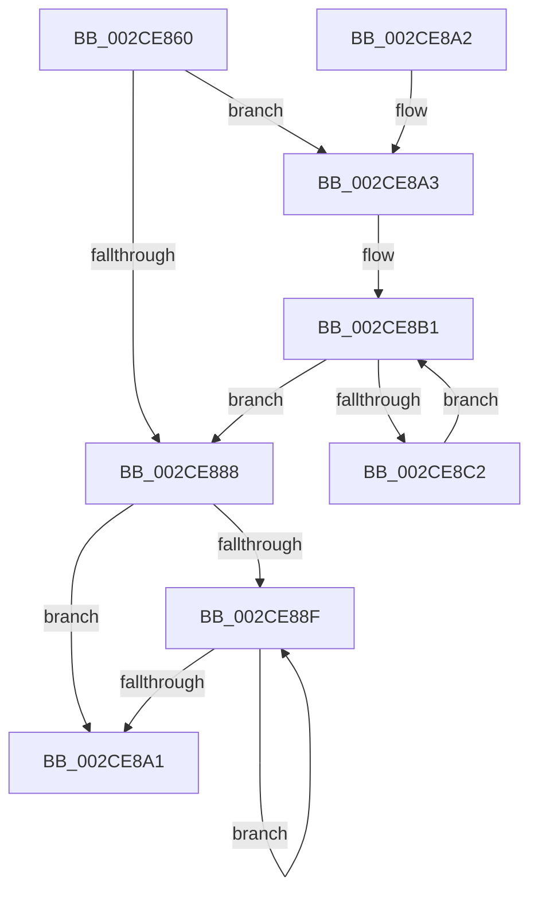

# KiCopyAffinityEx

- RVA: `0x002CE860`–`0x002CE8C4` (길이 `100` bytes)
- VA: `0x00000001402CE860`
- 실행 섹션: `.text`
- PDB 이름 있음: `예`; PDB Function 태그: `아니요`
- unwind 정보 RVA: `0x000DB714`
- 디코드: `30`개 명령, `100/100` bytes 표시
- 미해석 바이트: `0` (있으면 어셈블리에 `.byte`로 보존)

> 이 문서는 커널 이미지의 기계어와 PDB 기호를 분석해 생성했습니다. 4번과 5번은 함수 원형과 자료형을 바이너리 사용 방식에서 추정한 C 해석이며 원본 소스 복구 결과는 아닙니다.

## 1. Dependencies

- 직접 호출 지점: **0**; 고유 호출 대상: **0**
- 직접 호출자로 확인된 함수: **68**
- RIP 상대 이미지 참조: **0**

### Outgoing calls
- 직접 디코드된 call 명령이 없습니다.

### Direct callers
- [KiSetProcessConcurrencyCount](../24/KiSetProcessConcurrencyCount_function_00249F2C.md) at `0x0024A06B`
- [KiChooseTargetProcessor](../25/KiChooseTargetProcessor_function_002556D8.md) at `0x002558B4`
- [KeSetUserGroupAffinityThread](KeSetUserGroupAffinityThread_function_002CD1C4.md) at `0x002CD252`
- [KiSetAffinityThread](KiSetAffinityThread_function_002CE010.md) at `0x002CE0B6`
- [KiSetAffinityThread](KiSetAffinityThread_function_002CE010.md) at `0x002CE14A`
- [KeFlushProcessWriteBuffers](KeFlushProcessWriteBuffers_function_002CE4FC.md) at `0x002CE583`
- [KeQueryAffinityProcess](KeQueryAffinityProcess_function_002CE710.md) at `0x002CE760`
- [KeQueryLogicalProcessorRelationship](KeQueryLogicalProcessorRelationship_function_002CEA60.md) at `0x002CEEF1`
- [KeQueryLogicalProcessorRelationship](KeQueryLogicalProcessorRelationship_function_002CEA60.md) at `0x002CF17E`
- [KeQueryLogicalProcessorRelationship](KeQueryLogicalProcessorRelationship_function_002CEA60.md) at `0x002CF23F`
- [KeQuerySystemAllowedCpuSetAffinity](../2D/KeQuerySystemAllowedCpuSetAffinity_function_002D85F4.md) at `0x002D867E`
- [KeChangeMemoryAttributes](../30/KeChangeMemoryAttributes_function_00304D08.md) at `0x00304D7D`
- [PpmParkReportMask](../30/PpmParkReportMask_function_00305190.md) at `0x003051D1`
- [KxFlushEntireTb](../30/KxFlushEntireTb_function_00309094.md) at `0x0030920A`
- [KxFlushNonGlobalTb](../31/KxFlushNonGlobalTb_function_00314E50.md) at `0x00314EDD`
- [KiComputeThreadAffinity](../39/KiComputeThreadAffinity_function_00399DE0.md) at `0x0039A04E`
- [KiComputeCpuSetAffinity](../39/KiComputeCpuSetAffinity_function_0039A1C0.md) at `0x0039A63B`
- [KiComputeCpuSetAffinity](../39/KiComputeCpuSetAffinity_function_0039A1C0.md) at `0x0039A695`
- [KiComputeCpuSetAffinity](../39/KiComputeCpuSetAffinity_function_0039A1C0.md) at `0x0039A7FA`
- [KiComputeCpuSetAffinity](../39/KiComputeCpuSetAffinity_function_0039A1C0.md) at `0x0039A810`
- [KiComputeCpuSetAffinity](../39/KiComputeCpuSetAffinity_function_0039A1C0.md) at `0x0039A839`
- [KiForwardTick](../39/KiForwardTick_function_0039D40C.md) at `0x0039D4C7`
- [PpmHeteroUpdateHgsConfiguration](../3B/PpmHeteroUpdateHgsConfiguration_function_003BF344.md) at `0x003BFA79`
- [KeSetAffinityProcess](../3C/KeSetAffinityProcess_function_003C0A60.md) at `0x003C0B80`
- [KeStartThread](../3C/KeStartThread_function_003C21B8.md) at `0x003C22A4`
- [KeStartThread](../3C/KeStartThread_function_003C21B8.md) at `0x003C22EC`
- [KeStartThread](../3C/KeStartThread_function_003C21B8.md) at `0x003C22FF`
- [KeQueryUserAffinityThread](../49/KeQueryUserAffinityThread_function_00496234.md) at `0x00496294`
- [KeSynchronizeAddressPolicy](../49/KeSynchronizeAddressPolicy_function_00498358.md) at `0x00498425`
- [KeGetTopologySiblingAffinityForProcessor](../4A/KeGetTopologySiblingAffinityForProcessor_function_004A946C.md) at `0x004A9491`
- [KeSynchronizeSecurityDomain](../4B/KeSynchronizeSecurityDomain_function_004B0FE0.md) at `0x004B1078`
- [KeRevertToUserMultipleGroupAffinityThread](../4D/KeRevertToUserMultipleGroupAffinityThread_function_004D8A90.md) at `0x004D8C02`
- [KeRevertToUserMultipleGroupAffinityThread](../4D/KeRevertToUserMultipleGroupAffinityThread_function_004D8A90.md) at `0x004D8C25`
- [KeFreezeExecution](../4D/KeFreezeExecution_function_004DFA40.md) at `0x004DFC28`
- [PpmHeteroRestrictToFavoredClassEx](../4E/PpmHeteroRestrictToFavoredClassEx_function_004EF940.md) at `0x004EFBC3`
- [PpmParkBuildTopologyCandidatesEx](../4F/PpmParkBuildTopologyCandidatesEx_function_004F3038.md) at `0x004F3063`
- [KiQueryCpuPartitionAffinity](../4F/KiQueryCpuPartitionAffinity_function_004F548C.md) at `0x004F54D9`
- [HalpNmiReboot](../55/HalpNmiReboot_function_0055B2D4.md) at `0x0055B373`
- [EmonAddProfileSource](../55/EmonAddProfileSource_function_0055BEA0.md) at `0x0055BFE2`
- [Amd64AddProfileSource](../56/Amd64AddProfileSource_function_0056B720.md) at `0x0056B85D`
- [KeBugCheck2](../5B/KeBugCheck2_function_005B27D0.md) at `0x005B34FC`
- [KeUpdateProcessorRestrictionsEx](../5B/KeUpdateProcessorRestrictionsEx_function_005B64E8.md) at `0x005B66F6`
- [KeUpdateProcessorRestrictionsEx](../5B/KeUpdateProcessorRestrictionsEx_function_005B64E8.md) at `0x005B673F`
- [KeUpdateProcessorRestrictionsEx](../5B/KeUpdateProcessorRestrictionsEx_function_005B64E8.md) at `0x005B681C`
- [KiStartPrcbThread](../5B/KiStartPrcbThread_function_005B941C.md) at `0x005B9506`
- [KeCopyAffinityEx](../5B/KeCopyAffinityEx_function_005B95E0.md) at `0x005B95EC`
- [KeQueryProcessAvailableCpus](../5B/KeQueryProcessAvailableCpus_function_005B96FC.md) at `0x005B9778`
- [KeQuerySystemAvailableCpus](../5B/KeQuerySystemAvailableCpus_function_005B97BC.md) at `0x005B981A`
- [KeQueryActiveProcessorAffinity](../5B/KeQueryActiveProcessorAffinity_function_005BBD80.md) at `0x005BBDB2`
- [KeQueryCpuPartitionAffinity](../5C/KeQueryCpuPartitionAffinity_function_005C0EF8.md) at `0x005C0F86`
- [KiCpuPartitionCheckAffinitization](../5C/KiCpuPartitionCheckAffinitization_function_005C1420.md) at `0x005C1531`
- [KeGetAffinitizedInterruptsInfo](../5C/KeGetAffinitizedInterruptsInfo_function_005C5634.md) at `0x005C5648`
- [KiBugCheckRecoveryFreezeOtherProcessors](../5C/KiBugCheckRecoveryFreezeOtherProcessors_function_005C7120.md) at `0x005C71E1`
- [KxFlushSingleTb](../5C/KxFlushSingleTb_function_005CAE18.md) at `0x005CAEBF`
- [PoInitiateProcessorWake](../5C/PoInitiateProcessorWake_function_005CF2D0.md) at `0x005CF39D`
- [PpmInstallNewIdleDomains](../5D/PpmInstallNewIdleDomains_function_005D0660.md) at `0x005D06E5`
- [PpmHeteroHgsGetWpsHint](../5D/PpmHeteroHgsGetWpsHint_function_005D8BB0.md) at `0x005D8BF6`
- [PpmParkCalculateCoreParkingMaskEx](../5D/PpmParkCalculateCoreParkingMaskEx_function_005DFBE0.md) at `0x005DFE0E`
- [PpmParkCalculateCoreParkingMaskEx](../5D/PpmParkCalculateCoreParkingMaskEx_function_005DFBE0.md) at `0x005DFEBC`
- [PpmParkCalculateCoreParkingMaskEx](../5D/PpmParkCalculateCoreParkingMaskEx_function_005DFBE0.md) at `0x005DFF58`
- [PpmParkCalculateCoreParkingMaskEx](../5D/PpmParkCalculateCoreParkingMaskEx_function_005DFBE0.md) at `0x005E01DF`
- [PpmParkComputeUnparkMaskEx](../5E/PpmParkComputeUnparkMaskEx_function_005E05E0.md) at `0x005E09B0`
- [PpmParkComputeUnparkMaskEx](../5E/PpmParkComputeUnparkMaskEx_function_005E05E0.md) at `0x005E0B53`
- [PpmParkComputeUnparkMaskEx](../5E/PpmParkComputeUnparkMaskEx_function_005E05E0.md) at `0x005E0BE6`
- [PpmParkComputeUnparkMaskEx](../5E/PpmParkComputeUnparkMaskEx_function_005E05E0.md) at `0x005E0C46`
- [PpmParkComputeUnparkMaskEx](../5E/PpmParkComputeUnparkMaskEx_function_005E05E0.md) at `0x005E0C91`
- [PpmParkComputeUnparkMaskEx](../5E/PpmParkComputeUnparkMaskEx_function_005E05E0.md) at `0x005E0D28`
- [PpmParkComputeUnparkMaskEx](../5E/PpmParkComputeUnparkMaskEx_function_005E05E0.md) at `0x005E0E3B`
- [PpmParkComputeUnparkMaskEx](../5E/PpmParkComputeUnparkMaskEx_function_005E05E0.md) at `0x005E0E7E`
- [PpmParkComputeUnparkMaskEx](../5E/PpmParkComputeUnparkMaskEx_function_005E05E0.md) at `0x005E0F54`
- [PpmParkComputeUnparkMaskEx](../5E/PpmParkComputeUnparkMaskEx_function_005E05E0.md) at `0x005E13A6`
- [PpmParkComputeUnparkMaskEx](../5E/PpmParkComputeUnparkMaskEx_function_005E05E0.md) at `0x005E13EC`
- [PpmParkComputeUnparkMaskEx](../5E/PpmParkComputeUnparkMaskEx_function_005E05E0.md) at `0x005E140D`
- [PpmParkInitParkNode](../5E/PpmParkInitParkNode_function_005E1444.md) at `0x005E166D`
- [PpmParkRegisterParkingEx](../5E/PpmParkRegisterParkingEx_function_005E183C.md) at `0x005E1AE6`
- [SMKM_STORE_MGR&lt;SM_TRAITS&gt;::SmCompressManagerUpdateTopology](../60/SMKM_STORE_MGR_SM_TRAITS_SmCompressManagerUpdateTopology_function_0060C634.md) at `0x0060C70E`
- [sub_006D831E](../6D/Unknown_function_006D831E.md) at `0x006D8832`
- [sub_006E7E46](../6E/Unknown_function_006E7E46.md) at `0x006E7EA9`
- [sub_006EDD50](../6E/Unknown_function_006EDD50.md) at `0x006EDE22`
- [sub_006EDD50](../6E/Unknown_function_006EDD50.md) at `0x006EDE3B`
- [sub_006EDD50](../6E/Unknown_function_006EDD50.md) at `0x006EDE5B`
- [sub_006EDD50](../6E/Unknown_function_006EDD50.md) at `0x006EDE97`
- [sub_006EDD50](../6E/Unknown_function_006EDD50.md) at `0x006EDEB0`
- [sub_006EDD50](../6E/Unknown_function_006EDD50.md) at `0x006EDEC9`
- [sub_006EDD50](../6E/Unknown_function_006EDD50.md) at `0x006EDEE2`
- [sub_006EDD50](../6E/Unknown_function_006EDD50.md) at `0x006EDEFB`
- [sub_006EDD50](../6E/Unknown_function_006EDD50.md) at `0x006EDF14`
- [sub_006F3648](../6F/Unknown_function_006F3648.md) at `0x006F384D`
- [KeInitializeProfileCallback](../../page/6F/KeInitializeProfileCallback_function_006FF624.md) at `0x006FF696`
- [PnpReplacePartitionUnit](../../page/73/PnpReplacePartitionUnit_function_00738550.md) at `0x00738DBA`
- [KiPrepareUpdateCoresHeteroMask](../../page/74/KiPrepareUpdateCoresHeteroMask_function_0074508C.md) at `0x00745299`
- [KiPrepareUpdateCoresHeteroMask](../../page/74/KiPrepareUpdateCoresHeteroMask_function_0074508C.md) at `0x007453BE`
- [KiPrepareUpdateCoresHeteroMask](../../page/74/KiPrepareUpdateCoresHeteroMask_function_0074508C.md) at `0x00745537`
- [KiPrepareUpdateCoresHeteroMask](../../page/74/KiPrepareUpdateCoresHeteroMask_function_0074508C.md) at `0x00745557`
- [KiPrepareUpdateCoresHeteroMask](../../page/74/KiPrepareUpdateCoresHeteroMask_function_0074508C.md) at `0x0074558C`
- [KiPrepareUpdateCoresHeteroMask](../../page/74/KiPrepareUpdateCoresHeteroMask_function_0074508C.md) at `0x007455AC`
- [KiPrepareUpdateCoresHeteroMask](../../page/74/KiPrepareUpdateCoresHeteroMask_function_0074508C.md) at `0x007455CB`
- [KeDeleteCpuPartition](../../page/74/KeDeleteCpuPartition_function_00747158.md) at `0x007471D3`
- [PpmInstallCoordinatedIdleStates](../../page/75/PpmInstallCoordinatedIdleStates_function_007552A0.md) at `0x00755563`
- [PpmRegisterPerfStates](../../page/75/PpmRegisterPerfStates_function_0075B084.md) at `0x0075B626`
- [EtwpLoadMicroarchitecturalProfileSource](../../page/7B/EtwpLoadMicroarchitecturalProfileSource_function_007B7288.md) at `0x007B75B6`
- [ExpProfileCreate](../../page/7D/ExpProfileCreate_function_007D1AB8.md) at `0x007D1F19`
- [NtStartProfile](../../page/7D/NtStartProfile_function_007D22C0.md) at `0x007D250C`
- [PspSetEffectiveJobLimits](../../page/87/PspSetEffectiveJobLimits_function_0087E738.md) at `0x0087E97F`
- [PspAllocateProcess](../../page/A1/PspAllocateProcess_function_00A13B3C.md) at `0x00A14E94`
- [KeInitializeProcess](../../page/A6/KeInitializeProcess_function_00A63CF4.md) at `0x00A63DCF`
- [KeInitializeProcess](../../page/A6/KeInitializeProcess_function_00A63CF4.md) at `0x00A63E10`
- [HalpReportResourceUsage](../../init/C1/HalpReportResourceUsage_function_00C1F034.md) at `0x00C1F20A`
- [PpmHeteroInitializeIntelWpsSupport](../../init/C4/PpmHeteroInitializeIntelWpsSupport_function_00C440C8.md) at `0x00C44173`

### Static image references
- 디코드된 RIP-relative 메모리 참조가 없습니다.

## 2. Other-region calls and transfers

- 다른 실행 섹션으로 향하는 call: **0**
- 별도 외부 분기/꼬리 이동을 확인하지 못했습니다.

## 3. Assembly (complete function range)

```asm
002CE860  4C 8B C9                        mov r9, rcx
002CE863  41 0F B7 08                     movzx ecx, word ptr [r8]
002CE867  66 3B CA                        cmp cx, dx
002CE86A  66 0F 47 CA                     cmova cx, dx
002CE86E  45 33 DB                        xor r11d, r11d
002CE871  66 41 89 09                     mov word ptr [r9], cx
002CE875  41 0F B7 C3                     movzx eax, r11w
002CE879  66 41 89 51 02                  mov word ptr [r9 + 2], dx
002CE87E  45 89 59 04                     mov dword ptr [r9 + 4], r11d
002CE882  66 44 3B D9                     cmp r11w, cx
002CE886  72 1B                           jb 0x1402ce8a3
002CE888  66 41 3B 41 02                  cmp ax, word ptr [r9 + 2]
002CE88D  73 12                           jae 0x1402ce8a1
002CE88F  0F B7 C8                        movzx ecx, ax
002CE892  66 FF C0                        inc ax
002CE895  4D 89 5C C9 08                  mov qword ptr [r9 + rcx*8 + 8], r11
002CE89A  66 41 3B 41 02                  cmp ax, word ptr [r9 + 2]
002CE89F  72 EE                           jb 0x1402ce88f
002CE8A1  C3                              ret
002CE8A2  CC                              int3
002CE8A3  49 8D 51 08                     lea rdx, [r9 + 8]
002CE8A7  44 0F B7 D1                     movzx r10d, cx
002CE8AB  4D 2B C1                        sub r8, r9
002CE8AE  0F B7 C1                        movzx eax, cx
002CE8B1  49 8B 0C 10                     mov rcx, qword ptr [r8 + rdx]
002CE8B5  48 89 0A                        mov qword ptr [rdx], rcx
002CE8B8  48 8D 52 08                     lea rdx, [rdx + 8]
002CE8BC  49 83 EA 01                     sub r10, 1
002CE8C0  74 C6                           je 0x1402ce888
002CE8C2  EB ED                           jmp 0x1402ce8b1
```

## 4. C-style interpretation (structured pseudocode)

```c
__int64 __fastcall KiCopyAffinityEx(__int64 a1, unsigned __int16 a2, __int64 a3)
{
    __int64 result;
    __int64 v_r10;
    __int64 v_r11;

    a1 = *(unsigned __int16 *)(a3);
    if (((unsigned __int16)(*(unsigned __int16 *)(a3))) > a2) { a1 = a2; }
    v_r11 = 0;
    *(unsigned __int16 *)(a1) = (unsigned __int16)(a1);
    *(unsigned __int16 *)(a1 + 2) = a2;
    *(unsigned int *)(a1 + 4) = 0;
    if (0 < ((unsigned __int16)(a1))) goto loc_002CE8A3;
loc_002CE888:
    if (0 >= (*(unsigned __int16 *)(a1 + 2))) goto loc_002CE8A1;
loc_002CE88F:
    result = (unsigned __int16)((0) + 1);
    *(unsigned __int64 *)(a1 + 0 * 8 + 8) = 0;
    if (((unsigned __int16)(result)) < (*(unsigned __int16 *)(a1 + 2))) goto loc_002CE88F;
loc_002CE8A1:
    return result;
loc_002CE8A3:
    a3 = (a3) - (a1);
loc_002CE8B1:
    *(unsigned __int64 *)(a1 + 8) = *(unsigned __int64 *)(a3 + a1 + 8 * 1);
    v_r10 = (0) - (1);
    if (condition_is_equal) goto loc_002CE888;
    goto loc_002CE8B1;
}
```

## 5. (Beta) C Style

```c
int64_t KiCopyAffinityEx(void *Arg1, uint16_t Arg2, void *Arg3)
{
    uint8_t *arg1 = (uint8_t *)Arg1;
    uint8_t *arg3 = (uint8_t *)Arg3;

    int64_t result;
    int64_t local_r10;
    int64_t local_r11;

    Arg1 = *(uint16_t *)(arg3);
    if (((uint16_t)(*(uint16_t *)(arg3))) > Arg2) { Arg1 = Arg2; }
    local_r11 = 0;
    *(uint16_t *)(arg1) = (uint16_t)(Arg1);
    *(uint16_t *)(arg1 + 0x2) = Arg2;
    *(uint32_t *)(arg1 + 0x4) = 0;
    if (0 < ((uint16_t)(Arg1))) goto loc_002CE8A3;
loc_002CE888:
    if (0 >= (*(uint16_t *)(arg1 + 0x2))) goto loc_002CE8A1;
loc_002CE88F:
    result = (uint16_t)((0) + 1);
    *(uint64_t *)(arg1 + 0x0 * 8 + 0x8) = 0;
    if (((uint16_t)(result)) < (*(uint16_t *)(arg1 + 0x2))) goto loc_002CE88F;
loc_002CE8A1:
    return result;
loc_002CE8A3:
    Arg3 = (Arg3) - (Arg1);
loc_002CE8B1:
    *(uint64_t *)(arg1 + 0x8) = *(uint64_t *)(arg3 + arg1 + 0x8 * 1);
    local_r10 = (0) - (1);
    if (condition_is_equal) goto loc_002CE888;
    goto loc_002CE8B1;
}
```

### 관측된 메모리 오프셋

구조체 형식이 확인되지 않은 접근은 인자 기준의 오프셋으로만 기록했습니다.

| 기준 인자 | 오프셋 표현 | 폭 (bit) | 접근 |
|---|---:|---:|---|
| `Arg1` | `+ 0x0` | `16` | `W` |
| `Arg1` | `+ 0x0` | `64` | `W` |
| `Arg1` | `+ 0x2` | `16` | `R` |
| `Arg1` | `+ 0x2` | `16` | `W` |
| `Arg1` | `+ 0x4` | `32` | `W` |
| `Arg1` | `+ 0x8` | `64` | `R` |
| `Arg1` | `+ 0x8 + rcx*8` | `64` | `W` |
| `Arg3` | `+ 0x0` | `16` | `R` |
| `Arg3` | `+ 0x0 + rdx*1` | `64` | `R` |

## 6. Execution-region graph

[열기: 2D/3D 그래프와 함수 탐색 컨트롤 패널](../../../control-panel.html?section=text&rva=0x002CE860&view=graph)

- 2D 그래프는 위에서 아래로 흐르고, 3D 그래프는 빈 공간을 드래그해 회전합니다. Shift+드래그는 이동, 휠은 확대·축소, 함수 노드 선택은 대상 보고서 이동입니다.

### Static fallback


