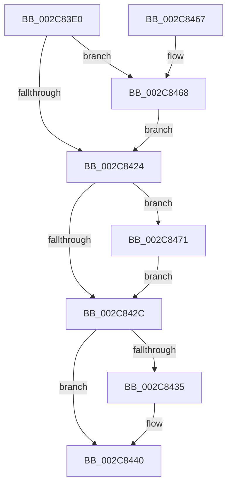

# KiGenericCallDpcInitiatorDpc

- RVA: `0x002C83E0`–`0x002C8479` (길이 `153` bytes)
- VA: `0x00000001402C83E0`
- 실행 섹션: `.text`
- PDB 이름 있음: `예`; PDB Function 태그: `아니요`
- unwind 정보 RVA: `0x0005FA04`
- 디코드: `39`개 명령, `153/153` bytes 표시
- 미해석 바이트: `0` (있으면 어셈블리에 `.byte`로 보존)

> 이 문서는 커널 이미지의 기계어와 PDB 기호를 분석해 생성했습니다. 4번과 5번은 함수 원형과 자료형을 바이너리 사용 방식에서 추정한 C 해석이며 원본 소스 복구 결과는 아닙니다.

## 1. Dependencies

- 직접 호출 지점: **4**; 고유 호출 대상: **4**
- 직접 호출자로 확인된 함수: **0**
- RIP 상대 이미지 참조: **1**

### Outgoing calls
- `0x002C8409` → [KiInitiateGenericCallDpc](KiInitiateGenericCallDpc_function_002C9C40.md) (function, `0x002C9C40`)
- `0x002C843B` → [KiLowerIrqlProcessIrqlFlags](../4F/KiLowerIrqlProcessIrqlFlags_function_004F5698.md) (function, `0x004F5698`)
- `0x002C844D` → [KeSignalGate](KeSignalGate_function_002C748C.md) (function, `0x002C748C`)
- `0x002C846A` → [KiRaiseIrqlProcessIrqlFlags](../4F/KiRaiseIrqlProcessIrqlFlags_function_004F56FC.md) (function, `0x004F56FC`)

### Direct callers
- 이 함수 시작 RVA로 연결되는 직접 call은 확인되지 않았습니다. 간접 호출은 완전히 역산할 수 없습니다.

### Static image references
- `0x002C841B` → RVA `0x00FC6D20` (`ALMOSTRO`; read)

## 2. Other-region calls and transfers

- 다른 실행 섹션으로 향하는 call: **0**
- 별도 외부 분기/꼬리 이동을 확인하지 못했습니다.

## 3. Assembly (complete function range)

```asm
002C83E0  48 89 5C 24 08                  mov qword ptr [rsp + 8], rbx
002C83E5  48 89 6C 24 10                  mov qword ptr [rsp + 0x10], rbp
002C83EA  48 89 74 24 18                  mov qword ptr [rsp + 0x18], rsi
002C83EF  57                              push rdi
002C83F0  48 83 EC 20                     sub rsp, 0x20
002C83F4  65 48 8B 3C 25 20 00 00 00      mov rdi, qword ptr gs:[0x20]
002C83FD  48 8B EA                        mov rbp, rdx
002C8400  48 8B CF                        mov rcx, rdi
002C8403  8B B7 AC 83 00 00               mov esi, dword ptr [rdi + 0x83ac]
002C8409  E8 32 18 00 00                  call 0x1402c9c40
002C840E  44 0F 20 C3                     mov rbx, cr8
002C8412  BA 0D 00 00 00                  mov edx, 0xd
002C8417  44 0F 22 C2                     mov cr8, rdx
002C841B  83 3D FE E8 CF 00 00            cmp dword ptr [rip + 0xcfe8fe], 0
002C8422  75 44                           jne 0x1402c8468
002C8424  3B B7 AC 83 00 00               cmp esi, dword ptr [rdi + 0x83ac]
002C842A  7C 45                           jl 0x1402c8471
002C842C  83 3D ED E8 CF 00 00            cmp dword ptr [rip + 0xcfe8ed], 0
002C8433  74 0B                           je 0x1402c8440
002C8435  44 0F 20 C1                     mov rcx, cr8
002C8439  8A D3                           mov dl, bl
002C843B  E8 58 D2 22 00                  call 0x1404f5698
002C8440  0F B6 C3                        movzx eax, bl
002C8443  44 0F 22 C0                     mov cr8, rax
002C8447  48 8D 4D 50                     lea rcx, [rbp + 0x50]
002C844B  33 D2                           xor edx, edx
002C844D  E8 3A F0 FF FF                  call 0x1402c748c
002C8452  48 8B 5C 24 30                  mov rbx, qword ptr [rsp + 0x30]
002C8457  48 8B 6C 24 38                  mov rbp, qword ptr [rsp + 0x38]
002C845C  48 8B 74 24 40                  mov rsi, qword ptr [rsp + 0x40]
002C8461  48 83 C4 20                     add rsp, 0x20
002C8465  5F                              pop rdi
002C8466  C3                              ret
002C8467  CC                              int3
002C8468  8A CB                           mov cl, bl
002C846A  E8 8D D2 22 00                  call 0x1404f56fc
002C846F  EB B3                           jmp 0x1402c8424
002C8471  89 B7 AC 83 00 00               mov dword ptr [rdi + 0x83ac], esi
002C8477  EB B3                           jmp 0x1402c842c
```

## 4. C-style interpretation (structured pseudocode)

```c
__int64 __fastcall KiGenericCallDpcInitiatorDpc(__int64 a1, __int64 a2)
{
    __int64 result;
    __int64 v_rsp;
    unsigned __int64 v_stack_p10;
    unsigned __int64 v_stack_p18;
    unsigned __int64 v_stack_p8;

    v_stack_p8 = v_rbx;
    v_stack_p10 = v_rbp;
    v_stack_p18 = v_rsi;
    v_rsp = (v_rsp) - (32);
    result = KiInitiateGenericCallDpc(*(unsigned __int64 *)(gs_base + (0 + 32)), a2, a3, a4);
    if ((*(unsigned int *)(v_rip + 13625598)) != 0) goto loc_002C8468;
loc_002C8424:
    if (((unsigned int)((unsigned int)(*(unsigned int *)(*(unsigned __int64 *)(gs_base + (0 + 32)) + 33708)))) < (*(unsigned int *)(*(unsigned __int64 *)(gs_base + (0 + 32)) + 33708))) goto loc_002C8471;
loc_002C842C:
    if ((*(unsigned int *)(v_rip + 13625581)) != 0) {
        a1 = 13;
        a2 = (unsigned __int8)(v_cr8);
        result = KiLowerIrqlProcessIrqlFlags(a1, a2, a3, a4);
    }
    a2 = 0;
    result = KeSignalGate(a2 + 80, a2, a3, a4);
    v_rsp = (v_rsp) + (32);
    return result;
loc_002C8468:
    result = KiRaiseIrqlProcessIrqlFlags((unsigned __int8)(v_stack_p8), a2, a3, a4);
    goto loc_002C8424;
loc_002C8471:
    *(unsigned int *)(*(unsigned __int64 *)(gs_base + (0 + 32)) + 33708) = (unsigned int)(v_stack_p18);
    goto loc_002C842C;
}
```

## 5. (Beta) C Style

```c
int64_t KiGenericCallDpcInitiatorDpc(int64_t Arg1, void *Arg2)
{
    uint8_t *arg2 = (uint8_t *)Arg2;

    int64_t result;
    int64_t local_rsp;
    uint64_t v_stack_p10;
    uint64_t v_stack_p18;
    uint64_t v_stack_p8;

    v_stack_p8 = local_rbx;
    v_stack_p10 = local_rbp;
    v_stack_p18 = local_rsi;
    local_rsp = (local_rsp) - (32);
    result = KiInitiateGenericCallDpc(*(uint64_t *)(gs_base + (0 + 0x20)), Arg2, a3, a4);
    if ((*(uint32_t *)(v_rip + 0xCFE8FE)) != 0) goto loc_002C8468;
loc_002C8424:
    if (((uint32_t)((uint32_t)(*(uint32_t *)(*(uint64_t *)(gs_base + (0 + 0x20)) + 0x83AC)))) < (*(uint32_t *)(*(uint64_t *)(gs_base + (0 + 0x20)) + 0x83AC))) goto loc_002C8471;
loc_002C842C:
    if ((*(uint32_t *)(v_rip + 0xCFE8ED)) != 0) {
        Arg1 = 13;
        Arg2 = (uint8_t)(v_cr8);
        result = KiLowerIrqlProcessIrqlFlags(Arg1, Arg2, a3, a4);
    }
    Arg2 = 0;
    result = KeSignalGate(Arg2 + 80, Arg2, a3, a4);
    local_rsp = (local_rsp) + (32);
    return result;
loc_002C8468:
    result = KiRaiseIrqlProcessIrqlFlags((uint8_t)(v_stack_p8), Arg2, a3, a4);
    goto loc_002C8424;
loc_002C8471:
    *(uint32_t *)(*(uint64_t *)(gs_base + (0 + 0x20)) + 0x83AC) = (uint32_t)(v_stack_p18);
    goto loc_002C842C;
}
```

### 관측된 메모리 오프셋

구조체 형식이 확인되지 않은 접근은 인자 기준의 오프셋으로만 기록했습니다.

| 기준 인자 | 오프셋 표현 | 폭 (bit) | 접근 |
|---|---:|---:|---|
| `Arg2` | `+ 0x50` | `64` | `R` |

## 6. Execution-region graph

[열기: 2D/3D 그래프와 함수 탐색 컨트롤 패널](../../../control-panel.html?section=text&rva=0x002C83E0&view=graph)

- 2D 그래프는 위에서 아래로 흐르고, 3D 그래프는 빈 공간을 드래그해 회전합니다. Shift+드래그는 이동, 휠은 확대·축소, 함수 노드 선택은 대상 보고서 이동입니다.

### Static fallback


