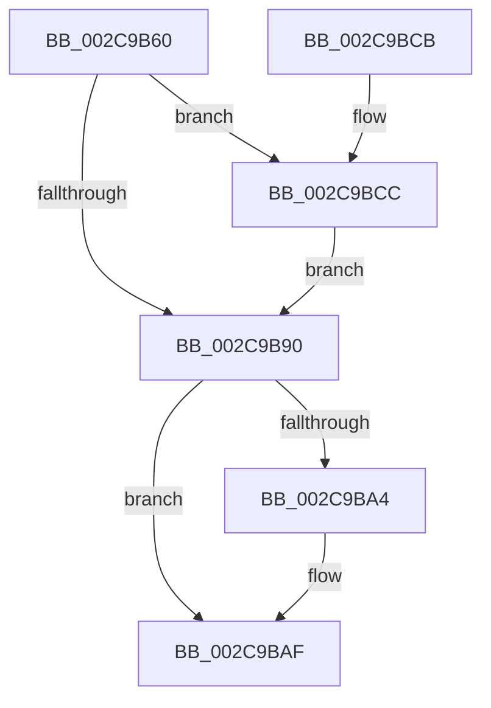

# KiGenericCallDpcInitiatorWorker

- RVA: `0x002C9B60`–`0x002C9BD5` (길이 `117` bytes)
- VA: `0x00000001402C9B60`
- 실행 섹션: `.text`
- PDB 이름 있음: `예`; PDB Function 태그: `아니요`
- unwind 정보 RVA: `0x00068908`
- 디코드: `32`개 명령, `117/117` bytes 표시
- 미해석 바이트: `0` (있으면 어셈블리에 `.byte`로 보존)

> 이 문서는 커널 이미지의 기계어와 PDB 기호를 분석해 생성했습니다. 4번과 5번은 함수 원형과 자료형을 바이너리 사용 방식에서 추정한 C 해석이며 원본 소스 복구 결과는 아닙니다.

## 1. Dependencies

- 직접 호출 지점: **5**; 고유 호출 대상: **5**
- 직접 호출자로 확인된 함수: **0**
- RIP 상대 이미지 참조: **1**

### Outgoing calls
- `0x002C9B75` → [KiAcquireDpcCorralLock](KiAcquireDpcCorralLock_function_002C9BDC.md) (function, `0x002C9BDC`)
- `0x002C9B96` → [KiInitiateGenericCallDpc](KiInitiateGenericCallDpc_function_002C9C40.md) (function, `0x002C9C40`)
- `0x002C9BAA` → [KiLowerIrqlProcessIrqlFlags](../4F/KiLowerIrqlProcessIrqlFlags_function_004F5698.md) (function, `0x004F5698`)
- `0x002C9BB6` → [KiReleaseDpcCorralLock](KiReleaseDpcCorralLock_function_002C9D20.md) (function, `0x002C9D20`)
- `0x002C9BCE` → [KiRaiseIrqlProcessIrqlFlags](../4F/KiRaiseIrqlProcessIrqlFlags_function_004F56FC.md) (function, `0x004F56FC`)

### Direct callers
- 이 함수 시작 RVA로 연결되는 직접 call은 확인되지 않았습니다. 간접 호출은 완전히 역산할 수 없습니다.

### Static image references
- `0x002C9B87` → RVA `0x00FC6D20` (`ALMOSTRO`; read)

## 2. Other-region calls and transfers

- 다른 실행 섹션으로 향하는 call: **0**
- 별도 외부 분기/꼬리 이동을 확인하지 못했습니다.

## 3. Assembly (complete function range)

```asm
002C9B60  48 89 5C 24 08                  mov qword ptr [rsp + 8], rbx
002C9B65  48 89 74 24 10                  mov qword ptr [rsp + 0x10], rsi
002C9B6A  57                              push rdi
002C9B6B  48 83 EC 20                     sub rsp, 0x20
002C9B6F  48 8B FA                        mov rdi, rdx
002C9B72  48 8B F1                        mov rsi, rcx
002C9B75  E8 62 00 00 00                  call 0x1402c9bdc
002C9B7A  44 0F 20 C3                     mov rbx, cr8
002C9B7E  BA 02 00 00 00                  mov edx, 2
002C9B83  44 0F 22 C2                     mov cr8, rdx
002C9B87  83 3D 92 D1 CF 00 00            cmp dword ptr [rip + 0xcfd192], 0
002C9B8E  75 3C                           jne 0x1402c9bcc
002C9B90  48 8B D7                        mov rdx, rdi
002C9B93  48 8B CE                        mov rcx, rsi
002C9B96  E8 A5 00 00 00                  call 0x1402c9c40
002C9B9B  83 3D 7E D1 CF 00 00            cmp dword ptr [rip + 0xcfd17e], 0
002C9BA2  74 0B                           je 0x1402c9baf
002C9BA4  44 0F 20 C1                     mov rcx, cr8
002C9BA8  8A D3                           mov dl, bl
002C9BAA  E8 E9 BA 22 00                  call 0x1404f5698
002C9BAF  0F B6 C3                        movzx eax, bl
002C9BB2  44 0F 22 C0                     mov cr8, rax
002C9BB6  E8 65 01 00 00                  call 0x1402c9d20
002C9BBB  48 8B 5C 24 30                  mov rbx, qword ptr [rsp + 0x30]
002C9BC0  48 8B 74 24 38                  mov rsi, qword ptr [rsp + 0x38]
002C9BC5  48 83 C4 20                     add rsp, 0x20
002C9BC9  5F                              pop rdi
002C9BCA  C3                              ret
002C9BCB  CC                              int3
002C9BCC  8A CB                           mov cl, bl
002C9BCE  E8 29 BB 22 00                  call 0x1404f56fc
002C9BD3  EB BB                           jmp 0x1402c9b90
```

## 4. C-style interpretation (structured pseudocode)

```c
__int64 __fastcall KiGenericCallDpcInitiatorWorker(__int64 a1, __int64 a2)
{
    __int64 result;
    __int64 v_rsp;
    unsigned __int64 v_stack_p10;
    unsigned __int64 v_stack_p8;

    v_stack_p8 = v_rbx;
    v_stack_p10 = v_rsi;
    v_rsp = (v_rsp) - (32);
    result = KiAcquireDpcCorralLock(a1, a2, a3, a4);
    if ((*(unsigned int *)(v_rip + 13619602)) != 0) goto loc_002C9BCC;
loc_002C9B90:
    result = KiInitiateGenericCallDpc(a1, a2, a3, a4);
    if ((*(unsigned int *)(v_rip + 13619582)) != 0) {
        a1 = 2;
        a2 = (unsigned __int8)(v_cr8);
        result = KiLowerIrqlProcessIrqlFlags(a1, a2, a3, a4);
    }
    result = KiReleaseDpcCorralLock(a1, a2, a3, a4);
    v_rsp = (v_rsp) + (32);
    return result;
loc_002C9BCC:
    result = KiRaiseIrqlProcessIrqlFlags((unsigned __int8)(v_stack_p8), a2, a3, a4);
    goto loc_002C9B90;
}
```

## 5. (Beta) C Style

```c
int64_t KiGenericCallDpcInitiatorWorker(int64_t Arg1, int64_t Arg2)
{
    int64_t result;
    int64_t local_rsp;
    uint64_t v_stack_p10;
    uint64_t v_stack_p8;

    v_stack_p8 = local_rbx;
    v_stack_p10 = local_rsi;
    local_rsp = (local_rsp) - (32);
    result = KiAcquireDpcCorralLock(Arg1, Arg2, a3, a4);
    if ((*(uint32_t *)(v_rip + 0xCFD192)) != 0) goto loc_002C9BCC;
loc_002C9B90:
    result = KiInitiateGenericCallDpc(Arg1, Arg2, a3, a4);
    if ((*(uint32_t *)(v_rip + 0xCFD17E)) != 0) {
        Arg1 = 2;
        Arg2 = (uint8_t)(v_cr8);
        result = KiLowerIrqlProcessIrqlFlags(Arg1, Arg2, a3, a4);
    }
    result = KiReleaseDpcCorralLock(Arg1, Arg2, a3, a4);
    local_rsp = (local_rsp) + (32);
    return result;
loc_002C9BCC:
    result = KiRaiseIrqlProcessIrqlFlags((uint8_t)(v_stack_p8), Arg2, a3, a4);
    goto loc_002C9B90;
}
```

## 6. Execution-region graph

[열기: 2D/3D 그래프와 함수 탐색 컨트롤 패널](../../../control-panel.html?section=text&rva=0x002C9B60&view=graph)

- 2D 그래프는 위에서 아래로 흐르고, 3D 그래프는 빈 공간을 드래그해 회전합니다. Shift+드래그는 이동, 휠은 확대·축소, 함수 노드 선택은 대상 보고서 이동입니다.

### Static fallback


