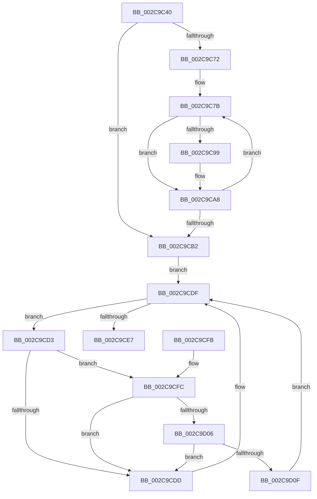

# KiInitiateGenericCallDpc

- RVA: `0x002C9C40`–`0x002C9D18` (길이 `216` bytes)
- VA: `0x00000001402C9C40`
- 실행 섹션: `.text`
- PDB 이름 있음: `예`; PDB Function 태그: `아니요`
- unwind 정보 RVA: `0x0006F0E8`
- 디코드: `64`개 명령, `216/216` bytes 표시
- 미해석 바이트: `0` (있으면 어셈블리에 `.byte`로 보존)

> 이 문서는 커널 이미지의 기계어와 PDB 기호를 분석해 생성했습니다. 4번과 5번은 함수 원형과 자료형을 바이너리 사용 방식에서 추정한 C 해석이며 원본 소스 복구 결과는 아닙니다.

## 1. Dependencies

- 직접 호출 지점: **5**; 고유 호출 대상: **5**
- 직접 호출자로 확인된 함수: **3**
- RIP 상대 이미지 참조: **3**

### Outgoing calls
- `0x002C9C5D` → [KeQueryActiveProcessorCountEx](../24/KeQueryActiveProcessorCountEx_function_00249EF0.md) (function, `0x00249EF0`)
- `0x002C9CA3` → [KeInsertQueueDpc](../20/KeInsertQueueDpc_function_00207C50.md) (function, `0x00207C50`)
- `0x002C9CCA` → [guard_dispatch_icall](../6B/guard_dispatch_icall_function_006BAAD0.md) (function, `0x006BAAD0`)
- `0x002C9D06` → [KiCheckVpBackingLongSpinWaitHypercall](../30/KiCheckVpBackingLongSpinWaitHypercall_function_0030F490.md) (function, `0x0030F490`)
- `0x002C9D11` → [HvlNotifyLongSpinWait](../30/HvlNotifyLongSpinWait_function_0030F460.md) (function, `0x0030F460`)

### Direct callers
- [KiGenericCallDpcInitiatorDpc](KiGenericCallDpcInitiatorDpc_function_002C83E0.md) at `0x002C8409`
- [KeGenericCallDpcEx](KeGenericCallDpcEx_function_002C99F4.md) at `0x002C9B0E`
- [KiGenericCallDpcInitiatorWorker](KiGenericCallDpcInitiatorWorker_function_002C9B60.md) at `0x002C9B96`

### Static image references
- `0x002C9C72` → RVA `0x00FC8C40` (`ALMOSTRO`; read)
- `0x002C9CD5` → RVA `0x00FC52AC` (`ALMOSTRO`; reference)
- `0x002C9CFC` → RVA `0x00FC6AB8` (`ALMOSTRO`; read)

## 2. Other-region calls and transfers

- 다른 실행 섹션으로 향하는 call: **0**
- 별도 외부 분기/꼬리 이동을 확인하지 못했습니다.

## 3. Assembly (complete function range)

```asm
002C9C40  48 89 5C 24 18                  mov qword ptr [rsp + 0x18], rbx
002C9C45  48 89 6C 24 20                  mov qword ptr [rsp + 0x20], rbp
002C9C4A  56                              push rsi
002C9C4B  57                              push rdi
002C9C4C  41 56                           push r14
002C9C4E  48 83 EC 30                     sub rsp, 0x30
002C9C52  48 8B E9                        mov rbp, rcx
002C9C55  4C 8B F2                        mov r14, rdx
002C9C58  B9 FF FF 00 00                  mov ecx, 0xffff
002C9C5D  E8 8E 02 F8 FF                  call 0x140249ef0
002C9C62  89 44 24 50                     mov dword ptr [rsp + 0x50], eax
002C9C66  89 44 24 5C                     mov dword ptr [rsp + 0x5c], eax
002C9C6A  89 44 24 58                     mov dword ptr [rsp + 0x58], eax
002C9C6E  85 C0                           test eax, eax
002C9C70  74 40                           je 0x1402c9cb2
002C9C72  48 8D 3D C7 EF CF 00            lea rdi, [rip + 0xcfefc7]
002C9C79  8B F0                           mov esi, eax
002C9C7B  48 8B 17                        mov rdx, qword ptr [rdi]
002C9C7E  49 8B 06                        mov rax, qword ptr [r14]
002C9C81  48 8D 8A 60 83 00 00            lea rcx, [rdx + 0x8360]
002C9C88  48 89 41 18                     mov qword ptr [rcx + 0x18], rax
002C9C8C  49 8B 46 08                     mov rax, qword ptr [r14 + 8]
002C9C90  48 89 41 20                     mov qword ptr [rcx + 0x20], rax
002C9C94  48 3B D5                        cmp rdx, rbp
002C9C97  74 0F                           je 0x1402c9ca8
002C9C99  4C 8D 44 24 58                  lea r8, [rsp + 0x58]
002C9C9E  48 8D 54 24 50                  lea rdx, [rsp + 0x50]
002C9CA3  E8 A8 DF F3 FF                  call 0x140207c50
002C9CA8  48 83 C7 08                     add rdi, 8
002C9CAC  48 83 EE 01                     sub rsi, 1
002C9CB0  75 C9                           jne 0x1402c9c7b
002C9CB2  49 8B 06                        mov rax, qword ptr [r14]
002C9CB5  48 8D 8D 60 83 00 00            lea rcx, [rbp + 0x8360]
002C9CBC  49 8B 56 08                     mov rdx, qword ptr [r14 + 8]
002C9CC0  4C 8D 4C 24 58                  lea r9, [rsp + 0x58]
002C9CC5  4C 8D 44 24 50                  lea r8, [rsp + 0x50]
002C9CCA  E8 01 0E 3F 00                  call 0x1406baad0
002C9CCF  33 DB                           xor ebx, ebx
002C9CD1  EB 0C                           jmp 0x1402c9cdf
002C9CD3  FF C3                           inc ebx
002C9CD5  85 1D D1 B5 CF 00               test dword ptr [rip + 0xcfb5d1], ebx
002C9CDB  74 1F                           je 0x1402c9cfc
002C9CDD  F3 90                           pause
002C9CDF  8B 44 24 50                     mov eax, dword ptr [rsp + 0x50]
002C9CE3  85 C0                           test eax, eax
002C9CE5  75 EC                           jne 0x1402c9cd3
002C9CE7  48 8B 5C 24 60                  mov rbx, qword ptr [rsp + 0x60]
002C9CEC  90                              nop
002C9CED  48 8B 6C 24 68                  mov rbp, qword ptr [rsp + 0x68]
002C9CF2  48 83 C4 30                     add rsp, 0x30
002C9CF6  41 5E                           pop r14
002C9CF8  5F                              pop rdi
002C9CF9  5E                              pop rsi
002C9CFA  C3                              ret
002C9CFB  CC                              int3
002C9CFC  8B 05 B6 CD CF 00               mov eax, dword ptr [rip + 0xcfcdb6]
002C9D02  A8 40                           test al, 0x40
002C9D04  74 D7                           je 0x1402c9cdd
002C9D06  E8 85 57 04 00                  call 0x14030f490
002C9D0B  84 C0                           test al, al
002C9D0D  74 CE                           je 0x1402c9cdd
002C9D0F  8B CB                           mov ecx, ebx
002C9D11  E8 4A 57 04 00                  call 0x14030f460
002C9D16  EB C7                           jmp 0x1402c9cdf
```

## 4. C-style interpretation (structured pseudocode)

```c
__int64 __fastcall KiInitiateGenericCallDpc(__int64 a1, __int64 a2)
{
    __int64 result;
    __int64 v_rbx;
    __int64 v_rdi;
    __int64 v_rsi;
    __int64 v_rsp;
    unsigned int v_stack_p10;
    unsigned int v_stack_p14;
    unsigned __int64 v_stack_p18;
    unsigned __int64 v_stack_p20;
    unsigned int v_stack_p8;

    v_stack_p18 = v_rbx;
    v_stack_p20 = v_rbp;
    v_rsp = (v_rsp) - (48);
    result = KeQueryActiveProcessorCountEx((unsigned int)(0xFFFFULL), a2, a3, a4);
    v_stack_p8 = (unsigned int)(result);
    v_stack_p14 = (unsigned int)(result);
    v_stack_p10 = (unsigned int)(result);
    if ((unsigned int)(result) == 0) goto loc_002C9CB2;
loc_002C9C7B:
    *(unsigned __int64 *)(*(unsigned __int64 *)(v_rip + 13627335) + 33632 + 24) = *(unsigned __int64 *)(a2);
    *(unsigned __int64 *)(*(unsigned __int64 *)(v_rip + 13627335) + 33632 + 32) = *(unsigned __int64 *)(a2 + 8);
    result = *(unsigned __int64 *)(a2 + 8);
    if ((*(unsigned __int64 *)(v_rip + 13627335)) != a1) {
        a3 = v_stack_p10;
        a2 = v_stack_p8;
        result = KeInsertQueueDpc(*(unsigned __int64 *)(v_rip + 13627335) + 33632, a2, a3, a4);
    }
    v_rdi = (v_rip + 13627335) + (8);
    v_rsi = ((unsigned int)((unsigned int)(result))) - (1);
    if (condition_is_not_equal) goto loc_002C9C7B;
loc_002C9CB2:
    result = guard_dispatch_icall(a1 + 33632, *(unsigned __int64 *)(a2 + 8), v_stack_p8, v_stack_p10);
    v_rbx = 0;
    goto loc_002C9CDF;
loc_002C9CD3:
    v_rbx = (unsigned int)((v_rbx) + 1);
    if (((*(unsigned int *)(v_rip + 13612497)) & ((unsigned int)(v_rbx))) == 0) goto loc_002C9CFC;
loc_002C9CDD:
loc_002C9CDF:
    if ((unsigned int)((unsigned int)(v_stack_p8)) != 0) goto loc_002C9CD3;
    v_rsp = (v_rsp) + (48);
    return (unsigned int)(v_stack_p8);
loc_002C9CFC:
    if ((((unsigned __int8)((unsigned int)(*(unsigned int *)(v_rip + 13618614)))) & (64)) == 0) goto loc_002C9CDD;
    result = KiCheckVpBackingLongSpinWaitHypercall(a1 + 33632, *(unsigned __int64 *)(a2 + 8), v_stack_p8, v_stack_p10);
    if ((unsigned __int8)(result) == 0) goto loc_002C9CDD;
    result = HvlNotifyLongSpinWait((unsigned int)((unsigned int)(v_stack_p18)), *(unsigned __int64 *)(a2 + 8), v_stack_p8, v_stack_p10);
    goto loc_002C9CDF;
}
```

## 5. (Beta) C Style

```c
int64_t KiInitiateGenericCallDpc(void *Arg1, void *Arg2)
{
    uint8_t *arg1 = (uint8_t *)Arg1;
    uint8_t *arg2 = (uint8_t *)Arg2;

    int64_t result;
    int64_t local_rbx;
    int64_t local_rdi;
    int64_t local_rsi;
    int64_t local_rsp;
    uint32_t v_stack_p10;
    uint32_t v_stack_p14;
    uint64_t v_stack_p18;
    uint64_t v_stack_p20;
    uint32_t v_stack_p8;

    v_stack_p18 = local_rbx;
    v_stack_p20 = local_rbp;
    local_rsp = (local_rsp) - (48);
    result = KeQueryActiveProcessorCountEx((uint32_t)(0xFFFFULL), Arg2, a3, a4);
    v_stack_p8 = (uint32_t)(result);
    v_stack_p14 = (uint32_t)(result);
    v_stack_p10 = (uint32_t)(result);
    if ((uint32_t)(result) == 0) goto loc_002C9CB2;
loc_002C9C7B:
    *(uint64_t *)(*(uint64_t *)(v_rip + 0xCFEFC7) + 0x8360 + 0x18) = *(uint64_t *)(arg2);
    *(uint64_t *)(*(uint64_t *)(v_rip + 0xCFEFC7) + 0x8360 + 0x20) = *(uint64_t *)(arg2 + 0x8);
    result = *(uint64_t *)(arg2 + 0x8);
    if ((*(uint64_t *)(v_rip + 0xCFEFC7)) != Arg1) {
        a3 = v_stack_p10;
        Arg2 = v_stack_p8;
        result = KeInsertQueueDpc(*(uint64_t *)(v_rip + 0xCFEFC7) + 33632, Arg2, a3, a4);
    }
    local_rdi = (v_rip + 13627335) + (8);
    local_rsi = ((uint32_t)((uint32_t)(result))) - (1);
    if (condition_is_not_equal) goto loc_002C9C7B;
loc_002C9CB2:
    result = guard_dispatch_icall(Arg1 + 33632, *(uint64_t *)(arg2 + 0x8), v_stack_p8, v_stack_p10);
    local_rbx = 0;
    goto loc_002C9CDF;
loc_002C9CD3:
    local_rbx = (uint32_t)((local_rbx) + 1);
    if (((*(uint32_t *)(v_rip + 0xCFB5D1)) & ((uint32_t)(local_rbx))) == 0) goto loc_002C9CFC;
loc_002C9CDD:
loc_002C9CDF:
    if ((uint32_t)((uint32_t)(v_stack_p8)) != 0) goto loc_002C9CD3;
    local_rsp = (local_rsp) + (48);
    return (uint32_t)(v_stack_p8);
loc_002C9CFC:
    if ((((uint8_t)((uint32_t)(*(uint32_t *)(v_rip + 0xCFCDB6)))) & (64)) == 0) goto loc_002C9CDD;
    result = KiCheckVpBackingLongSpinWaitHypercall(Arg1 + 33632, *(uint64_t *)(arg2 + 0x8), v_stack_p8, v_stack_p10);
    if ((uint8_t)(result) == 0) goto loc_002C9CDD;
    result = HvlNotifyLongSpinWait((uint32_t)((uint32_t)(v_stack_p18)), *(uint64_t *)(arg2 + 0x8), v_stack_p8, v_stack_p10);
    goto loc_002C9CDF;
}
```

### 관측된 메모리 오프셋

구조체 형식이 확인되지 않은 접근은 인자 기준의 오프셋으로만 기록했습니다.

| 기준 인자 | 오프셋 표현 | 폭 (bit) | 접근 |
|---|---:|---:|---|
| `Arg1` | `+ 0x8360` | `64` | `R` |
| `Arg2` | `+ 0x0` | `64` | `R` |
| `Arg2` | `+ 0x8` | `64` | `R` |

## 6. Execution-region graph

[열기: 2D/3D 그래프와 함수 탐색 컨트롤 패널](../../../control-panel.html?section=text&rva=0x002C9C40&view=graph)

- 2D 그래프는 위에서 아래로 흐르고, 3D 그래프는 빈 공간을 드래그해 회전합니다. Shift+드래그는 이동, 휠은 확대·축소, 함수 노드 선택은 대상 보고서 이동입니다.

### Static fallback


