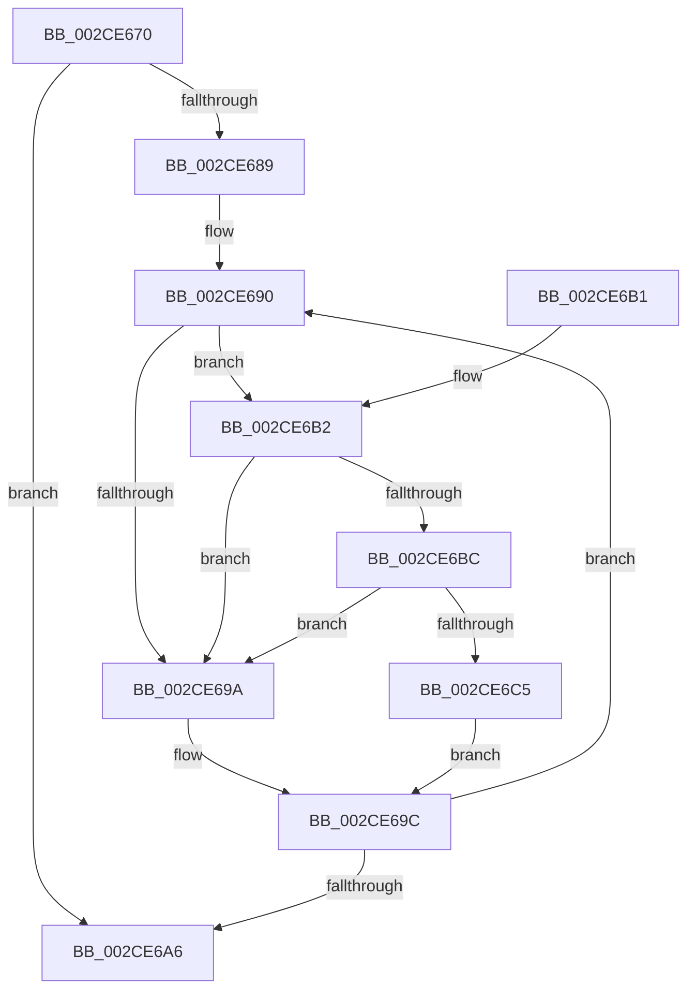

# KiIpiStallOnPacketTargetsPrcb

- RVA: `0x002CE670`–`0x002CE6CE` (길이 `94` bytes)
- VA: `0x00000001402CE670`
- 실행 섹션: `.text`
- PDB 이름 있음: `예`; PDB Function 태그: `아니요`
- unwind 정보 RVA: `0x0005D394`
- 디코드: `30`개 명령, `94/94` bytes 표시
- 미해석 바이트: `0` (있으면 어셈블리에 `.byte`로 보존)

> 이 문서는 커널 이미지의 기계어와 PDB 기호를 분석해 생성했습니다. 4번과 5번은 함수 원형과 자료형을 바이너리 사용 방식에서 추정한 C 해석이며 원본 소스 복구 결과는 아닙니다.

## 1. Dependencies

- 직접 호출 지점: **2**; 고유 호출 대상: **2**
- 직접 호출자로 확인된 함수: **7**
- RIP 상대 이미지 참조: **2**

### Outgoing calls
- `0x002CE6BC` → [KiCheckVpBackingLongSpinWaitHypercall](../30/KiCheckVpBackingLongSpinWaitHypercall_function_0030F490.md) (function, `0x0030F490`)
- `0x002CE6C7` → [HvlNotifyLongSpinWait](../30/HvlNotifyLongSpinWait_function_0030F460.md) (function, `0x0030F460`)

### Direct callers
- [KeFlushProcessWriteBuffers](KeFlushProcessWriteBuffers_function_002CE4FC.md) at `0x002CE606`
- [KeChangeMemoryAttributes](../30/KeChangeMemoryAttributes_function_00304D08.md) at `0x00304DFC`
- [KeQueryTotalCycleTimeThread](../37/KeQueryTotalCycleTimeThread_function_0037EF20.md) at `0x0037F99C`
- [KiIpiStallOnPacketTargets](../47/KiIpiStallOnPacketTargets_function_004718D8.md) at `0x004718E5`
- [KeUpdateThreadTag](../47/KeUpdateThreadTag_function_00475770.md) at `0x00475BA3`
- [KeSynchronizeAddressPolicy](../49/KeSynchronizeAddressPolicy_function_00498358.md) at `0x004984E6`
- [KeSynchronizeSecurityDomain](../4B/KeSynchronizeSecurityDomain_function_004B0FE0.md) at `0x004B1175`

### Static image references
- `0x002CE692` → RVA `0x00FC52AC` (`ALMOSTRO`; reference)
- `0x002CE6B2` → RVA `0x00FC6AB8` (`ALMOSTRO`; read)

## 2. Other-region calls and transfers

- 다른 실행 섹션으로 향하는 call: **0**
- 별도 외부 분기/꼬리 이동을 확인하지 못했습니다.

## 3. Assembly (complete function range)

```asm
002CE670  48 89 5C 24 08                  mov qword ptr [rsp + 8], rbx
002CE675  57                              push rdi
002CE676  48 83 EC 20                     sub rsp, 0x20
002CE67A  8B 82 80 2D 00 00               mov eax, dword ptr [rdx + 0x2d80]
002CE680  33 DB                           xor ebx, ebx
002CE682  48 8B FA                        mov rdi, rdx
002CE685  85 C0                           test eax, eax
002CE687  74 1D                           je 0x1402ce6a6
002CE689  0F 1F 80 00 00 00 00            nop dword ptr [rax]
002CE690  FF C3                           inc ebx
002CE692  85 1D 14 6C CF 00               test dword ptr [rip + 0xcf6c14], ebx
002CE698  74 18                           je 0x1402ce6b2
002CE69A  F3 90                           pause
002CE69C  8B 87 80 2D 00 00               mov eax, dword ptr [rdi + 0x2d80]
002CE6A2  85 C0                           test eax, eax
002CE6A4  75 EA                           jne 0x1402ce690
002CE6A6  48 8B 5C 24 30                  mov rbx, qword ptr [rsp + 0x30]
002CE6AB  48 83 C4 20                     add rsp, 0x20
002CE6AF  5F                              pop rdi
002CE6B0  C3                              ret
002CE6B1  CC                              int3
002CE6B2  8B 05 00 84 CF 00               mov eax, dword ptr [rip + 0xcf8400]
002CE6B8  A8 40                           test al, 0x40
002CE6BA  74 DE                           je 0x1402ce69a
002CE6BC  E8 CF 0D 04 00                  call 0x14030f490
002CE6C1  84 C0                           test al, al
002CE6C3  74 D5                           je 0x1402ce69a
002CE6C5  8B CB                           mov ecx, ebx
002CE6C7  E8 94 0D 04 00                  call 0x14030f460
002CE6CC  EB CE                           jmp 0x1402ce69c
```

## 4. C-style interpretation (structured pseudocode)

```c
__int64 __fastcall KiIpiStallOnPacketTargetsPrcb(__int64 a1, __int64 a2)
{
    __int64 result;
    __int64 v_rbx;
    __int64 v_rsp;
    unsigned __int64 v_stack_p8;

    v_stack_p8 = v_rbx;
    v_rsp = (v_rsp) - (32);
    v_rbx = 0;
    if ((unsigned int)((unsigned int)(*(unsigned int *)(a2 + 11648))) == 0) goto loc_002CE6A6;
loc_002CE690:
    v_rbx = (unsigned int)((v_rbx) + 1);
    if (((*(unsigned int *)(v_rip + 13593620)) & ((unsigned int)(v_rbx))) == 0) goto loc_002CE6B2;
loc_002CE69A:
loc_002CE69C:
    if ((unsigned int)((unsigned int)(*(unsigned int *)(a2 + 11648))) != 0) goto loc_002CE690;
loc_002CE6A6:
    v_rsp = (v_rsp) + (32);
    return (unsigned int)(*(unsigned int *)(a2 + 11648));
loc_002CE6B2:
    if ((((unsigned __int8)((unsigned int)(*(unsigned int *)(v_rip + 13599744)))) & (64)) == 0) goto loc_002CE69A;
    result = KiCheckVpBackingLongSpinWaitHypercall(a1, a2, a3, a4);
    if ((unsigned __int8)(result) == 0) goto loc_002CE69A;
    result = HvlNotifyLongSpinWait((unsigned int)((unsigned int)(v_stack_p8)), a2, a3, a4);
    goto loc_002CE69C;
}
```

## 5. (Beta) C Style

```c
int64_t KiIpiStallOnPacketTargetsPrcb(int64_t Arg1, void *Arg2)
{
    uint8_t *arg2 = (uint8_t *)Arg2;

    int64_t result;
    int64_t local_rbx;
    int64_t local_rsp;
    uint64_t v_stack_p8;

    v_stack_p8 = local_rbx;
    local_rsp = (local_rsp) - (32);
    local_rbx = 0;
    if ((uint32_t)((uint32_t)(*(uint32_t *)(arg2 + 0x2D80))) == 0) goto loc_002CE6A6;
loc_002CE690:
    local_rbx = (uint32_t)((local_rbx) + 1);
    if (((*(uint32_t *)(v_rip + 0xCF6C14)) & ((uint32_t)(local_rbx))) == 0) goto loc_002CE6B2;
loc_002CE69A:
loc_002CE69C:
    if ((uint32_t)((uint32_t)(*(uint32_t *)(arg2 + 0x2D80))) != 0) goto loc_002CE690;
loc_002CE6A6:
    local_rsp = (local_rsp) + (32);
    return (uint32_t)(*(uint32_t *)(arg2 + 0x2D80));
loc_002CE6B2:
    if ((((uint8_t)((uint32_t)(*(uint32_t *)(v_rip + 0xCF8400)))) & (64)) == 0) goto loc_002CE69A;
    result = KiCheckVpBackingLongSpinWaitHypercall(Arg1, Arg2, a3, a4);
    if ((uint8_t)(result) == 0) goto loc_002CE69A;
    result = HvlNotifyLongSpinWait((uint32_t)((uint32_t)(v_stack_p8)), Arg2, a3, a4);
    goto loc_002CE69C;
}
```

### 관측된 메모리 오프셋

구조체 형식이 확인되지 않은 접근은 인자 기준의 오프셋으로만 기록했습니다.

| 기준 인자 | 오프셋 표현 | 폭 (bit) | 접근 |
|---|---:|---:|---|
| `Arg2` | `+ 0x2D80` | `32` | `R` |

## 6. Execution-region graph

[열기: 2D/3D 그래프와 함수 탐색 컨트롤 패널](../../../control-panel.html?section=text&rva=0x002CE670&view=graph)

- 2D 그래프는 위에서 아래로 흐르고, 3D 그래프는 빈 공간을 드래그해 회전합니다. Shift+드래그는 이동, 휠은 확대·축소, 함수 노드 선택은 대상 보고서 이동입니다.

### Static fallback


